## Based on “Complete System Design Crash Course by Microsoft SDE: Must-Know Concepts for Interviews”

  

These notes follow the transcript's order and terminology. They organize the ideas into study-friendly explanations, comparison tables, Mermaid diagrams, interview prompts, and exercises. A final section separately flags places where the transcript's simplified statements should be phrased carefully in interviews.

  

---

  

# 1. What is system design?

  

The video defines system design as the process of defining a system's **architecture, data flow, and modules** so it can handle growing user needs effectively.

  

Imagine an application that works well for 10 users but crashes as it grows to a million users. Or imagine a server that works fine for nearby users but causes high latency for geographically distant users. These are the types of real-world constraints system design addresses.

  

System design aims to make software work reliably under real-world conditions:

- More users and traffic

- More data

- Traffic spikes

- Users in different geographical locations

- Component failures

- Different performance and freshness requirements

  

## The mental model

  

Do not start by adding every technology you know. Start with a simple design, identify its limit, and add a component that addresses that limit.

  

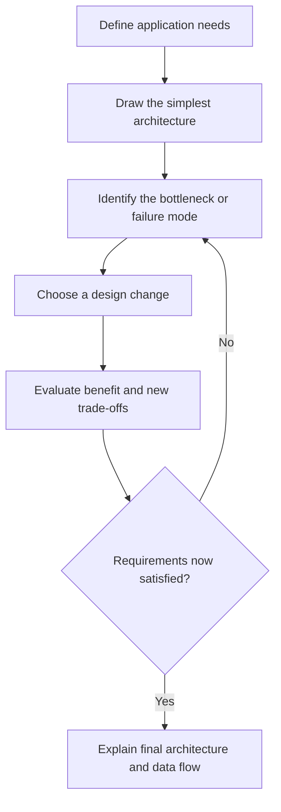

  

**Interview principle:** Every architectural component should have a reason for being there.

  

---

  

# 2. Client–server architecture

  

Client–server architecture is the foundation of web applications.

  

- **Client:** A browser, mobile app, desktop application, or another service that sends a request.

- **Server:** Receives the request, performs the necessary logic, accesses data as permitted, and returns a response.

  

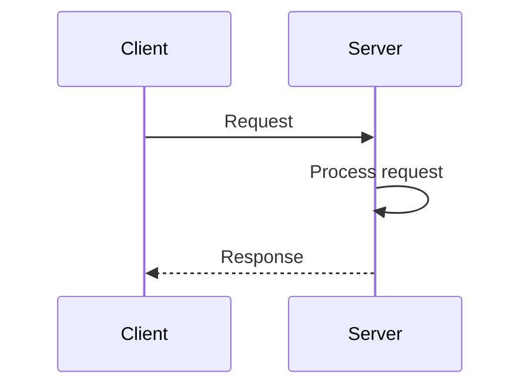

  

## 2.1 Where does the database fit?

  

A key rule emphasized by the video is that a public client should not connect directly to the application's private database. The server sits in between and controls data access.

  

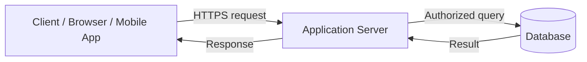

  

The server can enforce authentication, authorization, validation, business rules, rate limiting, logging, and access boundaries. Exposing database credentials or a database endpoint directly to an untrusted client is unsafe.

  

## 2.2 HTTP and HTTPS

  

The transcript says HTTPS should be preferred for real-world applications because it protects communication. HTTPS uses HTTP over TLS, protecting data in transit and authenticating the server through certificates.

  

Do not memorize the blanket claim that HTTP is never used. HTTP can exist in local development, private/internal environments, or redirect flows, but sensitive production traffic should be appropriately protected—normally with HTTPS.

  

---

  

# 3. Two-tier vs. three-tier architecture

  

## 3.1 Two-tier architecture

  

In the video's simplified model, a client tier communicates with a server/data tier.

  

- **Client tier:** Primarily presentation logic; the video notes it may also contain some business logic.

- **Server/data tier:** Handles data access and communication with the database in the described model.

  

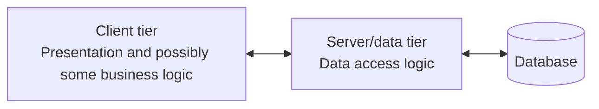

  

Two-tier designs can be sufficient for simpler systems. But putting too much business logic in clients creates problems with consistency, updates, security, and duplicated implementation across clients.

  

## 3.2 Three-tier architecture

  

The video describes three conceptual tiers:

  

1. **Client/presentation tier:** UI and user interaction.

2. **Application tier:** Business logic, application server, web server and APIs.

3. **Database/data tier:** Persistence and data retrieval.

  

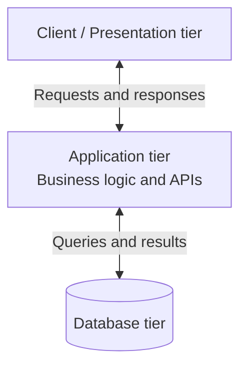

  

### Why use three tiers?

- Responsibilities are easier to separate.

- Application logic can change without rebuilding the data tier.

- Application servers can often be scaled separately from database capacity.

- Access to persistent data is centralized through controlled application interfaces.

  

### Distinguish “tier” from “layer”

In some architecture discussions, *layer* means a logical separation of code responsibilities and *tier* means a deployment boundary. Introductory explanations often use the terms more loosely. Explain which meaning you are using in an interview.

  

---

  

# 4. Monolithic vs. microservices architecture

  

## 4.1 Monolithic architecture

  

A monolith packages a set of application capabilities into one deployable unit. The video uses examples such as login, payments, dashboard, and administration being developed and deployed together.

  

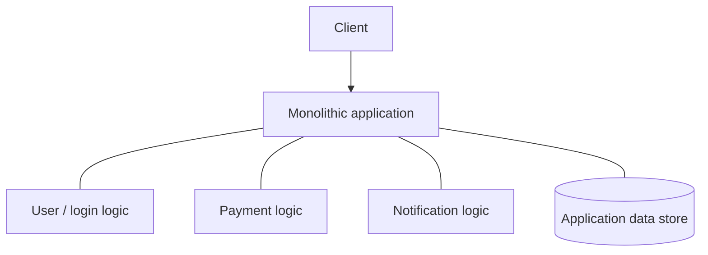

  

### Advantages described by the video

- Relatively easy to implement at the start.

- Easier to test and debug within one process in many cases.

- Function calls within the process avoid the network hops required between separate services.

- Deployment and local development can be simpler.

  

### Trade-offs

- The whole deployable unit may need to be built/deployed for a small change.

- Independent scaling of one feature is harder.

- As the codebase grows, coupling and coordination can become harder.

- Process-level failures and resource exhaustion can affect multiple features hosted in the same unit.

  

A monolith is not automatically a bad design. For a new or moderate-size product, a well-structured monolith can be the simplest and safest choice.

  

## 4.2 Microservices architecture

  

The video describes an application divided into separate services with focused responsibilities, such as user, payment, and notification services. Services communicate over APIs, and the transcript says each service has its own database.

  

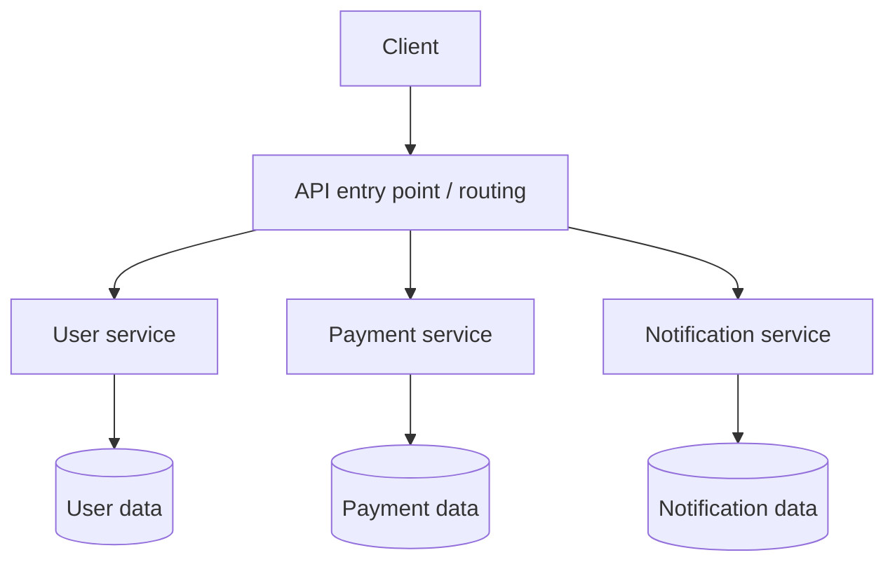

  

### Advantages described by the video

- Services can often be developed, tested, deployed, and scaled independently.

- One non-critical service failing does not necessarily take down the whole product.

- Different teams can own different services.

- Resources can be allocated to a service according to its own workload.

  

### Trade-offs

- Operational complexity is substantially higher.

- Network calls add latency and can fail independently.

- Distributed tracing, deployment coordination, monitoring, retries, service discovery, and access control become more important.

- Data ownership and cross-service transactions can be difficult.

- A failure can still cascade if services depend on each other synchronously.

  

### Comparison

  

| Dimension | Monolith | Microservices |

|---|---|---|

| Deployable units | Usually one main unit | Multiple independently deployable services |

| Communication | Often in-process calls | Commonly network APIs/events |

| Independent scaling | More limited by deployment boundary | Possible per service |

| Operational complexity | Usually simpler initially | Higher |

| Failure isolation | A process/resource issue may affect many features | Can isolate faults, but dependencies can still cascade |

| Data design | Often a shared database/schema in common designs | Service-owned data is a common goal |

| Team organization | Easier with one small team | Can support independently owned service teams |

| Good starting point | Often a strong default | Justified when independent ownership/scaling needs warrant it |

  

## 4.3 How to choose

  

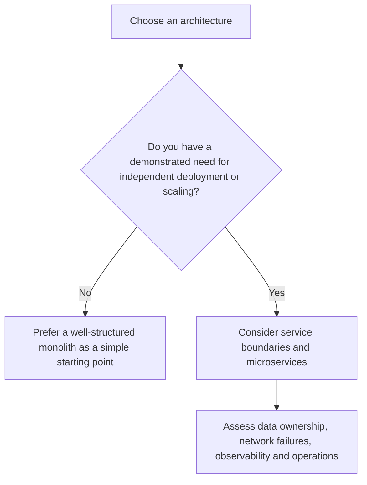

  

**Interview-safe wording:** Do not say “a monolith always crashes if any one feature fails.” A well-designed monolith can isolate exceptions and failures within limits. Microservices offer deployment and fault-isolation opportunities, but introduce distributed-systems failure modes.

  

---

  

# 5. Synchronous vs. asynchronous communication

  

Services can communicate in different ways. The important difference is whether the sender waits for the requested work to finish before it continues.

  

## 5.1 Synchronous communication

  

The caller sends a request and waits for the response.

  

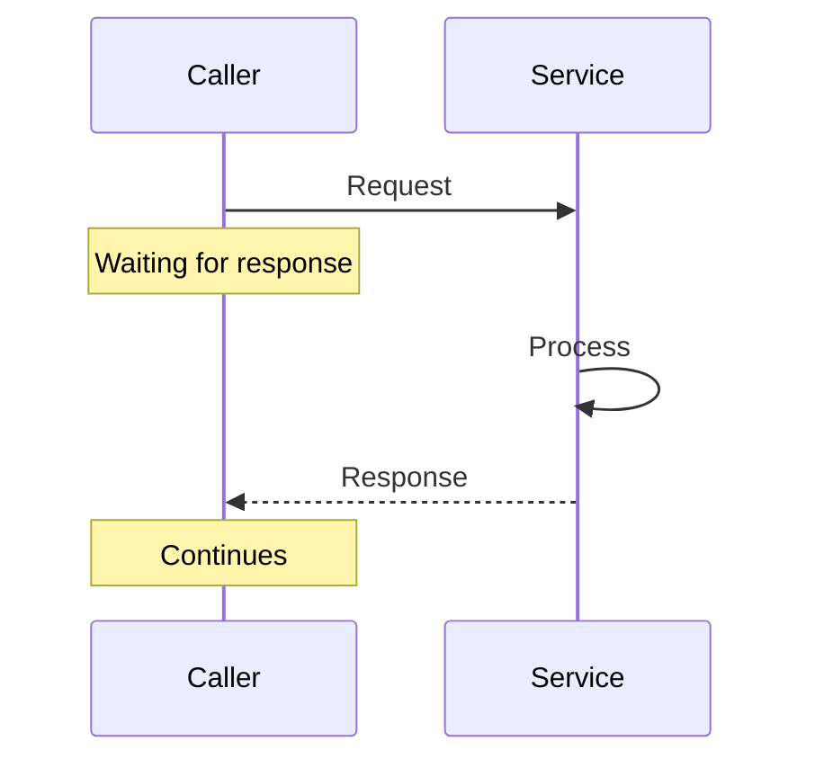

  

### Advantages

- Simple control flow.

- The caller receives an immediate result or error.

- Useful for operations where the next step depends on the response.

  

### Costs

- Caller latency includes downstream processing and network delay.

- A slow or unavailable dependency can delay or fail the caller.

- Long dependency chains can make tail latency worse.

  

A real client should use sensible timeouts. “Waiting forever” is not an acceptable failure strategy.

  

## 5.2 Asynchronous communication

  

The caller submits work—often to a queue—and can continue without waiting for the entire operation to finish. A worker may process it later and publish a completion event or update a status.

  

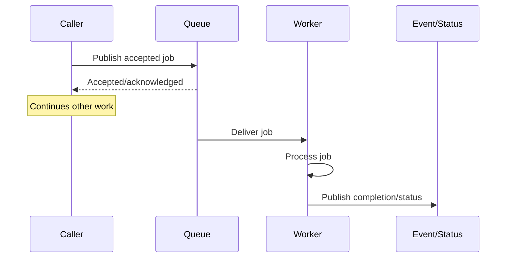

  

### Advantages

- Can decouple the producer from downstream processing.

- Can buffer traffic spikes.

- Can make the initial request faster when long work is moved out of the request path.

- Workers can be scaled separately from the API.

  

### Costs

- The result may not be available immediately.

- More states and infrastructure must be managed.

- Retries can duplicate work; ordering and delivery guarantees matter.

- Users may need a job ID, status endpoint, polling, or push notification.

  

## 5.3 When to use which

  

| Use synchronous when… | Use asynchronous when… |

|---|---|

| The caller needs the result immediately | Work can finish after the initial response |

| The operation is short and bounded | Work is long-running or bursty |

| A later step depends directly on the result | Work can be decoupled through a queue/event |

| Immediate validation or confirmation is needed | Email, image processing, analytics, or report generation can happen in the background |

  

**Important:** Asynchronous does not mean “faster for every operation.” It changes when the caller waits and adds an operational workflow. Some systems use a synchronous response for acceptance and asynchronous processing for completion.

  

---

  

# 6. Load balancers

  

A load balancer distributes incoming traffic across multiple servers so a single instance does not receive all the work and healthy instances can continue serving requests when another instance fails.

  

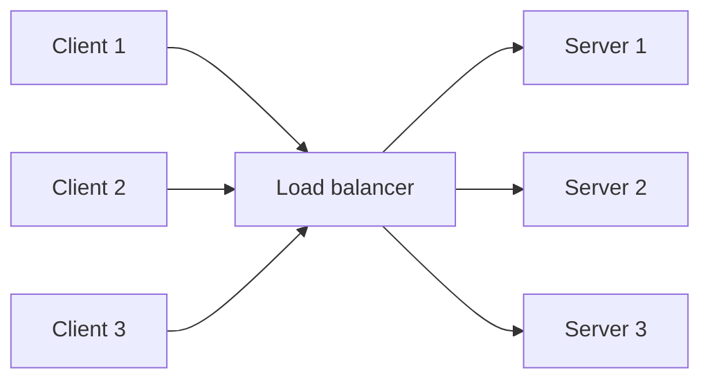

  

## 6.1 Static vs. dynamic load balancing (transcript terminology)

  

- **Static load balancing:** Uses a predetermined routing plan and, in the transcript's description, does not adapt based on current server health/performance.

- **Dynamic load balancing:** Makes routing decisions based on server health and/or performance state.

  

Dynamic approaches can better adapt to uneven load but require accurate signals and more configuration/operational care. Actual products can combine static policies with health checks and other dynamic behavior, so treat this as an introductory distinction rather than a rigid product classification.

  

## 6.2 Layer 4 vs. Layer 7

  

| Feature | Layer 4 | Layer 7 |

|---|---|---|

| OSI layer | Transport | Application |

| Typical input to routing decision | IP/port and transport-level metadata | Application data such as HTTP host, path, headers or cookies |

| Work performed | Usually less application-level inspection | More application-aware parsing/routing |

| Example | Route a TCP connection to a backend pool | Route `/payments/*` to payment API and `/images/*` to content service |

  

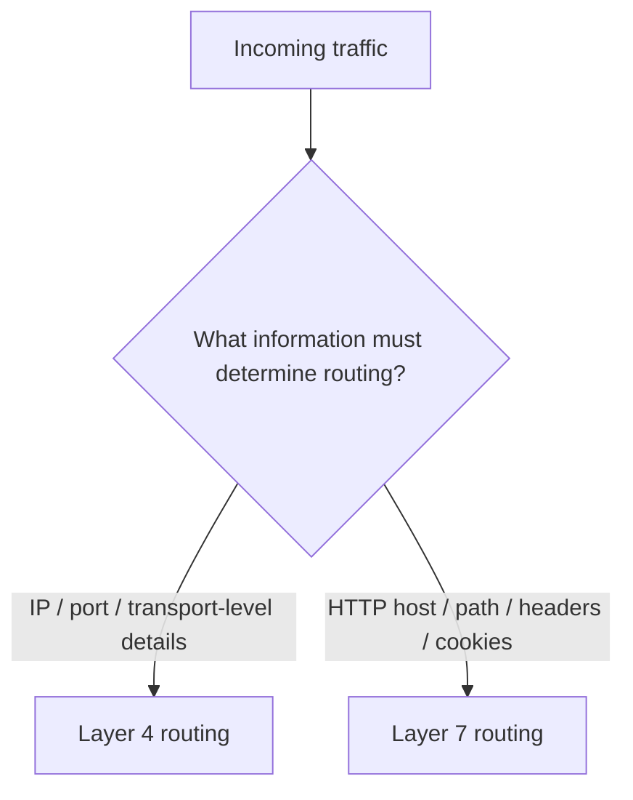

  

Neither layer is universally better. Use the level of inspection required by the design, security requirements, protocol, and performance targets.

  

## 6.3 Load-balancing algorithms in the video

  

### A. Round robin

Assign requests to servers in a repeating sequence, such as A → B → C → A.

  

- Simple.

- Works best when instances are similar and workloads are reasonably comparable.

- Does not account for the varying cost of requests unless combined with another policy.

  

### B. Least connections

Route to the server with the fewest active connections.

  

- Can help when connections remain open for different durations.

- Connection count is only a proxy for actual resource usage; not all connections represent equal work.

  

### C. Sticky session / session affinity

Try to route a client's session to the same backend over time.

  

- May be useful if session state exists locally on a backend.

- Can create uneven load and makes instance changes more complicated.

- Shared session storage or stateless authentication may reduce the need for affinity.

  

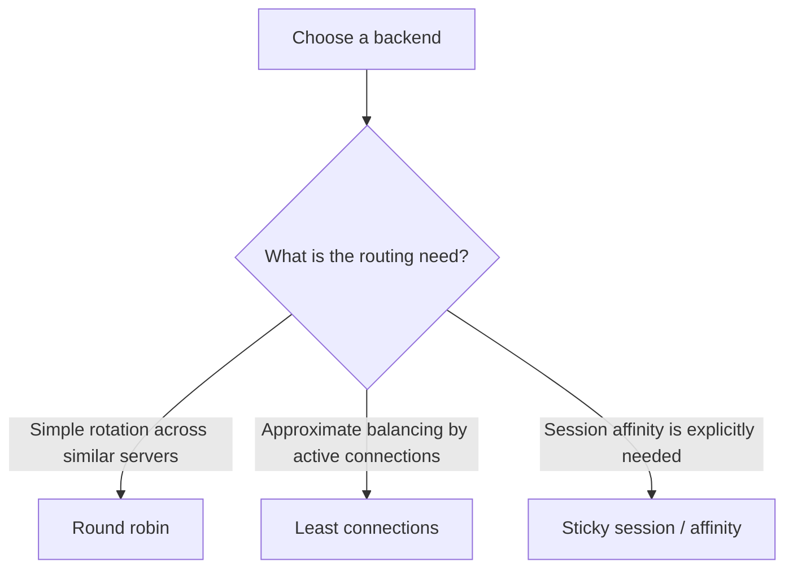

  

**Health checks:** A practical load balancer should avoid sending new traffic to known-unhealthy backends. A single load-balancer instance can itself be a point of failure unless the deployment is redundant or managed.

  

---

  

# 7. Caching

  

Caching stores a copy of frequently accessed data in a faster-to-access location so subsequent requests may avoid repeating expensive computation or retrieving the same data from a slower source.

  

## 7.1 Cache hit and miss

  

- **Cache hit:** The requested value is available and can be used under the freshness policy.

- **Cache miss:** The value is not available; the application generally fetches it from the underlying source and may populate the cache.

  

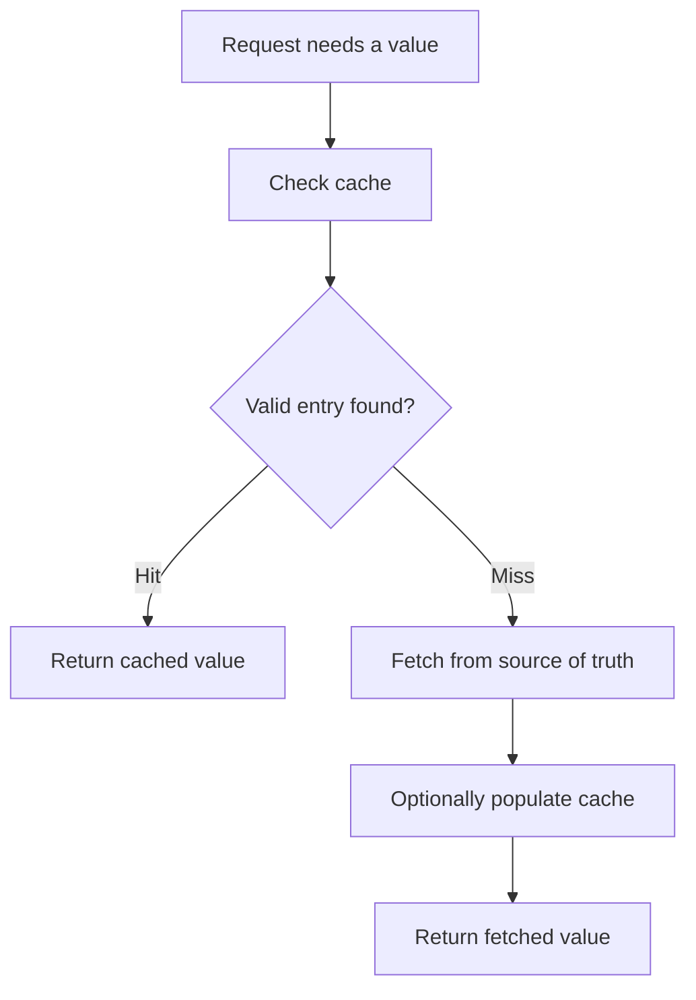

  

A cache should not be treated as the source of truth unless the design explicitly makes it part of a durable write path. The cache can be empty, evicted, restarted, or unavailable.

  

## 7.2 Four caching types covered by the video

  

### 1. Client-side/browser caching

The browser stores eligible resources locally. Repeat visits can avoid downloading unchanged resources again, reducing both page-load latency and server traffic.

  

Examples: fingerprinted CSS/JS, images, fonts, with suitable cache policy.

  

### 2. CDN caching

A content delivery network keeps cacheable content at distributed edge locations near users, reducing long-distance fetches from the origin.

  

### 3. Application-level caching

Backend application servers use an in-memory or remote cache such as Redis or Memcached for popular values, product data, leaderboards, sessions, or calculated results.

  

### 4. Database query caching

The video describes caching frequently executed queries/results. Whether this is built into the database, supplied by a framework, or implemented in the application depends on the technology. A query cache needs clear invalidation rules, especially when underlying rows change.

  

| Cache type | Typical location | Primary benefit |

|---|---|---|

| Client-side | User's browser/device | Faster repeat loads; less repeat transfer |

| CDN | Edge nodes near users | Lower geographic latency; reduced origin load |

| Application-level | Backend cache such as Redis/Memcached | Lower database/computation load |

| Database query/result cache | Database or application layer depending on design | Avoid repeating eligible query work |

  

## 7.3 Cache algorithms

  

### LRU — Least Recently Used

Remove the entry that has not been accessed for the longest time.

  

The transcript walks through a cache of capacity 3 and the access pattern A, B, C, A, B, D, E:

- A, B, C fill the cache.

- A is accessed again, so A becomes recently used.

- When D is inserted, B is the least recently used and is evicted.

- On E, the least recently used remaining entry is evicted.

  

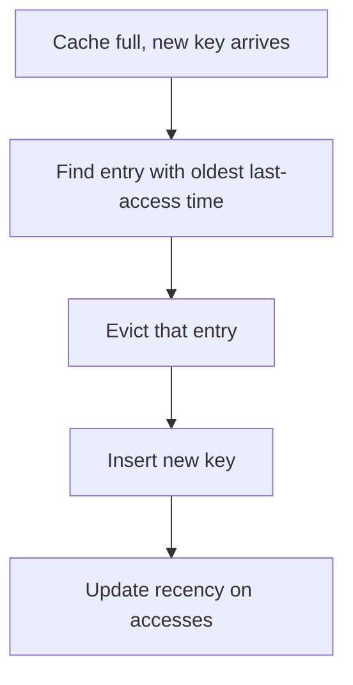

  

### FIFO — First In, First Out

Evict the entry that entered the cache earliest, regardless of whether it has been used recently.

  

- Simple to reason about.

- A recently accessed but old entry may be evicted just because it arrived earlier.

  

| Access pattern concept | LRU | FIFO |

|---|---|---|

| Eviction basis | Last access time | Insertion time |

| Recent access affects eviction? | Yes | No |

| Main intuition | Keep recently used values | Remove oldest inserted value |

  

## 7.4 When caching helps—and when it may be dangerous

  

The video says caching is useful when:

- The same data or request is accessed repeatedly.

- The data does not change very often.

- Faster responses are important.

  

It cautions against caching when data must always be fresh, using stock-market data and bank balances as examples.

  

A more precise way to express this is: **caching is a trade-off between latency/load and freshness/consistency.** Highly time-sensitive data may still use short-lived caches or streaming updates if the product explicitly permits them. Financial balances may use caches for certain views, but operations that require authoritative current state should read/commit through the appropriate source of truth.

  

Ask:

- How stale can this value be?

- How is the cache invalidated?

- What happens on a miss or cache outage?

- Is the cached value user-specific or sensitive?

- Are concurrent requests likely to create a thundering herd?

- How much memory will the cached working set consume?

  

---

  

# 8. CDN — Content Delivery Network

  

The video introduces a CDN as a global network of servers that caches and delivers static content from an edge closer to the user, reducing latency.

  

Analogy from the transcript: shipping everything from one warehouse makes distant customers wait; regional warehouses make delivery faster. For a CDN, the “warehouse” is a copy of eligible digital content at an edge location.

  

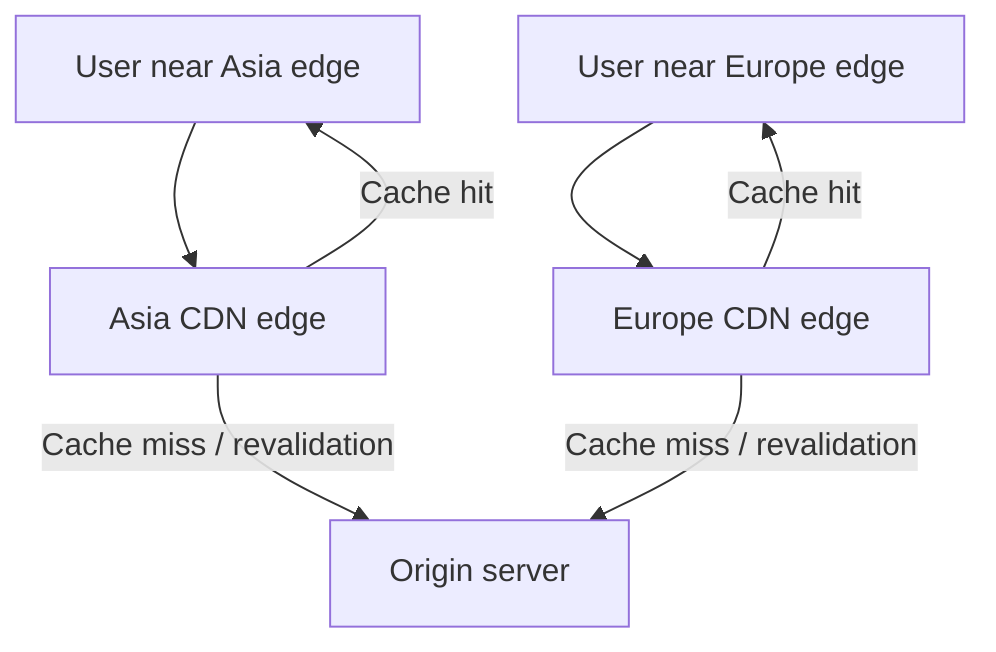

  

Typical content includes images, video segments, CSS, JavaScript bundles, fonts, and suitable static HTML.

  

## 8.1 CDN caching flow

  

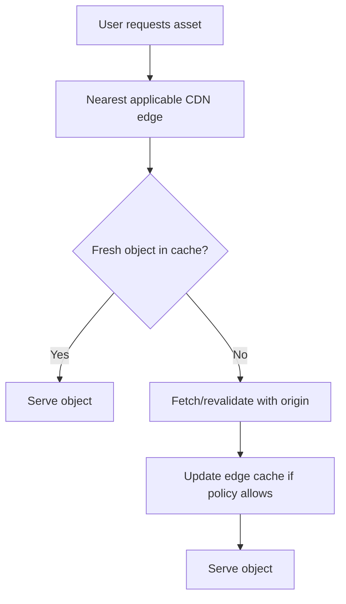

  

### Cache freshness

- **TTL:** A cached object expires or becomes stale after a configured duration.

- **Versioned filenames:** New content uses a new URL such as `bundle.v2.js`, so old cached copies under the previous URL do not masquerade as the new object.

- **Invalidation/purge:** Explicitly tell the CDN to stop serving particular cached objects when required.

  

Use cache-control policies and cache keys carefully. A CDN can safely serve dynamic responses in some designs, but user-specific content must never be accidentally served to the wrong user.

  

---

  

# 9. SQL vs. NoSQL databases

  

The video emphasizes choosing a database based on the data model, access patterns, relationships, consistency needs, and expected scale.

  

## 9.1 SQL / relational databases

  

Characteristics described in the video:

- Relational data represented in tables with rows and columns.

- A defined schema.

- Relationships between tables, often expressed using keys such as foreign keys.

- SQL queries for reading and updating data.

- Useful for complex relationships, querying/reporting, and transactional workloads.

  

Examples mentioned in the transcript: MySQL, Microsoft SQL Server, Oracle, and PostgreSQL.

  

## 9.2 NoSQL databases

  

The video describes NoSQL as non-relational with flexible or model-specific schemas. Common data models it lists are:

  

- Key-value

- Document

- Wide-column

- Graph

  

Examples mentioned in the transcript:

- Redis as a key-value-style store

- MongoDB as a document database

  

NoSQL is not one single type of database. Different products make different trade-offs in query capability, consistency, indexing, transactions, schema constraints, and scaling.

  

## 9.3 How the video frames the choice

  

| Requirement described in the video | Suggested direction in the transcript |

|---|---|

| Relational data with complex relationships | SQL |

| Complex queries and reporting | SQL |

| Transaction-related work and ACID requirements | SQL |

| Flexible schema / evolving record shapes | NoSQL can be suitable |

| Very high traffic and low-latency key-oriented reads | Some NoSQL designs can be suitable |

| High-speed caching or session-like data | A suitable NoSQL/key-value store may be used |

  

### ACID refresher

- **Atomicity:** A transaction succeeds as a unit or is rolled back.

- **Consistency:** A transaction preserves defined database invariants.

- **Isolation:** Concurrent transactions are controlled according to an isolation level.

- **Durability:** Committed data persists according to the system's guarantees.

  

The video recommends SQL for transaction-related queries. Treat that as a useful introductory heuristic, not an absolute law: some NoSQL databases support transactions, and relational databases can be scaled in several ways. Select based on the exact operation guarantees and workload.

  

## 9.4 Database selection decision path

  

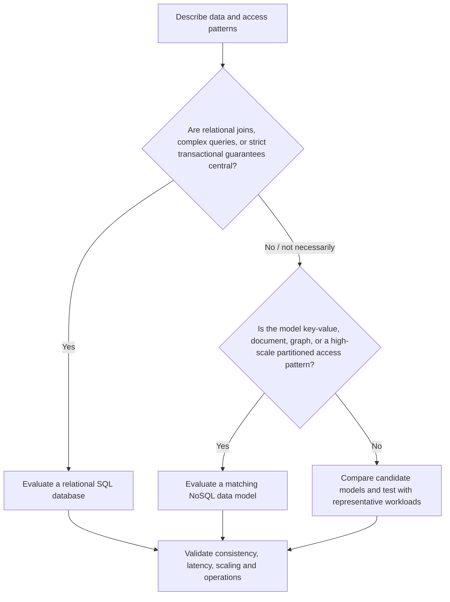

  

**Best interview practice:** Give the requirements before naming a database product. “I would use PostgreSQL because I need relational constraints and transactions” is more useful than “SQL is always better.”

  

---

  

# 10. Vertical vs. horizontal scaling

  

Scaling means increasing system capacity to handle more traffic, users, data, or spikes.

  

## 10.1 Vertical scaling (scale up)

  

Increase the resources of an existing machine: CPU, RAM, storage, or network bandwidth.

  

### Advantages

- Usually simpler to introduce.

- Often does not require major architecture changes.

- Can reduce network coordination between application components on that machine.

  

### Disadvantages

- Hardware and instance sizes have an upper limit.

- Larger configurations can become expensive.

- A single machine can remain a single point of failure.

  

## 10.2 Horizontal scaling (scale out)

  

Add more machines/nodes so work and/or data can be distributed.

  

### Advantages

- More aggregate capacity.

- A failed instance need not take down the whole service if routing and redundancy are configured.

- Can scale service instances independently.

  

### Disadvantages

- More nodes need routing, monitoring, deployment, and coordination.

- State must be handled across instances.

- Data replication and consistency may become concerns.

- The database and other shared dependencies can remain bottlenecks even if app servers scale horizontally.

  

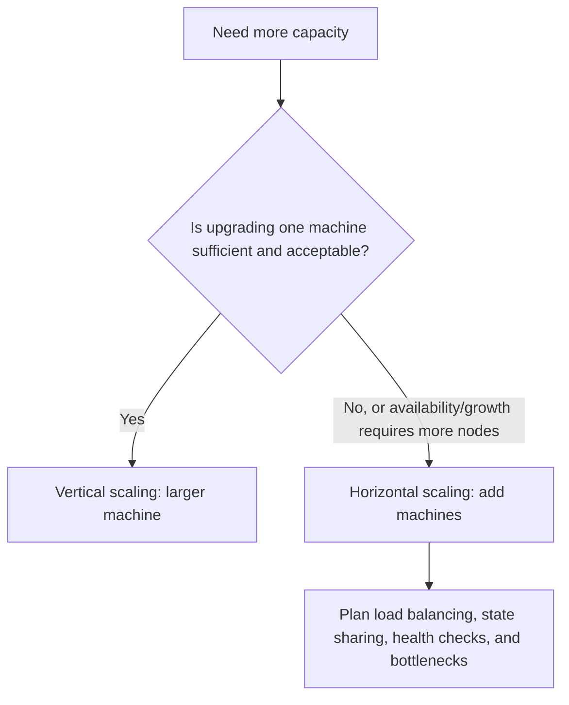

  

| Dimension | Vertical | Horizontal |

|---|---|---|

| Change | Increase resources on one node | Add nodes |

| Initial complexity | Often lower | Higher |

| Hard capacity boundary | Size of one node | Aggregate capacity, still subject to coordination and architecture limits |

| Single-node failure | Can take down service if no redundancy | Can be tolerated when replicas and routing are designed correctly |

| Coordination | Often simpler | More distributed coordination and state management |

  

---

  

# 11. Database sharding

  

The video defines sharding as dividing a large database into smaller independent database instances, called **shards**, each holding a subset of the total data.

  

Replication makes copies; sharding partitions the dataset. They solve different problems and may be combined.

  

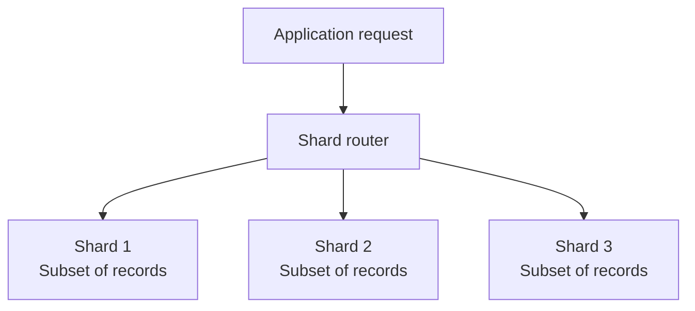

  

## 11.1 Choose a sharding key

  

The transcript uses user ID as an example of a sharding key for a social networking site:

- User IDs are unique and stable in the example.

- The key should identify which shard stores the user's data.

- Other attributes, such as a display name, may change and may not be unique.

  

A good shard key should be evaluated against:

- Distribution of data size across shards

- Traffic volume per key

- Typical query patterns

- Whether requests can be routed from a key included in the request

- Growth and rebalancing

- Cross-shard queries and transactions

  

A unique key alone does not guarantee a good shard key. If a small number of keys receive disproportionate traffic, they can still cause hot partitions.

  

## 11.2 Hash-based sharding

  

The transcript describes hashing the shard key and applying a modulo operation to assign one of a fixed number of shards:

  

\[

\text{shard index} = h(\text{key}) \bmod N

\]

  

where \(h\) is a hash function and \(N\) is the number of shards.

  

```mermaid

flowchart TD

    A[Record with user ID] --> B[Hash the key]

    B --> C[Apply modulo N]

    C --> D[Obtain shard index]

    D --> E[Route record/query to that shard]

```

  

**Advantage:** Can distribute records evenly when the hash and key distribution are suitable.

  

**Limitation highlighted by the video:** Adding or removing shards changes \(N\); simple modulo mapping may then remap many keys, making rebalancing expensive.

  

## 11.3 Range-based sharding

  

Records are assigned based on intervals of a key. The video gives examples such as splitting user-ID ranges between shard 1 and shard 2.

  

```mermaid

flowchart TD

    A[Record key] --> B{Key belongs to which range?}

    B -->|Range 1| C[Shard 1]

    B -->|Range 2| D[Shard 2]

    B -->|Range 3| E[Shard 3]

```

  

**Advantage:** Simple to understand and can support queries over a range of keys.

  

**Limitation highlighted by the video:** If recent or active keys cluster in one range, that shard can grow faster or receive much more traffic than others (a hotspot).

  

## 11.4 Directory-based sharding

  

Keep a lookup/directory mapping keys to shards.

  

The video’s example:

1. A request asks for user ID `102`.

2. The system looks up `102` in the directory.

3. The directory says which shard stores that user.

4. The system fetches the data from that shard.

  

```mermaid

sequenceDiagram

    participant App as Application / Router

    participant D as Shard directory

    participant S as Chosen shard

    App->>D: Lookup shard for key 102

    D-->>App: Shard 2

    App->>S: Query user 102 on Shard 2

    S-->>App: User record

```

  

**Limitations highlighted by the video:**

- The directory must be highly available; otherwise it can become a single point of failure.

- Lookup adds an additional step.

- The directory must stay synchronized as records are added, moved, or removed.

  

## 11.5 Sharding strategy comparison

  

| Strategy | Mapping rule | Main advantage | Main risk |

|---|---|---|---|

| Hash-based | Hash the key, then map to a shard | Can spread keys | Adding/removing shards can cause substantial remapping under simple modulo |

| Range-based | Key falls into a configured range | Simple; can support range queries | Skew/hotspots in populated or popular ranges |

| Directory-based | Lookup table says where a key lives | Flexible mapping and rebalancing | Directory availability, synchronization, extra lookup |

  

## 11.6 How to choose a sharding strategy

  

```mermaid

flowchart TD

    A[Choose shard strategy] --> B{Are range queries and key ordering important?}

    B -->|Yes| C[Consider range-based sharding]

    B -->|No| D{Can a stable hash distribute load sufficiently well?}

    D -->|Yes| E[Consider hash-based sharding]

    D -->|No / need flexible reassignment| F[Consider directory-based sharding]

    C --> G[Check skew, hotspots and rebalancing]

    E --> H[Check resharding/remapping cost]

    F --> I[Design redundant directory and synchronization]

```

  

No strategy is automatically superior. The choice depends on access patterns, distribution, capacity growth, and operational constraints.

  

---

  

# 12. End-to-end architecture map from this video

  

This diagram summarizes the main concepts covered in the transcript; it is a conceptual map, not a required architecture for every application.

  

```mermaid

flowchart TD

    C[Client UI] -->|HTTPS| LB[Load balancer]

    LB --> A1[Application instance 1]

    LB --> A2[Application instance 2]

    A1 --> CACHE[Application cache]

    A2 --> CACHE

    CACHE --> ROUTER[Database access / shard routing]

    A1 --> ROUTER

    A2 --> ROUTER

    ROUTER --> S1[(Shard 1)]

    ROUTER --> S2[(Shard 2)]

    C --> CDN[CDN edge for cacheable static assets]

    CDN --> ORIGIN[Origin / object server]

```

  

This summarizes the covered components:

- A client communicates with server-side APIs.

- The load balancer distributes application traffic.

- Caches can serve repeated reads without hitting the database every time.

- A database choice is made based on data and query requirements.

- Scaling and sharding address capacity constraints.

- A CDN is used for eligible content closer to the user.

  

---

  

# 13. Interview scenarios

  

For each scenario, state the immediate concern, propose the first fitting approach, and describe a downside.

  

1. An application works for a small group but crashes under a large traffic increase.

2. A browser/mobile app needs to fetch user data from a database securely.

3. A monolith is becoming hard to deploy because separate teams need independent release cycles.

4. A slow downstream service makes every API request wait several seconds.

5. Three application servers exist, but all traffic still reaches only one.

6. Some routes need HTTP-path-based routing while others need transport-level routing.

7. A popular product's information is read frequently but changes rarely.

8. The same key is evicted or expires and many requests query the database simultaneously.

9. Users geographically far from the origin receive static assets slowly.

10. The data is relational and reporting queries involve multiple related tables.

11. A flexible document model needs to support records with differing fields.

12. One server is reaching its CPU/RAM capacity.

13. A dataset no longer fits comfortably on one database server.

14. Simple modulo sharding remaps too many records whenever a node is added.

15. A range-based shard receives most of the active users.

16. A shard directory goes down and requests cannot determine where a record lives.

17. The system needs to send emails or resize images without delaying the upload response.

  

### Suggested reasoning

  

1. Measure the bottleneck; consider scale-up and/or scale-out.

2. Use a server-side application/API layer; do not expose database credentials to the client.

3. Consider service boundaries and microservices only if independent deployment/ownership benefits outweigh distributed complexity.

4. Apply timeouts and evaluate whether the operation can be moved to asynchronous processing.

5. Add or correct the load-balancing/routing configuration and verify health.

6. Layer 7 for application-aware routing; Layer 4 for transport-level routing where sufficient.

7. Application cache with a stated freshness/invalidation policy.

8. Request coalescing/single-flight, lock or refresh strategy, plus suitable cache policy.

9. CDN for cacheable assets.

10. Relational database is a reasonable candidate because relationships/querying matter.

11. A document store may be a candidate if the access model fits.

12. Vertical scaling may be a short-term step; horizontal scaling may be appropriate for capacity/availability.

13. Evaluate partitioning/sharding with replication as needed.

14. Consider consistent hashing or another explicit rebalancing design.

15. Revisit key design and skew; range boundaries may need reassignment or a different key strategy.

16. Make the directory highly available and ensure mapping changes are reliable.

17. Queue the independent jobs and use background workers.

  

---

  

# 14. Revision flashcards

  

**Q: What is system design?**  

A: Defining architecture, data flow, and modules so the system meets growing real-world user and workload requirements.

  

**Q: Why should a client not connect directly to a private database?**  

A: The server should enforce authorization, validation, and business rules while protecting database credentials and boundaries.

  

**Q: Two-tier vs three-tier?**  

A: Two-tier is a simplified client/server arrangement; three-tier separates presentation, application/business logic, and data responsibilities.

  

**Q: Monolith vs microservices?**  

A: A monolith is one main deployable unit; microservices split capabilities into independently deployable networked services, with extra operational and distributed-data complexity.

  

**Q: Synchronous vs asynchronous communication?**  

A: Synchronous waits for the response; asynchronous allows a sender to continue after accepted/submitted work, with completion occurring later.

  

**Q: What does a load balancer do?**  

A: Distributes incoming traffic across backend servers and, with health checks, avoids routing new traffic to known-unhealthy instances.

  

**Q: Layer 4 vs Layer 7 load balancing?**  

A: Layer 4 uses transport/network metadata; Layer 7 can make routing decisions using application-protocol information.

  

**Q: Round robin vs least connections vs sticky sessions?**  

A: Round robin rotates among backends; least connections chooses the backend with the fewest active connections; sticky sessions try to preserve client-to-backend affinity.

  

**Q: What is a cache hit?**  

A: The requested value is present and valid under the cache's freshness rules.

  

**Q: What is LRU?**  

A: Least Recently Used; evict the entry that has gone longest without access.

  

**Q: What is FIFO?**  

A: First In, First Out; evict the entry that was inserted earliest.

  

**Q: What are the four cache types discussed?**  

A: Client-side/browser, CDN, application-level, and database query/result caching.

  

**Q: Why use a CDN?**  

A: To deliver eligible content from a nearby edge, reducing latency and origin load.

  

**Q: SQL vs NoSQL?**  

A: Compare the data model, relationships, schema flexibility, query patterns, transaction requirements, consistency, and scale—not just traffic volume.

  

**Q: Vertical vs horizontal scaling?**  

A: Scale up one machine versus scale out by adding nodes.

  

**Q: Replication vs sharding?**  

A: Replication copies data; sharding splits different subsets of data among database instances.

  

**Q: Hash-, range-, and directory-based sharding?**  

A: Compute a shard from a hash; route by key range; or consult a mapping directory.

  

---

  

# 15. Accuracy and nuance for interviews

  

The notes above preserve the video's topic scope, but these points help avoid overgeneralized answers.

  

1. **Three-tier vs. two-tier:** Tier naming can vary by architecture. Clarify whether you mean logical code layers or physical deployment tiers.

2. **Microservices:** One service failing does not automatically leave the rest healthy; synchronous dependencies and shared infrastructure can cascade failure. Independent deployment is a possibility, not a guarantee of isolation.

3. **SQL vs NoSQL:** Do not claim SQL is always required for every transaction or NoSQL is always better for massive traffic. Different systems have different transaction, query, scale, and consistency guarantees.

4. **Caching:** “Do not cache bank balances or stock data” is too absolute. Cache only where the freshness and correctness requirements permit it; sensitive operations should use authoritative data paths and carefully defined consistency.

5. **Load balancing:** More even request counts do not guarantee evenly distributed work. Requests have different costs, and connection counts are imperfect load measurements.

6. **Sticky sessions:** They can preserve affinity but may worsen balance and failure handling. Shared session state or stateless designs can be more resilient.

7. **Horizontal scaling:** Adding more application servers does not by itself scale the database, queue, or other dependency. Find and address each bottleneck separately.

8. **Sharding:** A stable unique key is not necessarily a good shard key. Query patterns, traffic skew, hot keys, rebalancing, and cross-shard operations matter.

9. **Database directories:** A shard map does not have to be one vulnerable central process; it can be cached and replicated, but correctness and updates still matter.

10. **HTTPS:** HTTPS is normally expected for public production traffic, while HTTP still exists in local/private/redirect contexts.

  

---

  

# Final mental map

  

- **Architecture:** client → application API → data access.

- **Code/deployment organization:** monolith or microservices, chosen according to real needs.

- **Communication:** synchronous when an immediate result is needed; asynchronous when independent work can complete later.

- **Traffic distribution:** load balancer, health checks, and an appropriate routing strategy.

- **Speed:** use caching/CDNs where freshness and correctness allow.

- **Database selection:** match the data model and consistency/query requirements.

- **Capacity:** scale vertically or horizontally; shard only when partitioning is justified.

- **Sharding choices:** hash, range, or directory mapping, each with distinct failure modes.

  

The strongest design answer is not the one with the most technologies. It is the one that explains the requirement, the bottleneck, the chosen design, its data flow, and the trade-offs it creates.