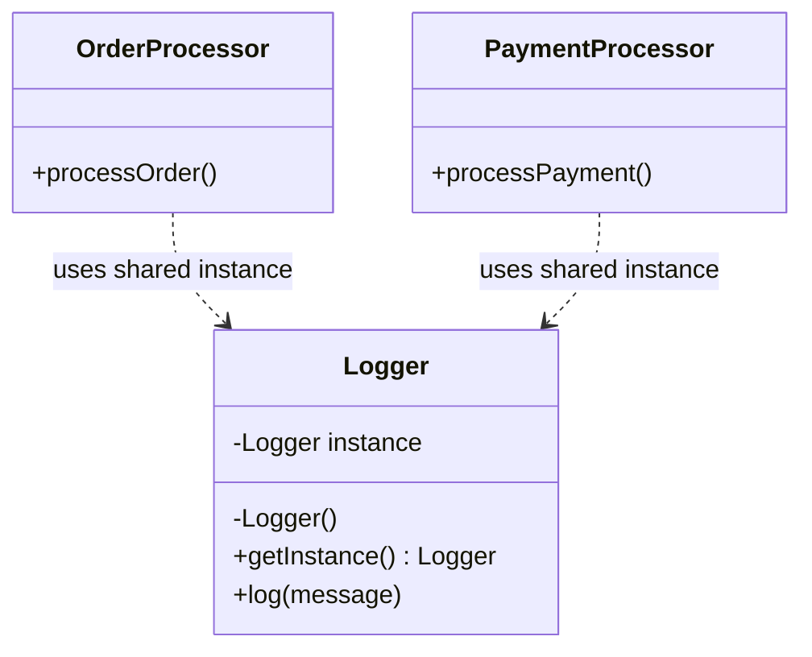
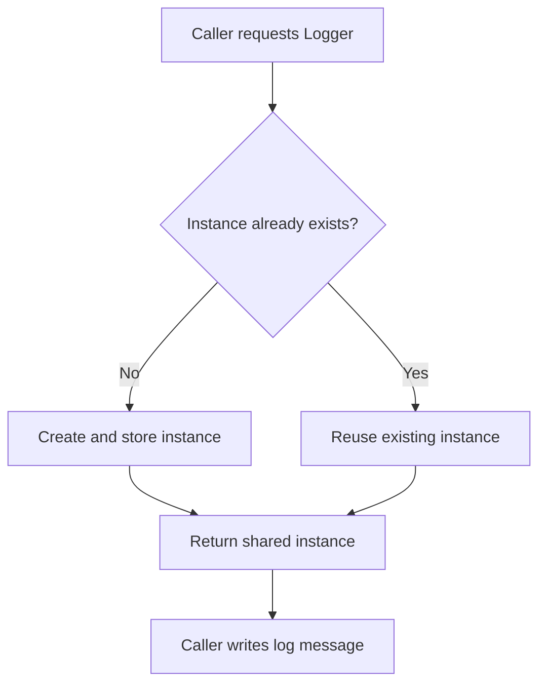
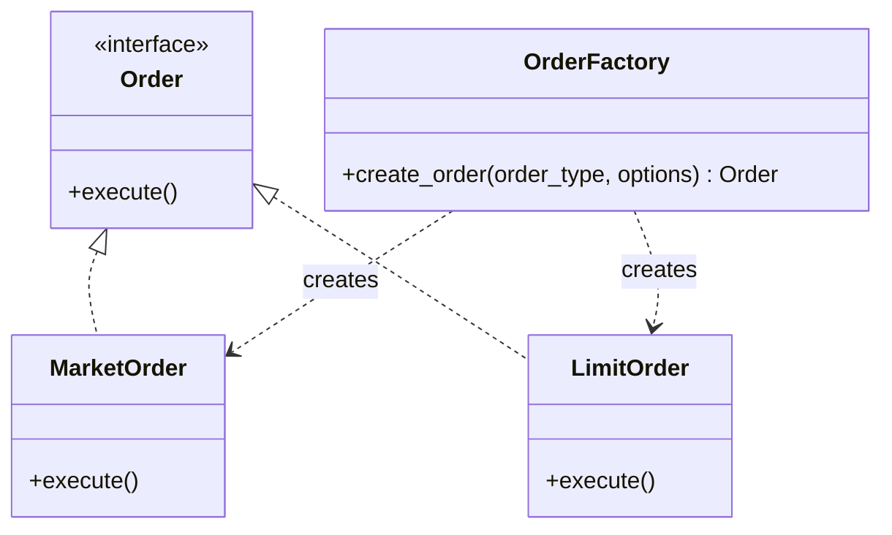
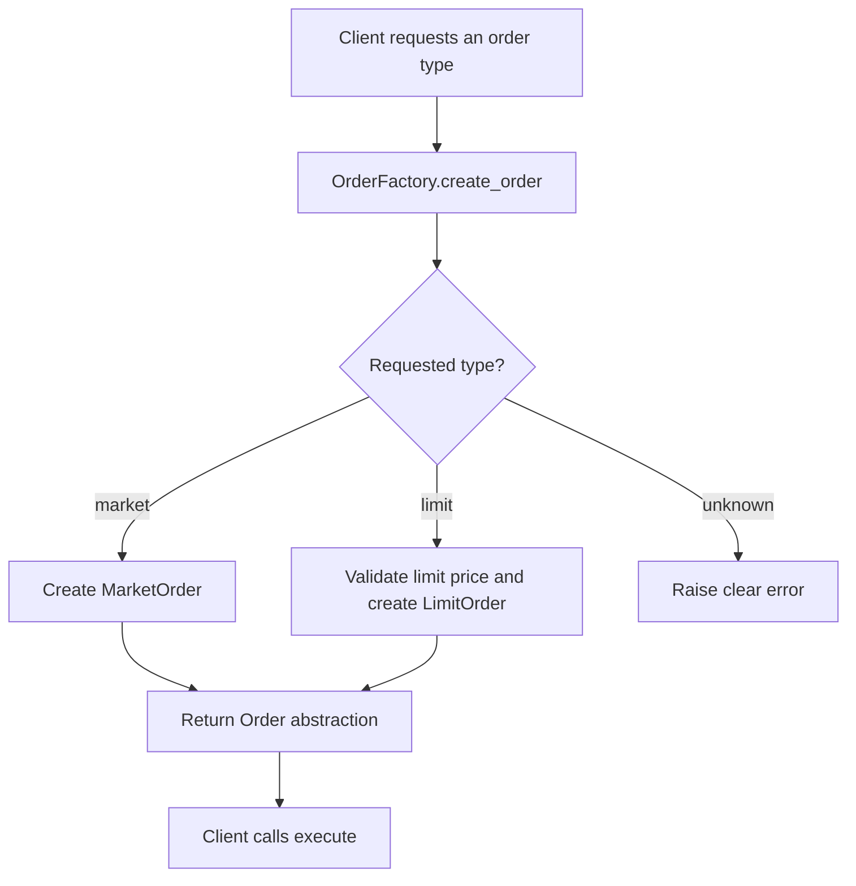
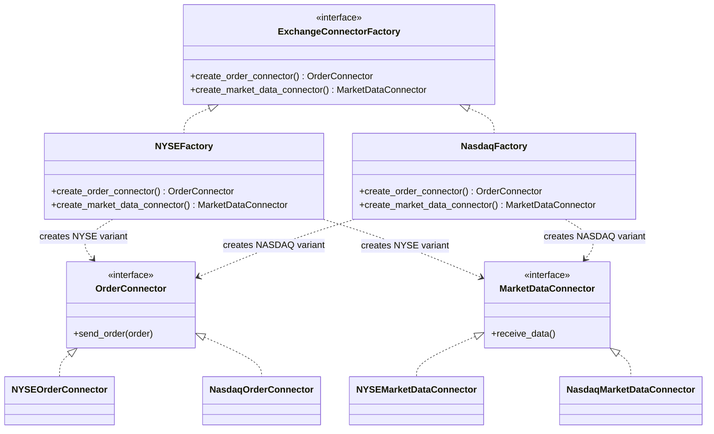
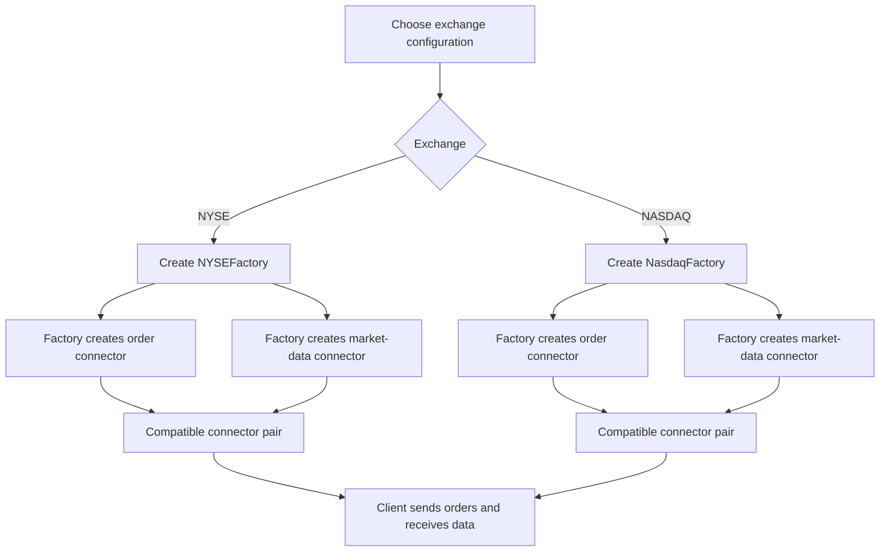
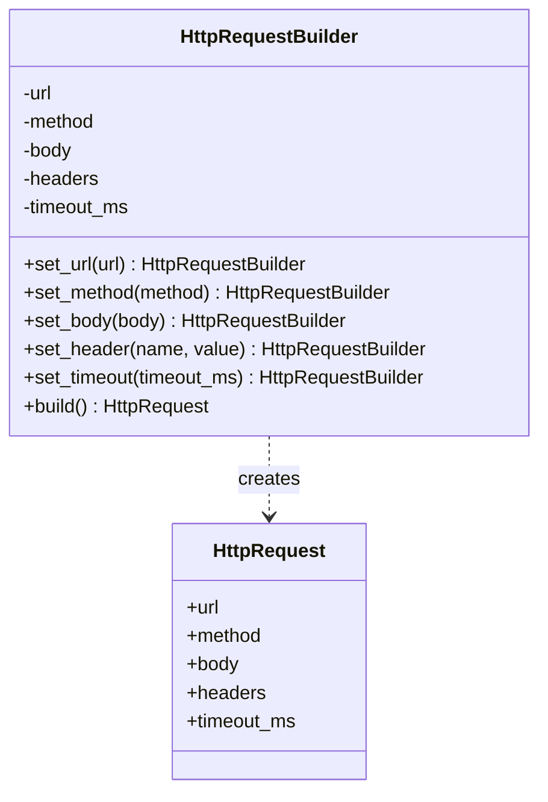
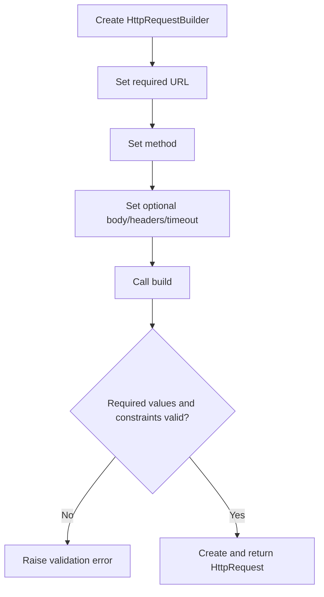
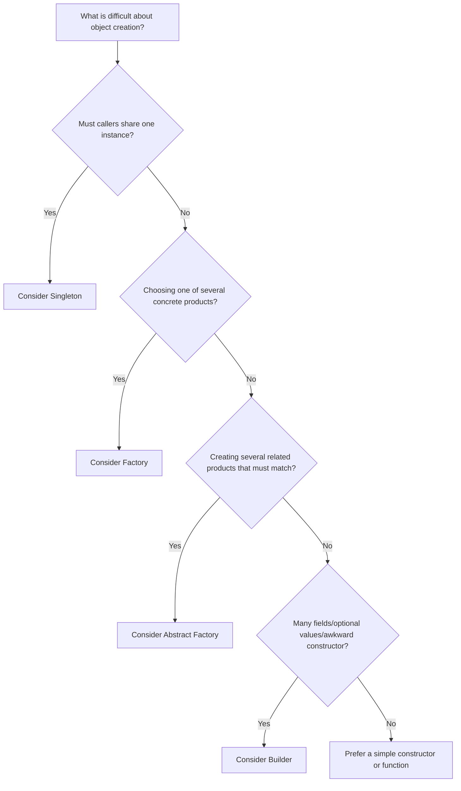

# Creational Design Patterns — Restructured Study Guide

> **Source:** the uploaded video, *Design Patterns 101 — Creational Patterns*.
>
> **Purpose:** make the video's ideas easier to learn, compare, implement, and recall in interviews. The main examples remain the video's software examples: a logger, trading orders, exchange connectors, and an HTTP request.

## How to use this guide

Read in this order:

1. **The map** — learn the problem each pattern solves before learning its name.
2. **The four pattern chapters** — each chapter follows the same layout, so you can compare them without mentally reorganizing the notes.
3. **The selection guide** — use the decision flow when a design question does not explicitly name a pattern.
4. **Interview and practice sections** — explain each pattern aloud, then implement it without looking at the examples.

## Contents

- [1. The map: what creational patterns solve](#1-the-map-what-creational-patterns-solve)
- [2. Singleton — one shared logger](#2-singleton--one-shared-logger)
- [3. Factory — choose one kind of order](#3-factory--choose-one-kind-of-order)
- [4. Abstract Factory — create a compatible family](#4-abstract-factory--create-a-compatible-family)
- [5. Builder — assemble an HTTP request step by step](#5-builder--assemble-an-http-request-step-by-step)
- [6. Choose the pattern](#6-choose-the-pattern)
- [7. Interview-ready explanations](#7-interview-ready-explanations)
- [8. Implementation checklist and common traps](#8-implementation-checklist-and-common-traps)
- [9. Practice in increasing difficulty](#9-practice-in-increasing-difficulty)
- [10. Last-minute revision sheet](#10-last-minute-revision-sheet)

---

# 1. The map: what creational patterns solve

A **design pattern** is a reusable design idea for a recurring software problem. It is not code that should be copied mechanically. The design must still fit the actual requirements.

Creational patterns focus on **how objects are created**. The video also names the other two broad families:

| Family | Main question | Examples named in the video |
|---|---|---|
| Creational | How should an object or group of objects be created? | Singleton, Factory, Abstract Factory, Builder |
| Structural | How should objects be composed or connected? | Adapter, Decorator, Facade |
| Behavioral | How should objects communicate or vary their behavior? | Observer, Strategy, Visitor |

The video briefly mentions **Prototype** as another creational pattern but does not teach it in detail. It is therefore only noted here, not treated as a full chapter.

## The four-pattern map

| Pattern | The pain you notice | The design move | Video example |
|---|---|---|---|
| **Singleton** | Multiple parts of the application independently create a resource that should be shared. | Provide one controlled access point to a shared instance. | A logger writing to `app.log`. |
| **Factory** | Many callers repeat the same conditional object-creation logic. | Put the creation decision in one dedicated place and return a common abstraction. | Create a market or limit order. |
| **Abstract Factory** | Several related objects must be compatible with one another. | Create a *family* of related objects through one family-specific factory. | Order and market-data connectors for one exchange. |
| **Builder** | A constructor has many arguments, optional fields, or ambiguous same-typed values. | Configure an object through named steps, then finalize it with `build()`. | Construct an HTTP request. |

## A practical way to recognize a pattern

Do not begin by asking, “Which pattern should I use?” Begin with the design pain:

- **“This resource must be shared.”** Consider Singleton, then verify whether global sharing is truly required.
- **“Every caller chooses the concrete class.”** Consider a Factory.
- **“These objects must belong to the same compatible family.”** Consider Abstract Factory.
- **“This object is awkward or error-prone to construct.”** Consider Builder.

Patterns are tools, not goals. If a straightforward constructor or a small conditional is clear and easy to maintain, adding a pattern may only add indirection.

---

# 2. Singleton — one shared logger

## 2.1 The problem

Imagine an application whose components write diagnostic messages to the same `app.log` file. An order processor, payment processor, and other services all need logging.

A naive design lets each component create its own logger object. That can mean multiple file handles, inconsistent configuration, confusing output, and concurrency concerns. The intended design is for all components to access a common logger instance.

**The problem is not simply “creating an object is expensive.”** The central requirement is controlled sharing: the application wants one logical logger resource rather than unrelated logger instances created by every caller.

## 2.2 The solution in one sentence

**Singleton restricts construction and provides a shared access point that returns the same instance on subsequent requests.**

## 2.3 Roles and structure

| Role | Responsibility in the logger example |
|---|---|
| Singleton class | `Logger`, which owns the shared instance. |
| Private/controlled constructor | Prevents arbitrary callers from freely constructing more instances in languages that enforce private constructors. |
| Static/class access method | `get_instance()` provides access without requiring a caller to already have a `Logger`. |
| Shared instance | The object returned to the various application components. |

In UML notation, `+` normally marks a public member and `-` a private member. The video describes a private constructor and private static instance, with public static `getInstance()` and a public logging method.



## 2.4 Runtime flow



Step by step:

1. A component calls `Logger.get_instance()`.
2. If no instance exists yet, the access method initializes one and stores it.
3. If it already exists, the stored object is returned without creating another one.
4. Different callers receive a reference to the same in-process object.
5. They use that object through its public methods.

## 2.5 Python implementation example

Python does not enforce a private constructor in the same way as C++ or Java. This example demonstrates controlled access through `get_instance()`; callers should use that method rather than instantiate `Logger` directly.

```python
from __future__ import annotations

import threading


class Logger:
    _instance: Logger | None = None
    _instance_lock = threading.Lock()
    _write_lock = threading.Lock()

    def __init__(self) -> None:
        # A real logger might open a configured file or initialize a sink here.
        self._destination = "app.log"

    @classmethod
    def get_instance(cls) -> Logger:
        # Fast path after initialization; lock protects first creation.
        if cls._instance is None:
            with cls._instance_lock:
                if cls._instance is None:
                    cls._instance = cls()
        return cls._instance

    def log(self, message: str) -> None:
        # Demonstration of serialized writes. A production logger may use
        # a queue/handler rather than holding a lock during file I/O.
        with self._write_lock:
            print(f"[{self._destination}] {message}")


order_logger = Logger.get_instance()
payment_logger = Logger.get_instance()

assert order_logger is payment_logger
order_logger.log("Order created")
payment_logger.log("Payment authorized")
```

### What each piece means

- `_instance` stores the one shared object.
- `get_instance()` is the access point.
- `_instance_lock` prevents two threads from both observing “no instance” and creating one concurrently during initialization.
- `_write_lock` illustrates a separate concern: coordinating simultaneous writes. Singleton itself does **not** automatically make every method thread-safe.
- `assert order_logger is payment_logger` checks object identity, not merely equality.

## 2.6 Thread safety: the important distinction

The video explains that a multi-threaded application needs a mutex/lock or a safe static initialization strategy so two concurrent calls do not create two instances.

Keep these two concerns separate:

1. **Initialization safety:** can concurrent callers create the instance more than once?
2. **Method/resource safety:** can concurrent callers safely use the shared logger after it exists?

A thread-safe singleton initialization solves the first concern. It does not automatically solve the second; writes may still need synchronization, a thread-safe logging library, or a queue.

## 2.7 When it helps — and when to pause

**Potential fit:** one process-wide logger, metrics registry, or deliberately shared in-memory configuration object.

**Pause before using it when:**

- callers actually need independent configurations;
- it introduces hidden global mutable state that makes tests difficult;
- multiple application processes or machines need a shared resource;
- dependency injection would make the dependency clearer.

A singleton is typically **one instance within one process/runtime**, not one universal instance across an entire distributed deployment. Multiple servers each running the application can each have their own singleton.

## 2.8 Testing checklist

- Two calls to `get_instance()` return the same object.
- Concurrent first calls do not initialize multiple instances.
- Logging behavior is tested independently from singleton identity.
- Tests can reset or isolate singleton state where needed, without leaking state from one test to another.

## 2.9 Explain it in an interview

> “I’d use Singleton when the application genuinely requires one shared instance and a controlled access point. In the logger example, callers use `get_instance()` instead of creating independent logger objects. For a multi-threaded program, initialization must be safe, and concurrent writes need their own synchronization. I’d avoid using Singleton just to make an object globally accessible.”

---

# 3. Factory — choose one kind of order

## 3.1 The problem

A trading application can support different order types. In the video's example:

- **Market order:** requests execution at the current market price.
- **Limit order:** includes a specified price constraint.

If many parts of the codebase each contain their own `if/else` to choose and construct an order, the same decision becomes duplicated. Adding or changing order types then requires coordinated changes in many places, increasing the chance of inconsistent behavior.

The issue is not that `if/else` is inherently wrong. It is that the same creation decision is repeated across many callers.

## 3.2 The solution in one sentence

**A Factory centralizes the decision about which concrete product to create and returns it through a common interface.**

## 3.3 Roles and structure

| Role | Trading example |
|---|---|
| Product abstraction | `Order`, declaring the operation clients need, such as `execute()`. |
| Concrete products | `MarketOrder` and `LimitOrder`. |
| Factory/creator | `OrderFactory`, which selects and constructs a concrete order. |
| Client | The caller, which asks for an order and uses `execute()` without needing to construct the concrete class itself. |



## 3.4 Runtime flow



1. The caller provides the desired order type and any required details.
2. The factory validates the request.
3. It creates the relevant concrete order.
4. It returns an `Order` that supports the expected operation.
5. The caller uses the returned object without scattering construction logic throughout the application.

## 3.5 Python implementation example

```python
from abc import ABC, abstractmethod
from dataclasses import dataclass
from enum import Enum


class OrderType(Enum):
    MARKET = "market"
    LIMIT = "limit"


class Order(ABC):
    @abstractmethod
    def execute(self) -> str:
        raise NotImplementedError


class MarketOrder(Order):
    def execute(self) -> str:
        return "Market order submitted"


@dataclass(frozen=True)
class LimitOrder(Order):
    limit_price: float

    def __post_init__(self) -> None:
        if self.limit_price <= 0:
            raise ValueError("limit_price must be positive")

    def execute(self) -> str:
        return f"Limit order submitted at {self.limit_price:.2f}"


class OrderFactory:
    @staticmethod
    def create_order(
        order_type: OrderType,
        *,
        limit_price: float | None = None,
    ) -> Order:
        if order_type is OrderType.MARKET:
            if limit_price is not None:
                raise ValueError("Market orders do not take a limit price")
            return MarketOrder()

        if order_type is OrderType.LIMIT:
            if limit_price is None:
                raise ValueError("Limit orders require limit_price")
            return LimitOrder(limit_price=limit_price)

        raise ValueError(f"Unsupported order type: {order_type!r}")


order = OrderFactory.create_order(OrderType.LIMIT, limit_price=101.50)
print(order.execute())
```

The code keeps the example small, but includes two production-minded details: invalid combinations are rejected explicitly, and the returned object follows a common interface.

## 3.6 Why this is easier to maintain

- Callers do not each repeat the type-selection logic.
- The construction rule has one obvious home.
- Clients can depend on `Order`, rather than knowing every concrete order class.
- Tests can check each product and the factory's selection behavior separately.

### Trade-off

With a simple centralized factory, adding a new product type may still require editing the factory's conditional. That can still be preferable to changing dozens of duplicated call sites. For a large or frequently extended product set, a registry or a more extensible creator hierarchy may be appropriate.

## 3.7 Terminology note for interviews

The video calls its centralized `create_order()` example **Factory Method**. The implementation shown is commonly described as a **Simple Factory**: one factory method branches on a value and creates one of several products.

In the stricter GoF vocabulary, **Factory Method** usually means a creator abstraction delegates creation to overridable methods implemented by concrete creators. Interviewers sometimes use “factory” broadly, so explain the design you actually implement and, when relevant, state which meaning you intend.

## 3.8 When to use / avoid

**Use it when:** multiple clients need to create one of several implementations behind a common abstraction, and the creation decision would otherwise be duplicated.

**Avoid overengineering when:** there is only one concrete class, one obvious constructor, and no meaningful creation decision to centralize.

## 3.9 Testing checklist

- Each supported type returns the correct concrete implementation.
- Unsupported types fail clearly.
- Required inputs are validated (for example, limit price).
- Client code works through the abstraction rather than checking concrete types everywhere.

## 3.10 Explain it in an interview

> “The factory moves repeated object-selection and construction logic into one place. In the trading example, the client asks for a market or limit order and receives the common `Order` interface. This reduces duplicated conditionals and keeps callers independent of concrete constructors. I’d still keep validation explicit and avoid a factory when a simple constructor is clearer.”

---

# 4. Abstract Factory — create a compatible family

## 4.1 The problem

The trading example now has two kinds of connector:

1. An **order connector**, used to send orders.
2. A **market-data connector**, used to receive a market data feed.

The application can connect to different exchanges, such as the video's New York Stock Exchange and NASDAQ examples. Each exchange has its own compatible implementation of both connector types.

Creating the two objects independently is risky: code could select an order connector for one exchange and a market-data connector for another. Both objects might satisfy the same interfaces yet speak incompatible protocols or have inconsistent configurations.

## 4.2 The solution in one sentence

**Abstract Factory provides a common interface for creating a family of related products, so a client obtains the family from one concrete factory rather than choosing each product independently.**

## 4.3 Roles and structure

| Role | Exchange example |
|---|---|
| Abstract factory | `ExchangeConnectorFactory`, with methods to create an order connector and a market-data connector. |
| Concrete factories | `NYSEFactory` and `NasdaqFactory`. |
| Abstract products | `OrderConnector` and `MarketDataConnector`. |
| Concrete products | `NYSEOrderConnector`, `NYSEMarketDataConnector`, `NasdaqOrderConnector`, and `NasdaqMarketDataConnector`. |
| Client | Code that asks the supplied factory to create both connectors. |



## 4.4 Runtime flow



The key is the **family choice**: the client chooses an exchange factory once, then gets both compatible product types from that same factory.

## 4.5 Python implementation example

```python
from abc import ABC, abstractmethod


class OrderConnector(ABC):
    @abstractmethod
    def send_order(self, order: str) -> str:
        raise NotImplementedError


class MarketDataConnector(ABC):
    @abstractmethod
    def receive_data(self) -> str:
        raise NotImplementedError


class NYSEOrderConnector(OrderConnector):
    def send_order(self, order: str) -> str:
        return f"NYSE order sent: {order}"


class NYSEMarketDataConnector(MarketDataConnector):
    def receive_data(self) -> str:
        return "Receiving NYSE market data"


class NasdaqOrderConnector(OrderConnector):
    def send_order(self, order: str) -> str:
        return f"NASDAQ order sent: {order}"


class NasdaqMarketDataConnector(MarketDataConnector):
    def receive_data(self) -> str:
        return "Receiving NASDAQ market data"


class ExchangeConnectorFactory(ABC):
    @abstractmethod
    def create_order_connector(self) -> OrderConnector:
        raise NotImplementedError

    @abstractmethod
    def create_market_data_connector(self) -> MarketDataConnector:
        raise NotImplementedError


class NYSEFactory(ExchangeConnectorFactory):
    def create_order_connector(self) -> OrderConnector:
        return NYSEOrderConnector()

    def create_market_data_connector(self) -> MarketDataConnector:
        return NYSEMarketDataConnector()


class NasdaqFactory(ExchangeConnectorFactory):
    def create_order_connector(self) -> OrderConnector:
        return NasdaqOrderConnector()

    def create_market_data_connector(self) -> MarketDataConnector:
        return NasdaqMarketDataConnector()


def connect_to_exchange(factory: ExchangeConnectorFactory) -> None:
    order_connector = factory.create_order_connector()
    data_connector = factory.create_market_data_connector()
    print(data_connector.receive_data())
    print(order_connector.send_order("BUY XYZ"))


connect_to_exchange(NYSEFactory())
connect_to_exchange(NasdaqFactory())
```

The client depends on `ExchangeConnectorFactory`, not on `NYSEFactory` or `NasdaqFactory` directly. Concrete products are selected by the factory implementation.

## 4.6 What the pattern guarantees — and what it does not

When correctly implemented and used, each concrete factory consistently returns products from its own family. This prevents the client from needing to independently select each concrete product.

It is not magical protection against every mismatch: code can still bypass the factory and manually mix implementations if the architecture allows it. The design reduces that risk by making the compatible construction path the natural one.

## 4.7 Abstract Factory vs Factory

| Question | Factory in the video | Abstract Factory |
|---|---|---|
| What is being selected? | One product, such as an order. | A family containing several related product types. |
| Typical creation interface | One method such as `create_order(...)`. | Multiple methods such as `create_order_connector()` and `create_market_data_connector()`. |
| Main benefit | Centralizes selection of one kind of object. | Keeps a set of related objects compatible. |
| Example | Market order vs limit order. | NYSE order connector plus NYSE market-data connector. |
| Cost | Factory selection logic to maintain. | More interfaces and concrete factory classes to maintain. |

A quick clue from the video: count what the factory creates. One kind of product with different variants points toward Factory; multiple product types that must fit together point toward Abstract Factory.

## 4.8 When to use / avoid

**Use it when:** a client must work with multiple product types, and those products vary together by environment, provider, platform, protocol, or product family.

**Avoid it when:** there is only one product type, or the related objects do not need to be selected as a compatible group. Abstract Factory can add unnecessary interfaces and classes to a small system.

## 4.9 Testing checklist

- Each concrete factory returns products from the intended family.
- Every returned product supports the expected abstraction.
- The client can work against the abstract factory without checking its concrete type.
- Adding a new family does not require rewriting the client logic.
- Consider the cost of adding a new *product type*: each concrete factory may need a new method implementation.

## 4.10 Explain it in an interview

> “I’d use Abstract Factory when several related objects must vary together. For the exchange example, a single exchange factory creates both the order connector and the market-data connector. That way the client does not independently select potentially incompatible implementations. It is more structure than a simple factory, so I’d use it only when the product family genuinely matters.”

---

# 5. Builder — assemble an HTTP request step by step

## 5.1 The problem

An HTTP request may include a URL, method, body, headers, timeout, and additional options. Some fields are required while others are optional.

A long positional constructor makes the call hard to read:

```python
# Intentionally bad example: the meaning of each value is unclear.
request = HttpRequest(url, "POST", body, 5000, True, False)
```

A caller may swap values that share the same type—such as URL and body, both strings—or place several booleans in the wrong order. The code can remain syntactically valid while representing the wrong request.

## 5.2 The solution in one sentence

**Builder assembles a complex object through named, chainable configuration steps and returns the completed object when `build()` is called.**

## 5.3 Roles and structure

| Role | HTTP request example |
|---|---|
| Product | `HttpRequest`, the finished request value. |
| Builder | `HttpRequestBuilder`, which holds configuration while the request is assembled. |
| Named configuration methods | `set_url()`, `set_method()`, `set_body()`, `set_header()`, `set_timeout()`. |
| Finalization method | `build()`, which validates and returns the finished request. |
| Client | Chain of named calls that reveals intent at the call site. |



## 5.4 Runtime flow



Each setter returns the builder object itself, which allows chaining. The final `build()` call returns the actual request—not the builder.

## 5.5 Python implementation example

```python
from dataclasses import dataclass
from types import MappingProxyType
from typing import Mapping


@dataclass(frozen=True)
class HttpRequest:
    url: str
    method: str
    body: str | None
    headers: Mapping[str, str]
    timeout_ms: int


class HttpRequestBuilder:
    def __init__(self) -> None:
        self._url: str | None = None
        self._method = "GET"
        self._body: str | None = None
        self._headers: dict[str, str] = {}
        self._timeout_ms = 5_000

    def set_url(self, url: str) -> "HttpRequestBuilder":
        self._url = url
        return self

    def set_method(self, method: str) -> "HttpRequestBuilder":
        normalized = method.upper().strip()
        if not normalized:
            raise ValueError("method must not be empty")
        self._method = normalized
        return self

    def set_body(self, body: str) -> "HttpRequestBuilder":
        self._body = body
        return self

    def set_header(self, name: str, value: str) -> "HttpRequestBuilder":
        if not name.strip():
            raise ValueError("header name must not be empty")
        self._headers[name] = value
        return self

    def set_timeout(self, timeout_ms: int) -> "HttpRequestBuilder":
        if timeout_ms <= 0:
            raise ValueError("timeout_ms must be positive")
        self._timeout_ms = timeout_ms
        return self

    def build(self) -> HttpRequest:
        if not self._url:
            raise ValueError("url is required")
        return HttpRequest(
            url=self._url,
            method=self._method,
            body=self._body,
            headers=MappingProxyType(dict(self._headers)),
            timeout_ms=self._timeout_ms,
        )


request = (
    HttpRequestBuilder()
    .set_url("https://api.example.com/orders")
    .set_method("POST")
    .set_body('{"symbol": "XYZ", "quantity": 10}')
    .set_header("Content-Type", "application/json")
    .set_timeout(3_000)
    .build()
)
```

### Read the chain out loud

- `.set_url(...)` clearly identifies the URL.
- `.set_method("POST")` clearly identifies the HTTP method.
- `.set_body(...)` clearly identifies the request body.
- `.set_header(...)` identifies header configuration.
- `.set_timeout(3_000)` makes the number's meaning explicit.
- `.build()` finalizes and returns the `HttpRequest`.

Optional setters can be omitted; their defaults remain in effect. The `build()` method is also the natural place to enforce cross-field validation—for example, if a particular method requires a body in this application's API contract.

## 5.6 Why not just use setters on the finished object?

A builder can help when the object should only become usable after it has been fully configured. It can validate required fields at finalization and can return an immutable product. Ordinary setters on the product may expose a partially configured object to the rest of the program.

The builder is not always necessary. A language with named arguments, a small number of fields, or a straightforward data object may be clearer without it. Choose it when construction complexity and correctness justify the extra class.

## 5.7 When to use / avoid

**Use it when:** construction has several optional parameters, the call would otherwise contain ambiguous values, multiple configuration steps are needed, or validation should happen before the object is returned.

**Avoid it when:** an object has only a few simple fields and a direct constructor or named arguments already make the call clear.

## 5.8 Testing checklist

- Required fields are enforced by `build()`.
- Defaults are correct when optional setters are omitted.
- Invalid values such as non-positive timeouts are rejected.
- Chained setters return the same builder instance.
- The final object contains the requested values and cannot be changed accidentally if immutability is intended.
- Mutating the builder's internal headers after `build()` does not mutate an already-built request.

## 5.9 Explain it in an interview

> “Builder is useful when an object has many fields or optional settings, because a long positional constructor is hard to understand and easy to misuse. The caller configures the HTTP request with named methods, then calls `build()` to validate and return the finished request. I’d use it when the construction complexity warrants it, not for every small data object.”

---

# 6. Choose the pattern

Use the design problem, not the class names, as your starting point.



## Comparison table

| Dimension | Singleton | Factory | Abstract Factory | Builder |
|---|---|---|---|---|
| Main question | Who owns the shared instance? | Which concrete object should I create? | Which compatible product family should I create? | How should I assemble this complex object? |
| Number of created product types | One shared instance of one class in the intended scope | One of several variants of a product abstraction | Several related product abstractions | One complex product assembled from settings |
| Typical client call | `Logger.get_instance()` | `OrderFactory.create_order(...)` | `factory.create_order_connector()` and `factory.create_market_data_connector()` | `Builder().set_...().build()` |
| Main advantage | Centralized access to a shared instance | Removes duplicated creation decisions | Keeps family choice consistent | Makes construction self-documenting and validates before finalization |
| Common risk | Hidden global state; thread-safety assumptions | Factory becomes a growing conditional | Too many classes; difficult to add a new product category | Unnecessary ceremony for simple objects |
| Video example | `app.log` logger | Market vs limit order | Exchange connector pairs | HTTP request |

## Do not mix up these pairs

### Factory vs Abstract Factory

- **Factory:** “Which one kind of product should I create?”
- **Abstract Factory:** “Which compatible set of different product types belongs to this environment or family?”

### Factory vs Builder

- **Factory:** the central decision is *which concrete class* to instantiate.
- **Builder:** the central problem is *how to configure and assemble one object* clearly and safely.

### Singleton vs a global variable

Both can make an object globally reachable. Singleton adds a deliberate construction/access convention, but it does not automatically make global state a good design. Prefer an explicit dependency where that improves clarity and testing.

---

# 7. Interview-ready explanations

Keep your answer in this order: **problem → design move → concrete example → trade-off**. This is easier to follow than starting with a memorized definition.

## Singleton — 20 to 30 seconds

1. Problem: independent components should use one shared logger.
2. Design: private or controlled construction plus `get_instance()`.
3. Benefit: callers share one in-process instance.
4. Trade-off: global state can hurt testing, and thread safety must be considered separately for initialization and writes.

## Factory — 20 to 30 seconds

1. Problem: many callers repeat the market-versus-limit order decision.
2. Design: one factory creates the requested concrete order and returns an `Order` abstraction.
3. Benefit: callers no longer duplicate construction logic.
4. Trade-off: a simple factory may still need modification when a new product type is added; do not introduce it when direct construction is already clear.

## Abstract Factory — 20 to 30 seconds

1. Problem: an order connector and market-data connector must target the same exchange.
2. Design: choose an exchange factory that creates both product types.
3. Benefit: compatibility is organized around one product family.
4. Trade-off: more interfaces/classes and a cost when a new product category is introduced.

## Builder — 20 to 30 seconds

1. Problem: a long constructor contains ambiguous and optional request fields.
2. Design: named fluent methods set each field, and `build()` returns a validated request.
3. Benefit: call sites are readable and invalid objects can be rejected before use.
4. Trade-off: an extra builder class is unnecessary for simple objects.

## Questions an interviewer may ask

**“Does Singleton automatically make a class thread-safe?”**

No. Safe initialization prevents duplicate first-time creation. Methods operating on shared mutable state may need separate synchronization.

**“Why not put the factory conditional in the caller?”**

One conditional can be fine. If many clients repeat the same selection and construction logic, centralizing it prevents duplication and inconsistent choices.

**“Why not use Factory for the exchange connectors?”**

A factory for one product decision does not naturally express the requirement that several different products vary together as a compatible family. Abstract Factory models that relationship directly.

**“Why not use a single constructor with defaults instead of Builder?”**

That may be appropriate for a small object. Builder becomes attractive when the number of options makes the constructor hard to read, when optional steps are numerous, or when validation should occur before a complete object is returned.

**“Are design patterns always better?”**

No. They are useful when they clarify a recurring design problem. Otherwise, extra abstractions can make code harder to navigate.

---

# 8. Implementation checklist and common traps

## General checklist

- [ ] State the requirement before naming a pattern.
- [ ] Identify the object or products being created.
- [ ] Define a small interface for the behavior clients actually need.
- [ ] Keep creation/configuration separate from business behavior where it improves clarity.
- [ ] Validate inputs and unsupported choices explicitly.
- [ ] Test successful creation, invalid input, and important concurrency or compatibility assumptions.
- [ ] Explain the cost of the additional abstraction.

## Pattern-specific traps

| Pattern | Trap | Better way to reason about it |
|---|---|---|
| Singleton | Assuming one instance means every operation is thread-safe. | Separate initialization safety from safe use of shared resources. |
| Singleton | Assuming one instance across every server in a deployment. | State the scope: usually one process/runtime. |
| Factory | Believing all `if/else` statements are bad. | Centralize repeated creation decisions; retain simple conditionals when they are local and clear. |
| Factory | Returning an unvalidated product or allowing unknown types to fall through. | Handle each supported type and fail clearly for unsupported input. |
| Abstract Factory | Creating related products through unrelated factories. | Obtain the products through one concrete family factory. |
| Abstract Factory | Adding the pattern when products do not actually vary together. | Confirm there is a meaningful family/compatibility requirement. |
| Builder | Returning the builder from `build()` instead of the product. | Setters return the builder; `build()` returns the finished object. |
| Builder | Letting required fields silently remain unset. | Validate required fields and cross-field constraints during `build()`. |

## Quick implementation practice sequence

For each pattern, implement the smallest working version first, then add the engineering constraint:

1. Singleton: same object returned twice → test concurrent first access → test concurrent logging.
2. Factory: two order types → invalid type → product-specific validation.
3. Abstract Factory: two exchange families → one connector of each type → test each family returns matched products.
4. Builder: required URL and defaults → fluent chaining → validation → ensure the built object is independent of later builder changes.

---

# 9. Practice in increasing difficulty

Try these without looking at the code examples. For each exercise, write the problem the pattern solves before writing classes.

## Level 1 — basic implementation

1. Implement a `Logger.get_instance()` method and prove that two calls return the same object.
2. Add an `Order` interface with `MarketOrder` and `LimitOrder`, then implement `OrderFactory.create_order()`.
3. Define two abstract connector interfaces and concrete NYSE/NASDAQ implementations.
4. Build an HTTP request using `set_url()`, `set_method()`, `set_header()`, and `build()`.

## Level 2 — edge cases

5. What can go wrong if two threads call `get_instance()` for the first time simultaneously?
6. What should the factory do if it receives an unsupported order type or a limit order without a price?
7. How would you test that `NYSEFactory` does not accidentally return a NASDAQ market-data connector?
8. Which fields are required in an HTTP request, and where should those requirements be validated?

## Level 3 — design judgement

9. A class has only two required constructor parameters and one optional field. Would you use Builder? Explain your decision.
10. A system has one payment-gateway abstraction with Stripe-like and Adyen-like implementations. Is a simple Factory enough, or does the system create multiple related provider-specific objects that must match?
11. A service is deployed as ten processes, each with a Singleton cache. Is that one globally shared cache? What alternative might be needed?
12. A factory has twenty `if` branches. What evidence would make you keep the design, refactor it to a registry, or adopt a creator hierarchy?

## Self-evaluation rubric

For every answer, check that you can explain:

- **Intent:** what recurring design pain exists?
- **Structure:** which roles/classes collaborate?
- **Flow:** what happens at runtime, from client call to returned object?
- **Trade-off:** what complexity is added, and when would you not use the pattern?
- **Testing:** what behavior demonstrates that the design works?

---

# 10. Last-minute revision sheet

| Pattern | Remember this phrase | Example from the video |
|---|---|---|
| **Singleton** | One controlled access point to one shared instance. | Logger writing to `app.log`. |
| **Factory** | One place decides which concrete product to create. | Market order or limit order. |
| **Abstract Factory** | One family factory creates related products that should match. | Exchange-specific order and market-data connectors. |
| **Builder** | Named steps assemble a complex object; `build()` returns it. | HTTP request. |

The video’s broader message is that creational patterns help object creation stay understandable instead of scattering fragile construction decisions throughout the codebase. They are most useful when each pattern answers a real design need—not merely because a design-pattern name is available.

### Scope note

This guide follows the uploaded video’s core topics and examples. Prototype is mentioned in the source but not explained in enough detail to warrant a full implementation chapter here. The Python implementations and engineering clarifications are practical study adaptations, not claims that the video itself used Python or that the examples reproduce any proprietary production system.
