## Based on “Design Google Docs System Design Architecture — System Design Interview (With Microsoft SDE)”

  

> **Scope and source note:** These notes organize the architecture and examples presented in the supplied video transcript. They describe an interview-style design for a Google Docs-like collaborative editor; they should not be taken as a verified description of Google's proprietary production implementation. The last section separates the video's stated assumptions from additional engineering considerations.

  

---

  

# 1. Problem statement: what are we designing?

  

The video describes Google Docs as a **real-time collaborative document editor** that allows multiple users to create, read, edit, and share documents while seeing changes nearly immediately and avoiding conflicting document states.

  

## 1.1 Functional requirements from the video

  

1. **Create, read, update documents.**

2. **Real-time collaborative editing:** multiple users can edit the same document simultaneously.

3. **Conflict resolution:** concurrent operations must not leave different clients with inconsistent document states.

4. **Cursor and presence synchronization:** users should see collaborators' cursor positions and presence.

5. **Version history:** preserve operations/history to support undo/redo and recovery.

  

## 1.2 Quality attributes implied by the problem

  

These are engineering requirements to clarify with an interviewer:

  

- Low perceived typing latency.

- Consistent convergence of document state.

- Availability during partial component failure.

- Durable storage and recoverability.

- Efficient operation-log replay and version-history access.

- Authorization: only permitted users can read or edit a document.

- Scalability across many documents and concurrently active editing sessions.

  

## 1.3 Why this system is different from a normal CRUD app

  

A typical CRUD request can often be processed independently: read a row, update a record, return a response. In a collaborative editor, operations can be created against different versions of the same document and arrive at the server in a different order from the order in which users generated them.

  

The hard questions are:

  

- What does “insert at position 10” mean if another user inserted or deleted text before position 10?

- How can a client feel instant while still converging with the server?

- How are all connected clients given the same committed operation order?

- How can a large document be recovered without replaying its entire history?

- How can the service survive a collaboration server failing?

  

**Central idea in the video:** the collaboration server, operation ordering, and **Operational Transformation (OT)** layer form the core of the editing architecture.

  

---

  

# 2. Capacity estimation

  

The video makes explicit assumptions before drawing the architecture. Treat these as interview estimates, not measured Google Docs traffic figures.

  

## 2.1 Assumptions from the transcript

  

| Quantity | Assumption used in the video |

|---|---:|

| Daily active users (DAU) | 100 million |

| Peak concurrent users | 1% of DAU = 1 million |

| Average typing rate | 5 characters/second/user |

| Estimated edit-operation size | 50 bytes |

| Average document size | 100 KB |

| Average documents per user | 2 |

| Version-history multiplier | 5× in the video's estimate |

  

## 2.2 Write throughput

  

The video treats each typed character as one edit operation for a rough estimate.

  

\[

1{,}000{,}000\text{ concurrent users}

\times 5\text{ operations/sec/user}

= 5{,}000{,}000\text{ operations/sec}

\]

  

**Estimated incoming edit rate: 5 million operations per second.**

  

This is a deliberately simplified upper-level model. A production system could batch/coalesce edits, send multi-character insert operations, and have users with very different activity rates. The calculation is still useful for establishing scale.

  

## 2.3 Incoming operation bandwidth

  

Using the video's estimate of 50 bytes per operation:

  

\[

5{,}000{,}000\text{ ops/sec}

\times 50\text{ bytes/op}

=250{,}000{,}000\text{ bytes/sec}

\]

  

That is approximately **250 MB/s** in decimal units, or roughly **238 MiB/s**. This payload estimate excludes WebSocket framing, authentication/session metadata, retransmission, replication, Kafka overhead, persistence writes, broadcast fan-out, and other protocol/transport costs.

  

## 2.4 Raw document storage

  

The transcript assumes:

- 100 million users.

- Two documents per user.

- 100 KB average document size.

  

Document count:

  

\[

100\text{ million users}\times 2

=200\text{ million documents}

\]

  

Raw content storage estimate:

  

\[

200\text{ million docs}\times100\text{ KB/doc}

\approx20\text{ TB}

\]

  

The video then assumes a **5× factor for version history** and estimates:

  

\[

20\text{ TB}\times5 =100\text{ TB}

\]

  

So the transcript's headline estimate is **about 100 TB** for document content plus version history under its stated multiplier. The wording does not make fully explicit whether the 5× factor is inclusive of current content or additional history; this estimate interprets it as a total 5× footprint.

  

## 2.5 What to say in an interview

  

Don't present the result without the assumptions. State:

1. DAU and peak concurrency.

2. Whether an operation means a character, a keystroke batch, or an edit transaction.

3. Bytes per operation and whether transport overhead is included.

4. Document count and average size.

5. Version-history retention and compression assumptions.

6. Whether figures refer to logical data or replicated physical storage.

  

You can then use the result to explain why the design needs partitioning, streaming, hot-state caching, snapshots, and efficient broadcasting.

  

---

  

# 3. What is an edit operation?

  

The transcript models an edit as compact metadata, described as JSON-like content that can be transmitted to the server.

  

An operation can contain:

  

- **Type:** insert or delete.

- **Position:** where the change applies.

- **Value:** inserted text/character, or the deleted content/related payload depending on the implementation.

- **Length:** important for delete ranges.

- **Base version:** the document version against which the client created the operation.

  

A simplified operation representation:

  

```json

{

  "type": "insert",

  "position": 10,

  "value": "A",

  "length": 1,

  "baseVersion": 10

}

```

  

For a deletion, the transcript describes the analogous fields with a delete type and position/length. Exact operation schemas vary by design; the above is an illustrative interview model.

  

## 3.1 Why include `baseVersion`?

  

The base version says which document state the user's position refers to.

  

For example:

- Client A sees version V10.

- Client A inserts `X` at position 10.

- Before that edit arrives, another user inserts three characters earlier in the document.

- The server is now at V11 and the original position 10 may no longer point to the intended place.

  

The server needs the base version and the operations that occurred since that version to transform the incoming operation correctly.

  

## 3.2 Operation timeline

  

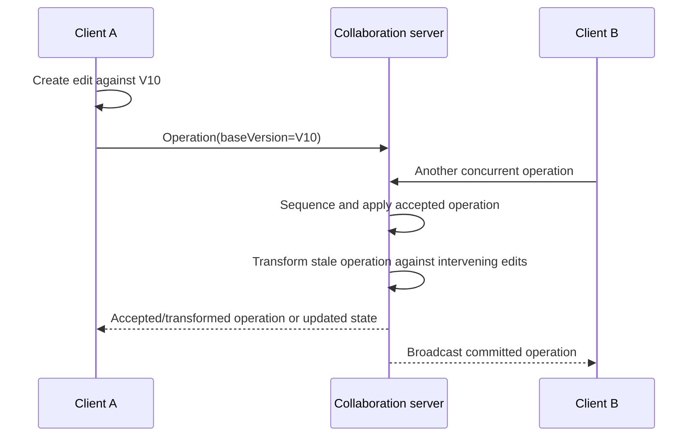

  

**Important:** the operation's base version is not necessarily the version at which the server will finally apply it. The server transforms stale operations into the current version's coordinate space.

  

---

  

# 4. Why conflict resolution is necessary

  

The video uses concurrent typing as the motivation. If users edit the same document from the same initial state, their operations can arrive out of order.

  

A naive system that blindly applies old indices can:

- Insert text in an unintended position.

- Delete the wrong character.

- Produce different results at different clients.

- Leave the clients with divergent document states.

  

The server therefore maintains:

- Current document state.

- Current document version.

- A log of operations accepted since earlier versions.

- A deterministic processing order for incoming operations.

  

The video focuses on **Operational Transformation (OT)** to reconcile concurrent operations.

  

---

  

# 5. Operational Transformation (OT)

  

Operational Transformation transforms an operation created against an earlier document state so that it can be applied to a newer state that already includes other edits.

  

## 5.1 High-level algorithm from the video

  

For each incoming operation:

  

1. **Validate its base version.**

2. If its base version is greater than the server's current version, the server does not yet have the state the client claims to have seen. The operation cannot be transformed against missing future history; synchronize/reject the transformation attempt and recover the version discrepancy.

3. If its base version is older than the current version, collect the intervening operations between the client's base version and the server's current version.

4. Transform the incoming operation against those intervening operations using appropriate pairwise transformation rules.

5. Apply the transformed operation to the current document state.

6. Increment the document version.

7. Store the accepted operation/version in the operation log.

8. Broadcast the committed/transformed operation to clients.

  

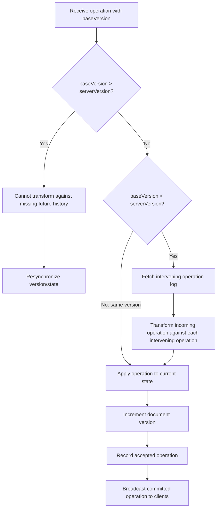

  

This is the algorithm at the level presented by the video. A production design must specify operation identity, ordering/tie-breaking, validation, retries, duplicate detection, and exact transform functions.

  

## 5.2 Pairwise cases named in the video

  

The transcript identifies these cases:

- Insert–insert

- Delete–insert

- Insert–delete

- Delete–delete

- Delete-range–insert outside the deleted range

- Insert inside a deleted range

  

The following sections reproduce the transcript's simplified examples. Positions are treated as zero-based character indices/insert boundaries according to each example. Real OT implementations need a formally defined indexing convention and complete transform rules.

  

---

  

# 6. OT example 1 — Insert vs. insert

  

**Initial document:** `abcde`, version V0.

  

Two clients create operations against V0:

- Client A: insert `x` at position 2.

- Client B: insert `y` at position 2.

  

Assume A's operation reaches the server first.

  

### Step 1: Apply A

  

Insert `x` at position 2:

  

```text

Before: a b c d e

After:  a b x c d e

Version: V1

```

  

### Step 2: Transform B

  

B's operation was created against V0, but the server is now at V1. The intervening operation inserted one character before B's insertion boundary, so the video shifts B's position from 2 to 3.

  

```text

B original:   insert y at position 2, base V0

B transformed: insert y at position 3, base/current V1

```

  

### Step 3: Apply transformed B

  

```text

Final: a b x y c d e

Version: V2

```

  

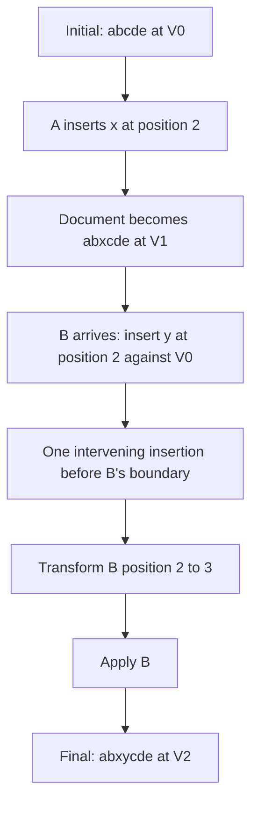

  

**Lesson:** When an earlier operation inserts content before a later operation's insertion boundary, the later position may need to shift right.

  

**Tie-breaking note:** If two inserts target the same position, a full OT design needs a deterministic rule for their relative order, including when operations have equivalent timestamps.

  

---

  

# 7. OT example 2 — Delete vs. insert

  

**Initial document:** `abcde`, V0.

  

The video’s order:

- Operation A deletes `b` at position 1.

- Operation B inserts `x` at position 3, also created against V0.

- A arrives first.

  

### Step 1: Apply A

  

```text

Before: abcde

Delete b at position 1

After:  acde

Version: V1

```

  

### Step 2: Transform B

  

Because a character before B's target boundary was deleted, the video decrements B's position from 3 to 2.

  

```text

B original:    insert x at position 3, base V0

B transformed: insert x at position 2, base V1

```

  

### Step 3: Apply B

  

The transformed insertion is applied to `acde`, yielding the video's final example:

  

```text

Final: acxde

Version: V2

```

  

**Lesson:** An earlier deletion before the insertion boundary shifts a later insertion position left.

  

---

  

# 8. OT example 3 — Insert vs. delete

  

**Initial document:** `abcde`, V0.

  

- A inserts `x` at position 2.

- B deletes at position 3, created against V0.

- A arrives first.

  

### Step 1: Apply A

  

```text

Before: abcde

Insert x at position 2

After:  abxcde

Version: V1

```

  

### Step 2: Transform B

  

The earlier insertion adds a character before the character B intended to delete. The transcript increments B's delete position from 3 to 4 so that the original intended character (`d` in the example) remains the target.

  

### Step 3: Apply transformed B

  

```text

After delete: abxce

Version: V2

```

  

**Lesson:** When an earlier insertion occurs before a deletion's target, the deletion index may need to shift right to continue targeting the same original character.

  

---

  

# 9. OT example 4 — Delete vs. delete

  

**Initial document:** `abcde`, V0.

  

- A deletes `b` at position 1.

- B deletes the character originally at position 3.

- A arrives first.

  

### Step 1: Apply A

  

```text

Before: abcde

Delete b

After:  acde

Version: V1

```

  

### Step 2: Transform B

  

The earlier deletion removes a character before B's target, so B's position shifts left by one: position 3 → position 2.

  

### Step 3: Apply transformed B

  

```text

After B: ace

Version: V2

```

  

**Lesson:** If a prior deletion occurred before a later deletion target, the later index may shift left.

  

---

  

# 10. OT example 5 — Delete a range, then insert outside it

  

**Initial document:** `ABCDEFG`, V0.

  

The transcript's example:

- A deletes three characters starting at position 2: `CDE`.

- B inserts `X` at position 6 against V0.

- A arrives first.

  

### Step 1: Apply range deletion

  

```text

Before: ABCDEFG

Delete CDE (start 2, length 3)

After:  ABFG

Version: V1

```

  

### Step 2: Transform B

  

B's insertion point was after the deleted range. Three characters before that point disappeared, so the transcript subtracts 3 from position 6:

  

```text

B original:    insert X at position 6, base V0

B transformed: insert X at position 3, base V1

```

  

### Step 3: Apply B

  

```text

Final: ABFXG

Version: V2

```

  

**Lesson:** If a range deletion removes characters before a later insertion boundary, shift the boundary left by the length of the deleted range.

  

---

  

# 11. OT example 6 — Insert inside a range that was deleted first

  

Use the same initial document `ABCDEFG`, V0.

  

- A deletes three characters from position 2 (the range `CDE`).

- A different operation C inserts `X` at position 3 against V0.

- A's deletion is applied first.

  

The original insertion position for C falls inside the deleted range. The video says to transform C so the insertion moves to the **start of the deleted range**, position 2.

  

```text

Before:          ABCDEFG

Delete range:    CDE

After deletion:  ABFG

Transformed C:   insert X at position 2, base V1

Final:           ABXFG

Version:         V2

```

  

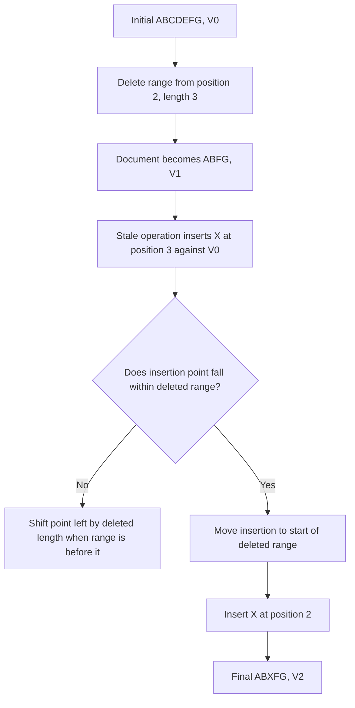

  

**Lesson:** A transform rule must decide what happens to edits whose intended position no longer exists because that region was deleted. The example policy in the video maps such an insertion to the deletion's start.

  

---

  

# 12. OT rule summary

  

| Previously accepted operation | Incoming stale operation | Transform intuition illustrated in the video |

|---|---|---|

| Insert before the incoming insert position | Insert | Shift incoming insertion right by inserted length |

| Delete before the incoming insert position | Insert | Shift incoming insertion left by deleted length |

| Insert before the incoming delete target | Delete | Shift deletion target right to preserve the intended character |

| Delete before the incoming delete target | Delete | Shift deletion target left |

| Delete range before later insert point | Insert outside range | Shift insertion point left by range length |

| Delete range contains incoming insert point | Insert | In this example, map insertion to the start of the deleted range |

  

This table is a mnemonic for the transcript's examples, **not a complete production OT specification**. Full transform logic has to define boundaries, overlapping ranges, simultaneous same-position edits, multi-character inserts, operations against deleted content, selection/cursor transforms, and deterministic tie-breaking.

  

---

  

# 13. Server version log and replay

  

The video states that the server keeps:

- Current version `n`.

- The current document state.

- The series of operations that produced newer versions (operation log).

  

When an operation comes in based on version `b` and the server is already at version `n`, the server identifies operations after `b` and transforms the incoming operation against them.

  

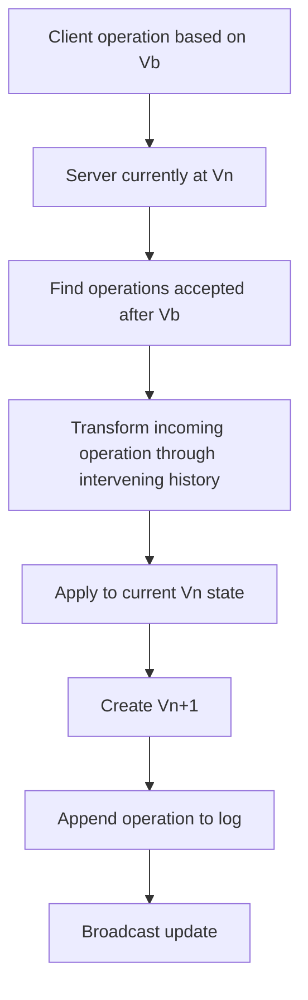

  

### Why log accepted operations?

- Transform incoming stale operations.

- Synchronize reconnecting clients.

- Rebuild state from a snapshot plus later operations.

- Preserve edit history and support undo/redo behavior.

- Replay operations for a replica or after a failure.

  

The operation log is not the same as a single current document snapshot. A snapshot captures state at a point in time; the log captures subsequent changes.

  

---

  

# 14. Cursor position synchronization

  

A remote edit can change the numeric position of a cursor even if that user has not moved it deliberately.

  

Example: a user has a cursor after `HELLO`; another collaborator inserts `ABC` before the cursor. The cursor position must shift right so it remains at the intended logical location.

  

The video says the same positional transformation logic applied to edit operations is also applied to cursor positions.

  

Simplified rules stated in the transcript:

- Insert before the cursor: new cursor position = old position + inserted length.

- Delete before the cursor: new cursor position = old position − deleted range length.

- Delete overlaps the cursor: move cursor to the start of the deletion range.

  

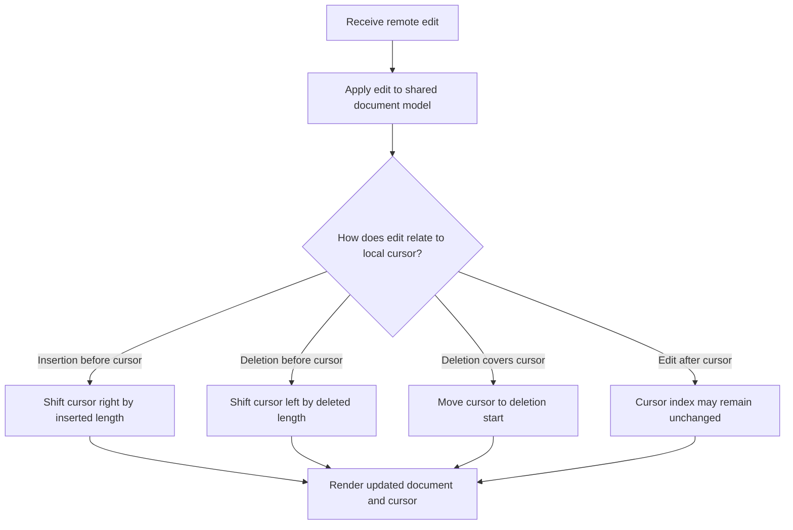

  

The same general idea is used for selections/anchored positions, but production implementations need exact rules for start/end of selections, concurrent modifications, Unicode/grapheme positions, and cursor identity.

  

---

  

# 15. End-to-end Google Docs-like architecture from the video

  

The transcript assembles the following components:

  

1. Browser/client editor.

2. Client-side optimistic update and pending-operation queue.

3. Secure WebSocket gateway for a persistent real-time connection.

4. Load balancer/routing by document ID so one document's operations reach the appropriate collaboration server/shard.

5. Collaboration server.

6. Global sequencer that establishes an order for operations.

7. Operational Transformation engine.

8. Broadcast manager that fans committed operations to connected clients.

9. Redis hot cache for active documents and recent operations since the last snapshot.

10. Kafka operation/event stream.

11. Persistent storage for snapshots, operation logs, and history.

12. Replica collaboration server maintaining in-memory state and able to be promoted after failure, using Redis and Kafka to recover to a recent state in the video's design.

  

## 15.1 High-level diagram

  

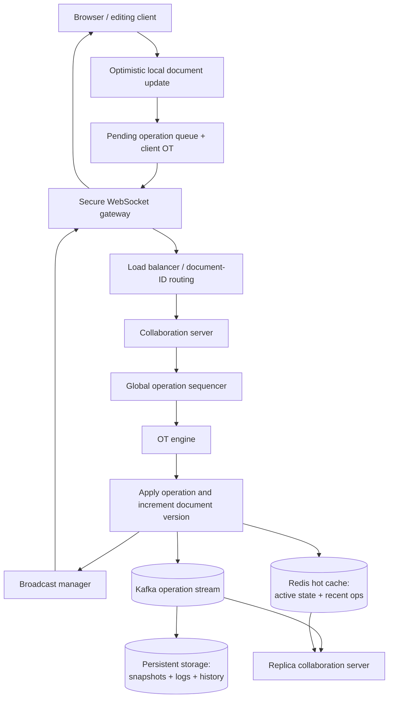

  

This is the architecture proposed in the transcript. Exact message ordering, acknowledgments, durability guarantees, and replication semantics must be made explicit for a real system.

  

## 15.2 Role of each component

  

| Component | Main responsibility in the transcript's design |

|---|---|

| Client/browser | Capture editing actions and render document/cursors |

| Optimistic UI | Apply local edits immediately to avoid typing lag |

| Pending operation queue | Track local edits not yet fully reconciled with server state |

| Client OT layer | Reconcile local pending operations with server updates |

| Secure WebSocket gateway | Maintain persistent real-time connections and forward messages |

| Load balancer/document router | Route a document's operations to its assigned collaboration shard/server |

| Global sequencer | Define a total/consistent processing order for arriving operations |

| Collaboration server | Own active collaboration workflow and current document version/state |

| OT engine | Transform stale/concurrent operations into the current state |

| Broadcast manager | Send committed updates to all relevant connected clients |

| Redis hot cache | Keep active document state and recent post-snapshot operations for fast access |

| Kafka | Carry the operation stream to persistence and replica consumers in the proposed design |

| Persistent storage | Store snapshots, operation logs, and document history |

| Replica collaboration server | Keep an in-memory state sufficiently current to support failover in this design |

  

---

  

# 16. Client-side optimistic editing

  

The transcript emphasizes that a client does not wait for the server before displaying each character.

  

A typical flow:

1. User types `A` at a position.

2. Browser creates an insert operation with the visible document's base version.

3. Browser immediately applies it to the local UI (optimistic update).

4. The operation is placed into a pending queue and sent over the WebSocket.

5. Server sequences/transforms/applies it.

6. The committed operation is broadcast.

7. The client reconciles the server's response with pending local operations and remote edits.

  

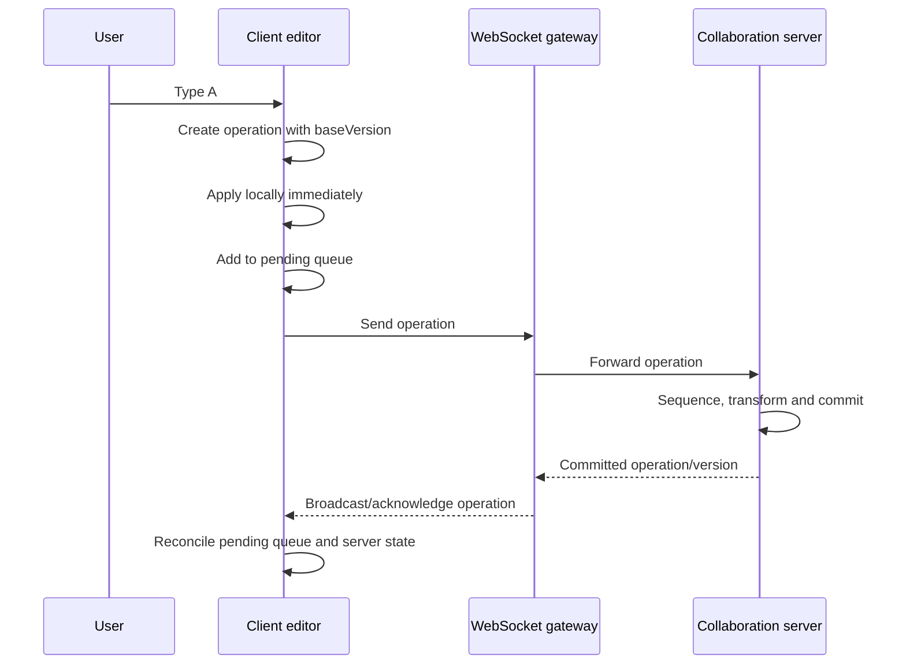

  

**Why optimistic UI?** Waiting for a round-trip on every keystroke would make typing feel laggy. Optimism improves perceived latency, but it means the client must be able to reconcile local predictions with the canonical server operation order.

  

---

  

# 17. WebSocket gateway and document routing

  

The video uses a **secure WebSocket gateway** as a persistent operation stream.

  

The gateway maintains persistent connections and forwards editing operations. A load-balancing/routing layer hashes the document ID so a given document is handled by the appropriate collaboration server/shard.

  

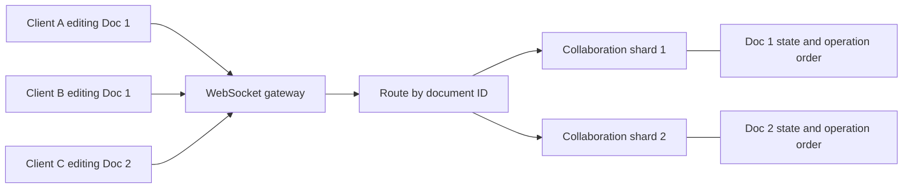

  

### Why route by document ID?

- Operations for one document need a coordinated order and shared state.

- Keeping the same document's hot editing session on its responsible shard simplifies sequencing and OT.

- Different documents can be distributed across different collaboration servers/shards.

  

### Trade-off to mention

A very popular document can become a **hot document**: all collaborators editing it place load on the same logical document owner. Document-ID routing is a way to preserve per-document ordering, but it does not eliminate the need to scale/balance hot sessions. The supplied video does not go deeply into hot-document mitigation.

  

---

  

# 18. Global sequencer, OT engine, and broadcast manager

  

These components are adjacent but do different jobs.

  

## Global sequencer

The transcript describes a sequencer using timestamps and other factors to choose a processing order when operations arrive. The resulting order is the basis for applying operations consistently.

  

## OT engine

After operation order is established, the OT engine transforms stale operations against intervening accepted operations and applies the transformed operation to the current document state.

  

## Broadcast manager

Once an operation is accepted/applied, the broadcast manager fans the committed update out to clients editing that document via the WebSocket gateway.

  

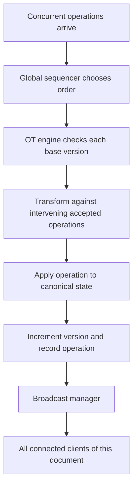

  

The sequencer should have a deterministic ordering rule. A timestamp alone is not necessarily sufficient: different machines can have clock skew, simultaneous operations need tie-breaking, and a client timestamp is not automatically a canonical server order. In an interview, say that the system establishes a deterministic per-document operation order rather than assuming raw wall-clock time solves concurrency.

  

---

  

# 19. Redis, Kafka, persistence, and replicas

  

The transcript assigns different roles to Redis, Kafka, durable storage, and the replica server.

  

## 19.1 Redis hot cache

The video says Redis stores:

- Active documents/current hot state.

- Recent operations since the most recent snapshot.

  

That lets a collaboration server or promoted replica recover/load active state faster than reconstructing it solely from cold persistent storage.

  

## 19.2 Kafka operation stream

Accepted operations are also sent to Kafka in the video's design. Kafka serves as an event/operation stream consumed by:

- Persistent-storage workers that maintain snapshots, logs, and history.

- Replica collaboration servers that maintain an in-memory state from the stream.

  

## 19.3 Persistent storage

The persistent tier stores:

- Document snapshots.

- Operation logs.

- Version history.

  

## 19.4 Replica collaboration server and failover

The transcript describes a replica server receiving events from Kafka and maintaining in-memory state. If the active collaboration server fails:

1. Promote a replica to leader for the affected document/shard.

2. Load recent state from Redis.

3. Replay relevant Kafka events to catch up to the correct version.

4. Resume processing operations.

  

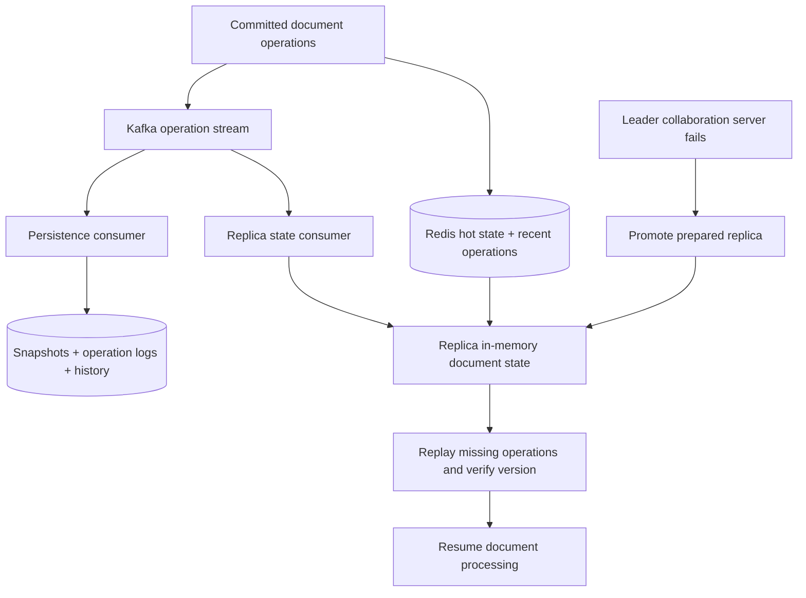

  

### Important design questions

The transcript presents the high-level data flow, but a real system must specify:

- Whether an operation is broadcast before or after durable acceptance.

- When the client receives an acknowledgment.

- How duplicates are identified.

- Which Kafka offsets/versions a replica has applied.

- How the system avoids applying the same operation twice during replay.

- How Redis state is associated with a snapshot/version.

- How leader ownership is transferred so two servers do not concurrently commit operations for the same document.

- What happens if Redis is unavailable or lagging.

  

These details determine actual durability and failover correctness; the existence of Redis, Kafka, and a replica alone does not provide those guarantees automatically.

  

---

  

# 20. Snapshots plus operation logs

  

The video describes snapshots as a complete document state at a particular version. Rather than replaying every operation from the document's creation, recovery loads the latest snapshot and then applies operations after that snapshot.

  

Example from the transcript:

- A document has progressed through many thousands of edits.

- A snapshot is captured at version V1000.

- The system later fails at a version about 100 operations beyond that snapshot.

- Recovery loads the snapshot and replays only those later operations, rather than all historical edits.

  

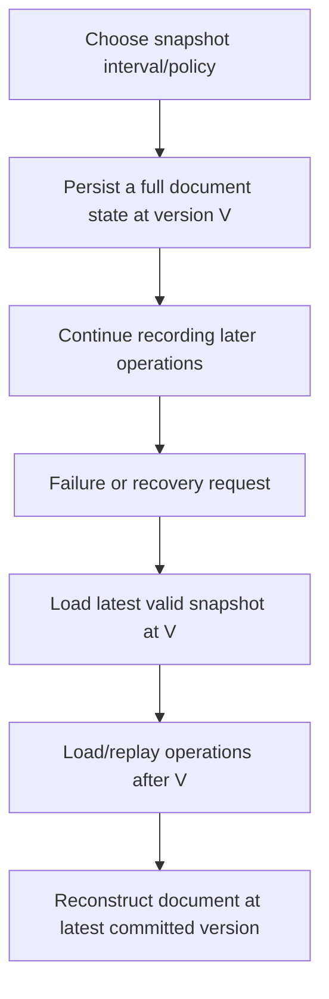

  

### Snapshot interval trade-off

- **More frequent snapshots:** shorter replay time and potentially less replay work after a failure; more snapshot storage/compute/I/O.

- **Less frequent snapshots:** fewer snapshots to produce/store, but longer operation replay and recovery.

  

The transcript's `Kafka after snapshot version` idea is an operation-stream replay design. In a real architecture, the snapshot version and stream offset/cut must be tied together so no operation is lost or applied twice at the boundary.

  

---

  

# 21. Version history, undo, and redo

  

The transcript says the server stores versioned operations so earlier states can be reconstructed and undo/redo can be supported.

  

In a collaborative editor, undo needs careful semantics:

- Undoing the user's last edit should usually invert or compensate for that user's intended operation.

- A collaborator may have edited the same region since then.

- A simple “restore the whole earlier document snapshot” could overwrite other users' later work.

- The design needs to define whether undo is local-to-user or global and how an inverse/compensating operation is transformed against later operations.

  

The video motivates history via the operation log but does not fully specify the product semantics for undo/redo. In an interview, explicitly clarify them instead of assuming “keep snapshots” is a complete undo implementation.

  

---

  

# 22. Architecture walkthrough: one character typed

  

This is the end-to-end story to practice saying out loud.

  

1. A user types a character at a caret position.

2. The browser creates an edit operation, including its type, position/value, and base version.

3. The browser applies it optimistically and stores it in a pending queue.

4. The operation travels over the secure WebSocket gateway.

5. The gateway routes it by document ID to the responsible collaboration shard.

6. The collaboration server sequences the operation relative to other concurrent operations.

7. The OT engine checks the base version, fetches intervening operations if needed, transforms the incoming operation, and applies it to the canonical document state.

8. The server advances the document version and records the accepted operation.

9. The broadcast manager distributes the committed operation to clients viewing that document.

10. Redis is updated with active hot state/recent operations; Kafka carries the operation event to persistence and replica consumers according to the proposed architecture.

11. Persistent storage maintains snapshots, operation logs, and history.

12. Replica state is kept current so it can be promoted and catch up using Redis plus Kafka replay if the active collaboration server fails.

  

---

  

# 23. Failure modes and production-minded discussion

  

These questions go beyond the transcript's precise step-by-step design, but are natural interview follow-ups.

  

| Failure / challenge | Question to answer in the design |

|---|---|

| WebSocket disconnect | How does the client reconnect, discover the latest version, and synchronize missing operations? |

| Duplicate operation delivery | Is each operation uniquely identified, and how does the server detect/reject duplicates? |

| Stale client base version | Is the required history still available? How does the client resynchronize if not? |

| Collaboration server crash | Which replica is eligible to take over, and how is split-brain prevented? |

| Kafka lag | How far behind are persistence and replicas, and can the system safely acknowledge operations? |

| Redis miss/outage | Can active state be reloaded from snapshot plus operation log? What latency/capacity impact results? |

| Snapshot/stream boundary | How are snapshot version and stream offset coordinated to avoid gaps or double application? |

| Broadcast failure | How does a connected client learn which committed operations it missed? |

| Hot document | Can a single highly active document saturate its collaboration server? What admission control/optimization is used? |

| Permission revocation | How are connected clients prevented from continuing to read/write after access is revoked? |

| Very large documents | Are operations and snapshots compacted, batched, compressed, or segmented? |

| Undo/redo | What are the semantics when other collaborators have edited since the target operation? |

  

The goal is to explain both the happy path and how the design recovers from lost messages, stale state, and component failure.

  

---

  

# 24. Interview diagram checklist

  

When asked to design a Google Docs-like system, draw in this order:

  

1. **Client:** UI, optimistic edits, pending operations, client reconciliation/OT.

2. **Connection:** secure WebSocket gateway.

3. **Routing:** load balancer that routes by document ID to the owning collaboration shard.

4. **Collaboration server:** current state/version, sequencer, OT engine.

5. **Broadcast:** send accepted operations to all connected clients editing that document.

6. **Hot state:** Redis for active documents and recent operations in the video's design.

7. **Event stream:** Kafka for operation events to persistence and replica consumers.

8. **Durability:** snapshots, operation logs, and version history in persistent storage.

9. **Recovery:** a replica with state plus replay ability, and a defined leader-promotion procedure.

10. **Presence/cursors:** show how cursor and presence updates are distributed; the video explicitly covers cursor transforms, though it does not fully specify a separate presence-storage subsystem.

  

---

  

# 25. Quick revision flashcards

  

**Q: What are the core functional requirements?**  

A: Create/read/update, real-time collaboration, conflict resolution, synchronized cursors/presence, and version history/undo-redo.

  

**Q: Why do capacity estimation first?**  

A: It determines the rough operation rate, bandwidth, document count, storage footprint, and whether a single-server design is plausible.

  

**Q: What does the video estimate for peak concurrent users and operations?**  

A: One million concurrent users, five operations/second per user, approximately five million operations/second.

  

**Q: What is the estimated operation size?**  

A: 50 bytes per operation in the video's simplifying assumption, yielding about 250 MB/s of payload.

  

**Q: What is OT?**  

A: A technique that transforms an operation created against an older document version so it can be applied correctly after intervening operations.

  

**Q: Why include a base version in an operation?**  

A: It records which document state/coordinate system the user's operation was based on.

  

**Q: What does the server keep for OT?**  

A: Current document state/version and the operation history needed to transform incoming stale operations.

  

**Q: Why optimistic UI?**  

A: To display the user's edit immediately and avoid making typing wait for a network round-trip.

  

**Q: Why WebSockets?**  

A: Persistent bidirectional connections suit a stream of low-latency edit and collaboration updates.

  

**Q: Why route by document ID?**  

A: Operations on the same document need coordinated state and a consistent application order, so they should reach the document's responsible collaboration server/shard.

  

**Q: What does the sequencer do?**  

A: Establishes the processing order used for concurrent operations.

  

**Q: What does the OT engine do?**  

A: Transforms stale operations against the intervening history before applying them.

  

**Q: What does Redis store in the transcript's architecture?**  

A: Active document/hot state and recent operations since the latest snapshot.

  

**Q: What does Kafka do in the transcript's architecture?**  

A: Carries operation events to persistence and replica consumers.

  

**Q: Why use snapshot plus log replay?**  

A: Recovery can load a recent full document state and replay only later operations rather than the complete edit history.

  

**Q: How is the cursor position transformed?**  

A: Shift it for remote insertions/deletions before it; if a deletion overlaps it, the video moves the cursor to the start of the deleted region.

  

---

  

# 26. Source-grounded facts vs. additional engineering cautions

  

## Explicit in the video transcript

- Google Docs is presented as a real-time collaborative editor.

- Requirements include CRUD, collaboration, conflict resolution, synchronized cursors/presence, and version history.

- The estimates are 100 million DAU, 1% concurrent, five typed operations/second per concurrent user, 50 bytes/operation, average 100 KB documents, two documents/user, and a 5× history multiplier.

- The resulting estimates are 5 million operations/second, about 250 MB/s incoming operation payload, about 20 TB raw documents, and about 100 TB under the stated history multiplier.

- The video explains server versions, operation logs, OT transform cases, optimistic UI, secure WebSocket gateway, document-ID routing, global sequencer, broadcast manager, Redis hot cache, Kafka, persistent snapshots/log/history, replica state, and failover/replay.

- It applies OT-like position transformations to cursors.

  

## Additional engineering cautions (not fully specified in the video)

- The estimates need protocol overhead, broadcast fan-out, replication, compression, batching, and storage-retention refinements before capacity planning.

- The video presents an interview architecture; it does not establish the exact proprietary internals of Google's production Google Docs.

- OT requires deterministic transformation rules, especially for same-position edits, Unicode/index semantics, multi-character operations, selections, and duplicated/reordered messages.

- Timestamp-based sequencing alone is not sufficient unless there is a deterministic coordination/tie-breaking rule.

- A durable operation stream and a replica help recovery only if the system defines acknowledgments, offsets, idempotency, leader ownership, and snapshot/log boundaries.

- The video does not deeply specify presence storage, authorization/revocation behavior, or hot-document mitigation.

  

---

  

# Final mental model

  

- **Capacity estimation** tells you why the system cannot be only one server and a single full-document write per keystroke.

- **Client optimistic UI** makes editing feel immediate.

- **WebSockets** carry ongoing real-time operations.

- **Document-ID routing** takes operations to the owner of a document's collaboration state.

- **Sequencer + OT** establish a canonical order and transform stale operations.

- **Broadcast manager** distributes accepted updates.

- **Redis** holds hot active state and recent operations in the video's proposed architecture.

- **Kafka** carries operation events to persistent storage and replicas.

- **Snapshots + operation logs** provide an efficient recovery path.

- **Replicas and replay** support takeover after a collaboration-server failure.

- **Cursor transforms** keep caret/selection positions aligned with document edits.

  

The interview answer is strongest when you can trace one character from the user's keyboard through optimistic UI, WebSocket routing, sequencing and OT, broadcast, cache/event stream, and durable history—and then explain how the design recovers if the responsible server fails.