 

## Based on “Design Instagram Reels Architecture — System Design Asked in Google and Meta Interview”

  

> **Source scope:** These notes follow the supplied video transcript and organize its proposed architecture into study-ready sections. This is an interview-style design for a Reels/Shorts-like platform, **not a verified description of Instagram's proprietary production systems**. Assumptions from the video are identified as such, and implementation details the transcript does not specify are not invented as facts.

  

---

  

# 1. Problem statement and requirements

  

Instagram Reels / YouTube Shorts-style platforms let creators upload short vertical videos while viewers scroll through an auto-playing, personalized feed.

  

The video identifies these key capabilities:

  

1. Upload short video content (the video assumes a duration below 90 seconds).

2. Process/transcode uploaded videos into multiple formats.

3. Moderate submitted content.

4. Generate personalized feeds.

5. Start playback quickly as the user scrolls.

6. Capture watch-time, likes, comments and other engagement signals.

7. Detect trending content.

  

## 1.1 Quality attributes to clarify

  

These are useful additions to ask about in a system-design interview:

  

- **Low startup latency:** the first playable segment should arrive quickly.

- **Playback continuity:** avoid stalls when the user scrolls or bandwidth changes.

- **Scalability:** support high view/read traffic and a separate upload workload.

- **Personalization:** rank different reels for different users.

- **Durability:** avoid losing accepted uploads and engagement events.

- **Moderation and safety:** blocked content must not be served to users.

- **Freshness:** trending and engagement counters should update sufficiently quickly.

- **Cost efficiency:** video storage, transcoding, bandwidth, and CDN delivery are major cost centres.

  

**Core architectural insight:** this is a **CDN- and bandwidth-dominated system**. The upload pipeline, personalized feed, segment delivery, and engagement analytics should be designed as related but separately scalable paths.

  

---

  

# 2. Capacity estimation from the video

  

The presenter uses simplifying assumptions to show why the system requires distributed storage, asynchronous processing, caching and a CDN.

  

## 2.1 Assumptions in the transcript

  

| Input | Video's assumption |

|---|---:|

| Daily active users (DAU) | 250 million |

| Views per user per day | 30 |

| Average video size | 7 MB |

| Peak video starts | 400,000 per second |

| New reel uploads per day | 25 million |

| Processed storage per reel | 40 MB |

  

These are **the video's example inputs**, not claimed current platform measurements.

  

## 2.2 Daily views

  

\[

250\text{ million users} \times 30\text{ views/user/day}

= 7.5\text{ billion views/day}

\]

  

## 2.3 Naive daily video traffic

  

With an assumed 7 MB per view:

  

\[

7.5\text{ billion views/day}\times7\text{ MB/view}

=52.5\text{ billion MB/day}

\]

  

That is approximately **52.5 petabytes/day** in decimal units if every view transfers the full 7 MB asset. The video rounds this to about 52 PB/day.

  

**Important limitation:** this is a simple full-video payload model. Real delivered traffic depends on watch completion, partial downloads, segment prefetching, bitrate choice, caching, retransmissions, and the definition of “video size.” It illustrates scale; it is not a final bandwidth bill.

  

## 2.4 Peak video starts / RPS

  

The video estimates **400K video starts/second**. A video start is not the same as every individual segment request: one playback may involve several segment requests, manifest/metadata calls, retries and CDN cache interactions.

  

When estimating an interview system, state whether you are counting:

- Feed page requests

- Playback starts

- Video-segment requests

- Engagement events

- Upload events

  

These are separate rates and should not all be called one generic RPS number.

  

## 2.5 Upload storage growth

  

Assumption: 25 million new reels per day and 40 MB of processed storage per reel, including multiple formats/representations.

  

\[

25\text{ million reels/day}\times40\text{ MB/reel}

=1{,}000\text{ million MB/day}\approx1\text{ PB/day}

\]

  

The transcript therefore estimates about **1 PB of new processed video storage each day** under its assumptions.

  

This is logical storage at the stated 40 MB/reel estimate. Physical replication, metadata, thumbnails, manifests, retention, deletion, encoding variation, and compression can change actual capacity requirements.

  

## 2.6 What the estimates tell us

  

- Raw video should live in object storage, not be proxied through the application server for every upload/download byte.

- Transcoding should be asynchronous and parallelizable.

- Multiple quality levels and short segments enable adaptive bitrate streaming.

- CDN caching is essential to reduce origin traffic and geographically distant latency.

- Feed metadata and statistics must be served from efficient indexes/caches rather than scanning all videos.

- Engagement counts should be aggregated rather than requiring a read-modify-write of one counter row for every view/like.

  

---

  

# 3. Separate the two main workflows

  

A short-video platform has at least two major paths:

  

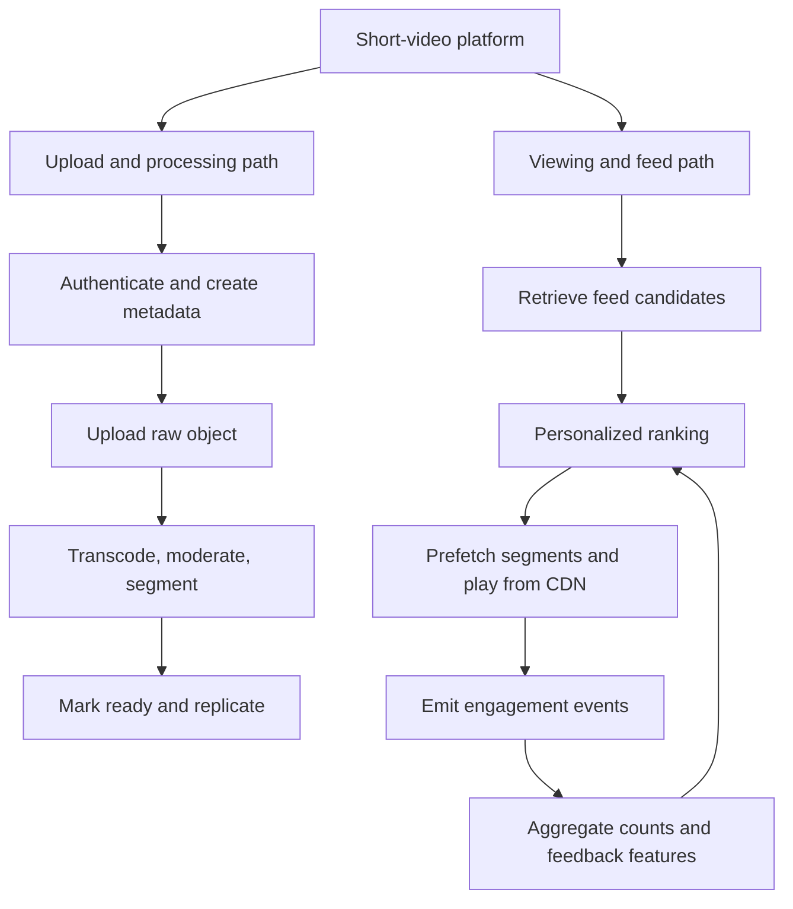

  

**Why separate them?** Uploads are heavy in file transfer and CPU-intensive video processing; viewing is dominated by request latency, CDN traffic, segment delivery and repeated feed reads; engagement is a high-volume event-ingestion and aggregation workload. One server tier should not have to scale all three in lockstep.

  

---

  

# 4. Upload workflow — four phases from the video

  

The transcript divides upload into four phases:

- Phase A: upload/session initialization and metadata.

- Phase B: direct upload to object storage.

- Phase C: asynchronous processing/transcoding.

- Phase D: multi-region replication.

  

## 4.1 Phase A — initialize upload and metadata

  

When the user taps upload:

  

1. Client establishes a secure TLS connection to a nearby region; the video mentions anycast routing.

2. The authentication token is validated.

3. A globally unique reel ID is generated, using a distributed ID generator such as Snowflake in the video.

4. A metadata row is written with initial status `init`.

  

The transcript describes an example Snowflake-style ID layout:

- 41-bit timestamp

- 10-bit region/worker identifier

- 12-bit sequence

  

This is a teaching example, not a universal Snowflake format. Concrete ID layouts depend on the implementation and bit allocation.

  

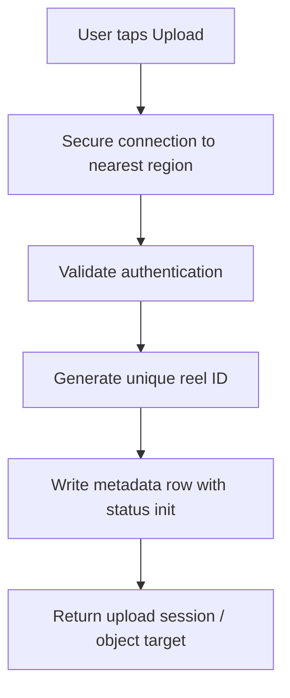

  

### Metadata fields mentioned in the video

- `reel_id`

- `creator_id`

- `status`

- `created_at`

- `duration`

- `visibility` (public/private)

  

The full end-to-end recap also mentions:

- Caption

- Thumbnail URL

- Audio ID

- Category ID

- Timestamps

  

These fields support authorization, feed eligibility, filtering, ranking, and rendering the UI without retrieving the full video bytes.

  

## 4.2 Reel status state machine

  

The video describes states such as:

- `init`: record exists, but upload is not complete; not playable or feed-eligible.

- `uploaded`: raw media is uploaded to object storage.

- `processing`: transcoding/moderation work is underway.

- `failed`: processing could not complete.

- `blocked`: content is blocked after moderation.

- `ready`: processing succeeded; content is playable and eligible for the feed.

  

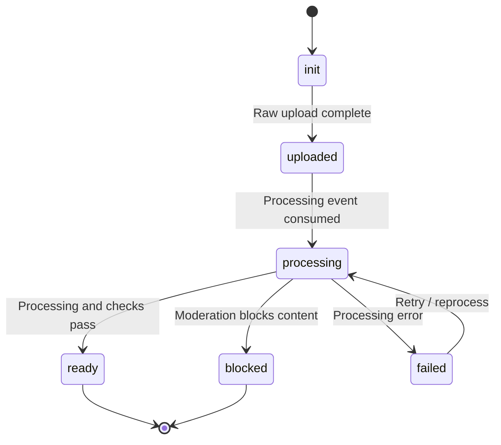

  

The exact implementation can have more intermediate statuses (uploading, retrying, deleting, expired, etc.). The key invariant from the video is that **only content in the `ready` state should be eligible for playback/feed delivery**.

  

## 4.3 Metadata database choice

  

The video proposes a **distributed SQL database**, sharded by `reel_id`, for metadata because it wants strong consistency for ownership/metadata and a latency target around 20 ms.

  

Treat “distributed SQL and under 20 ms” as a design assumption in the transcript, not a verified platform implementation or guaranteed latency. The important reasoning is:

- Metadata has structured fields and queries.

- Ownership/status transitions need clear correctness.

- Reel-ID sharding helps distribute metadata records.

- Metadata reads are small compared with video media bytes.

  

---

  

# 5. Phase B — direct upload to object storage

  

The client uploads the raw video directly to an object-storage service, with S3 given as an example in the transcript.

  

The video describes an illustrative object-storage workflow:

- Divide larger objects into chunks (8 MB is the video’s example).

- Store replicas across separate racks (three replicas in the example).

- Maintain an index/metadata entry.

- Acknowledge successful storage.

  

These are conceptual object-store properties in the video, **not guarantees that every S3 upload is internally handled exactly this way**. Managed object-storage implementation details differ by provider and service.

  

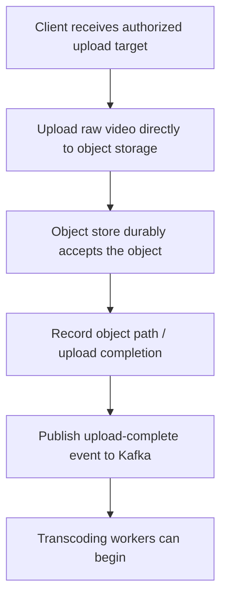

  

### Why direct-to-object-storage upload?

- The application server does not need to carry the full media payload.

- Object storage is built to handle large objects and durability.

- Application servers can focus on authorization, metadata, and workflow coordination.

- Upload bandwidth can scale independently from API CPU.

  

A real design commonly requires scoped upload authorization, limits, upload-completion verification, checksum validation, and rejection/cleanup of incomplete or invalid objects. The transcript does not specify those details, but they are sensible production concerns.

  

## 5.1 Kafka event partitioning by reel ID

  

After upload completion, the transcript publishes an event to Kafka. The topic is partitioned by a hash of `reel_id` (shown as a hash/modulo pattern).

  

Why? Events for the same reel should usually be handled in a consistent partition/consumer order. This is useful for events such as upload completion, processing status, and readiness.

  

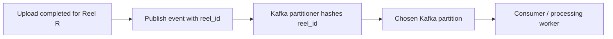

  

Partitioning by reel ID preserves order within that partition for a key. It does **not** automatically provide global ordering across all reels, exactly-once side effects, or protection from duplicate event processing.

  

---

  

# 6. Phase C — processing, moderation, and transcoding

  

When a processing worker consumes the Kafka event:

  

1. Read the `reel_id` and object-storage path/metadata.

2. Fetch the raw video from object storage.

3. Run an FFmpeg-like processing pipeline.

4. Perform the needed media validation and moderation checks.

5. Generate multiple quality/bitrate representations.

6. Segment the outputs.

7. Save output manifests/segments and metadata.

8. Mark the reel `ready` only when required processing succeeds and policy allows it.

  

The transcript explicitly lists content moderation as a product requirement and describes the transcode workflow, but it does **not** specify the moderation model or exactly where it runs. A robust design must ensure blocked media never becomes feed-eligible or publicly playable.

  

## 6.1 Bitrate ladder

  

The video gives example resolutions such as 240p, 360p, 480p, and 720p. A bitrate ladder creates multiple encodings of the same content so the player can select a suitable version based on bandwidth and device constraints.

  

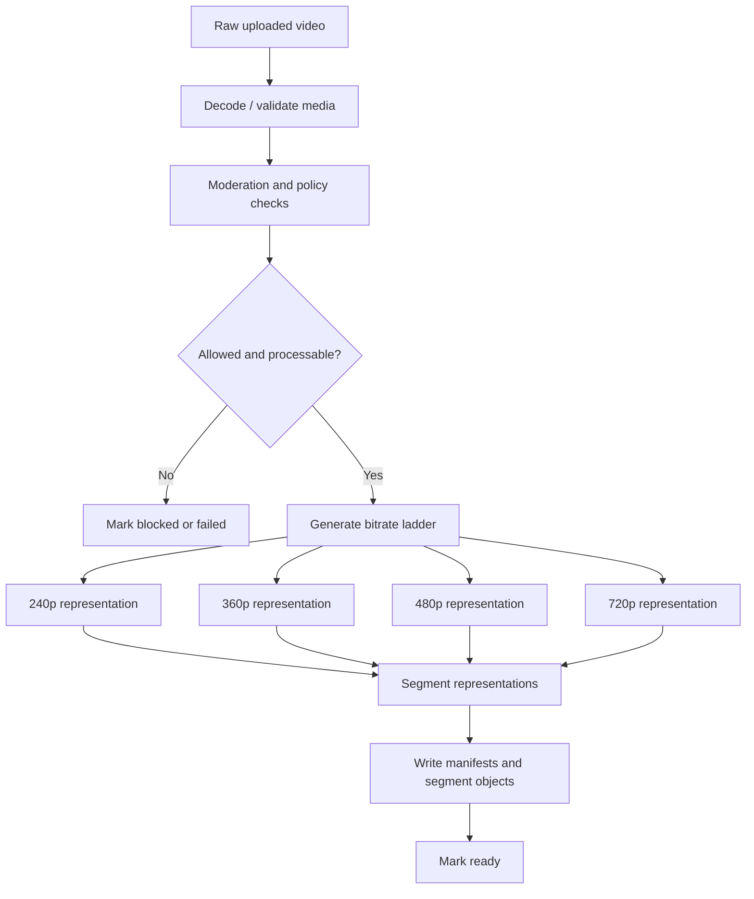

  

## 6.2 Adaptive bitrate streaming (ABR)

  

When network bandwidth changes, the player can request segments at a different quality. It need not re-download one monolithic video file from the beginning.

  

The transcript's example:

- Slow connection → lower-quality segments (e.g., 240p).

- Faster connection → higher-quality segments (e.g., 720p).

  

Device capability and display constraints can also affect what is sensible to play.

  

## 6.3 Segment duration

  

The transcript proposes short segments around **1–2 seconds**, often using 2 seconds as an example:

- A 30-second video split into 2-second segments would have approximately 15 segments per representation.

- Small segments can improve startup and quality adaptation.

- Extremely small segments increase request/manifest/overhead costs.

  

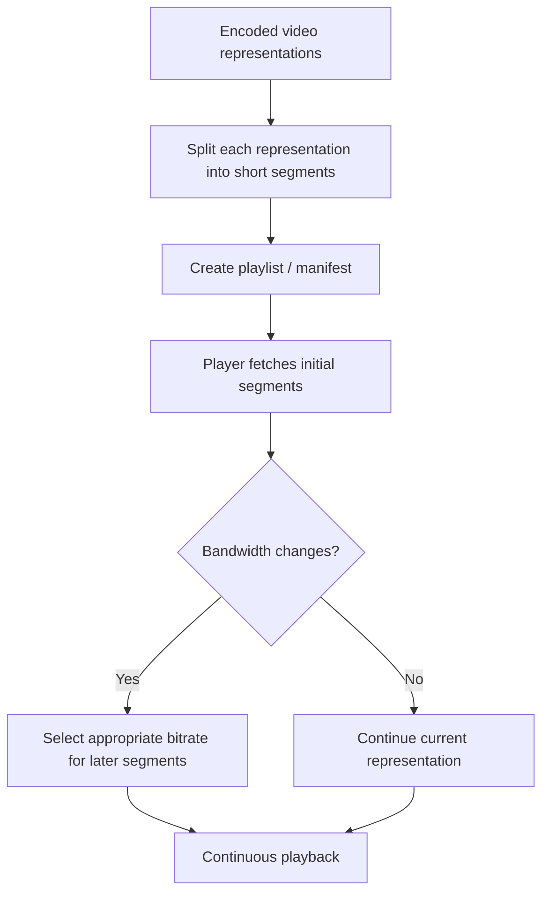

  

The segment length is a design choice. Packaging, latency, cache efficiency, codec/keyframe alignment, request overhead, and streaming protocol all influence it.

  

---

  

# 7. Phase D — multi-region replication

  

The transcript proposes:

- **Synchronous replication within a region** for the illustrated storage strategy.

- **Asynchronous replication across regions**.

- A stated preference for durability over availability in this stage.

  

This is a design assumption from the video, not a universal rule for every media platform.

  

The motivation is to keep accepted media durable and distribute content closer to users. A production design must make clear:

- At what point the upload is considered successfully committed.

- Whether playback can start before cross-region copies finish.

- What happens if a region is unavailable.

- Which locations host origin copies and which copies are CDN caches.

- How deletion, privacy changes, and moderation takedowns propagate to replicas and caches.

  

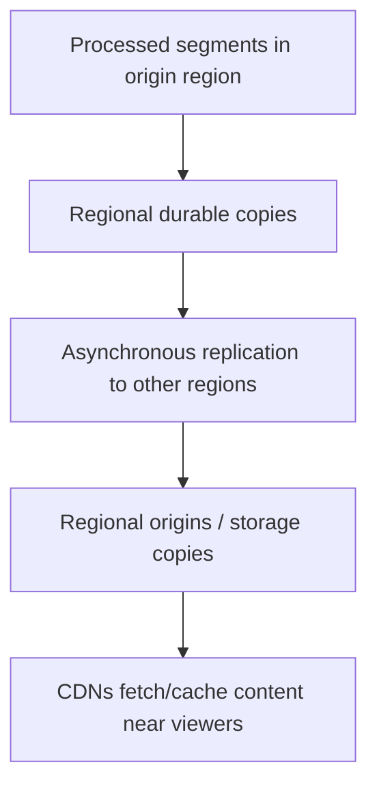

  

---

  

# 8. Viewing workflow — personalized candidate retrieval

  

When a user opens the Reels tab, the video says the feed service should **not scan the entire reel database**. Instead, it builds a candidate pool from several sources.

  

The transcript names three sources:

  

1. **Reels from accounts the user follows**

   - Fetch the user's follow list from a graph database.

   - Retrieve recent reels from those creators, typically ordered by creation time.

  

2. **Reels the user may like**

   - Fetch the user's embedding/vector from a feature store.

   - Retrieve similar reels from a vector index.

   - Filter out reels already watched, blocked content, and reels from muted users (as described by the video).

  

3. **Trending and viral reels**

   - A trending service maintains high-velocity, high-completion reels by region.

   - The transcript says trending candidates may be stored in Redis sorted sets, from which the feed service fetches region-level top reels.

  

The video estimates that these sources produce **roughly 1,000–1,500 candidate reels** per user before final ranking. That is an illustrative estimate.

  

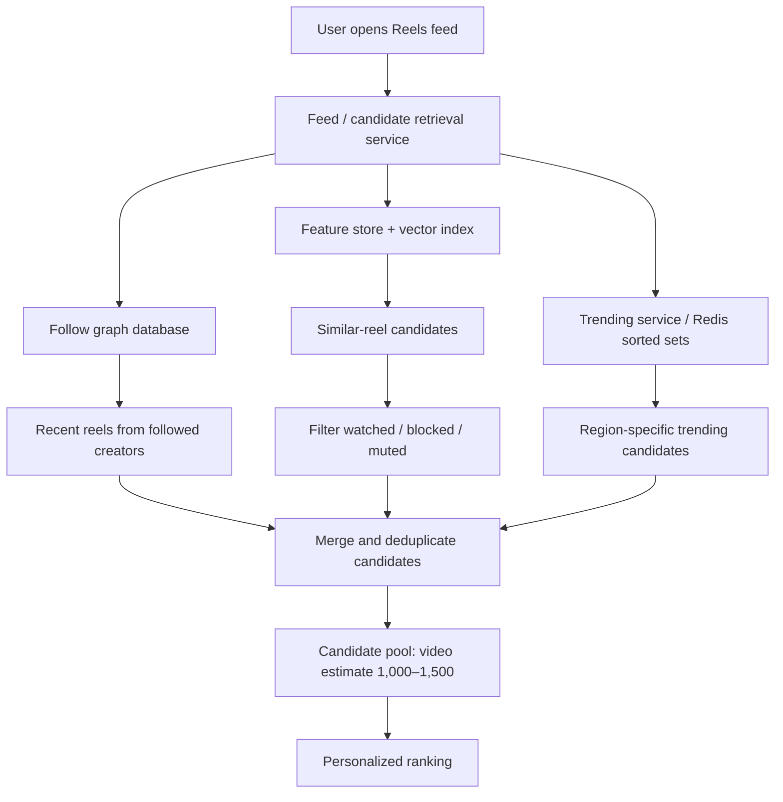

  

**Key distinction:** candidate retrieval narrows the universe; ranking orders those candidates for one user. These are different steps and usually need different data structures and compute budgets.

  

---

  

# 9. Ranking service and feature categories

  

The transcript groups ranking features into three categories.

  

## 9.1 User features

- Average watch time

- Like ratio

- Completion rate

  

The video uses completion behavior to illustrate personalization: someone who often watches full narratives may prefer longer/deeper material, while someone who swipes away quickly may prefer faster-paced videos. This is an illustrative ranking intuition, not a complete ranking policy.

  

## 9.2 Reel/content features

- Engagement velocity: views/engagement during a recent interval compared with a historical baseline.

- Global watch time or average observed watch duration.

- Content category, e.g. dance, coding, food, memes.

  

## 9.3 Context features

- Time of day.

- Network speed.

- Device type/capability.

  

These features can influence what content and quality are useful in the current session. Network speed and device capability especially intersect with adaptive bitrate playback.

  

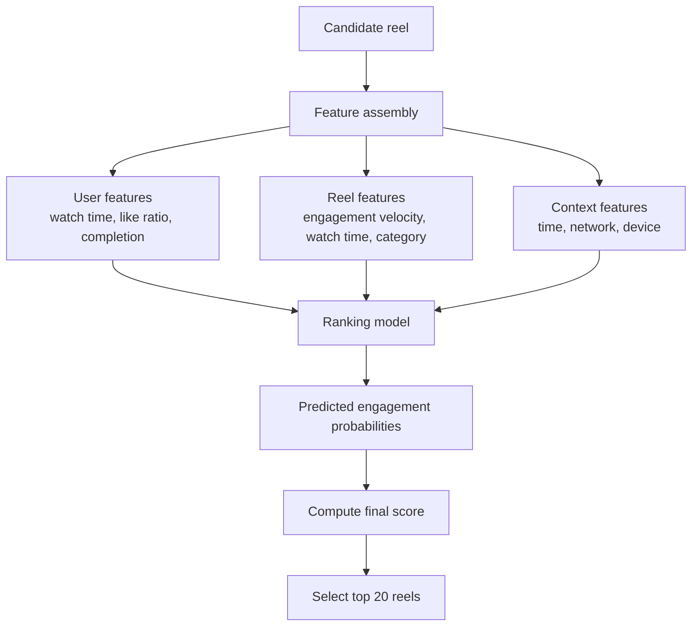

  

## 9.4 Prediction outputs named in the video

  

The ranking model predicts:

- Probability of a 3-second watch.

- Probability of a full watch.

- Probability of a like.

  

The system combines predictions into a final score, then returns the top 20 reels to the client in the transcript's example.

  

The transcript does not state a specific formula or learned model architecture. A score might use learned weights or a downstream ranking policy, but no exact coefficients should be invented from the source.

  

## 9.5 Feedback loop

  

Engagement events collected from viewers can become features for future ranking and trending:

- Did the viewer play the video?

- Did they watch past a threshold?

- Did they complete it?

- Did they like or comment?

- How long did they watch?

  

This turns the viewing workflow into a loop: ranking influences exposure, exposure produces engagement, engagement features influence future ranking and trend detection. A production ranking design also needs to guard against feedback loops, creator/content spam, bot engagement and distribution bias; the transcript doesn't go into those mitigations.

  

---

  

# 10. Feed prefetching and playback

  

The transcript explains why the next reel can begin almost immediately after a user swipes.

  

The flow described:

1. The feed service returns the top 20 reel candidates.

2. The client begins playing the first reel.

3. While the first reel is playing, the client prefetches the first few segments of the second reel and, in some cases, the third reel.

4. Playback/engagement events for the current reel are emitted in the background.

5. More candidates are generated asynchronously.

6. When the user swipes, the next reel's initial segments are already ready.

  

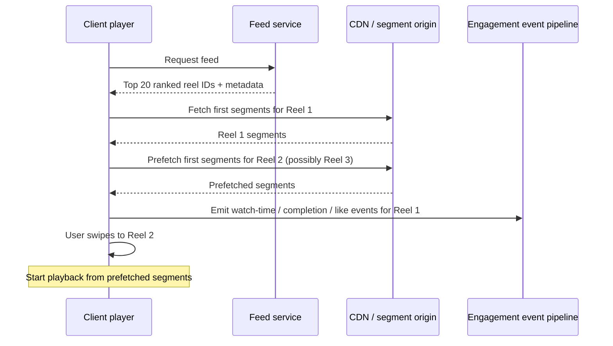

  

### Practical trade-off

Prefetching improves startup latency but uses bandwidth and memory for content the user may never watch. A practical player chooses how many segments/reels to prefetch according to network quality, memory, user behavior and cellular-data policies.

  

---

  

# 11. Storing likes, views, and comments

  

The transcript's main scaling principle is to **separate the durable relationship/content write from aggregated counters**. Avoid reading and updating one hot count record for every individual engagement event.

  

A viral reel could receive huge volumes of likes and views in a short interval. If every request performed a serialized read-modify-write of the same counter row, that row could become a bottleneck.

  

## 11.1 Likes: relationship table plus event stream

  

When a user likes a reel, the video describes two paths:

  

1. Write the relationship `(reel_id, user_id)` to a distributed likes table.

2. Publish a like event to a Kafka topic, e.g. `reel-engagement-events`.

  

Why keep the relationship row?

- Prevent duplicate likes / enforce one like per user per reel.

- Support unlike.

- Answer whether the current user has liked a reel.

  

This is a **per-like relationship write** in the video. The optimization is specifically about **not updating the aggregate like counter synchronously for every like**, not eliminating all database writes.

  

## 11.2 Statistics aggregation

  

The video describes a stats aggregator consuming engagement events:

- Maintain in-memory counters / batches for a short interval (the video mentions roughly 1–5 seconds, and elsewhere illustrates batching many tens of thousands of events).

- Persist aggregated count increments in a batch rather than performing a separate counter update for each event.

- Update Redis with the refreshed counts.

- Feed and ranking services read counts from Redis for low-latency access.

  

```mermaid

flowchart TD

    A[User likes Reel R] --> B[Write (reel_id, user_id) relationship]

    A --> C[Publish like event to Kafka]

    C --> D[Stats aggregator consumes events]

    D --> E[Batch / aggregate like increments]

    E --> F[Persist aggregated counters]

    F --> G[Refresh Redis statistics cache]

    G --> H[Feed and ranking read counters from Redis]

```

  

### Why batching matters

If 50,000 like events occur, a naive counter path may issue 50,000 serialized updates to one hot count. An aggregator may combine increments into fewer database writes. The exact reduction depends on batching interval, partitioning, key distribution and update strategy.

  

### Correctness cautions

- A relationship write and a Kafka publish can succeed/fail independently unless coordinated; use a reliable event-publication pattern when the event must not be lost.

- Aggregators should handle retries and duplicate event deliveries without double-counting.

- In-memory counters must be recoverable or flushable; a crash before persistence can lose pending increments.

- Counts may be eventually consistent. The UI/ranking should be designed for a short lag if that is acceptable.

- Do not use a read-modify-write counter row as the only deduplication mechanism for user likes.

  

## 11.3 Views

  

Views are higher-volume than likes in the video's model. The transcript describes emitting a view event when a viewer reaches a 3-second milestone or completes the video (depending on the chosen view definition). Those events go to Kafka, are batched by the stats aggregator, persisted, and used to refresh Redis periodically.

  

**Important product detail:** “view” must have a formal definition—start, 3-second play, qualifying watch, or completion. The threshold changes analytics and counting semantics. The video presents 3 seconds and completion as alternative event milestones rather than specifying one universally correct definition.

  

## 11.4 Comments

  

Comments differ from likes and views:

- Each comment's content is stored individually.

- The transcript lists fields such as `comment_id`, `reel_id`, `user_id`, comment text, and timestamp.

- The aggregate comment count can still be updated through the same batched counter pipeline.

  

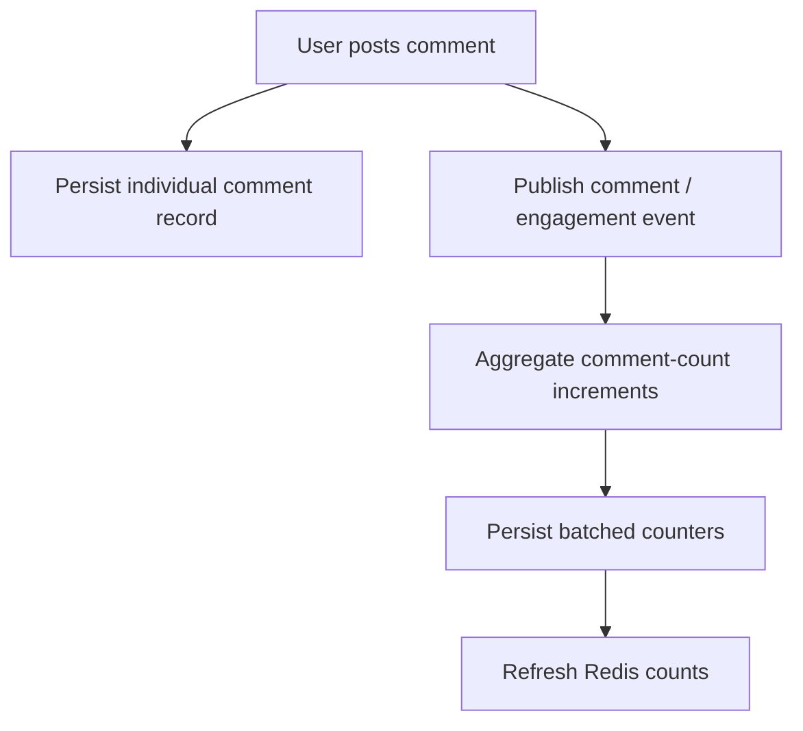

  

Do not confuse storing the comment body with updating the aggregate comment count. The body is an individual content record; the count is an aggregatable statistic.

  

## 11.5 Stats schema from the video

  

The transcript suggests a distributed NoSQL stats store with fields such as:

- `reel_id`

- `view_count`

- `like_count`

- `comment_count`

- `share_count`

- `watch_time_ms`

- `last_updated_at`

  

The candidate/feed system reads fast-updating counters from Redis, while metadata such as caption, thumbnail, creator ID and duration is retrieved from the metadata database.

  

---

  

# 12. Content moderation and readiness

  

Moderation appears in the functional requirements. The transcript's status model mentions `blocked`, and only `ready` reels are feed-eligible/playable.

  

A safe content workflow should keep the reel unavailable to general feed queries until required media processing and moderation steps have completed. The transcript does not specify the exact classifiers, human review flow, appeal process, or takedown propagation mechanism, so those should be treated as open design questions rather than source-derived facts.

  

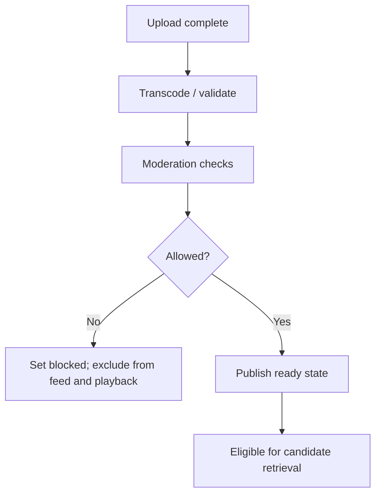

  

A production system must also handle post-publication reports, policy changes, deleted videos, private visibility, and invalidating CDN copies as appropriate. These are design follow-ups, not detailed in the transcript.

  

---

  

# 13. Full end-to-end architecture

  

The video brings its major services together as follows.

  

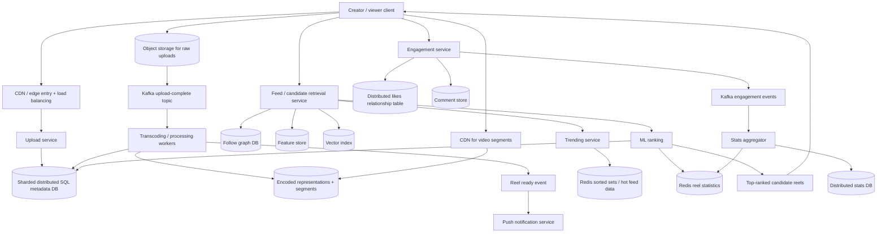

  

This is a teaching diagram. The exact network boundaries, whether the CDN is fronting only static/media delivery or also some API traffic, and the particular products used in a production deployment depend on the system. The source describes S3, Kafka, Redis, a distributed SQL metadata store, a graph database, a vector index, a feature store, and a distributed NoSQL stats store as components in the proposed design.

  

---

  

# 14. Interview walkthrough: from upload to personalized playback

  

Practice explaining the system in this order:

  

### A. Creator uploads a reel

1. Validate the creator's authentication.

2. Generate a globally unique reel ID.

3. Write metadata with `init` status.

4. Give the client an authorized destination and upload raw media directly to object storage.

5. Publish an upload-complete event to Kafka.

6. A worker fetches the raw asset, runs validation/moderation and FFmpeg-like transcoding.

7. Generate a bitrate ladder and short segments.

8. Write the processed representations and mark the reel `ready`.

9. Replicate processed assets across regions according to the storage policy; optional notification consumers act on the ready event.

  

### B. A viewer opens Reels

1. Fetch recently published reels from accounts they follow.

2. Retrieve similarity-based candidates using the feature store/vector index, excluding watched/blocked/muted items according to the video.

3. Add regional trending candidates from the trending service/Redis.

4. Merge/deduplicate the candidate pool.

5. Assemble user, reel, and context features.

6. Use the ranking model's predicted outcomes to score candidates.

7. Return the top 20 reels.

8. Fetch video segments through a CDN, prefetching the next reel's initial segments.

  

### C. The viewer likes/watches/comments

1. Persist user-to-reel like relationship or comment body as appropriate.

2. Emit engagement events to Kafka.

3. Aggregate high-volume views/likes and write counter increments in batches.

4. Refresh Redis statistics so feed/ranking reads do not query the durable stats store for every view.

5. Use engagement outcomes as inputs/features for future ranking and trending.

  

---

  

# 15. Common bottlenecks and why the proposed components exist

  

| Bottleneck | Design response in the video | Trade-off / further question |

|---|---|---|

| Large media uploads burden app servers | Direct upload to object storage | Verify upload completion and authorization |

| CPU-heavy video encoding | Async Kafka-driven processing workers | Queue lag, retries, processing failures |

| Different network speeds/devices | Multiple bitrates and segment-level ABR | More stored representations and encoding cost |

| Long geographic distance to origin | CDN and multi-region copies | Cache invalidation, replication lag and cost |

| Scanning every reel to build a feed | Candidate retrieval using graph, vector and trending sources | Candidate recall/quality, freshness |

| Too many candidates to rank deeply | Retrieve 1,000–1,500, rank and return top 20 in the example | ML serving cost and feature freshness |

| Reel starts feel slow | Prefetch first segments of next reel(s) | Wasted bandwidth and memory |

| Viral counters become a hot write row | Kafka events, batch aggregator, Redis count cache | Eventual consistency, duplicate handling |

| Duplicate likes | Store `(reel_id, user_id)` relationship | Unique constraints/idempotency and unlike races |

| View events overwhelm storage | Define milestones, batch counts | Precise view semantics and approximate freshness |

| Unprocessed/blocked content leaks | Readiness states and `ready`-only eligibility | Moderation review and cache takedown complexity |

  

---

  

# 16. Revision flashcards

  

**Q: Why is a Reels-like system CDN-dominated?**  

A: Video bytes are large and repeatedly requested by geographically distributed viewers. CDN caching reduces origin bandwidth and latency.

  

**Q: What are the main upload phases in the video?**  

A: Initialize metadata/ID; upload raw media to object storage; asynchronously transcode/moderate/segment; replicate processed assets across regions.

  

**Q: Why generate a reel ID with a distributed ID generator?**  

A: So IDs remain unique across nodes/regions without relying on one central counter. The bit split shown in the video is illustrative.

  

**Q: Why write metadata before marking a reel ready?**  

A: The system needs an identity, ownership, status and storage path to track the upload. `init`/processing states prevent incomplete content from entering the feed.

  

**Q: Why upload directly to object storage?**  

A: To keep large media bytes off ordinary application-server request paths and use storage infrastructure designed for objects.

  

**Q: Why Kafka between upload and transcoding?**  

A: It decouples upload completion from heavy processing and provides an event stream that workers can consume independently.

  

**Q: What is a bitrate ladder?**  

A: Multiple encodings at different bitrates/resolutions so the player can adapt quality to current network/device conditions.

  

**Q: Why segment video?**  

A: The player can start from initial chunks and change representations at segment boundaries rather than waiting for or downloading an entire video file.

  

**Q: What are the three candidate sources in the transcript?**  

A: Followed-creator reels, similarity-based “you may like” reels, and regional trending/viral reels.

  

**Q: What are the three feature categories for ranking?**  

A: User features, reel/content features, and context features.

  

**Q: What three outcomes does the video say the ML model predicts?**  

A: Probability of a 3-second watch, probability of full watch, and probability of a like.

  

**Q: Why prefetch the next reel?**  

A: To have initial segments ready when the viewer swipes, reducing visible startup delay.

  

**Q: Why not update the like count synchronously for every like?**  

A: Many events may target the same hot counter. Event aggregation batches increments and reduces the number of counter writes.

  

**Q: Why still persist the `(reel_id, user_id)` like relationship?**  

A: To prevent duplicate likes, support unlike, and determine whether a particular user has liked a reel.

  

**Q: How are views handled in the video?**  

A: Emit events at an agreed milestone (the video illustrates 3 seconds or completion), aggregate them in batches, persist counters, and refresh Redis.

  

**Q: How are comments different from counts?**  

A: Each comment body is stored individually; the aggregate comment count can be updated through the batched statistics path.

  

---

  

# 17. Technical precision and assumptions to mention in interviews

  

1. **Capacity inputs are estimates.** DAU, views/day, video size, peak starts, 25 million uploads/day and 40 MB processed/reel come from the video's illustrative model, not verified current Instagram measurements.

2. **52.5 PB/day is a simplified full-download estimate.** Segment requests, partial views, ABR, cache hits, prefetch and actual watch completion all change transferred bytes.

3. **400K video starts/sec is not segment request RPS.** Each playback can cause multiple manifest and segment requests, with retries/prefetch adding more.

4. **Snowflake bit allocation is implementation-dependent.** The video shows a timestamp/region/sequence example, not a universal specification.

5. **The object-store “8 MB chunks, three replicas” statement is illustrative.** Different storage providers expose different abstractions and internal replication/erasure-coding mechanisms.

6. **S3 is an example of object storage.** Do not claim the provider follows the video's exact internal write process unless you have verified documentation.

7. **Kafka partition ordering is per partition/key, not global.** A reel-ID key helps preserve order for events for the same reel in a partition; it does not provide every event exactly-once side effects.

8. **Ready-state gating matters.** A raw upload should not become feed-eligible before required processing and moderation succeed.

9. **Ranking features/formula are conceptual.** The video lists features and predicted outcomes but gives no exact final-score formula; don't invent weights.

10. **Candidate counts and top-20 size are examples.** Actual count depends on latency budgets, retrieval recall, user activity and product configuration.

11. **The like relationship write is not removed by aggregation.** The video still stores the user–reel relationship; batching reduces repeated aggregate-counter updates.

12. **Kafka plus batch aggregation needs correctness design.** Retries, duplicate events, pending in-memory counters, ordering and replay need idempotency/checkpointing.

13. **Counters can be eventually consistent.** The transcript describes periodically refreshed Redis counts; define how much display lag is acceptable.

14. **Moderation is named but not designed in detail.** The transcript does not explain specific models, human review, appeal paths, or how a post-publication takedown invalidates every cached copy.

15. **This is an interview model, not a claim about Instagram's exact internals.** Treat the chosen products/components as one proposed architecture.

  

---

  

# Final mental map

  

- **Upload:** authenticate → allocate reel ID → write metadata → upload raw object → emit event.

- **Process:** fetch raw media → validate/moderate → transcode to a bitrate ladder → segment → store outputs → mark `ready`.

- **Distribute:** replicate processed media as appropriate and serve segments through CDN.

- **Retrieve feed candidates:** followed creators + vector/similarity candidates + regional trending candidates.

- **Rank:** combine user, reel, and context features; score candidates; return the top set.

- **Play smoothly:** prefetch initial segments of upcoming reels and adapt quality as bandwidth changes.

- **Measure engagement:** store like relationships/comment bodies; emit events; batch aggregate counters; refresh Redis.

- **Close the loop:** views, watch time, likes, and comments help refresh ranking and trending signals.

  

The best interview explanation connects each component to its bottleneck: object storage for large media, asynchronous workers for expensive processing, segments and CDN for fast playback, candidate retrieval plus ML for personalization, and Kafka-based aggregation for high-volume engagement.