## Based on “Design Redis System Design Architecture: RESP, Event Loop and Data Storage”

  

**Scope of the video:** Single-node Redis architecture and internals: in-memory storage, cache request flow, capacity estimates, RESP, the event loop/reactor model, internal object encodings, RDB, AOF, the combined persistence approach mentioned in the transcript, end-to-end command execution, and lazy freeing.

  

**Explicitly out of scope in this video:** Distributed Redis architecture, replication/failover, Redis Cluster, hot keys, and distributed locks. The speaker says these are reserved for a possible part two.

  

> Throughout these notes, statements attributed to the video follow its framing. A final section marks version-dependent or simplified claims that should be expressed carefully in interviews and production design discussions.

  

---

  

# 1. Redis at a glance

  

The video introduces Redis as an **in-memory key-value store** optimized for speed and low latency. Redis keeps its active data structures in RAM, avoiding a disk read for every ordinary lookup.

  

A common use is an application cache between an application server and a durable database.

  

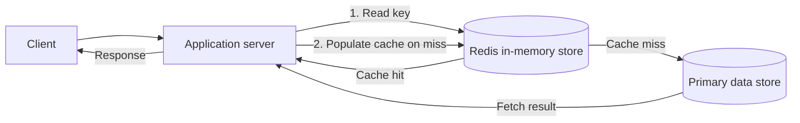

  

## 1.1 Cache hit vs. cache miss

  

- **Cache hit:** The required key/value is found in Redis and is usable under the application's freshness policy.

- **Cache miss:** The key is absent or unavailable. The application fetches the value from the underlying data source and may populate Redis before responding.

  

The video emphasizes that Redis is commonly used as a cache layer. It describes RAM as volatile and therefore presents Redis as not being the primary database. A later note clarifies the boundaries of that statement: Redis also has persistence features and can be used as a datastore when its durability requirements and configuration suit the workload.

  

## 1.2 Why use Redis?

  

The video’s interview-style answer is:

  

> Redis reduces latency and improves speed because its active data structures are held in RAM.

  

Typical use cases mentioned or implied by the video:

- Cache frequently accessed database results.

- Store session-like data where the application's loss/recovery requirements allow it.

- Maintain counters and rankings.

- Power leaderboards and low-latency gaming features.

- Reduce repeated database reads or repeated computations.

  

**Design note:** A cache is not free. It introduces invalidation/freshness problems, extra infrastructure, memory pressure, and an additional failure mode. Decide what happens when Redis is slow, empty, full, or unavailable.

  

---

  

# 2. Capacity estimation

  

The video offers the following rough estimates for a single Redis instance:

  

- Throughput: approximately **100K–500K operations/second** in the speaker’s example.

- Latency: described as **less than 1 ms**.

- RAM: a machine with 64 GB of RAM is illustrated as having about 60 GB available for Redis data after reserving some memory for the operating system.

  

These are **illustrative estimates from the video, not performance guarantees**. Real throughput and latency depend on hardware, network, pipelining, command complexity, value sizes, persistence, replication, client behavior, contention, and workload.

  

## 2.1 Three dimensions to estimate

  

| Dimension | Questions to ask |

|---|---|

| Throughput | How many commands per second? What mix of reads, writes, and data-structure operations? |

| Latency | What are average, p95, and p99 latency targets? Is the client network-local or remote? |

| Memory | What is the key count, value-size distribution, metadata/encoding overhead, fragmentation, and replication/persistence headroom? |

  

### Example capacity calculation from the video's rough assumption

  

Suppose the host has 64 GB RAM and the example reserves 4 GB for the OS and other headroom:

  

\[

64\text{ GB} - 4\text{ GB} = 60\text{ GB}

\]

  

The theoretical remaining 60 GB should **not** automatically be assumed available for application values. Redis data structures need metadata, allocator fragmentation and buffers can use additional memory, and production deployments need operational headroom.

  

## 2.2 What happens when the dataset grows beyond the memory budget?

  

The video introduces eviction policies:

- LRU — least recently used.

- LFU — least frequently used.

- No eviction / over-provisioning for data that should not be silently evicted, such as important leaderboard/counter state in the example.

  

The actual behavior depends on the Redis `maxmemory` configuration and the selected policy. Eviction is not the same as persistence, and neither is a replacement for capacity planning.

  

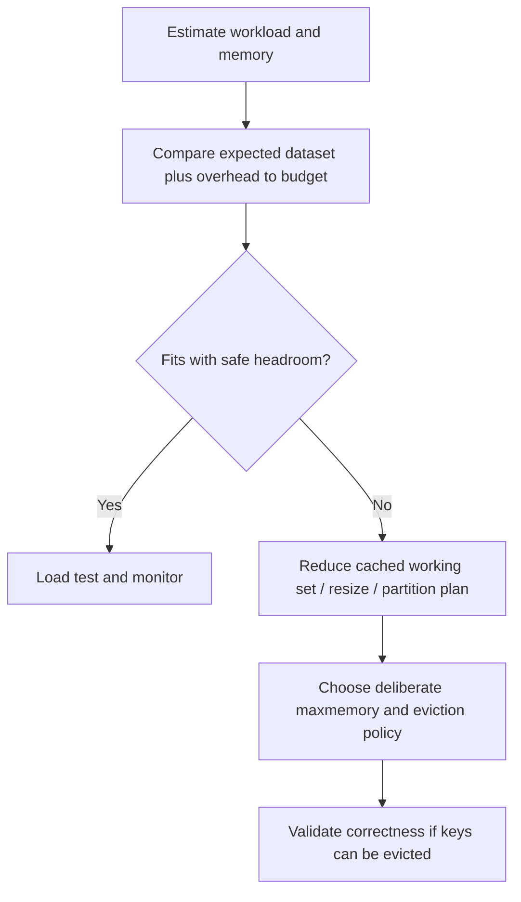

  

---

  

# 3. RESP — Redis Serialization Protocol

  

**RESP** is the wire protocol Redis clients use to send commands and receive replies. The transcript describes it as a simple, readable format sent across a TCP connection.

  

The client library generally handles encoding/decoding. Application code can call a method such as `SET`; it does not normally hand-build protocol bytes itself.

  

## 3.1 RESP type prefixes described in the video

  

| Prefix | Meaning in the introductory RESP2-style examples |

|---|---|

| `+` | Simple string reply, e.g. `+OK` |

| `-` | Error reply |

| `:` | Integer reply |

| `$` | Bulk string: a length followed by payload bytes |

| `*` | Array: a count followed by elements |

| `\r\n` | CRLF line terminator / framing marker |

  

RESP framing uses explicit lengths and delimiters so clients can parse replies unambiguously. Bulk-string lengths are **byte lengths**, not necessarily character counts for non-ASCII text.

  

## 3.2 Worked request: `SET user:1 Alice`

  

The logical command has three arguments: `SET`, `user:1`, and `Alice`. In a RESP2-style request, it can be encoded as:

  

```text

*3\r\n

$3\r\n

SET\r\n

$6\r\n

user:1\r\n

$5\r\n

Alice\r\n

```

  

The line breaks above are shown for readability; each `\r\n` denotes carriage-return plus line-feed bytes. The corresponding wire sequence is the concatenation of these parts.

  

How to read it:

1. `*3` means the request is an array containing three elements.

2. `$3` says the first element is a bulk string with 3 bytes: `SET`.

3. `$6` says the next argument is 6 bytes: `user:1`.

4. `$5` says the value is 5 bytes: `Alice`.

  

A successful `SET` command commonly gets a simple-string `OK` reply, represented in the example protocol style as:

  

```text

+OK\r\n

```

  

## 3.3 Why the protocol matters

  

RESP is the boundary between a Redis client and Redis server:

- The client encodes a logical command into protocol bytes.

- The server reads and parses the bytes.

- The command is executed.

- The reply is encoded and sent back to the client.

  

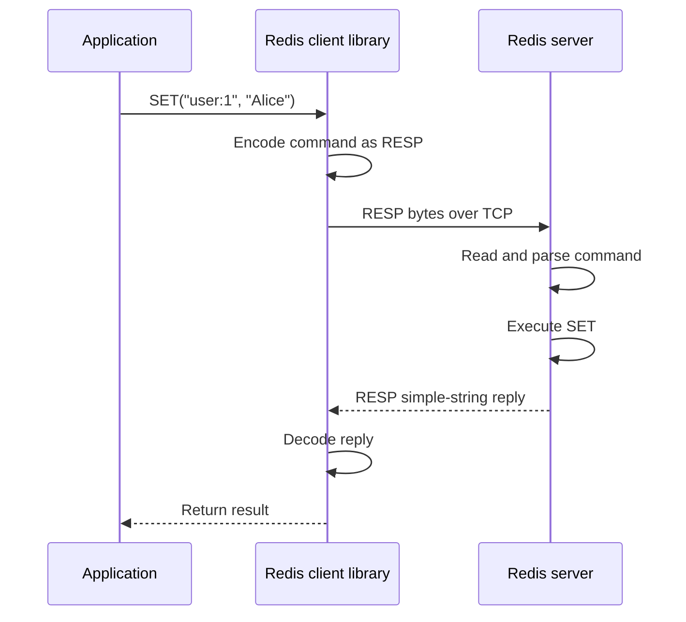

  

### Practical notes

- RESP is a protocol, not a text format that should be manually concatenated for production application use.

- Use a proper client library to avoid framing bugs and protocol injection errors.

- Pipelining can send multiple commands without waiting for each individual reply, reducing round-trip overhead; however, pipeline sizes should be bounded to avoid excessive memory use and queueing.

- The wire protocol should not be confused with the in-memory data structures used to store keys and values.

  

---

  

# 4. Redis's event loop and the reactor model

  

The transcript asks an important interview question: how can Redis handle many thousands of connections without creating one operating-system thread per client?

  

## 4.1 Why one thread per connection is expensive

  

A naive design might allocate one thread for every connected client. The video illustrates 100,000 clients and assumes 1 MB of stack per thread:

  

\[

100{,}000 \times 1\text{ MB} = 100{,}000\text{ MB} \approx 100\text{ GB}

\]

  

This is a simplified illustration of thread-stack cost. Real thread memory varies and not every stack consumes its full reservation as resident memory, but per-thread scheduling, context switching, stack reservations, synchronization, and lifecycle management can still be expensive at very high connection counts.

  

## 4.2 Readiness notification instead of busy polling

  

On Linux, `epoll` can monitor many file descriptors/sockets and report which ones are ready for relevant I/O. Redis need not continuously scan every socket itself.

  

The video describes the flow:

1. Redis registers sockets with the kernel's readiness mechanism.

2. The event loop waits (for example, through `epoll_wait`).

3. When sockets are ready, the kernel returns the ready set.

4. Redis handles the ready connections rather than polling every connection.

  

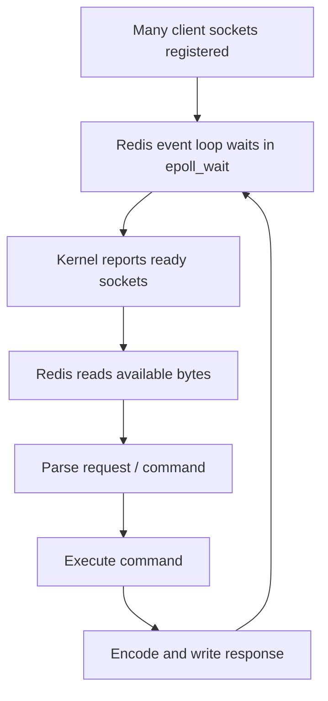

  

## 4.3 Event loop vs. `epoll_wait`

  

The transcript specifically warns against treating these as synonyms.

  

- **`epoll_wait`:** A Linux API call that waits for ready file descriptors.

- **Event loop:** The larger loop that reacts to readiness, reads data, parses commands, dispatches work, and arranges responses.

- **Reactor pattern:** An event-driven design in which readiness events are dispatched to handlers that perform the relevant I/O work.

  

A conceptual pseudocode model:

  

```python

while running:

    ready_sockets = epoll_wait(registered_sockets)

  

    for socket in ready_sockets:

        data = read_available_bytes(socket)

        requests = parse_protocol(data)

  

        for request in requests:

            result = execute_redis_command(request)

            response = encode_resp(result)

            queue_or_write_response(socket, response)

```

  

This is explanatory pseudocode, not literal Redis source code. Production networking must also handle partial reads/writes, buffered data, multiple commands, backpressure, timeouts, disconnected clients, and error paths.

  

## 4.4 Why Redis can be fast with a largely single-threaded command path

  

The model shown in the video has:

- Event-driven I/O readiness

- A main command execution path that avoids the complexity of many command-execution threads competing over shared mutable data

- Compact internal encodings and data structures

- Low per-command overhead for appropriate operations

  

**Important distinction:** “Single-threaded Redis” is a useful description of the main command execution model in the video, not a promise that every Redis version and every subsystem performs all work on one thread. Background persistence, lazy freeing, and some I/O/background facilities can use other processes or threads. Details differ by version and configuration.

  

---

  

# 5. The in-memory storage engine

  

The video emphasizes that Redis is not simply a naive `string -> string` map with one universal in-memory representation for every value. Redis exposes high-level data types and uses internal encodings that can be selected or changed to balance speed and memory use.

  

## 5.1 Redis object — the conceptual wrapper

  

The transcript presents a Redis object containing fields such as:

  

- **Type:** The logical Redis type (string, list, set, sorted set, and so on).

- **Encoding:** The internal representation used for that value.

- **LRU/LFU metadata:** Metadata that can support recency/frequency tracking for eviction policies.

- **Reference count:** Used in memory/lifetime management.

- **Pointer to the value/representation:** Refers to the underlying data or, for some compact integer representations, may encode a small value directly.

  

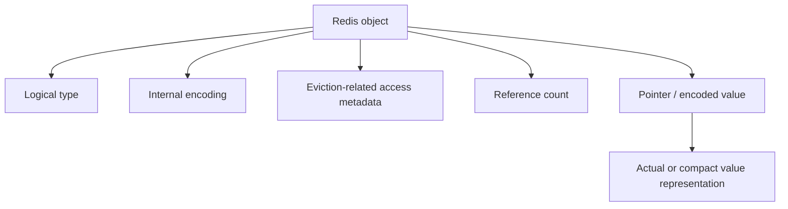

  

The client sees Redis data types and commands; it generally does not need to know which internal encoding Redis currently uses.

  

## 5.2 Why use multiple encodings?

  

The speaker's central point:

- Small values or small collections may fit in compact representations with low metadata overhead.

- As values or collections grow, Redis may switch to a representation better suited to larger or faster access patterns.

- That internal change is hidden from the client, which continues to use the same Redis commands.

  

This can reduce memory use versus a naive implementation that allocates a large general-purpose structure for every small value.

  

## 5.3 Integer-like string values

  

The video uses an integer value such as `42` to illustrate an optimized representation. In some Redis internal encodings, a small integer can be represented directly in the object metadata/pointer field rather than requiring a separately allocated character buffer.

  

This is an implementation detail, not a Redis command-level guarantee. Client applications should treat string/integer representations according to the command and data type contract, not depend on in-memory pointer tricks.

  

## 5.4 Short vs. long strings: EMBSTR and RAW

  

The transcript illustrates:

- Short strings use an encoding called **EMBSTR**.

- Longer strings use **RAW** and a separately allocated SDS buffer.

- The threshold quoted by the video is 44 bytes.

  

Conceptual comparison:

  

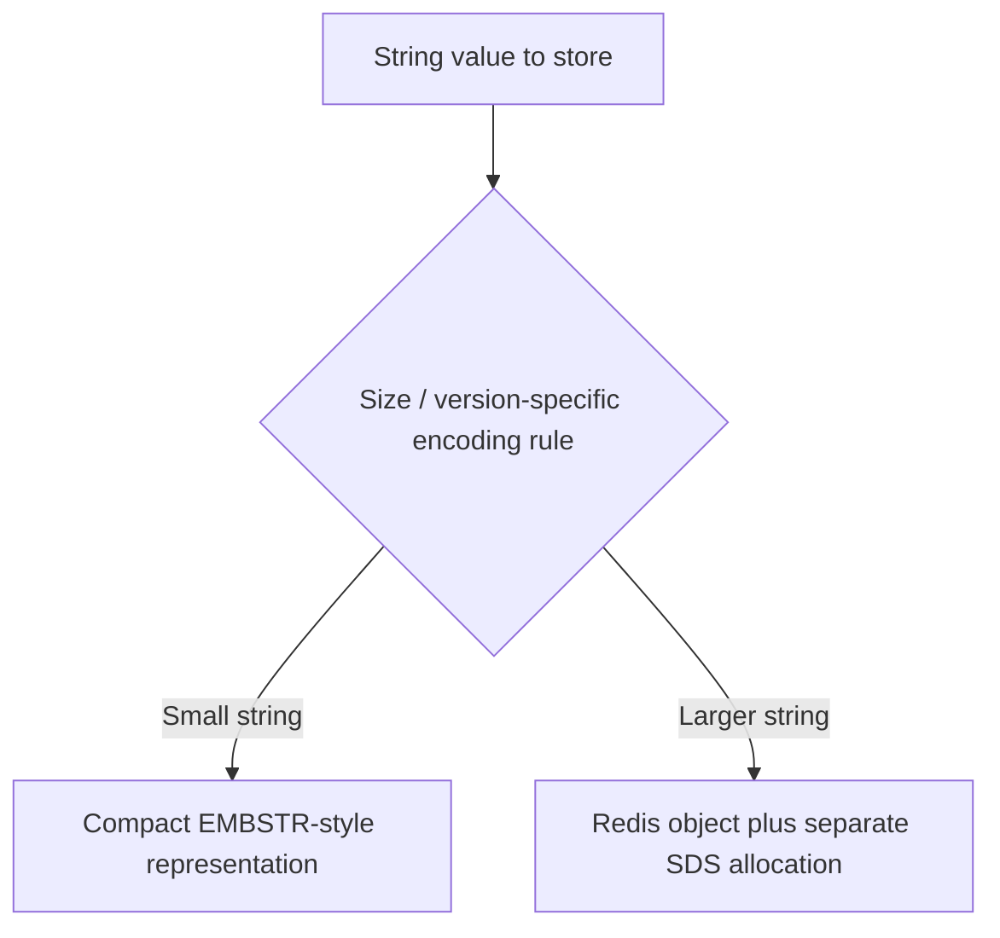

  

**EMBSTR (embedded string):** Conceptually, object metadata and string storage are allocated together, reducing allocation overhead for short strings.

  

**RAW:** The Redis object points to a separately allocated string buffer.

  

The exact threshold and details are version/build-specific. Do not assume “44 bytes” is a timeless public Redis contract.

  

## 5.5 SDS — Simple Dynamic String

  

The video calls SDS the string structure Redis uses to manage string data. SDS is designed to track string length and capacity efficiently and to support operations more safely and efficiently than relying on a traditional NUL-terminated C string alone.

  

Practical intuition:

- The internal string representation tracks the actual byte length.

- It can support binary-safe string values.

- It helps avoid repeatedly scanning to find string length.

- String memory allocation and resizing are managed internally by Redis.

  

Application code generally interacts with Redis strings through commands such as `SET`, `GET`, `APPEND`, `INCR`, and related operations, not by manipulating SDS directly.

  

## 5.6 Hash encodings: compact collection vs. hash table

  

The video uses a user record example with fields such as `name`, `age`, and `address`.

  

A small hash can use a compact sequential representation (the video uses the speech-recognition term “list pack”; the relevant encoding name in Redis is **listpack** in newer implementations, while older Redis material may refer to **ziplist**). When a size/entry threshold is exceeded, Redis can convert it to a hash-table-style representation.

  

The transcript quotes default-style thresholds of:

- More than 128 entries, or

- A field/value beyond 64 bytes.

  

These are **the video’s stated values**; actual threshold names, defaults, and applicable encodings vary by Redis version/configuration. Consult the deployed version's configuration and documentation before sizing or tuning from these numbers.

  

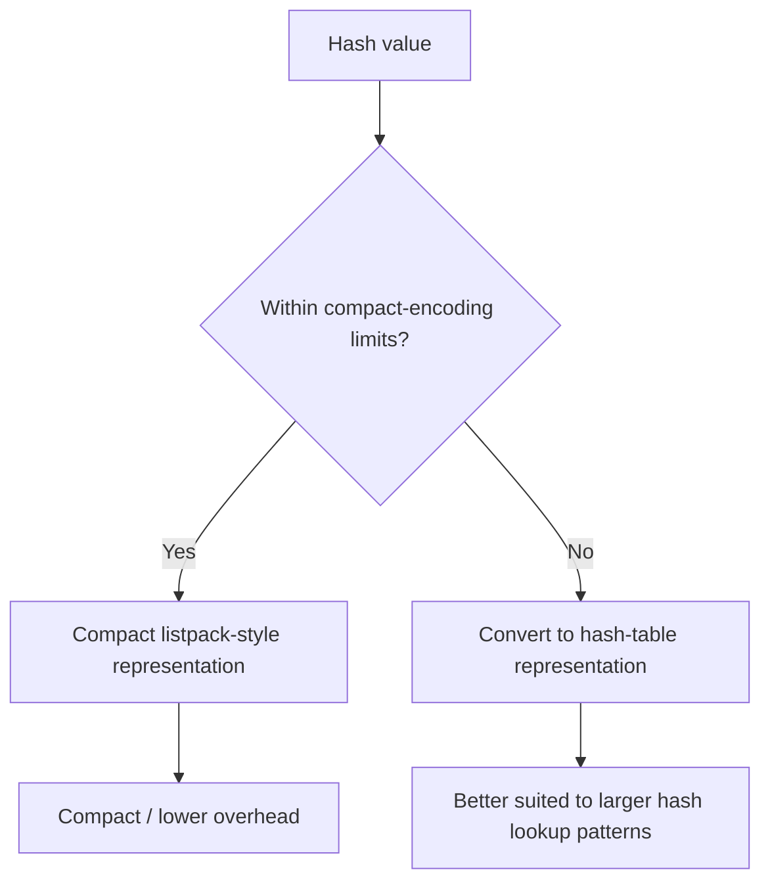

  

The video explains that once converted to a larger representation, the object may not be converted back automatically simply because it later shrinks. Treat the exact no-downgrade behavior as version/encoding-specific rather than assuming a universal rule for every data type and release.

  

## 5.7 Sorted sets: compact representation vs. skip list and dictionary

  

Redis sorted sets associate members with scores and support ranking/range operations, making them useful for leaderboards.

  

The transcript describes:

- Small sorted sets using a compact representation.

- Larger sorted sets using a skip list plus a hash table/dictionary.

  

The idea of the two structures:

- A dictionary helps find a member and its associated information efficiently.

- A skip list maintains ordering by score and supports sorted/range operations.

  

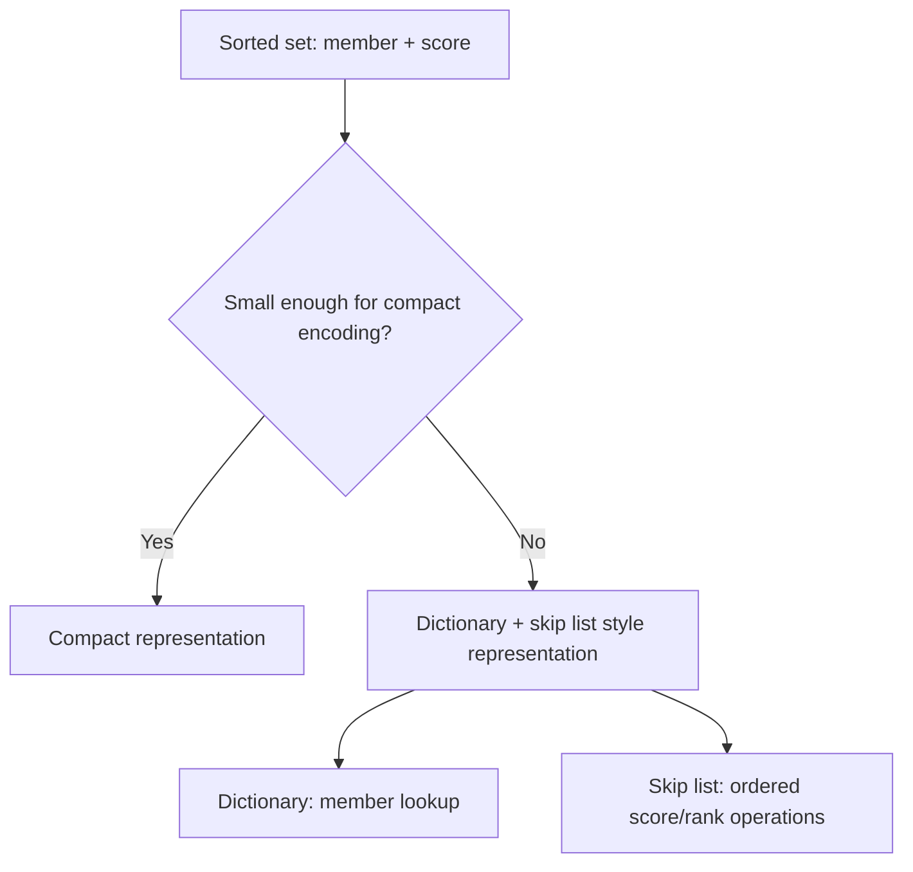

  

**Why this matters:** The same command-level data type may have different performance/memory trade-offs depending on collection size and encoding. Capacity estimates should account for metadata overhead, not only the size of application values.

  

---

  

# 6. Eviction policies and memory pressure

  

The video mentions LRU and LFU eviction:

- **LRU — Least Recently Used:** Prefer to evict data that has not been accessed recently.

- **LFU — Least Frequently Used:** Prefer to evict data that has been accessed less frequently.

- **No-eviction choice / capacity headroom:** For data whose unexpected eviction would break application behavior, configure and size the system deliberately rather than assuming any eviction is harmless.

  

Redis's actual policy is configured at the server level; per-object access metadata helps implement relevant policies, but an object does not independently select its own eviction rule in the simplistic sense. The chosen policy, `maxmemory` setting, key TTLs, and application correctness model must be aligned.

  

## 6.1 Example: session cache vs. leaderboard state

  

- A cache of recomputable sessions/profile summaries might tolerate an eviction if the application can rebuild or re-fetch the value.

- A counter/leaderboard that represents important state may require a durability and eviction strategy that makes silent loss unacceptable. Simply disabling eviction does not by itself guarantee durability; it only changes behavior under memory pressure.

  

### Memory-pressure checklist

- Estimate dataset size plus encoding/metadata overhead.

- Leave room for clients, buffers, replication, persistence, fragmentation, and operating system needs.

- Set `maxmemory` deliberately.

- Choose eviction/TTL behavior based on semantics of the keys.

- Monitor used memory, fragmentation, evictions, rejected writes, keyspace hits/misses, and latency.

- Decide what the application does during Redis outage or cache miss spikes.

  

---

  

# 7. Persistence: RDB vs. AOF

  

RAM is volatile. The video asks: if Redis crashes or the machine restarts, how much state can be recovered?

  

Redis persistence determines what can be recovered from files after a failure. The transcript describes three approaches:

1. RDB snapshots.

2. AOF (Append Only File).

3. A combination of RDB and AOF, described in the video as a hybrid approach available in Redis 7.

  

The actual configured persistence behavior depends on the Redis version, `redis.conf`, deployment, and operator choices. Do not assume every running Redis instance has persistence disabled or enabled in a particular way.

  

## 7.1 RDB — point-in-time snapshots

  

The video describes RDB as a point-in-time snapshot serialized into a binary file commonly named `dump.rdb`.

  

Simplified flow:

1. A snapshot is requested or triggered by configuration.

2. Redis creates a child process using `fork`.

3. The child iterates the dataset and writes a snapshot.

4. The parent continues to handle ordinary requests.

5. On restart, Redis can load the snapshot.

  

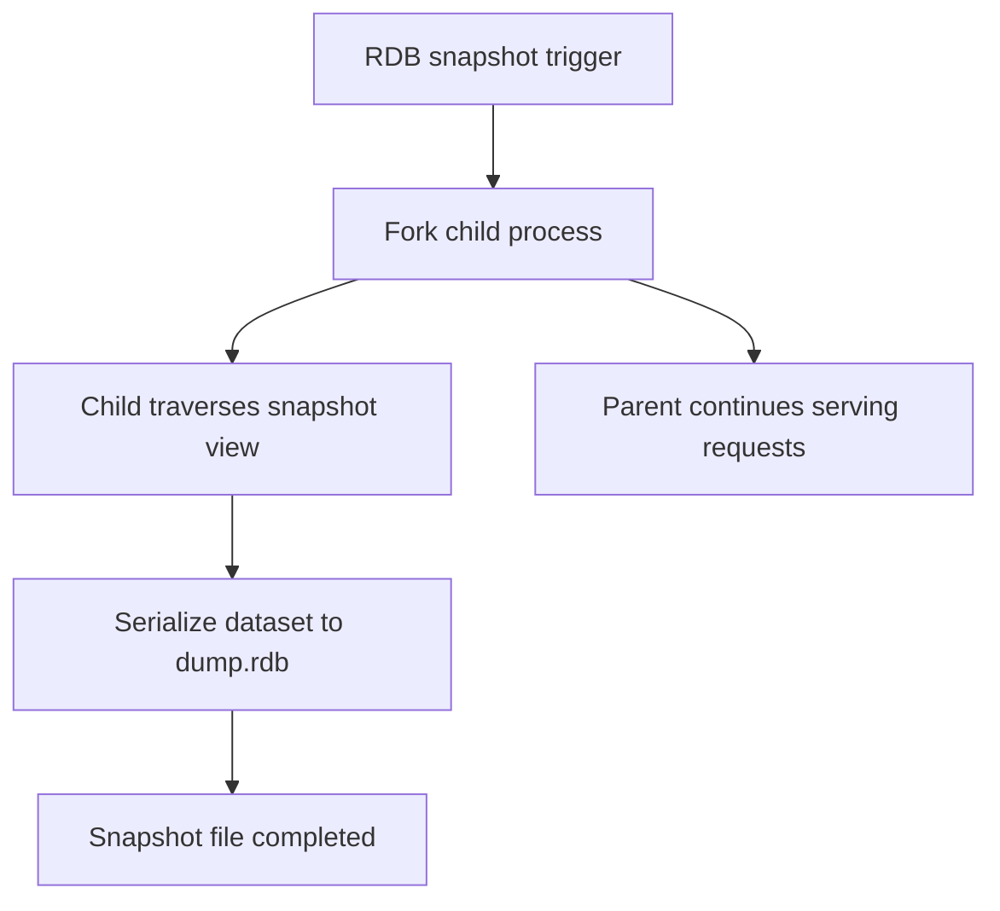

  

### Copy-on-write (COW)

  

The transcript describes how the parent and child initially share memory pages through the operating system's copy-on-write behavior. If the parent modifies a page while the child is taking the snapshot, the OS can make a private copy of that page so the child sees a consistent point-in-time view.

  

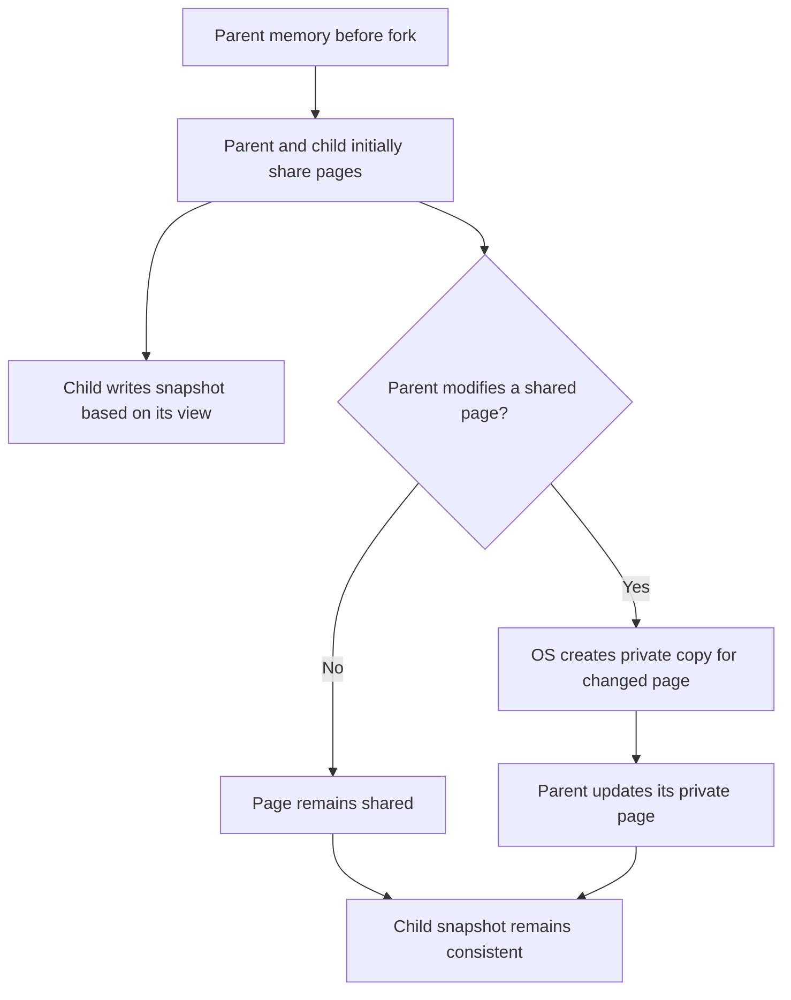

  

### RDB advantages in the video's framing

- Snapshot is a point-in-time image of the dataset.

- It produces a compact binary snapshot file.

- Loading the snapshot can rebuild in-memory state without replaying every historical write since the application's beginning.

  

### RDB trade-offs

- A crash after the last completed snapshot may lose writes made since that snapshot.

- Forking and writing the snapshot have CPU, disk I/O, and latency costs.

- Copy-on-write can increase memory usage while the child is alive, especially under write-heavy workloads.

- Snapshot duration and frequency should be measured with realistic data sizes.

  

**Example:** If snapshots are scheduled every five minutes and a failure happens four minutes after the last completed snapshot, the snapshot alone cannot recover the most recent four minutes of changes.

  

## 7.2 AOF — Append Only File

  

Instead of periodically storing only a point-in-time snapshot, AOF records write operations. On restart, Redis replays the log to reconstruct data.

  

The transcript's example concept:

- Insert value 2.

- Insert 3.

- Insert 4.

- Delete 4.

- Insert 5.

- Insert 6.

  

On replay, the final logical state includes 2, 3, 5, and 6, assuming these operations refer to the relevant logical structure and there are no other operations.

  

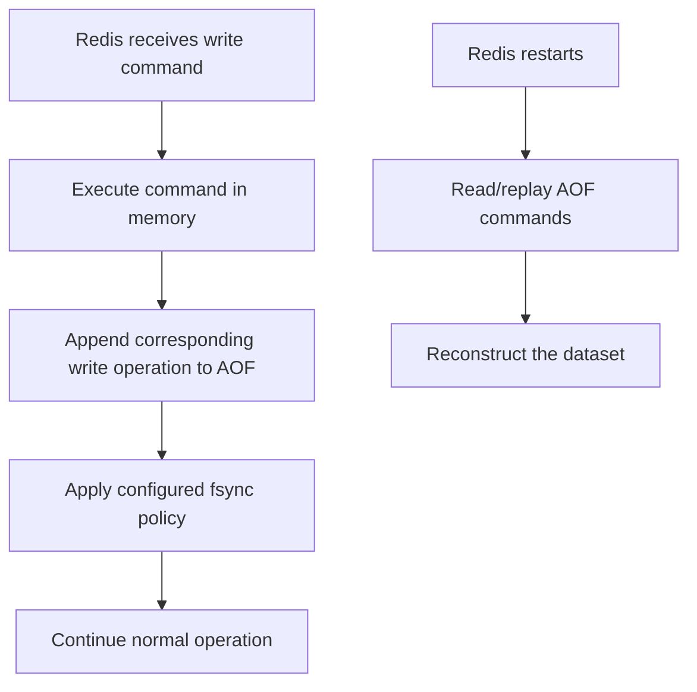

  

### AOF fsync policies described in the video

  

| Policy mentioned | Description | Main trade-off |

|---|---|---|

| `appendfsync always` | Request fsync after each write operation according to Redis's implementation | Stronger durability target, more write/latency overhead |

| `appendfsync everysec` | Fsync about once per second | Common compromise between durability and performance; recent writes may be lost in a failure |

| `appendfsync no` | Let the OS decide when to flush data | May reduce explicit sync overhead but gives less predictable durability |

  

A call to `write` or append and a successful `fsync` are not identical guarantees. Durability depends on the OS/filesystem/storage behavior as well as Redis configuration.

  

## 7.3 RDB vs. AOF

  

| Dimension | RDB | AOF |

|---|---|---|

| Primary idea | Snapshot of state at a point in time | Log of write operations |

| Recovery | Load the snapshot | Replay recorded operations |

| Main potential data-loss window | Changes after the last recoverable snapshot | Depends on append and fsync policy |

| File/space behavior | Snapshot of the dataset | Can grow with writes; rewrite/compaction behavior matters |

| Typical trade-off | Snapshot simplicity and compactness | Finer-grained recovery potential, with write/replay overhead |

  

## 7.4 Hybrid persistence as explained by the video

  

The speaker describes a combination of RDB and AOF: a snapshot provides a base state, and subsequent write operations can be replayed from that point rather than replaying the entire historical log from the beginning.

  

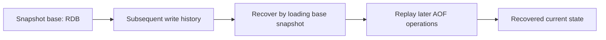

  

This is the conceptual benefit of combining snapshot and operation-log approaches. Exact hybrid formats and behavior vary by Redis version/configuration, so describe the concept rather than asserting one sequence as universal for all Redis 7 deployments.

  

## 7.5 How to choose persistence settings

  

Ask:

1. Is Redis being used as a disposable cache or for important state?

2. How much recent data loss is acceptable?

3. How much extra write latency is acceptable?

4. How long can a restart take while the dataset is reconstructed?

5. Can the machine sustain snapshots and copy-on-write overhead?

6. Is persistence combined with backups, replication, and tested recovery?

  

**Do not confuse persistence with replication.** Persistence creates recoverable on-disk state; replication maintains copies on other Redis nodes. They protect against different failure modes. Distributed replication/high availability is explicitly outside this video's scope.

  

---

  

# 8. End-to-end write command path

  

The video brings the components together with a write operation such as setting a user key to a string value.

  

Conceptual flow:

1. The application calls its Redis client library.

2. The client encodes the command into RESP.

3. The command bytes arrive on a TCP socket.

4. The kernel's readiness mechanism (the video uses Linux `epoll`) signals that the socket is ready.

5. The event loop reads and parses the command.

6. Redis dispatches the command to the relevant command implementation.

7. The keyspace dictionary locates/updates the key; Redis creates or updates an object/value representation as needed.

8. If persistence is configured, the write is recorded according to RDB/AOF behavior and scheduling.

9. Redis serializes the reply and sends it to the client.

  

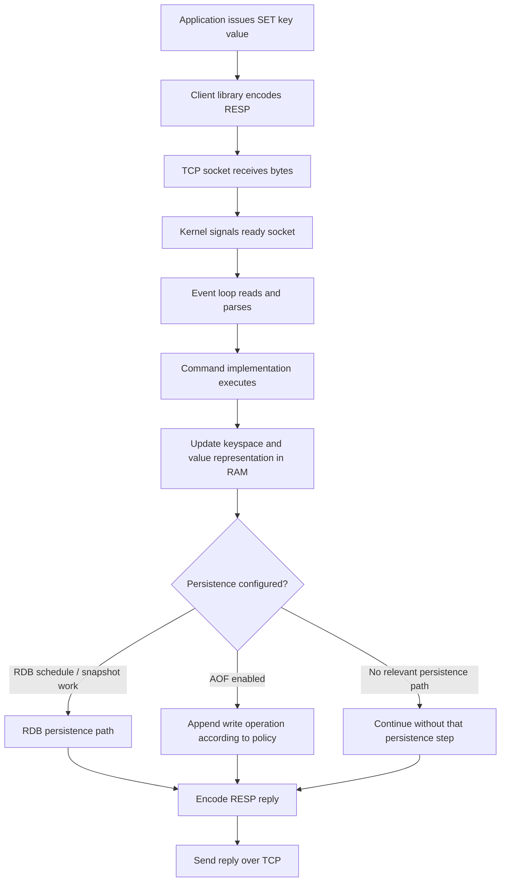

  

This drawing is an educational view. The exact ordering of command execution, AOF recording, replication propagation, and reply generation depends on Redis version and implementation details. The important architecture layers are protocol, I/O readiness, command execution, in-memory state, persistence policy, and reply encoding.

  

## 8.1 Example command-level practice

  

These are Redis command examples for practice, not a replacement for the video’s internal architecture model:

  

```text

SET user:1 Alice

GET user:1

  

HSET user:1 name Alice age 29

HGET user:1 name

HGETALL user:1

  

ZADD leaderboard 900 player:1

ZADD leaderboard 1200 player:2

ZREVRANGE leaderboard 0 9 WITHSCORES

```

  

The different command families operate on different Redis data types:

- `SET` / `GET`: string key/value operations.

- `HSET` / `HGET` / `HGETALL`: hash operations.

- `ZADD` / `ZREVRANGE`: sorted-set operations.

  

---

  

# 9. Lazy freeing (`UNLINK`-style idea)

  

The transcript ends with **lazy free**. It describes a large deletion, such as removing a key that refers to a sorted set with many members.

  

If freeing every memory allocation synchronously blocks the main command path, other clients may see increased latency. Lazy freeing separates removing the key from the keyspace from actually reclaiming the large value's memory.

  

Conceptual steps:

1. Redis removes/unlinks the key from the keyspace so it is no longer discoverable by normal lookups.

2. The command can complete without waiting for all the value's memory to be recursively freed.

3. Background work reclaims the detached memory.

  

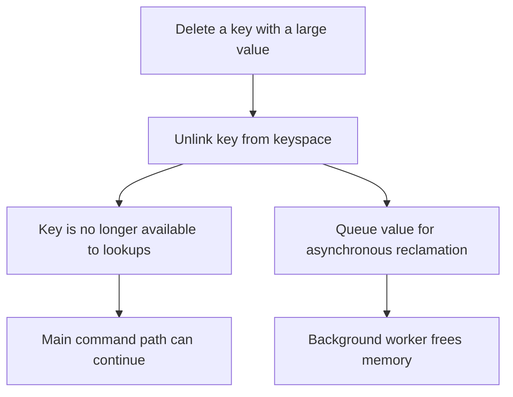

  

### Why it matters

- Large collections can take noticeable time to destroy.

- Avoiding long deallocation work on the command path can reduce latency spikes.

- Background reclamation still consumes CPU and memory until freeing is completed.

  

Redis offers different deletion behavior depending on the command and options. The transcript's concept is “detach now, reclaim later”; do not assume every deletion command automatically uses the same lazy-free behavior.

  

---

  

# 10. Flowchart — complete single-node architecture from the video

  

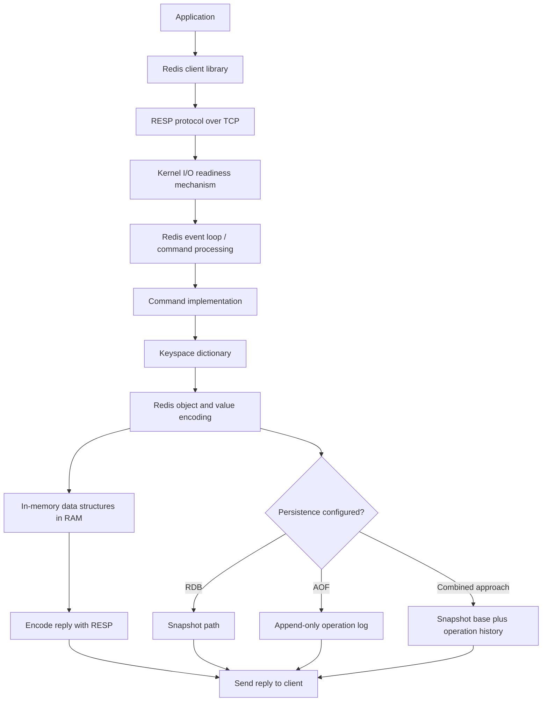

  

This diagram summarizes only the single-node internals covered by the transcript. It does not depict Redis Cluster, primary/replica topology, Sentinel/failover, distributed locking, or partitioning; the speaker says those topics are left for a later video.

  

---

  

# 11. Redis system-design interview questions

  

## Core architecture

**Q: Why is Redis fast?**  

A: Its active data structures are in memory; simple commands can avoid disk access, and the event-driven I/O architecture reduces the overhead of a thread-per-connection design. Internal encodings also aim to reduce memory and lookup overhead.

  

**Q: What is Redis most commonly used for in the video's framing?**  

A: A low-latency cache between an application server and a more durable data source, plus use cases such as counters, leaderboards, and gaming state.

  

**Q: What is a cache hit vs. cache miss?**  

A: A hit finds a usable entry; a miss requires a fallback source or computation and may trigger cache population.

  

## RESP and event loop

**Q: What is RESP?**  

A: The Redis serialization protocol used to frame requests and replies between client and server.

  

**Q: What do `+`, `-`, `:`, `$`, and `*` signify in the examples?**  

A: Simple string, error, integer, bulk string, and array, respectively.

  

**Q: What is `epoll_wait`?**  

A: A Linux interface that waits for ready file descriptors. It is part of the I/O-readiness mechanism used by an event-driven loop; it is not itself the entire event loop.

  

**Q: How can one main command thread support many connections?**  

A: Many sockets can be monitored by the kernel; the event loop processes sockets when they become ready rather than creating one command-execution thread for every client.

  

## Storage and memory

**Q: Does Redis use one fixed representation for every logical value?**  

A: No. The video emphasizes that internal encodings can vary by data type and size.

  

**Q: What is SDS?**  

A: Redis's Simple Dynamic String representation for managing string data.

  

**Q: What is the difference between EMBSTR and RAW in the video's example?**  

A: EMBSTR is a compact representation used for short strings; RAW uses a separate string allocation. The threshold is implementation/version dependent.

  

**Q: Why can compact hashes convert to a different encoding?**  

A: To balance low memory overhead for small collections against lookup and update behavior as collections grow.

  

**Q: Why can sorted sets use both a dictionary and skip list?**  

A: The dictionary supports member lookup, while the skip list maintains score order and supports rank/range operations.

  

## Persistence

**Q: RDB vs. AOF?**  

A: RDB stores point-in-time snapshots; AOF records write operations that can be replayed to reconstruct state.

  

**Q: What is copy-on-write?**  

A: After a fork, parent and child initially share pages. When a shared page is modified, the OS creates a private copy so the snapshot child can continue to observe its original view.

  

**Q: What is the main RDB trade-off?**  

A: Efficient snapshot recovery, but changes after the last recoverable snapshot can be lost; snapshotting can also incur fork and copy-on-write memory overhead.

  

**Q: What does `appendfsync everysec` attempt to balance?**  

A: Durability against write/latency overhead by syncing approximately once per second; a failure can still lose a recent window of data.

  

## Lazy free

**Q: Why is lazy freeing useful?**  

A: It can unlink a large value from normal key lookups promptly and reclaim its memory asynchronously, reducing deallocation work on the main command path.

  

---

  

# 12. Practical Redis checklist

  

Before using Redis in an application or proposing it in an interview, establish:

  

### Workload and capacity

- Expected commands/second and read/write ratio

- Key count, value sizes, collection sizes, TTL distributions

- p95/p99 latency target and network distance

- Memory overhead and safety headroom

  

### Data correctness

- Is Redis a disposable cache or the authoritative store for this workload?

- Can a key be evicted?

- How stale can a cached value be?

- How is cache invalidation or refresh performed?

- What does the application do on miss or Redis outage?

  

### Persistence and recovery

- Is RDB, AOF, or a combined persistence approach configured?

- What is the tolerated recovery point (recent-data-loss window)?

- What happens to latency and memory during snapshots?

- Have restart/recovery procedures been tested?

- Is replication required in addition to persistence?

  

### Operations

- Monitor latency, memory, fragmentation, evictions, rejected writes, hit/miss ratio and persistence status.

- Set timeouts and bounded retries in the client.

- Avoid unbounded pipelines or request queues.

- Consider large-key deletion and lazy reclamation.

- Load test using the same command mix, value sizes, and persistence configuration as expected in production.

  

---

  

# 13. Precision notes — claims to phrase carefully

  

This section distinguishes useful ideas from details that should not be memorized as universal facts.

  

1. **“Redis stores everything only in RAM.”** Active data structures are memory-resident in the model taught here, but Redis also has RDB/AOF persistence, and memory-backed operation does not imply data can never be recovered after restart.

2. **“Redis is never a database.”** The speaker presents Redis primarily as a cache and advises treating it as non-primary in the introductory model. More generally, Redis can be configured with persistence and used as a datastore for suitable workloads. Choose according to durability, consistency, recovery and data-model requirements.

3. **“100K–500K ops/sec and under 1 ms.”** These are the video's rough numbers, not universal guarantees. Workload, commands, data sizes, hardware, network, pipelining and persistence affect results.

4. **“One thread.”** The core command path is the focus of the video; background work can use child processes or threads, and networking/background capabilities differ by release/configuration.

5. **RESP is plain readable ASCII.** RESP has readable framing markers in common examples, but it is length-framed and binary-safe; payloads are not restricted to human-readable ASCII strings.

6. **EMBSTR under 44 bytes.** The video gives this illustrative threshold, but internal encoding details and thresholds can depend on Redis version/build. Treat them as implementation details, not public API guarantees.

7. **Hash threshold of 128 entries and 64 bytes.** These are the video’s stated values; threshold defaults and associated configuration names vary across Redis versions. Confirm the actual deployment version/configuration before tuning.

8. **RDB doesn't block the parent.** A forked child can let the parent continue serving, but fork cost, copy-on-write, disk I/O, CPU use, and memory pressure can still cause measurable impact.

9. **AOF every second means exactly one second of loss.** `everysec` is an approximate durability target, not an absolute guarantee. OS/filesystem and failure modes matter.

10. **Redis version 7 hybrid persistence.** The transcript describes an RDB-plus-AOF combination. Exact implementation and defaults depend on release and configuration; explain the concept of snapshot base plus subsequent operations rather than overgeneralizing every version.

11. **“Eviction policy belongs to each object.”** The object can hold access metadata that helps estimate recency/frequency; the server's configured memory policy governs eviction behavior.

12. **Cluster and replication are not covered in this video.** The transcript explicitly defers replication/high availability, Redis Cluster, hot keys and distributed locks to a possible second part. Do not attribute a full distributed Redis design to this video.

  

---

  

# Final mental model

  

- **RESP:** Framing language between the client library and Redis server.

- **Event loop/reactor:** Use OS readiness notification to process sockets efficiently without a thread per connection.

- **In-memory data structures:** Keep active values in RAM; use compact or larger internal encodings as appropriate.

- **Memory policy:** Dataset sizing, eviction, and TTL must match the meaning of stored keys.

- **RDB:** Snapshot-based recovery.

- **AOF:** Reconstruct state by replaying logged write operations.

- **COW:** Allows snapshot child and serving parent to observe appropriate views of memory, at a possible memory/latency cost.

- **Lazy free:** Detach a large value from the keyspace promptly and reclaim it asynchronously when supported.

- **Distributed Redis:** Replication, failover, Cluster, hot-key mitigation and distributed locks are important follow-up topics, but this transcript does not teach them in detail.

  

The strongest interview answer connects Redis's speed to its memory model, efficient I/O readiness, command-processing path, and internal encodings—then honestly explains the trade-offs in capacity, eviction, durability, and recovery.