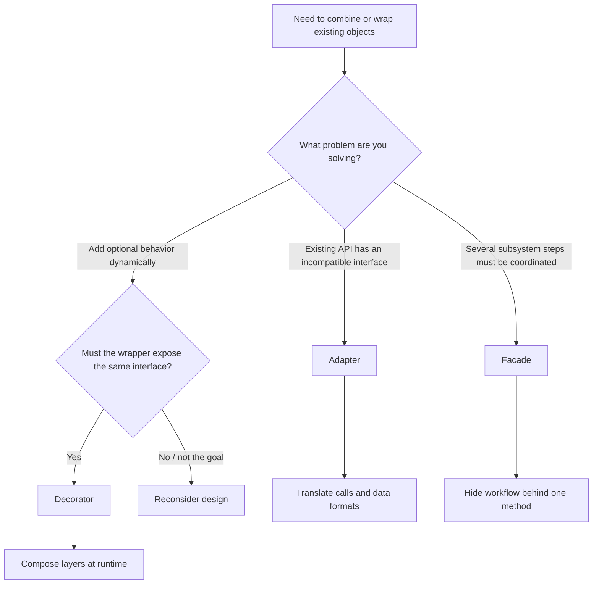
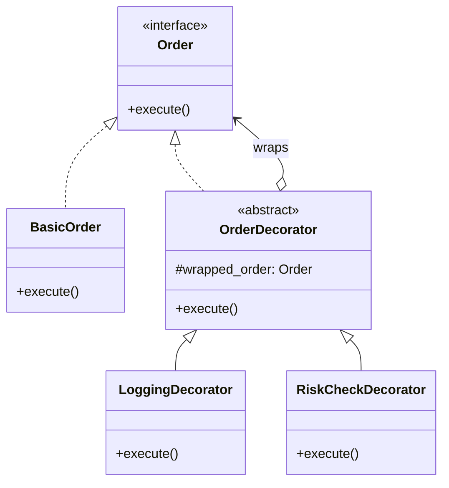
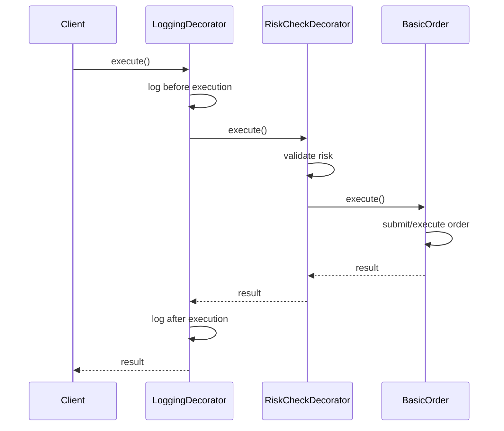
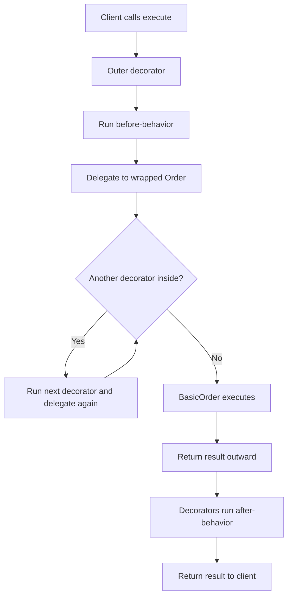
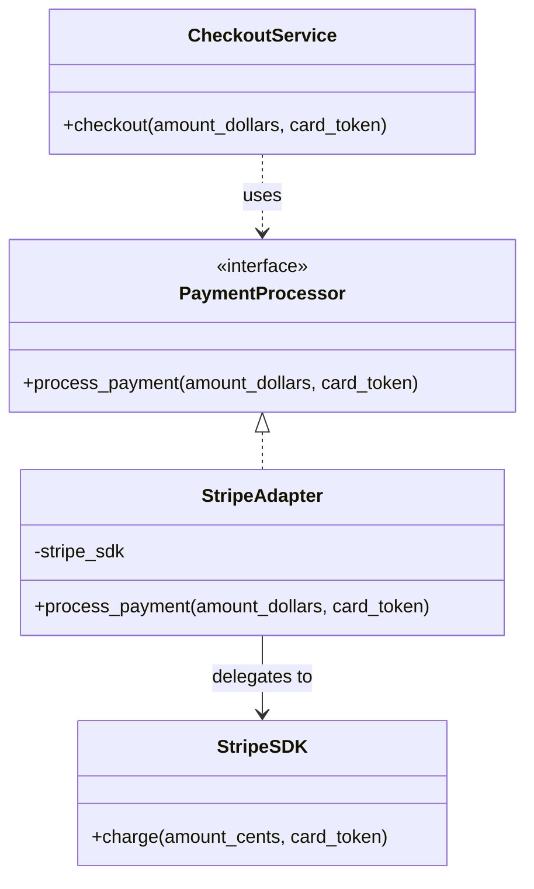
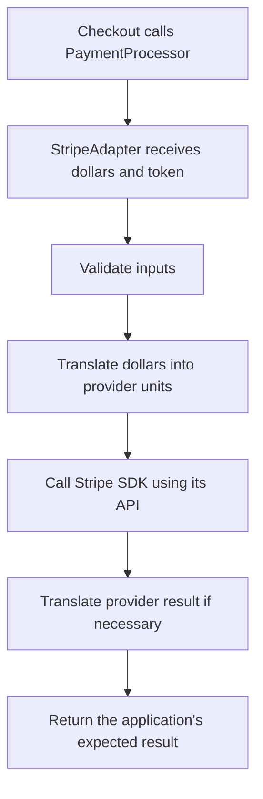
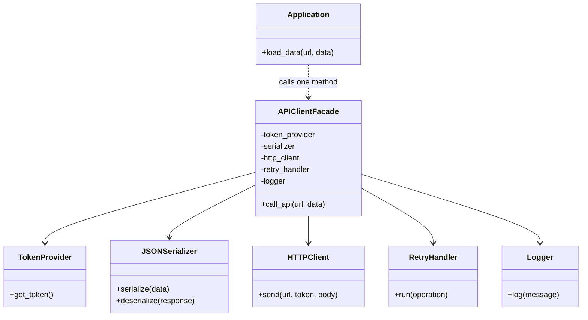
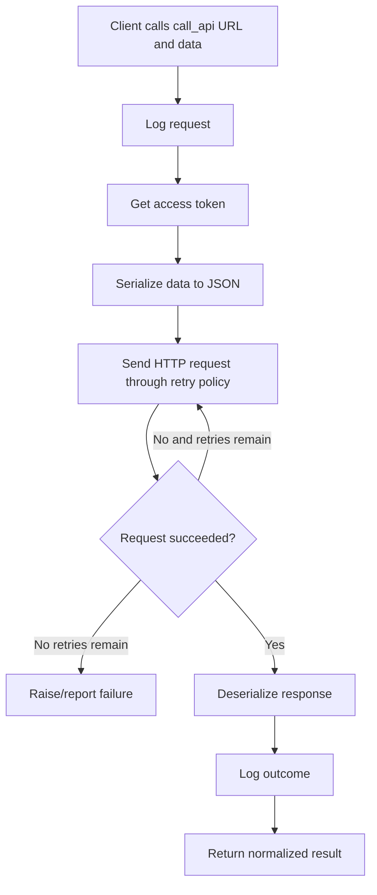
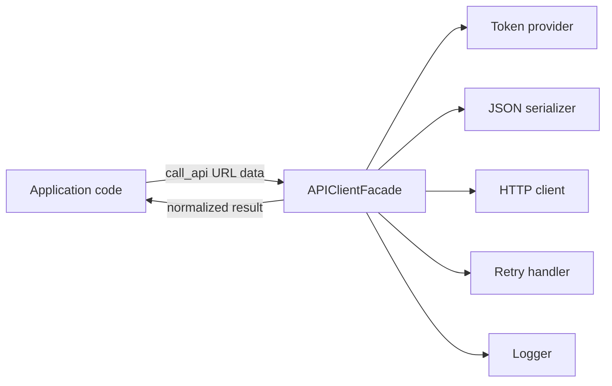
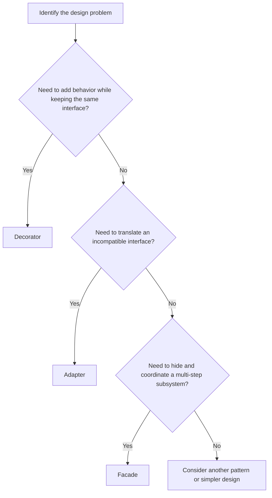

## Based on “Structural Design Patterns Explained: Decorator, Adapter & Facade”

  

These notes follow the video’s core framing and examples, then add clearly labeled implementation guidance, practical checks, and exercises to make the ideas usable in real code and low-level design (LLD) interviews.

  

---

  

## 1. What are structural design patterns?

  

**Creational patterns** focus on how objects are created. **Structural patterns** focus on how existing objects/classes are combined and arranged so that the code remains understandable and changeable.

  

The video introduces the seven classical structural patterns:

  

1. Decorator

2. Adapter

3. Facade

4. Bridge

5. Composite

6. Flyweight

7. Proxy

  

This video focuses on the first three: **Decorator, Adapter, and Facade**.

  

### The central question

  

> How can I combine or wrap objects cleanly without creating a mess?

  

A useful first-pass distinction:

  

- **Decorator:** Add optional behavior around an object while preserving the same interface.

- **Adapter:** Translate one interface into another interface the client already expects.

- **Facade:** Offer one simple entry point over a multi-part subsystem.

  

---

  

## 2. Pattern selection flowchart

  



  

**Interview tip:** State the problem first, name the pattern second, and explain the object relationships third.

  

---

  

# Part I — Decorator Pattern

  

## 3. Decorator: the problem it solves

  

The video uses a stock-trading order system. An order may need some combination of:

  

- Logging

- Risk checks

- Rate limiting

- Notifications

  

Different requests may need different combinations, and the choice can be made at runtime.

  

### The naive solution: a subclass for every combination

  

Suppose each feature can independently be enabled or disabled. With \(n\) binary features, the number of possible combinations is:

  

\[

2^n

\]

  

| Independent features | Possible combinations |

|---:|---:|

| 1 | 2 |

| 2 | 4 |

| 3 | 8 |

| 4 | 16 |

| 5 | 32 |

| 10 | 1,024 |

  

For example, with logging and risk checking, one might create `BasicOrder`, `LoggingOrder`, `RiskCheckedOrder`, and `LoggingAndRiskCheckedOrder`. Adding rate limiting and notifications makes this approach grow quickly.

  

This is **combinatorial explosion**: each new independent feature can multiply the number of combinations.

  

## 4. Decorator’s core idea

  

Instead of making a subclass for every combination, wrap one object with layers that each add one responsibility.

  

Each decorator:

1. Implements the same interface as the object it wraps.

2. Stores a reference to a wrapped object.

3. Performs its own behavior.

4. Delegates the main operation to the wrapped object.

  

### Structure

  



  

The critical relationship is that **a decorator is also an `Order`**. The caller can use a plain order or a decorated order through the same interface.

  

## 5. Decorator execution flow

  

For this composition:

  

```python

order = LoggingDecorator(

    RiskCheckDecorator(

        BasicOrder()

    )

)

order.execute()

```

  

The call travels from the outside inward:

  



  

**Order matters.** The outer decorator runs first on the way in. After it delegates, the inner object runs. On the way back out, outer decorators can perform post-processing.

  

For example, `Logging(RiskCheck(BasicOrder))` means logging begins first, then risk checks, then the base order. Reversing the wrappers changes the behavior order.

  

## 6. Practical Python implementation

  

The following is a small runnable illustration. The risk rule and logging are examples; a production trading system needs domain-specific validation, audit logging, and error handling.

  

```python

from abc import ABC, abstractmethod

  
  

class Order(ABC):

    @abstractmethod

    def execute(self) -> str:

        """Execute the order and return a result."""

        raise NotImplementedError

  
  

class BasicOrder(Order):

    def __init__(self, symbol: str, quantity: int):

        if not symbol:

            raise ValueError("symbol must not be empty")

        if quantity <= 0:

            raise ValueError("quantity must be positive")

        self.symbol = symbol

        self.quantity = quantity

  

    def execute(self) -> str:

        # Replace this with the actual execution boundary.

        return f"Executed {self.quantity} shares of {self.symbol}"

  
  

class OrderDecorator(Order):

    def __init__(self, wrapped: Order):

        self._wrapped = wrapped

  

    def execute(self) -> str:

        return self._wrapped.execute()

  
  

class LoggingDecorator(OrderDecorator):

    def execute(self) -> str:

        print("[LOG] Order execution started")

        try:

            result = self._wrapped.execute()

            print("[LOG] Order execution succeeded")

            return result

        except Exception:

            print("[LOG] Order execution failed")

            raise

  
  

class RiskCheckDecorator(OrderDecorator):

    def execute(self) -> str:

        print("[RISK] Validating order")

        # Illustrative check only. Real checks need access to order details

        # and a carefully defined policy.

        return self._wrapped.execute()

  
  

class RateLimitDecorator(OrderDecorator):

    def execute(self) -> str:

        # Real rate limiting should use a token bucket, leaky bucket,

        # or a shared limiter appropriate to the deployment.

        print("[RATE LIMIT] Request permitted")

        return self._wrapped.execute()

  
  

base = BasicOrder("AAPL", 10)

order = LoggingDecorator(

    RateLimitDecorator(

        RiskCheckDecorator(base)

    )

)

print(order.execute())

```

  

Example output order:

  

```text

[LOG] Order execution started

[RATE LIMIT] Request permitted

[RISK] Validating order

[LOG] Order execution succeeded

Executed 10 shares of AAPL

```

  

The exact output order follows the wrapper nesting. Notice that the logging decorator prints before and after its wrapped call.

  

### Add or remove a feature at runtime

  

```python

base = BasicOrder("AAPL", 10)

  

plain = base

logged = LoggingDecorator(base)

risk_checked = RiskCheckDecorator(base)

logged_and_checked = LoggingDecorator(RiskCheckDecorator(base))

```

  

No new subclass is needed for every combination.

  

## 7. Decorator flowchart

  



  

## 8. Decorator vocabulary

  

| Term | Meaning in the trading example |

|---|---|

| Component interface | `Order`, declaring `execute()` |

| Concrete component | `BasicOrder`, doing the core operation |

| Base decorator | `OrderDecorator`, storing/wrapping another `Order` |

| Concrete decorator | `LoggingDecorator`, `RiskCheckDecorator`, `RateLimitDecorator` |

| Wrapped object | The inner `Order` passed to a decorator |

  

## 9. When Decorator is a good fit

  

Use it when:

- Features are optional and can be combined.

- You need to select behavior at runtime.

- Multiple responsibilities can be represented as independent layers.

- The wrapped object and decorator should be interchangeable from the caller’s point of view.

  

Avoid it when:

- There are only one or two fixed behaviors and a simple function is clearer.

- The wrapper chain becomes so deep that debugging is difficult.

- Decorators have hidden ordering dependencies that are not documented.

- A decorator changes the meaning of the interface rather than preserving its contract.

  

### Real-world applications

- Request logging and tracing middleware

- Compression and encryption streams

- Authorization or validation layers

- Caching around a service call

- Retry/metrics wrappers (where ordering and retry safety are carefully designed)

  

### Practical implementation notes

- Decide and document the order of decorators.

- Preserve return values and exceptions unless the decorator intentionally changes them.

- Do not silently swallow errors in a logging decorator.

- Be careful with retries around non-idempotent operations such as charging a payment or placing an order.

- Keep decorators focused on one responsibility.

- If decorators need information from the component, expose it through a stable interface rather than reaching into private fields.

  

### Decorator testing checklist

- Plain component works without decorators.

- Each decorator works individually.

- Multiple decorators compose correctly.

- The call order is correct.

- Return values propagate unchanged.

- Exceptions propagate as expected.

- Optional features can be added or removed without changing the core component.

  

---

  

# Part II — Adapter Pattern

  

## 10. Adapter: the problem it solves

  

The video uses a payment gateway example.

  

Your application expects a payment interface such as:

  

```python

process_payment(amount_dollars, card_token)

```

  

But a third-party SDK might expose a different API, such as:

  

```python

stripe.charge(amount_cents, card_token)

```

  

The client and provider speak different “interface languages.” You may not control the third-party SDK, and you do not want provider-specific details spread throughout the application.

  

An **Adapter** translates between the interface the client expects and the interface the existing service provides.

  

## 11. Adapter structure

  



  

### Roles

  

| Term | Meaning |

|---|---|

| Client | Checkout code that wants a consistent payment interface |

| Target | `PaymentProcessor`, the interface the client expects |

| Adapter | `StripeAdapter`, implementing the target and translating calls |

| Adaptee | The existing `StripeSDK`, whose interface does not match |

  

**Memory hook:** Decorator adds behavior; Adapter changes the interface presented to the client.

  

## 12. Naive approach and its cost

  

A naive implementation may convert dollars to cents and call the SDK at every checkout call site:

  

```python

stripe.charge(round(amount_dollars * 100), card_token)

```

  

That may seem harmless in one place. If repeated across many files, provider-specific details become scattered. If the provider changes its method signature or amount representation, every call site may need updates. A missed conversion can also cause a bug.

  

The adapter centralizes the translation in one place.

  

## 13. Practical Python implementation

  

This is an illustrative fake SDK; it does not call a real payment provider.

  

```python

from abc import ABC, abstractmethod

from decimal import Decimal, ROUND_HALF_UP

  
  

class PaymentProcessor(ABC):

    @abstractmethod

    def process_payment(

        self, amount_dollars: Decimal, card_token: str

    ) -> bool:

        raise NotImplementedError

  
  

class FakeStripeSDK:

    def charge(self, amount_cents: int, card_token: str) -> bool:

        if amount_cents <= 0:

            return False

        if not card_token:

            return False

        print(f"Fake Stripe charge: {amount_cents} cents")

        return True

  
  

class StripeAdapter(PaymentProcessor):

    def __init__(self, stripe_sdk: FakeStripeSDK):

        self._stripe_sdk = stripe_sdk

  

    def process_payment(

        self, amount_dollars: Decimal, card_token: str

    ) -> bool:

        if amount_dollars <= Decimal("0"):

            raise ValueError("amount must be positive")

        if not card_token:

            raise ValueError("card token is required")

  

        amount_cents = int(

            (amount_dollars * 100).quantize(

                Decimal("1"), rounding=ROUND_HALF_UP

            )

        )

        return self._stripe_sdk.charge(amount_cents, card_token)

  
  

class CheckoutService:

    def __init__(self, processor: PaymentProcessor):

        self._processor = processor

  

    def checkout(self, amount_dollars: Decimal, card_token: str) -> bool:

        # Checkout knows only the application's target interface.

        return self._processor.process_payment(amount_dollars, card_token)

  
  

sdk = FakeStripeSDK()

processor = StripeAdapter(sdk)

checkout = CheckoutService(processor)

  

success = checkout.checkout(Decimal("49.99"), "tok_example")

print("Payment successful:", success)

```

  

Expected behavior: the checkout service passes `Decimal("49.99")`; the adapter converts it to `4999` cents and calls the SDK. The example uses `Decimal` to avoid common binary floating-point surprises with money.

  

**Production payment warning:** Do not build a real payment integration from this toy example alone. Use the provider’s official SDK and documentation, follow its currency/minor-unit rules, use idempotency keys, validate payment state server-side, and never log secrets or raw card data.

  

## 14. Adapter flowchart

  



  

## 15. Adapter variants and implementation choices

  

The video demonstrates an object adapter: the adapter **contains** an SDK object and delegates to it. This is usually a flexible approach because the adapter can wrap an existing object.

  

An adapter may translate:

- Method names (`process_payment` → `charge`)

- Argument order or shape

- Units (dollars → cents)

- Data formats (XML → JSON)

- Return types or error representations

- Protocols or vendor-specific models

  

### Practical implementation notes

- Keep the provider-specific code inside the adapter.

- Make the application depend on the target interface, not on the vendor SDK.

- Translate errors deliberately; do not turn every failure into a generic success/failure without preserving useful context.

- Validate units, currencies, and rounding rules explicitly.

- Avoid leaking provider-specific types through the application interface.

- Use dependency injection so a fake adapter can be supplied in tests.

- If switching providers, create another adapter that implements the same target interface.

  

### Adapter testing checklist

- Correct unit conversion (e.g., 49.99 → 4999 minor units for a two-decimal currency).

- Boundary cases and rounding behavior.

- Invalid input handling.

- SDK success and failure mapping.

- Provider exceptions are translated or propagated according to policy.

- Client code works against the interface without knowing the concrete SDK.

  

### When not to use Adapter

If you control both sides and can safely make their interfaces consistent directly, a wrapper may be unnecessary. Also avoid an adapter that becomes a large “god object” translating dozens of unrelated concepts; split it by responsibility.

  

---

  

# Part III — Facade Pattern

  

## 16. Facade: the problem it solves

  

The video’s example is an API client that must coordinate multiple subsystem objects in the correct order:

  

1. Obtain an access token.

2. Serialize request data to JSON.

3. Send an HTTP request.

4. Retry according to policy if needed.

5. Parse/deserialize the response.

6. Log the call.

  

If every caller repeats those steps, code is duplicated and easy to get wrong. One caller may forget retries or logging, or execute the steps in the wrong order.

  

A **Facade** offers a simple high-level method that coordinates the subsystem on behalf of the caller.

  

## 17. Facade structure

  



  

Unlike the decorator example, the facade does **not** need to implement the same interface as every subsystem class. It provides a simpler, higher-level interface over them.

  

## 18. Facade workflow

  



  

The precise order is a design decision. The diagram illustrates one reasonable sequence; the video emphasizes that the facade centralizes and protects the required workflow. A real API client should follow the protocol and security requirements of its service.

  

## 19. Practical Python implementation

  

This is a runnable structural illustration with fake subsystem objects. The HTTP client is simulated; it makes no network requests.

  

```python

import json

import logging

from typing import Any

  
  

class TokenProvider:

    def get_token(self) -> str:

        return "demo-token"

  
  

class JSONSerializer:

    def serialize(self, data: dict[str, Any]) -> str:

        return json.dumps(data)

  

    def deserialize(self, response_body: str) -> dict[str, Any]:

        return json.loads(response_body)

  
  

class FakeHTTPClient:

    def send(self, url: str, token: str, body: str) -> str:

        # Simulate a successful response from a remote service.

        if not url.startswith(("https://", "http://")):

            raise ValueError("URL must use HTTP or HTTPS")

        if not token:

            raise RuntimeError("Missing token")

        return json.dumps({"ok": True, "echo": json.loads(body)})

  
  

class RetryHandler:

    def __init__(self, max_attempts: int = 3):

        if max_attempts < 1:

            raise ValueError("max_attempts must be at least 1")

        self.max_attempts = max_attempts

  

    def run(self, operation):

        last_error = None

        for attempt in range(self.max_attempts):

            try:

                return operation()

            except (TimeoutError, ConnectionError) as exc:

                last_error = exc

                if attempt == self.max_attempts - 1:

                    raise

        raise last_error  # Defensive; loop normally returns or raises.

  
  

class APIClientFacade:

    def __init__(self, token_provider, serializer, http_client,

                 retry_handler, logger=None):

        self._token_provider = token_provider

        self._serializer = serializer

        self._http_client = http_client

        self._retry_handler = retry_handler

        self._logger = logger or logging.getLogger(__name__)

  

    def call_api(self, url: str, data: dict[str, Any]) -> dict[str, Any]:

        self._logger.info("API request started: %s", url)

        token = self._token_provider.get_token()

        body = self._serializer.serialize(data)

  

        response_body = self._retry_handler.run(

            lambda: self._http_client.send(url, token, body)

        )

        result = self._serializer.deserialize(response_body)

        self._logger.info("API request completed: %s", url)

        return result

  
  

client = APIClientFacade(

    token_provider=TokenProvider(),

    serializer=JSONSerializer(),

    http_client=FakeHTTPClient(),

    retry_handler=RetryHandler(max_attempts=3),

)

  

result = client.call_api(

    "https://example.test/items",

    {"item_id": 42, "active": True},

)

print(result)

```

  

### Important note about retries

  

The sample retries only `TimeoutError` and `ConnectionError`. It is intentionally minimal. In a real client:

- Retry only appropriate failures.

- Use backoff and jitter.

- Respect server retry hints such as `Retry-After` when applicable.

- Avoid blindly retrying non-idempotent operations.

- Set timeouts and cancellation behavior.

- Ensure logs do not expose tokens, credentials, or sensitive payloads.

  

## 20. Facade flowchart: caller view vs subsystem view

  



  

The caller sees one method. The facade coordinates several objects internally.

  

## 21. Facade vocabulary

  

| Term | Meaning |

|---|---|

| Client | Application code that needs to make an API call |

| Facade | `APIClientFacade`, the simplified entry point |

| Subsystem classes | Token provider, serializer, HTTP client, retry handler, logger |

| Facade method | `call_api(url, data)`, hiding the orchestration |

  

### Practical implementation notes

- Keep the facade’s public API small and task-oriented.

- Inject subsystem dependencies where it helps testing and configuration.

- Keep subsystem classes independently testable.

- Avoid turning the facade into a giant class with unrelated workflows; use multiple focused facades if needed.

- A facade simplifies access but should not necessarily forbid advanced callers from using subsystem APIs when that is part of the intended architecture.

- Make ordering, error handling, retry policy, and result normalization explicit.

  

### Facade testing checklist

- The facade invokes the required steps in the correct order.

- Success returns the expected normalized result.

- Failures from token retrieval, serialization, HTTP, retry exhaustion, and parsing are handled correctly.

- Retries occur only for eligible failures.

- Logging happens at the intended points and contains no secrets.

- Callers can use the facade without knowing the subsystem sequence.

  

---

  

# Part IV — Compare the three patterns

  

## 22. Quick comparison table

  

| Question | Decorator | Adapter | Facade |

|---|---|---|---|

| Main problem | Need optional behavior layers | Interfaces are incompatible | Subsystem is complex to use |

| Main intent | Add behavior | Translate interface | Simplify and coordinate |

| Same interface as wrapped/target? | Yes, normally | Implements the client’s target interface | Not required |

| Typical relationship | Wrapper contains a component | Adapter contains/delegates to adaptee | Facade uses several subsystem objects |

| Example in the video | Trading order with logging/risk/rate limits | Dollars-to-cents payment adapter | API client coordinating token/JSON/HTTP/retry/logging |

| Runtime composition | Strong fit | Usually select/configure adapter | Usually one higher-level entry point |

| Main danger | Confusing order/deep wrapper chain | Provider details leaking outside adapter | Facade becoming a god object |

  

## 23. The three-question interview test

  



  

A concise interview answer:

  

- **Decorator:** “I wrap an object with another object that implements the same interface, so I can add behavior dynamically and compose features.”

- **Adapter:** “I implement the interface my client expects and translate calls/data to the interface of an existing incompatible service.”

- **Facade:** “I expose a simple high-level operation that coordinates multiple subsystem classes in the correct order.”

  

---

  

# Part V — UML and code-review thinking

  

## 24. What to draw in an LLD interview

  

### Decorator

Draw:

- A component interface

- A concrete component

- An abstract/base decorator implementing the same interface

- A reference from decorator to component

- Concrete decorators inheriting from the base decorator

  

Explain that inheritance defines the shared interface, while **composition** builds combinations.

  

### Adapter

Draw:

- Client depending on a target interface

- Adapter implementing that target interface

- Adapter holding/delegating to the adaptee

  

Explain where translation occurs and what the client is shielded from.

  

### Facade

Draw:

- Client calling one facade method

- Facade depending on several subsystem classes

- A result returned to the client

  

Explain which sequence and policy decisions the facade owns.

  

## 25. Common mistakes

  

1. **Calling every wrapper a Decorator.** If the main purpose is interface translation, it is an Adapter.

2. **Calling every helper class a Facade.** A facade specifically simplifies access to a subsystem or coordinates subsystem operations.

3. **Using inheritance for every feature combination.** Decorator is often better when features need independent runtime composition.

4. **Putting provider-specific conversions throughout the app.** Centralize them in the adapter.

5. **Repeating a multi-step workflow at every call site.** A facade can make the workflow consistent.

6. **Ignoring ordering.** Decorator order affects nested execution; facade step order affects correctness.

7. **Making the abstraction more complex than the problem.** A pattern is useful only when it reduces coupling or complexity.

8. **Overclaiming what a pattern guarantees.** A facade does not automatically make a system secure or reliable; an adapter does not automatically guarantee correct currency handling; a decorator does not automatically make a behavior safe.

  

---

  

# Part VI — Practice and mastery

  

## 26. Scenario identification drills

  

Choose Decorator, Adapter, or Facade and justify your choice.

  

1. Add request timing and metrics around an existing `Repository` without changing callers.

2. A legacy tax library uses `calculate_tax_cents()`, but the application expects `calculate_tax(amount)`.

3. A report-generation task requires loading data, validating it, rendering a template, and exporting a PDF; callers should use one method.

4. Add optional caching around a service object, and allow caching to be enabled per instance.

5. A vendor SDK returns dates in a proprietary format; your app expects standard `datetime` objects.

6. Multiple modules repeat authentication, serialization, request, retry, and parsing in exactly the same sequence.

  

**Suggested answers**

1. Decorator.

2. Adapter.

3. Facade.

4. Decorator.

5. Adapter.

6. Facade.

  

The reasoning matters more than the label.

  

## 27. Implementation exercises

  

### Exercise A — Decorator

Add `MetricsDecorator` that measures duration around `execute()`. It must:

- Use the same `Order` interface.

- Delegate to the wrapped order.

- Preserve the result.

- Propagate exceptions.

- Record duration even when execution fails (use `try/finally`).

  

### Exercise B — Adapter

Create a `PayPalSDK` with a different method name and argument format. Implement `PayPalAdapter` so `CheckoutService` works with either adapter without modification.

  

### Exercise C — Facade

Extend `APIClientFacade` with a response validator. Decide:

- Should validation occur before or after deserialization?

- What error should the caller receive if validation fails?

- How would you test this without making a network call?

  

### Exercise D — Design tradeoff

A system has optional logging, metrics, caching, and retries. Which should be decorators, which belong in the API client facade, and why? There is not always one universal answer; explain the intended ordering and responsibilities.

  

## 28. Unit-testing examples to try

  

Use mocks or fakes for collaborators so tests are deterministic.

  

- Decorator: use a fake component that records calls; assert before/after order and exception propagation.

- Adapter: use a fake SDK that records the exact arguments it receives; assert conversion and return mapping.

- Facade: use fake subsystem classes that append names to a list; assert the call sequence and verify each failure path.

  

Example assertion for decorator order:

  

```python

events = []

  

# Have fake decorators append labels before delegation and a fake base

# append "base"; assert the observed order matches the wrapper nesting.

expected = ["logging-before", "risk-before", "base",

            "risk-after", "logging-after"]

```

  

## 29. Revision flashcards

  

**Q: What is the key property of a Decorator?**  

A: It implements the same component interface and wraps a component to add behavior dynamically.

  

**Q: Why not create a subclass for every feature combination?**  

A: The combinations can grow exponentially: \(2^n\) for \(n\) independent binary features.

  

**Q: What is the Adapter’s purpose?**  

A: To make an existing incompatible interface usable through the interface the client expects.

  

**Q: What are Target, Adapter, and Adaptee?**  

A: Target is the expected interface; Adapter implements/translates that interface; Adaptee is the existing service being wrapped.

  

**Q: What is the Facade’s purpose?**  

A: To provide a simpler entry point that coordinates a subsystem’s objects and steps.

  

**Q: Does a Facade need to implement the same interface as its subsystem classes?**  

A: No. It offers a higher-level interface suited to the client’s task.

  

**Q: Which pattern should I choose if I need to add optional behavior?**  

A: Usually Decorator.

  

**Q: Which pattern should I choose if a third-party API has the wrong method names or data units?**  

A: Adapter.

  

**Q: Which pattern should I choose if a correct workflow requires several coordinated calls?**  

A: Facade.

  

---

  

# Final mental model

  

- **Decorator = wrap to add.** Same interface, additional behavior, composable layers.

- **Adapter = wrap to translate.** Expected interface on the outside, existing incompatible API on the inside.

- **Facade = simplify and coordinate.** One clear method hides a multi-step subsystem workflow.

  

For interviews, practice explaining each pattern in this order:

  

1. The concrete problem.

2. Why the naive design becomes hard to maintain.

3. The pattern’s object relationships.

4. A short execution trace.

5. A realistic example.

6. Tradeoffs and tests.