# 

## Based on the video transcript: “System Design Masterclass: This Helped Me Crack Microsoft — From Zero to Scalable Architecture”

  

> **How to use these notes:** The main sections follow the video's progression: start with a simple system, identify what breaks, then add the component that addresses that particular bottleneck. The end includes practical caveats and interview-oriented extensions, clearly separated from the video's core explanation.

  

---

  

# 1. The central mental model

  

A scalable architecture is not a random collection of fashionable technologies. Each component should exist because a concrete constraint or failure mode requires it.

  

The video builds the system by repeatedly asking:

  

1. What is the current architecture?

2. What breaks as users, data, or work increase?

3. What new component addresses that specific limitation?

4. What new trade-off does that component introduce?

  

The architecture evolves roughly like this:

  

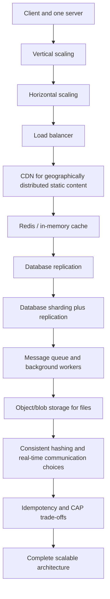

  

## The architecture principle

  

**Add a component to solve a demonstrated problem, not because every system design answer is expected to contain it.**

  

For example:

- A single server may be adequate for a small application.

- A load balancer becomes useful when multiple application servers must serve traffic.

- A CDN helps reduce latency for cacheable content served to geographically distant users.

- A cache helps when repeatedly reading the same data overwhelms or needlessly loads the database.

- Replicas spread read traffic and can improve failover options.

- Sharding distributes a dataset that no longer fits comfortably on one database node.

- A message queue decouples slow or independent background work from a user-facing request.

- Object storage is better suited to large binary files than treating the relational database as a file store.

  

---

  

# 2. The simplest client–server architecture

  

At the beginning, there are only two main actors:

  

- **Client:** Browser, mobile app, desktop application, or another service that initiates a request.

- **Server:** Receives the request, performs application logic, and returns a response.

  

A user enters a URL such as `example.com`. A simplified request path is:

  

1. The client asks a DNS resolver for the domain's address.

2. DNS resolves the hostname to an IP address (often via a chain of DNS resolvers and caches).

3. The client establishes the relevant network connection.

4. For HTTPS, TLS protects the HTTP exchange, and HTTP requests/responses travel over the connection.

5. The server processes the request and returns a response.

  

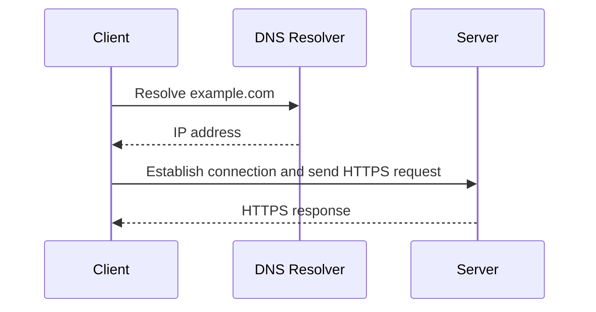

  

## Where this design starts to fail

  

A single server can become a bottleneck in CPU, memory, disk I/O, network throughput, connection capacity, or application-level work. It is also a **single point of failure**: if the machine or its critical service goes down, the whole application may become unavailable.

  

This gives us the first scaling decision.

  

---

  

# 3. Vertical scaling vs horizontal scaling

  

## 3.1 Vertical scaling (scale up)

  

Vertical scaling means increasing the capacity of one machine: more CPU, RAM, storage, or other resources.

  

**Benefits**

- Conceptually simple.

- Often requires fewer architectural changes.

- Can be effective while one machine still has headroom.

  

**Limitations**

- A machine has finite capacity and a maximum practical size.

- Larger instances can be expensive.

- A single critical machine can remain a single point of failure.

  

## 3.2 Horizontal scaling (scale out)

  

Horizontal scaling means adding more machines or application instances and distributing work between them.

  

**Benefits**

- Aggregate capacity can grow by adding instances.

- One instance failing need not bring down the entire application.

- Instances can be scaled independently within limits.

  

**New problem:** A client generally should not need to know which application instance should receive a request. A routing layer is needed in front of the servers.

  

### Flowchart: choosing the next scaling move

  

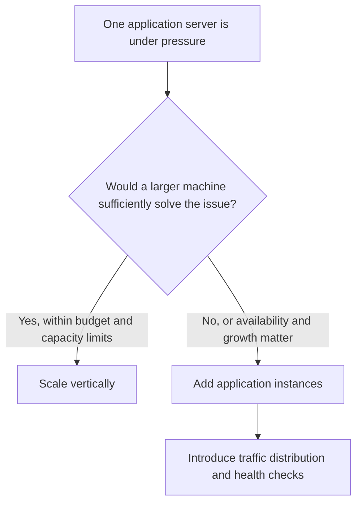

  

**Practical note:** Horizontal scaling works best when instances are sufficiently interchangeable. If session state or uploaded files exist only on one instance's local disk or memory, routing every request to arbitrary instances can break behavior. Prefer shared state or deliberately designed session affinity.

  

---

  

# 4. Load balancers

  

A **load balancer** sits in front of multiple application servers. Clients send traffic to the stable front door; the load balancer chooses a suitable healthy backend.

  

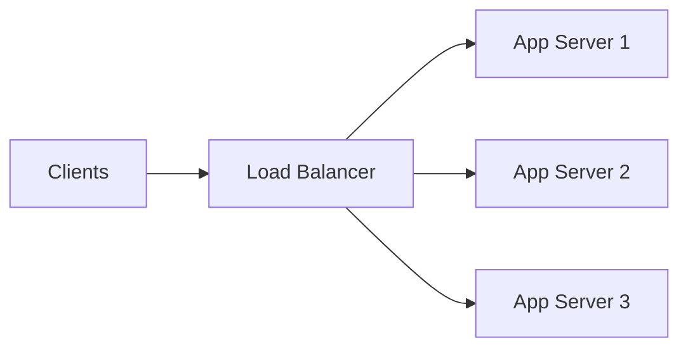

  

## 4.1 Common distribution strategies in the video

  

### Round robin

Requests are assigned to servers in a repeating order: server 1, server 2, server 3, then repeat.

  

- Simple and useful when backend capacities and request costs are reasonably similar.

- Can be unfair in practice if requests have dramatically different processing times or servers are not equally capable.

  

### Least connections

Choose the backend with the fewest active connections.

  

- Can help when requests have different durations.

- Active connection count is only a proxy for work. A connection may be idle or a single request may be CPU intensive.

  

### IP hashing / sticky routing

A hash based on the client IP maps a client to a backend.

  

- Can provide affinity when a system has server-side session state that is not shared.

- It is not a substitute for proper shared state: users can change IPs, many users can share a NAT IP, and backends can be removed or added.

  

## 4.2 Layer 4 vs Layer 7 load balancing

  

| Type | What it primarily uses | Strength | Example routing decision |

|---|---|---|---|

| Layer 4 | Transport-level information such as IP addresses and ports | Usually lower-overhead routing; does not need to interpret HTTP paths | Send a TCP connection to a backend pool |

| Layer 7 | Application-level details such as HTTP host, path, headers, or cookies | Can route different kinds of requests to different services | `/api/*` to application servers; static assets to a content-serving tier |

  

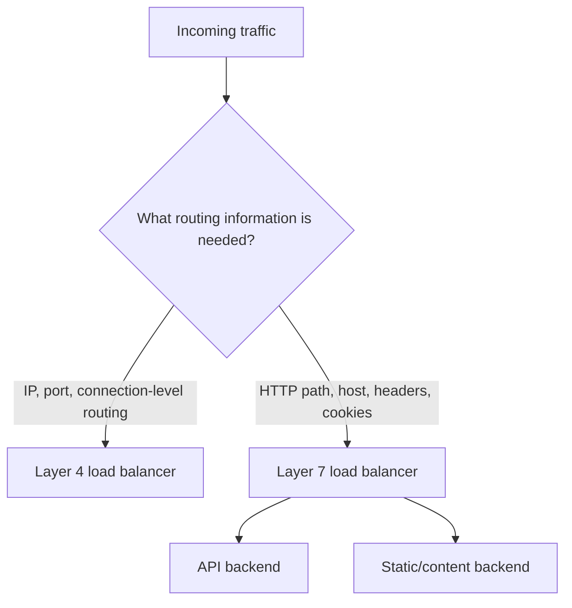

  

The video highlights Layer 7 routing because it can make application-aware decisions. This does **not** mean Layer 7 is always the right choice; the correct layer depends on the protocol, topology, performance goals, and routing needs.

  

## 4.3 Health checks and high availability

  

Load balancers can periodically check whether a backend is healthy. Unhealthy instances are removed from the set of destinations until they recover.

  

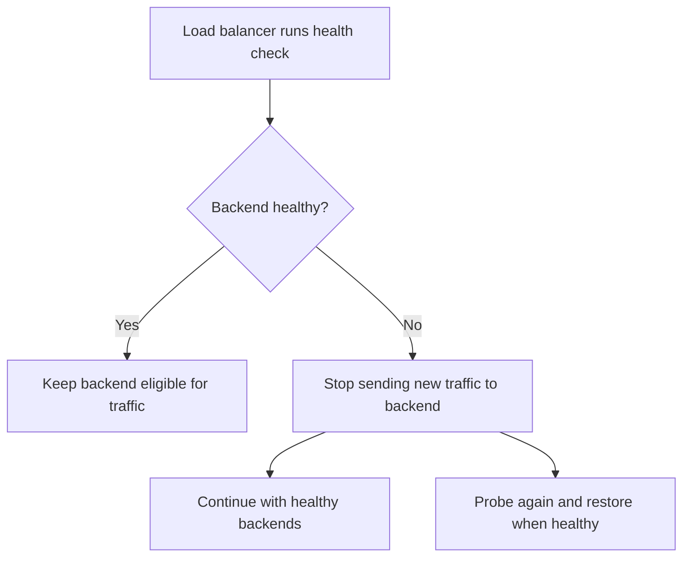

  

**Important distinction:** Health checks improve resilience, but do not guarantee that every request to a failed backend is transparently recovered. Timeouts, in-flight requests, retry safety, and application state still matter.

  

A load balancer can itself become a single point of failure if deployed as one unprotected instance. Managed cloud load-balancing services usually operate redundant infrastructure behind the provided endpoint.

  

---

  

# 5. CDN — Content Delivery Network

  

A CDN is a distributed set of edge locations or points of presence (PoPs) that can serve cacheable content closer to users.

  

The video motivates the CDN with geography: if the origin server is far away, a user may experience avoidable network latency even when the origin is healthy.

  

## 5.1 Typical CDN behavior

  

1. A client requests a cacheable asset.

2. The nearby CDN edge checks its cache.

3. On a **cache hit**, the edge can serve the asset.

4. On a **cache miss**, the edge obtains it from the origin (depending on configuration), caches it if permitted, and returns it.

5. Future requests may be served from the edge until the object expires, is evicted, or is invalidated.

  

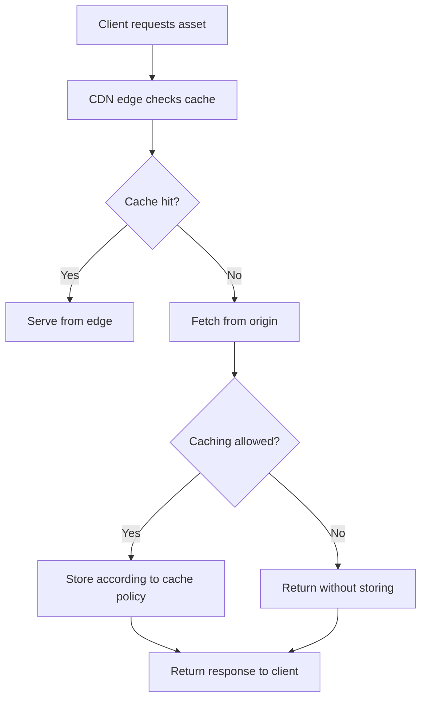

  

## 5.2 What belongs on a CDN?

  

Common examples:

- Images and video segments

- CSS, JavaScript bundles, fonts

- Public downloads

- Static HTML for sites designed to serve it that way

- Other cacheable responses with appropriate cache controls

  

Do not assume that all API responses are uncacheable or that all dynamic data is cacheable. A carefully designed API may cache public or user-independent results. User-specific or sensitive responses need conservative cache-control and correct cache keys to avoid leaking one user's data to another.

  

## 5.3 CDN cache invalidation

  

The transcript describes two familiar methods:

  

### Time to live (TTL)

The cached object is considered stale after a defined interval and must be revalidated or fetched again according to policy.

  

- Simple to operate.

- Content may remain stale until expiry unless there is an explicit purge or revalidation behavior.

  

### Versioned or content-hashed filenames

A new build produces a new asset URL, for example:

  

- `main.abc123.js`

- `main.def456.js`

  

Because the URL changes, the new asset is a separate cache key. This is especially useful for static assets in deployment pipelines.

  

**Common practice:** Long cache lifetimes for fingerprinted assets, shorter/revalidated caching for HTML or mutable resources, and explicit purge/invalidation only when required.

  

---

  

# 6. Redis and application caching

  

Even with a CDN, dynamic application requests may query the database repeatedly. An in-memory cache such as Redis can hold frequently accessed values to reduce database load and improve response time.

  

The video gives examples like user profiles, product pages, and leaderboards.

  

## 6.1 Basic cache-aside read flow

  

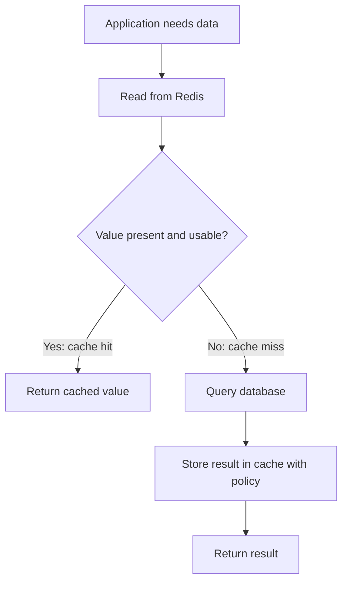

  

The application owns the cache lookup and decides what to do on a miss. The database remains the durable source for data that must survive cache loss.

  

## 6.2 Common write strategies in the video

  

### Write-through

A write updates the database and cache as part of the write path.

  

- Advantage: the cache can be kept more up to date.

- Cost: additional write-path work, including updating cache entries that may not be read again.

- Failure handling matters because a database update and a cache update are not automatically one atomic operation across two systems.

  

### Write-back (write-behind)

The write is accepted by the cache first, and the durable database is updated later in the background.

  

- Advantage: can lower write latency and batch database writes.

- Risk: acknowledged updates may be lost if the cache or write-behind mechanism fails before durable persistence, unless there is a reliable persistence/queueing design.

- Requires careful recovery, ordering, retry, and durability decisions.

  

These are different trade-offs, not universally interchangeable answers. Choose based on data-loss tolerance, consistency requirements, and workload.

  

## 6.3 Cache eviction and freshness policies

  

| Policy | What happens | Useful when |

|---|---|---|

| LRU — Least Recently Used | Evict entries that have not been accessed recently | Recent access is a useful predictor of future access |

| LFU — Least Frequently Used | Evict entries with low access frequency | Long-term popularity is meaningful |

| TTL — Time To Live | Entry becomes expired after a configured duration | Freshness must be bounded by time |

  

LRU, LFU, and TTL describe related but different concerns: eviction manages limited capacity; TTL controls validity/freshness. Systems may combine them.

  

## 6.4 Cache stampede / thundering herd

  

A very popular key expires. Many requests miss the cache at once and all query the database, potentially creating exactly the load spike caching was intended to prevent.

  

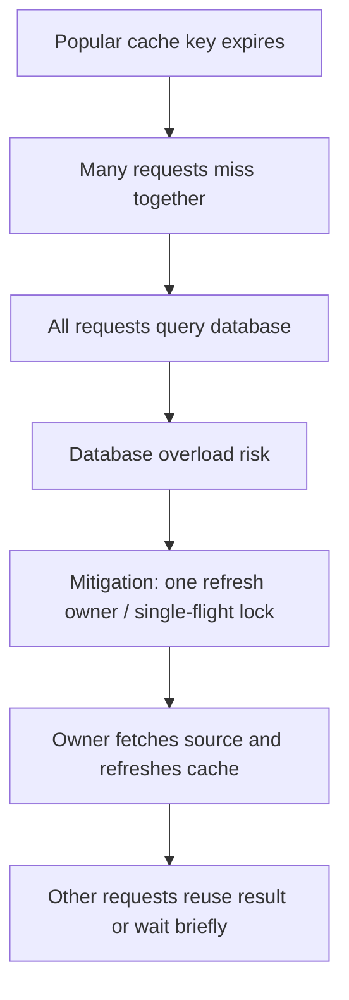

  

The video proposes a mutex lock so one request fetches the missing data and repopulates the cache while concurrent requests avoid duplicating the same expensive work.

  

Practical variants include single-flight request coalescing, a carefully implemented distributed lock, refresh-ahead, stale-while-revalidate, and TTL jitter. A lock needs expiry/ownership/failure handling; do not assume a simplistic lock is sufficient in a distributed production system.

  

## 6.5 Cold cache / cold start

  

A new or recently emptied cache has little useful data, so initial requests fall back to the database. If a large traffic wave arrives at that time, database load can spike.

  

**Cache warming / pre-warming:** Seed known high-demand keys before or during rollout, when the workload and correctness allow it. Warming is not always worthwhile; populating enormous amounts of low-probability data can waste resources.

  

### Cache checklist

- What is the source of truth?

- What is the cache key, and can it collide across users/tenants?

- What causes an update or invalidation?

- What stale-data window is acceptable?

- What happens on a cache outage?

- What prevents many requests from recomputing one missing value?

- Which data must never be cached or logged?

  

---

  

# 7. Database replication

  

A database can become overloaded by read traffic, and a single database is also a potential availability bottleneck.

  

In the video's architecture, **replication** adds copies of the database data:

  

- **Primary/leader:** handles writes in the described model.

- **Read replicas/followers:** receive replicated updates and serve eligible reads.

- **Failover:** if the primary fails, a replica may be promoted following the database's failover/election procedure.

  

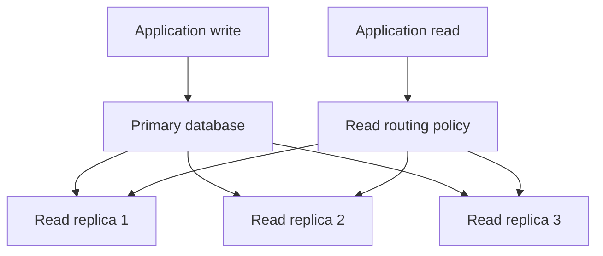

  

The exact replication mechanism and whether it is synchronous or asynchronous depend on the database. The video's explanation uses replicas that may lag behind the primary.

  

## 7.1 Replication lag and stale reads

  

With asynchronous replication, a write can be committed on the primary before every replica has applied it. A read routed immediately to a lagging replica may return an older value.

  

**One mitigation from the video:** after a client performs a write, route that client's reads to the primary for a short period, then return reads to replicas after an appropriate policy indicates the replicas have caught up.

  

Other possible consistency techniques depend on the database and application requirements; the key is to specify the freshness guarantee rather than assuming replicas are always immediately current.

  

## 7.2 Failover is more than “pick a replica”

  

A production failover mechanism needs to avoid split-brain, identify the correct authoritative node, manage replication state, redirect clients, and handle any data not yet replicated. Promotion is governed by the database/cluster's consensus and recovery procedures—not just a random choice.

  

---

  

# 8. Database sharding

  

Replication makes copies of data. **Sharding partitions the dataset** so that separate database nodes own different subsets.

  

These solve different problems:

  

- Replication is mainly about read capacity, redundancy, and failover.

- Sharding distributes data and often write/query load across partitions.

- A system may use both: each shard has its own primary and replicas.

  

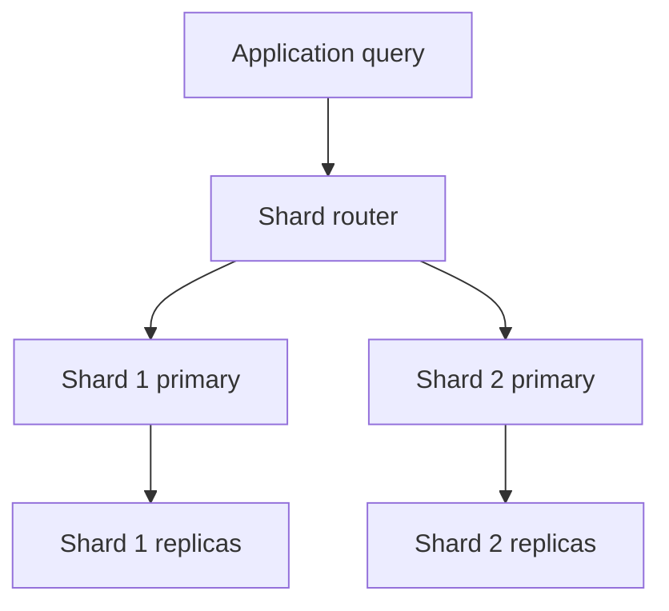

  

## 8.1 Shard assignment approaches from the video

  

### Range-based sharding

Partition by a range of a key; the video gives an illustrative alphabetic split such as A–M and N–Z.

  

- Easy to reason about for some range queries.

- Can create hotspots if the key distribution or arrival rate is uneven.

  

### Hash-based sharding

Hash a key and map it to a shard, often with a modulus in a simple illustration:

  

\[

\text{shard} = h(\text{key}) \bmod N

\]

  

- Can spread records more evenly if the hash and key distribution behave well.

- Changing \(N\) in a simple modulo scheme can remap many keys, creating expensive movement.

  

## 8.2 Operational trade-offs with sharding

  

Before selecting a shard key, consider:

- Query patterns: can the system route common requests to one shard?

- Distribution: will some shards hold much more data or traffic?

- Hot keys: can one user, tenant, or item overwhelm a shard?

- Cross-shard queries and transactions: are they frequent, costly, or avoidable?

- Growth: how will shards be added, removed, or rebalanced?

- Operations: backups, monitoring, migrations, failover, and repair become more complex.

  

The transcript notes that some distributed NoSQL databases manage partitioning and replication for the user. That convenience does not remove the need to understand partition keys, hot partitions, consistency, and operational limits.

  

---

  

# 9. Consistent hashing

  

The video introduces consistent hashing to reduce the amount of data that needs to move when nodes are added or removed.

  

## 9.1 The virtual ring idea

  

1. Hash servers and keys into positions on a logical ring.

2. For a key, move clockwise until reaching the first server position; that server owns the key.

3. A physical server is often represented by multiple **virtual nodes** around the ring.

4. When a server is added or removed, only keys in affected ring segments generally need remapping—not all keys.

  

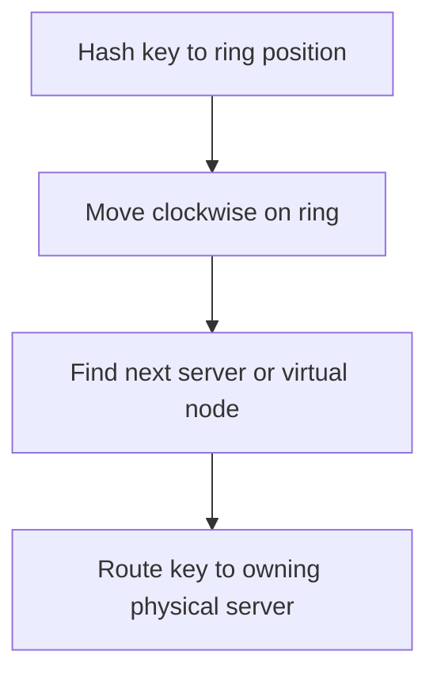

  

### Why virtual nodes help

With only one ring position per server, a server may receive a disproportionately large range. Multiple virtual nodes per server tend to smooth the distribution, assuming appropriate hashing and enough virtual nodes.

  

### Modulo hashing vs consistent hashing

  

| Property | Simple modulo hashing | Consistent hashing |

|---|---|---|

| Mapping idea | Hash key modulo node count | Map keys and nodes to a ring |

| Node count changes | Can remap a large fraction of keys | Usually remaps keys in affected ring ranges |

| Distribution | Depends on hash, key distribution, and number of nodes | Improved by multiple virtual nodes, but not automatically perfectly even |

| Complexity | Simpler | More complex; ring membership and rebalancing must be managed |

  

**Do not memorize a fixed movement percentage.** The exact fraction depends on the hash scheme, topology, and change being made. The useful insight is minimizing unnecessary remapping.

  

---

  

# 10. Message queues and event-driven architecture

  

The transcript uses photo upload as an example. Synchronously resizing, compressing, generating a thumbnail, updating the database, and sending an email forces the user-facing request to wait for all tasks.

  

A queue lets the application acknowledge an accepted request while independent workers perform longer tasks asynchronously.

  

## 10.1 Synchronous vs asynchronous work

  

### Synchronous flow

Client waits while the server completes every step.

  

Potential costs:

- Slow user-perceived response time.

- Request timeouts.

- One slow downstream operation delays the whole request.

- Traffic spikes immediately pressure every downstream dependency.

  

### Queue-based flow

The application validates the request, reliably records/enqueues work, returns an accepted response, and workers process tasks independently.

  

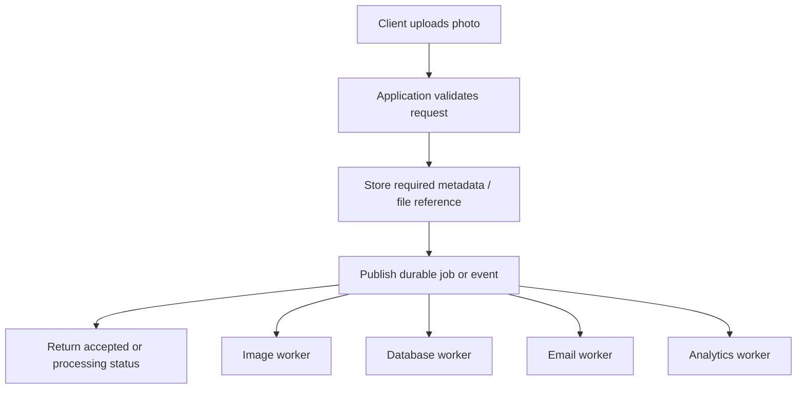

  

**Important language:** If background work has not completed, the API should not falsely claim that all processing is done. A response like “upload accepted” or “processing started” may be more accurate, with a job ID or status endpoint for tracking.

  

## 10.2 Benefits of queueing

  

- **Decoupling:** producers need not call every worker directly.

- **Buffering:** bursts can accumulate in the queue while workers process at a sustainable rate.

- **Independent scaling:** add more image workers without scaling email workers.

- **Fault recovery:** failed jobs can be retried according to policy.

- **Extensibility:** new consumers can process events without rewriting the original request path.

  

## 10.3 Failure handling to design explicitly

  

A queue does not magically guarantee that a job is processed exactly once or that the whole workflow is correct. Decide:

- At what point is the job considered accepted?

- Is the message durable and replicated as required?

- When is a job acknowledged?

- What happens if a worker crashes after performing the side effect but before acknowledging?

- How many retries are allowed?

- Where do poison messages go after repeated failure?

- How are duplicate deliveries handled?

- How do you monitor queue age, depth, and consumer lag?

  

Use idempotent worker operations where possible. “At least once” processing with deduplication is common; exactly-once effects across arbitrary external systems require additional coordination and should not be assumed from the queue alone.

  

## 10.4 Kafka vs RabbitMQ — the video's framing

  

| System | Transcript's high-level characterization | Typical fit described |

|---|---|---|

| Apache Kafka | Distributed persistent event log; consumers track positions and events can be replayed | Event streams, analytics, audit/event history |

| RabbitMQ | Message broker commonly used for task/message delivery | Work queues and routing messages to consumers |

  

This is an introductory distinction, not a universal rule that one product is always more popular or better. Both products have broader capabilities; select from delivery semantics, ordering, replay needs, throughput, routing, operational complexity, and ecosystem requirements.

  

---

  

# 11. Object/blob storage and pre-signed URLs

  

Large binary content—images, videos, audio, PDFs, and other files—often belongs in object storage such as Amazon S3 or a cloud blob-storage service rather than as large payloads embedded directly in ordinary application database rows.

  

The database can store metadata and references while object storage holds the bytes.

  

## 11.1 Upload and processing flow

  

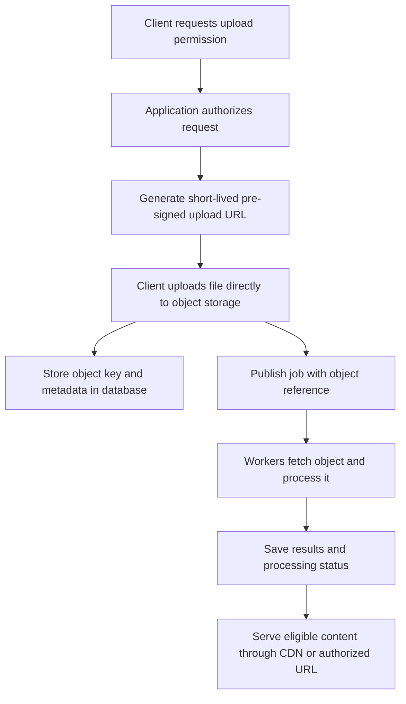

  

The video emphasizes:

- Store the actual file in object/blob storage.

- Store the file reference or URL/key in the database.

- Send the reference in a queue message so workers can fetch the source file.

- Serve cacheable assets through a CDN where appropriate.

  

## 11.2 What is a pre-signed URL?

  

A pre-signed URL is a time-limited URL whose signature grants a scoped operation on an object—such as upload or download—without requiring the client to hold long-lived cloud credentials.

  

Typical steps:

1. Client authenticates with the application.

2. Server checks authorization and generates a short-lived URL for a specific object and operation.

3. Client uploads/downloads directly to/from object storage.

4. Server verifies and records the resulting object/metadata as needed.

  

### Practical security details

- Keep expiry short enough for the use case.

- Restrict the object key, method, and allowed conditions where supported.

- Do not treat possession of a pre-signed URL as harmless: anyone who obtains it may be able to use it until it expires.

- Avoid placing private file URLs in public logs or analytics.

- Validate uploaded file size, content type, ownership, malware/security requirements, and completion status.

- Do not trust a client-supplied storage URL as proof that the upload succeeded or that the object belongs to that user.

  

Direct upload reduces application-server bandwidth, but it does not remove authorization, validation, or lifecycle responsibilities.

  

---

  

# 12. Real-time communication: polling, WebSockets, and SSE

  

Ordinary HTTP request–response is ideal for many interactions. But features such as live chat, collaborative editing, notifications, and live feeds often need server updates without constant client requests.

  

## 12.1 Short polling

The client asks repeatedly: “Any update?” Each request may return no new data.

  

- Easy to implement.

- Repeated requests create overhead, especially when events are infrequent.

  

## 12.2 Long polling

The client issues a request, and the server holds the response open until an update is available or a timeout occurs. The client then reconnects.

  

- Can reduce empty polling requests.

- Still has connection lifecycle and reconnection overhead.

  

## 12.3 WebSockets

A handshake establishes a persistent, bidirectional connection. Both client and server can send messages over it.

  

Good examples:

- Chat

- Multiplayer games

- Collaborative editors

- Interactive, low-latency features where both sides send updates

  

## 12.4 Server-Sent Events (SSE)

A persistent HTTP connection lets the server stream events to the client. The event stream is server-to-client; client commands are generally sent separately using ordinary HTTP requests.

  

Good examples:

- Notifications

- Live feeds

- Progress/status updates

- Streaming server-generated updates

  

### Comparison

  

| Technique | Direction | Connection model | Main trade-off |

|---|---|---|---|

| Short polling | Client repeatedly asks | Many short requests | Simple, but can waste requests |

| Long polling | Server responds when an update/time limit occurs | One held request followed by reconnect | Fewer empty requests; still reconnects |

| WebSocket | Bidirectional | Persistent connection | Flexible, but connection management and scaling matter |

| SSE | Server to client | Persistent event stream over HTTP | Simpler for one-way streams; client-to-server messages use another mechanism |

  

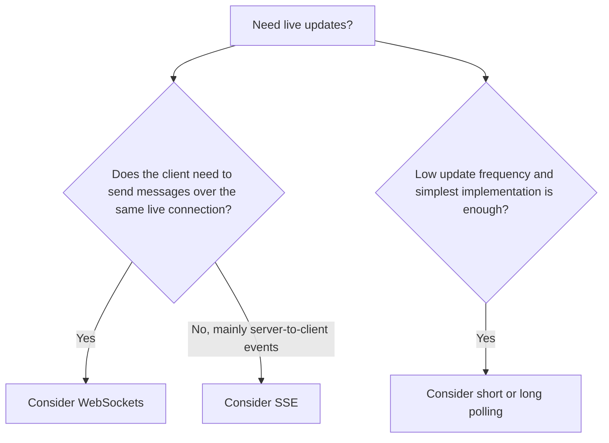

  

**Operational concerns:** Persistent connections consume resources and require reconnect handling, heartbeats/timeouts, authentication, authorization, connection distribution, graceful deployments, and a strategy for broadcasting events across multiple application instances.

  

---

  

# 13. Idempotency and safe retries

  

The video’s payment example illustrates an ambiguous failure:

  

1. The client sends a request to charge $100.

2. The server processes the charge.

3. The response is lost due to a network failure.

4. The client cannot tell whether the charge happened, so it retries.

5. Without deduplication, the user may be charged twice.

  

## 13.1 Idempotency key

  

An idempotency key is a unique identifier for a logical operation. A retry uses the **same key** as the original attempt.

  

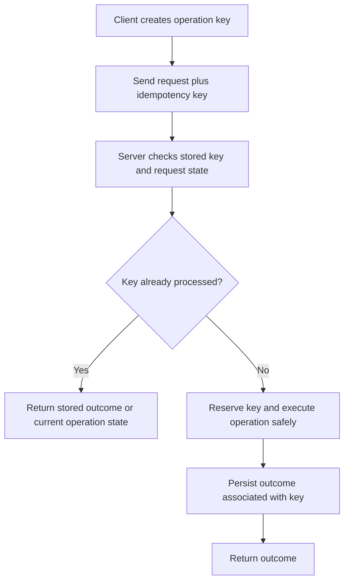

  

The key should be scoped appropriately (for example, to a customer/merchant and operation type) and stored long enough to cover the supported retry window.

  

### Robust implementation considerations

- A key must not silently be reused for a different payload; compare a request fingerprint or otherwise enforce consistent reuse.

- Handle two identical requests arriving concurrently with the same key.

- Record the operation state durably enough that a crash cannot cause duplicate side effects.

- Define behavior for in-progress, failed, timed-out, and completed operations.

- Use the payment provider's idempotency mechanism when available, and coordinate it with the application's own records.

  

Idempotency is not merely “cache a result in Redis.” The operation and the deduplication record have to be coordinated to achieve the intended guarantee.

  

---

  

# 14. CAP theorem — as introduced by the video

  

CAP stands for:

- **Consistency (C):** In the formal CAP sense, operations appear consistent with a single-copy/atomic view during the relevant execution model.

- **Availability (A):** A non-failing node receiving a request returns a response.

- **Partition tolerance (P):** The system continues to operate despite communication failures that partition nodes from one another.

  

The video presents the interview-level choice between CP and AP when a partition occurs:

  

- **CP-style behavior:** Prefer consistency; some requests may be delayed or rejected rather than return potentially conflicting/stale values.

- **AP-style behavior:** Prefer serving responses despite the partition; some responses may be stale or conflicting until the system converges.

  

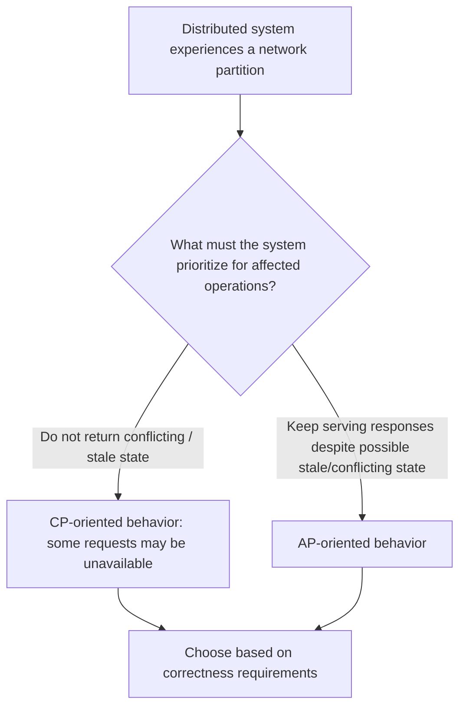

  

Examples used in the video:

- Financial operations are presented as favoring strong correctness.

- View counts/analytics are presented as allowing temporary staleness because they may converge over time.

  

**Do not reduce CAP to “every database is permanently CP or AP.”** The trade-off applies to behavior during a partition and depends on the operations and system design. Real systems can provide different consistency guarantees for different data paths.

  

---

  

# 15. Final architecture — all major pieces together

  

This is the end-state mental model assembled throughout the transcript.

  

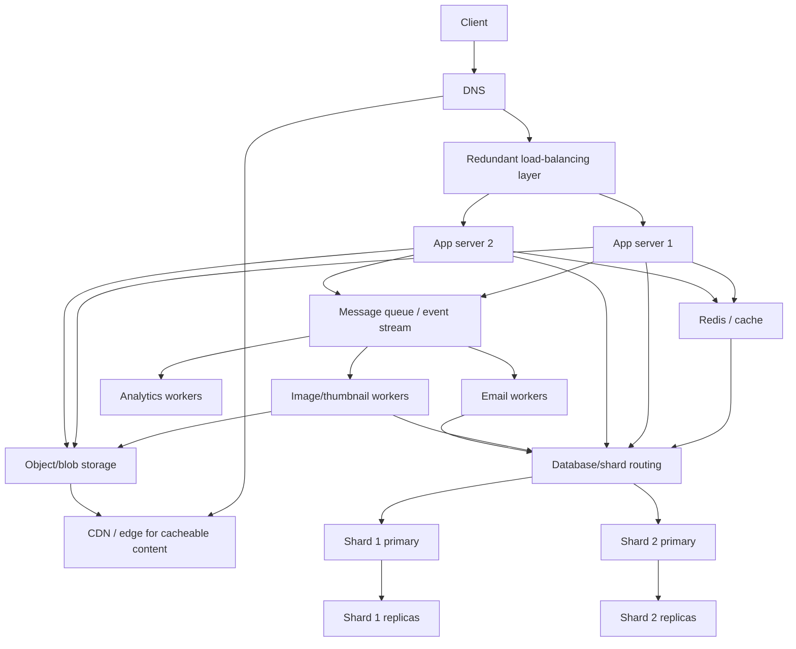

  

**Interpret the diagram carefully:**

- It is a conceptual diagram, not a universal deployment blueprint.

- A production design also needs observability, authentication/authorization, secrets management, deployment strategy, backups, disaster recovery, rate limiting, timeouts, circuit breakers where appropriate, and capacity planning.

- The routing and data flows vary by application. For example, direct object-storage upload can bypass the app server's file-byte path after the server authorizes it.

  

## 15.1 Component-to-problem map

  

| Component | Problem it addresses | Main trade-off or new responsibility |

|---|---|---|

| Vertical scaling | A single instance lacks capacity | Finite size/cost; single-instance failure risk remains |

| Horizontal scaling | Need more aggregate capacity and instance redundancy | Routing, state sharing, deployment/coordination |

| Load balancer | Distribute traffic and avoid known-unhealthy backends | Health checks, retries, routing policy, LB redundancy |

| CDN | Reduce latency and origin load for cacheable content | Freshness, invalidation, security/cache-key correctness |

| Redis/application cache | Repeated reads are expensive | Staleness, invalidation, stampedes, cache availability |

| Database replicas | Scale reads and provide failover options | Replica lag, failover correctness |

| Sharding | Dataset/load is too large for one database node | Routing, rebalancing, cross-shard complexity |

| Message queue | Slow work blocks requests and tasks are coupled | Delivery semantics, retries, duplicates, queue monitoring |

| Object storage | Large binary files are a poor fit for ordinary relational rows | Authorization, lifecycle, metadata consistency |

| WebSockets/SSE | Clients need timely updates without repeated polling | Persistent-connection operations and reconnects |

| Idempotency | Network retries can duplicate side effects | Durable deduplication/state handling |

| CAP trade-off | Network partitions force choices for affected operations | Must define acceptable consistency and availability behavior |

  

---

  

# 16. A system-design interview method inspired by the video

  

When asked to design a system, don't start by drawing every component you have memorized. Use a staged method.

  

## Step 1 — Clarify the product and workload

Ask what the system does, who uses it, and what matters most. Estimate traffic, read/write ratio, data volume, payload size, geography, latency expectations, and failure tolerance when relevant.

  

## Step 2 — Define the core API and data model

Identify key entities, operations, consistency needs, and which operations have side effects. Separate metadata from large binary objects.

  

## Step 3 — Draw the simplest viable design

Start with clients, application service, and data store. Explain what works and what the current constraints are.

  

## Step 4 — Scale only the bottlenecks that matter

- Compute/instance bottleneck → scale vertically or horizontally.

- Multiple servers need routing → load balancer.

- Distant cacheable content → CDN.

- Repeated reads overload the data store → cache.

- Read pressure or redundancy requirements → replication.

- Dataset/write scale exceeds one node → sharding.

- Long independent work blocks response → queue and workers.

- Large files burden app/database tiers → object storage and signed URLs.

- Real-time updates → polling, WebSockets, or SSE.

- Retryable side effects → idempotency strategy.

  

## Step 5 — Discuss failure modes

Explain what happens when a server, queue consumer, replica, cache, or storage operation fails. Include timeout and retry behavior, duplicate work, partial completion, and recovery.

  

## Step 6 — State the trade-offs

Every component buys something and costs something. Say what latency, consistency, availability, reliability, complexity, or operational cost changes when you add it.

  

## Step 7 — Draw the final architecture and walk the key flows

Walk through at least one read, one write, and one background/asynchronous operation. Mark which layer owns each responsibility.

  

---

  

# 17. Practical scenario drills

  

For each scenario, identify the first relevant design change and explain its benefit and downside.

  

1. A single API server runs out of CPU during peak traffic.

2. A service now has five application instances, but requests need a stable entry point.

3. Users in India receive images from an origin in North America and experience slow downloads.

4. A product page is requested thousands of times per second, but its underlying data rarely changes.

5. One hot cache key expires and a flood of misses overloads the database.

6. A system's read traffic greatly exceeds write traffic.

7. The dataset no longer fits comfortably on one database machine.

8. A photo upload request spends several seconds generating thumbnails and sending emails.

9. Users upload multi-gigabyte media and the application servers become bandwidth bottlenecks.

10. A user retries a payment because the response was lost.

11. A chat application needs low-latency messages in both directions.

12. A dashboard needs server-to-client updates, but user actions can still use ordinary HTTP requests.

13. Adding a shard forces too many keys to move under simple modulo hashing.

14. A partition occurs and the business must decide whether to reject some writes or allow temporarily inconsistent reads.

  

### Suggested direction

1. Vertical or horizontal scaling after measuring the bottleneck.

2. Load balancer.

3. CDN for eligible assets.

4. Application cache such as Redis; define invalidation/freshness.

5. Single-flight/locking or refresh strategy, plus TTL jitter or other stampede mitigation.

6. Replication with an explicit replica-lag policy.

7. Sharding, often combined with replication.

8. Message queue and background workers.

9. Direct upload/download with object storage and time-limited URLs.

10. Idempotency key and durable operation state.

11. WebSockets.

12. SSE is a strong candidate.

13. Consistent hashing/ring-based distribution or another deliberate rebalancing strategy.

14. Define per-operation consistency and availability requirements under partition.

  

---

  

# 18. Revision flashcards

  

**Q: Vertical vs horizontal scaling?**  

A: Vertical scaling increases one machine's resources; horizontal scaling adds instances and distributes work.

  

**Q: What does a load balancer add?**  

A: A routing layer that selects an appropriate backend and can stop sending new requests to unhealthy instances.

  

**Q: Round robin vs least connections?**  

A: Round robin cycles through backends; least connections uses active connection counts as a rough load signal.

  

**Q: Layer 4 vs Layer 7 load balancing?**  

A: Layer 4 relies primarily on transport-level details such as addresses and ports; Layer 7 can route based on application details such as HTTP host/path/headers.

  

**Q: What is a CDN cache hit?**  

A: The requested cacheable object is available at the edge and can be served without fetching it from origin.

  

**Q: Why use a cache alongside a database?**  

A: To avoid repeated expensive reads for frequently accessed data, while managing freshness and invalidation.

  

**Q: Cache stampede?**  

A: Many requests simultaneously miss or refresh the same key and flood the source of truth.

  

**Q: Replication vs sharding?**  

A: Replication copies data across nodes; sharding partitions the dataset across nodes.

  

**Q: What is replication lag?**  

A: A replica has not yet applied a recent primary update, so reads may be stale.

  

**Q: Why use a message queue?**  

A: To decouple producers from consumers, buffer bursts, and move longer work off the synchronous request path.

  

**Q: Kafka vs RabbitMQ in the video?**  

A: Kafka is introduced as a persistent event log with consumer offsets and replay; RabbitMQ as a message broker commonly used for queue-based delivery. Actual choice depends on requirements.

  

**Q: Why object storage?**  

A: It is designed for large binary objects; the database can store metadata/reference information separately.

  

**Q: What is a pre-signed URL?**  

A: A short-lived, signed URL granting a scoped operation on an object without giving the client long-lived cloud credentials.

  

**Q: WebSockets vs SSE?**  

A: WebSockets are bidirectional; SSE is a server-to-client event stream.

  

**Q: Why an idempotency key?**  

A: To recognize retries of the same logical operation and avoid repeating a side effect such as a payment.

  

**Q: What does CAP help reason about?**  

A: The trade-off between consistency and availability for affected operations when a network partition occurs.

  

---

  

# 19. Additional technical precision — interview-safe clarifications

  

This section adds clarifications beyond the transcript's introductory wording. The intent is to prevent common overgeneralizations in an interview.

  

1. **HTTPS and HTTP:** HTTPS is appropriate for protecting traffic in transit across untrusted networks; HTTP still exists in local development, private environments, service meshes, and redirect flows. Avoid the blanket claim that HTTP is never used.

2. **Load-balancer algorithms:** IP hashing can create sticky routing, but it does not guarantee a robust session architecture. Shared/distributed session state is often preferable when practical.

3. **CDNs:** Some dynamic responses can be cached safely, and some static-looking responses must not be cached publicly. Cacheability depends on headers, keys, authorization, and content semantics.

4. **Cache performance:** In-memory access itself is fast, but actual cache request latency includes networking, serialization, contention, and service overhead. Avoid promising that every Redis-backed request takes nanoseconds.

5. **Replication:** Replicas do not necessarily receive changes immediately, and failover needs a deliberate protocol to avoid stale promotion or split-brain. Read replicas can also be used for purposes other than read scaling.

6. **Queues:** A durable queue does not guarantee that a business side effect happens exactly once. Consumers should expect retries/duplicate delivery according to the chosen delivery model and make side effects idempotent where possible.

7. **Sharding:** “Hash then modulo node count” is a simple teaching example. Production partitioning needs rebalancing, hotspot mitigation, and thoughtful key design.

8. **Idempotency:** HTTP method semantics do not guarantee that every real-world GET endpoint is side-effect free. An idempotency key must be durably coordinated with the actual operation; a cache-only implementation can fail if the process crashes at the wrong moment.

9. **CAP:** CAP is about behavior during a network partition, not a universal label that makes an entire product simply “CP” or “AP” for every operation.

10. **Asynchronous responses:** If background processing is still pending, an API should accurately report that the job was accepted/started rather than implying all downstream work is finished.

  

---

  

# Final memory map

  

- **Need more compute capacity?** Scale vertically, then horizontally when appropriate.

- **Need to route traffic among instances?** Load balancer plus health checks.

- **Need nearby delivery of cacheable content?** CDN.

- **Too many repeated data reads?** Cache, with explicit freshness, invalidation, and stampede policies.

- **Need read scale/redundancy?** Replication, while accounting for lag and failover.

- **Dataset no longer fits one node?** Sharding, usually with replication and a deliberate shard key.

- **Slow work should not block the request?** Queue and independent workers.

- **Large files?** Object/blob storage; retain metadata and keys in the database.

- **Need to distribute keys while minimizing remapping?** Consistent hashing is one option.

- **Need live updates?** Polling, WebSockets, or SSE based on interaction direction and overhead.

- **Retries may repeat side effects?** Idempotency and durable operation state.

- **Nodes may be partitioned?** Choose and explain consistency/availability behavior for each operation.

  

The strongest interview answer is not the one with the most boxes. It is the one that connects each box to a real requirement, shows the resulting data flow, and explains the failure modes and trade-offs.