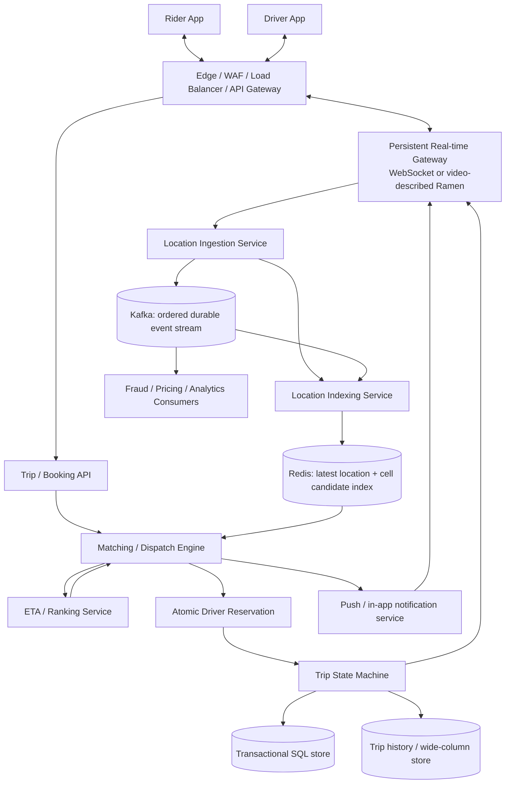
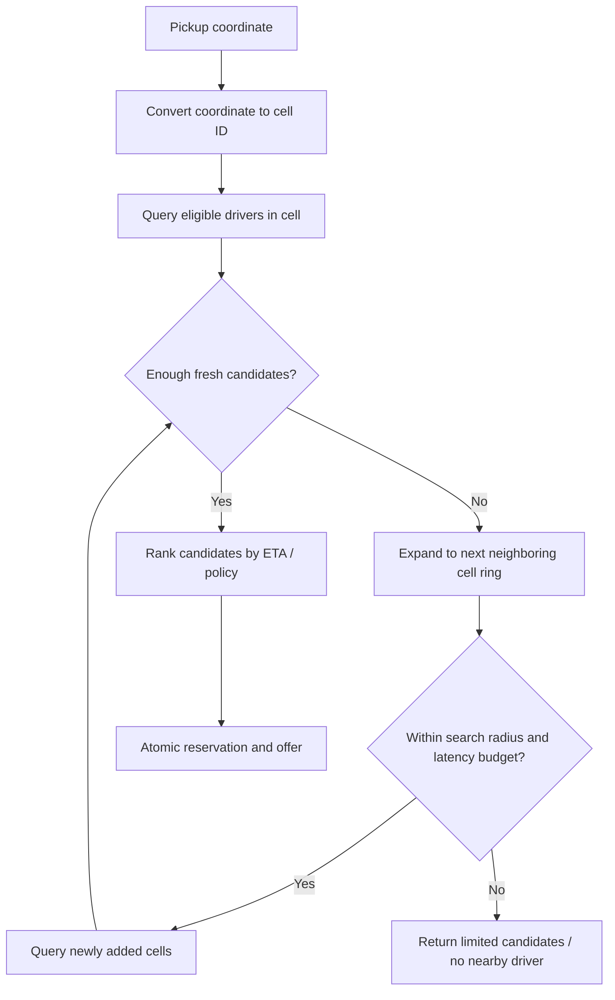
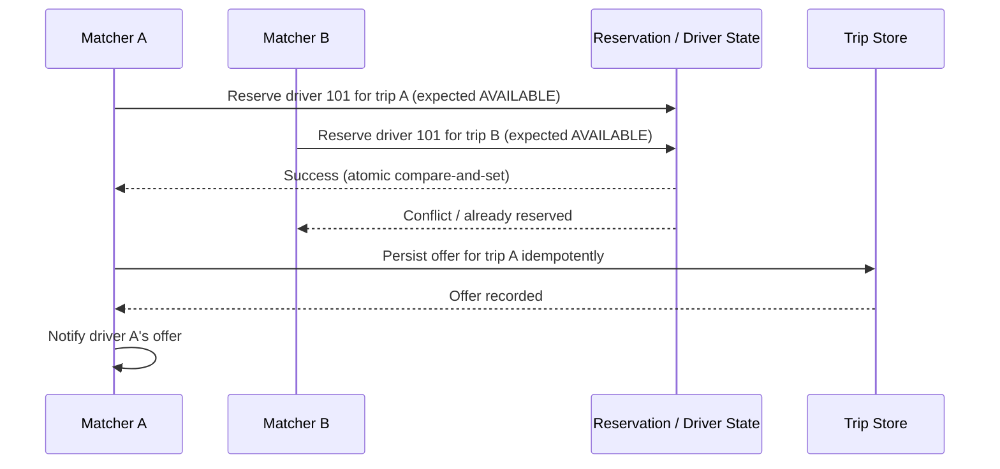
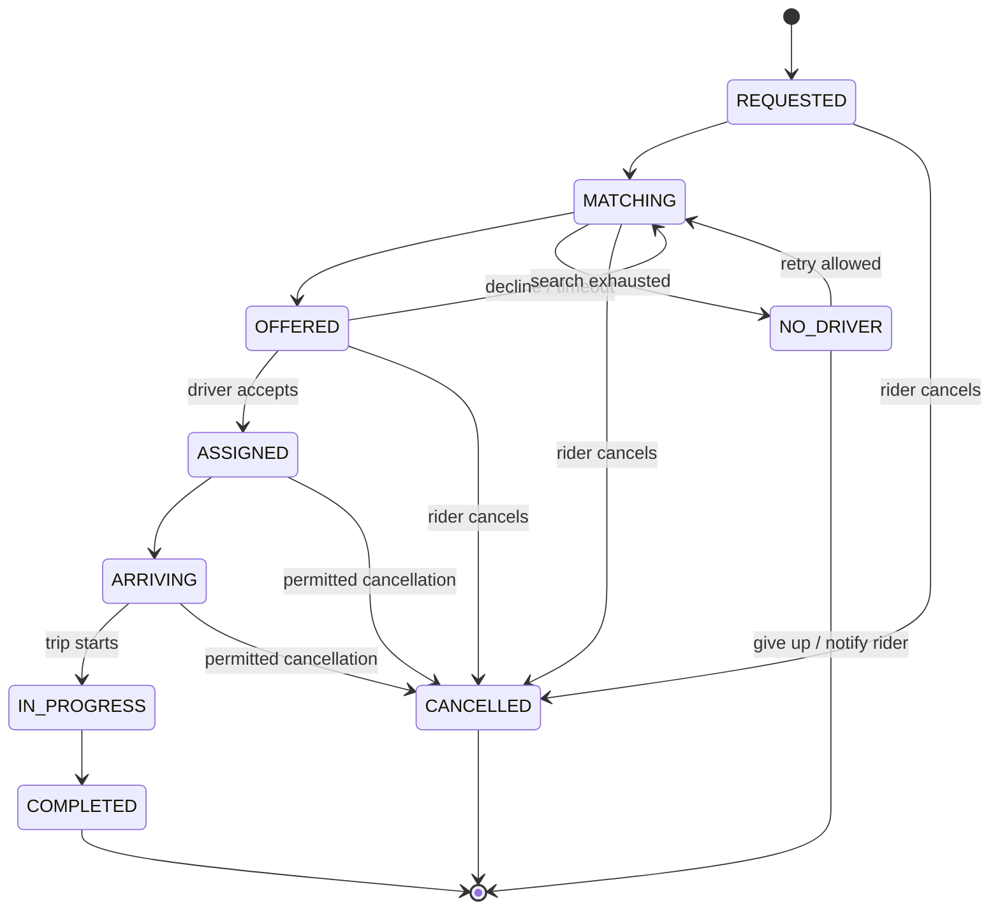
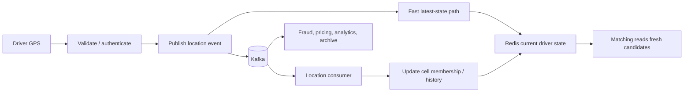
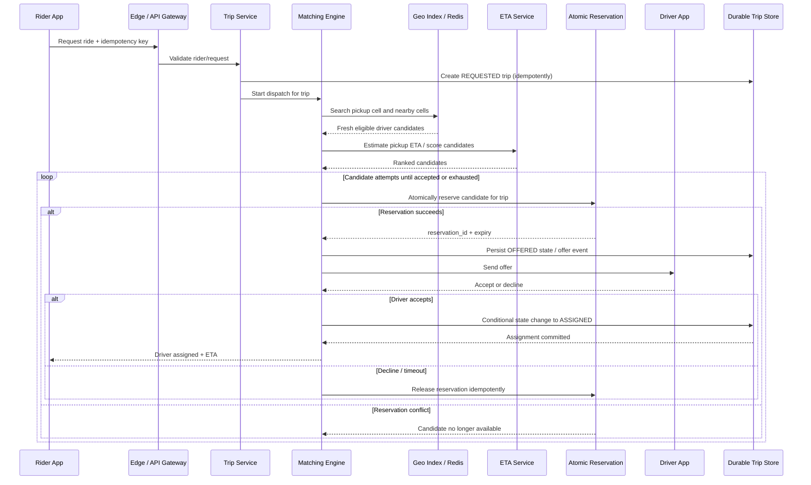

  

> **Source basis:** These notes are based on the uploaded transcript, *“Uber System Design: How Ride Sharing Apps like Uber, Lyft Works at Scale By Microsoft SDE.”* The video's assumptions and named components are preserved as the starting point. Arithmetic and terminology issues are explicitly called out rather than silently treated as facts.

>

> **Important boundary:** This is a system-design interview model, not a verified blueprint of Uber's current proprietary implementation. Names such as **Ramen**, **DISCO**, **Deep ETA**, and the specific retention windows are claims made in the video and should be presented as video-described/example components unless independently verified.

  

---

  

## 1. The problem in one sentence

  

Design a real-time ride-hailing platform that accepts a rider's trip request, discovers nearby **available** drivers, selects and reserves a good candidate without assigning one driver twice, notifies the driver and rider, streams trip/location updates, and persists important trip and payment state reliably.

  

The core challenge is not simply “find the closest driver.” It is coordinating **high-volume changing locations**, **low-latency matching**, **concurrent reservations**, **real-time updates**, **a correct trip lifecycle**, and **durable transaction records** across a distributed system.

  

## 2. The basic ride lifecycle

  

1. Rider enters pickup and destination, then requests a ride.

2. The backend validates identity, request data, service availability, and any relevant limits.

3. The location/matching system searches the pickup area's spatial cells for candidate drivers.

4. The matching engine ranks candidates, for example by estimated pickup time (ETA), suitability, and other product constraints.

5. The platform atomically reserves a candidate so two concurrent matching workers cannot claim the same driver.

6. The driver receives an offer and accepts or declines within a time window.

7. On acceptance, the trip moves to a confirmed/assigned state. If declined or timed out, the reservation is released and the system tries another candidate.

8. During pickup and the ride, driver location and trip status updates are streamed to the rider.

9. The trip starts, completes, and the fare/payment workflow is recorded.

10. Trip history, location traces subject to the applicable retention policy, and operational events are persisted for support, safety, dispute, billing, analytics, and model improvement.

  

The video describes a basic driver state as `available` or `on_trip`. A production-quality design should model intermediate states such as `reserved/offered`, because an available driver may be temporarily held for a rider while waiting for the driver's response.

  

## 3. Requirements to establish before drawing boxes

  

### Functional requirements

  

- Rider and driver authentication; rider requests a ride.

- Driver availability and frequent GPS updates.

- Nearby-driver candidate discovery using spatial indexing.

- Matching/ranking and driver offer delivery.

- Accept, decline, timeout, cancel, start, and complete operations.

- Live trip status and location updates to the appropriate clients.

- Fare quote/price calculation and payment integration.

- Trip history and records needed for support, safety, disputes, and analytics.

- Driver/rider notifications, fraud detection, and supply-demand pricing as downstream capabilities.

  

### Non-functional requirements

  

- **Low latency:** candidate discovery and offers should feel near-real-time.

- **Freshness:** stale GPS points should not be treated as current positions.

- **Correctness:** one driver must not be assigned to two active trips.

- **Availability:** location and matching should tolerate node and zone failures.

- **Durability:** confirmed trip-state transitions and financial records must not silently disappear.

- **Scalability:** separate the location-update workload from transactional trip operations.

- **Geographic locality:** route work and data to the appropriate city/region where possible.

- **Security and privacy:** authenticate clients, authorize trip access, protect location/payment data, rate-limit, audit sensitive operations, and apply retention controls.

  

### Scope and assumptions

  

The transcript focuses on location streaming, matching, trip persistence, and supporting services. It does not define a complete payment ledger, identity system, map-routing backend, regulatory policy, or precise production service-level objectives. In an interview, state which of these are in scope and make assumptions explicit.

  

---

  

## 4. Capacity estimation

  

Capacity estimates are **working assumptions** used to drive the architecture, not claims of exact current Uber traffic. The uploaded video uses the following illustrative values.

  

### 4.1 Video assumptions

  

| Input | Value used in the video | How it is used |

|---|---:|---|

| Monthly active users | ~202 million | Video's starting estimate; not independently verified here |

| Daily active users | ~40 million | Illustrative estimate |

| Daily trips | ~40 million | Used for request and storage estimates |

| Active drivers | ~2 million | Used for location-update estimates |

| Driver location interval | 4 seconds | One location ping per active driver every four seconds |

| Location payload | ~40 bytes | Driver ID, latitude, longitude, timestamp, and a small metadata allowance |

| Average trip duration | 20 minutes | Used to estimate pings per trip |

| Trip summary record | ~1 KB | Rider/driver IDs, route, fare, metadata, etc. |

| Recent hot trip/location retention | 7 days | Video's example before moving older data to archive |

| Matching batch window | 2–5 seconds | Described in the video as a batching approach |

| Reservation window | ~10 seconds | Video's illustrative driver reservation/offer timeout |

  

### 4.2 Average trip-request rate

  

If the system processes 40 million trips per day:

  

\[

\frac{40{,}000{,}000}{86{,}400}\approx 463\text{ trips/s on average}

\]

  

This is the **average**. Actual peaks can be much higher because demand varies by geography, time of day, weather, and events. Capacity planning should include a peak multiplier, burst handling, and per-city skew. The transcript's spoken phrase around this calculation is garbled; the arithmetic above is the correct interpretation of its numbers.

  

### 4.3 Location-update throughput

  

With 2 million active drivers sending a location update every four seconds:

  

\[

\text{updates/s}=\frac{2{,}000{,}000}{4}=500{,}000

\]

  

So the example workload is **500,000 GPS updates per second** before retries, reconnects, extra telemetry, and fan-out.

  

At 40 bytes per payload:

  

\[

500{,}000\times40=20{,}000{,}000\text{ bytes/s}

\]

  

That is approximately **20 MB/s**, or **160 megabits/s (Mbps)** using decimal units, for raw payload only. It excludes WebSocket/protocol framing, TLS, IP/TCP overhead, compression effects, replication, Kafka overhead, and downstream fan-out.

  

**Unit correction:** the video calls this roughly 20 Mbps. The multiplication produces **20 megabytes per second**, which is roughly **160 megabits per second**, not 20 Mbps. A 40-byte payload also means that 2 million drivers produce 80 MB **across one four-second reporting interval**; it is not 80 MB every second.

  

### 4.4 Location-data volume per day

  

At a 20-minute average trip and a four-second update interval:

  

\[

\frac{20\times60}{4}=300\text{ updates/trip}

\]

  

For 40 million trips/day:

  

\[

40{,}000{,}000\times300=12{,}000{,}000{,}000

\]

  

That is **12 billion location updates/day** under the video's simplifying assumptions.

  

At 40 bytes per point:

  

\[

12\text{ billion}\times40=480\text{ billion bytes/day}\approx480\text{ GB/day}

\]

  

Annualized without overhead or compression:

  

\[

480\text{ GB/day}\times365\approx175.2\text{ TB/year}

\]

  

This estimate is only the raw payload model. Real storage may be much larger due to indexing, replication, metadata, safety retention, and event envelopes—or smaller due to compression, sampling, and selective retention.

  

### 4.5 Trip-summary storage

  

With 40 million trips/day and an average 1 KB summary record:

  

\[

40{,}000{,}000\times1\text{ KB}\approx40\text{ GB/day}

\]

  

Annualized:

  

\[

40\text{ GB/day}\times365\approx14.6\text{ TB/year}

\]

  

This is the video's basic trip-summary estimate; it is separate from the much higher-volume GPS trace stream.

  

### 4.6 Five-times fan-out example

  

The video assumes that outgoing location traffic is approximately five times incoming traffic because multiple rider clients may observe a driver's location. **Using the corrected raw ingress estimate**, 5× would imply about 100 MB/s or 800 Mbps of payload-level egress in that simplified scenario. This is illustrative only: real fan-out depends on active trip subscriptions, update frequency, regional distribution, and delivery protocol.

  

### 4.7 What capacity math tells us

  

- Location updates are a high-volume, continuously changing stream.

- Matching needs a fast **latest-state index**, rather than scanning historical GPS records.

- Historical GPS events and transactional trip records have different read/write and retention patterns.

- A queue/event log decouples ingestion from consumers; an in-memory store serves fresh candidate lookups; a durable database records trip state.

- Provision for peak demand, uneven city distributions, recovery/replay, replication, observability, and backpressure—not just average byte rate.

  

---

  

## 5. High-level architecture

  

The video presents the design in layers. A useful interview diagram is:

  



  

**Read the diagram as logical responsibilities, not a required deployment topology.** In production, location ingestion may update Redis directly and publish to Kafka, or a stream consumer may update the latest-state index asynchronously. Those choices affect freshness, ordering, and recovery guarantees; the interview answer must specify which guarantees are required.

  

### Layer 1 — Client / edge / real-time connection

  

The rider and driver apps communicate through an edge layer containing load balancing, WAF/firewall protections, authentication, rate limiting, request routing, and persistent real-time connections.

  

The transcript names **Ramen** as Uber's “Real-Time Asynchronous Messaging Network” and describes it as Uber's own push-based connection platform. Treat that as the video's stated example, not as independently verified current implementation detail. A generic architecture can use WebSockets or another bidirectional/push channel.

  

Why persistent connections?

  

- Avoid making the client poll repeatedly for every update.

- Push driver offers and trip-state changes promptly.

- Stream driver location during an active trip.

- Reuse a connection while it is healthy, with reconnect and resynchronization logic.

  

The persistent channel does not replace normal request/response APIs for operations such as creating a booking, managing payment, or reading trip history.

  

### Layer 2 — Real-time location tracking (“Pulse” in the video)

  

Responsibilities:

  

1. Authenticate driver sessions and validate incoming location messages.

2. Reject malformed points and handle out-of-order/stale updates.

3. Normalize timestamps and attach event IDs or sequence numbers.

4. Publish location events to Kafka for downstream processing and replay.

5. Update the current location and spatial cell membership in Redis or an equivalent low-latency index.

6. Expose the latest eligible driver candidates to the matching engine.

  

The transcript calls this layer “Pulse.” It describes Kafka as a durable event bus and Redis as the fast store for the **latest driver state**. That separation is fundamental:

  

- **Kafka/event log:** history of events for independent consumers, replay, and buffering.

- **Redis/current-state index:** fast query of where a driver is now and whether that driver is eligible for dispatch.

  

A queue does not automatically mean every event is persisted forever. Configure retention and compaction intentionally, and avoid confusing the event log with the current-state database.

  

### Layer 3 — Geospatial indexing

  

The video describes mapping latitude/longitude to a spatial cell, then maintaining an index of eligible drivers by cell. A ride request maps the pickup point to a cell and queries the local cell plus nearby cells.

  

Core idea: **convert geometric proximity into a bounded indexed lookup** instead of scanning every driver in a city.

  

### Layer 4 — Matching engine (named “DISCO” in the video)

  

The transcript expands DISCO as “Dispatch Optimization” and describes it as the matching brain. It:

  

1. Collects ride requests and candidate drivers in an area.

2. Queries the current location index.

3. Expands to nearby cells if the pickup cell is empty or has too few eligible drivers.

4. Estimates pickup time / candidate suitability.

5. Ranks candidates or solves a small batch assignment problem.

6. Atomically reserves a driver before offering/confirming the ride.

7. Notifies driver and rider; retries after decline or timeout.

  

The video illustrates a **2–5 second batch window** and a deep-learning ETA model factoring traffic, weather, and time. These are illustrative statements from the transcript; a real design should define the maximum dispatch latency and what prediction inputs actually exist.

  

### Layer 5 — Storage and persistence

  

The video describes:

  

- A **trip service/state machine** that owns the trip lifecycle.

- A customized MySQL/SQL layer for profiles, payment-method tokens, bank details, and other strongly transactional records.

- Cassandra for high-volume trip details/history in the video's example.

- A cold/archive layer such as Hadoop or object storage (the video names S3) for older, compressed history after the example seven-day hot window.

  

Use the database best suited to each access pattern. A SQL database is a natural place for transactionally consistent booking, ownership, and payment state. A wide-column or log-oriented store can suit large append-heavy histories. Object storage is useful for cheaper long-term archives and analytics. These are architectural choices, not proof of the exact database topology used by Uber today.

  

### Supporting services in the video

  

- **Push notification service:** informs the driver/rider about a new offer or status update.

- **Fraud detection:** consumes location/trip signals to detect suspicious patterns.

- **Surge/search pricing:** compares local supply and demand; the video gives the intuitive example that prices may rise when riders greatly outnumber available drivers.

- **ETA service:** predicts pickup time using route, traffic, and other features.

  

These services should generally be decoupled from the critical dispatch path when possible. A delayed analytics or fraud-scoring consumer should not silently block every GPS ping; high-risk actions can still use synchronous safety checks when requirements demand it.

  

---

  

## 6. Geospatial indexing: the key idea

  

### 6.1 Why ordinary database filtering is not enough

  

A naive design might query every driver and calculate distance from the pickup point. If a city has hundreds of thousands of drivers and each ride request repeats a full scan, the cost is large and grows with the total driver population.

  

Instead:

  

1. Map a coordinate to a cell ID using a spatial indexing system.

2. Maintain the drivers currently associated with each cell.

3. Query only the rider's cell and a limited neighborhood of adjacent cells.

4. Filter for freshness and availability.

5. Compute more precise distance or route ETA only for the resulting candidates.

  

### 6.2 Hexagonal cell search and K-ring expansion

  

The video uses a hexagonal cell diagram and calls the fallback a **K-ring search**. The search begins in the pickup cell. If there are not enough suitable drivers, it expands to adjacent cells, then the next ring, until it has enough candidates or hits a distance/latency limit.

  



  

A `K` value should be chosen based on cell resolution and local density, not arbitrarily. Dense downtown areas can often search fewer rings; sparse areas may need more rings. Guardrails prevent unbounded expansion.

  

### 6.3 Important naming issue: H3, S2, and “S3” in the transcript

  

The video uses these terms inconsistently. It describes **H3** as a hexagonal hierarchical spatial index, then also mentions Google's **S2** library and appears to call cell IDs “S3” in places. These are distinct systems:

  

- **H3** is a hierarchical global grid based on hexagonal cells (with some pentagonal cells in the global tiling).

- **S2** is a spherical geometry library that indexes the Earth using hierarchical cells; it is not H3 and its cells are not a hexagonal tiling.

- **S3** conventionally refers to Amazon Simple Storage Service in cloud architecture, so avoid calling the spatial index “S3” unless the system has defined that internal name.

  

For an interview, select one index (for example, H3) and use its name consistently. The architecture concept—coordinate to cell, cell-to-driver membership, neighbor-cell lookup—is the same at a high level, but the exact cell topology and neighbor APIs differ.

  

### 6.4 Example data shape

  

Illustrative Redis keys (names are design examples, not from the transcript):

  

```text

cell:{cell_id}:available_drivers  -> set of driver IDs

 driver:{driver_id}:location      -> lat, lon, observed_at, sequence

 driver:{driver_id}:status        -> AVAILABLE / RESERVED / ON_TRIP / OFFLINE

 driver:{driver_id}:cell           -> current cell ID

```

  

A driver crossing a cell boundary must be removed from the old cell membership and added to the new cell membership. These changes should be made in a controlled manner so a ride request does not observe a driver in both cells indefinitely or in neither cell for too long. A periodic reconciliation job can repair leaked or stale memberships.

  

**Freshness is separate from cell membership.** Store an observation timestamp and ignore drivers whose location is too old for the use case. A heartbeat or TTL can help remove offline drivers, but expirations should not be the only correctness mechanism.

  

### 6.5 Cell precision and candidate ranking

  

- Coarse cells reduce index overhead but may return too many drivers.

- Fine cells improve locality but increase boundary handling and may leave sparse cells empty.

- Spatial distance is only a first filter; road-network ETA can differ from straight-line distance.

- Filter out drivers who are off-duty, stale, reserved, on a trip, incompatible with the ride type, or otherwise ineligible.

- Use a bounded candidate list to protect the ETA/ranking service from large fan-in.

  

---

  

## 7. Driver matching and dispatch

  

### 7.1 Candidate matching is more than nearest-neighbor search

  

A naive “pick nearest driver” approach can be suboptimal because:

  

- The nearest driver may be on a one-way road or behind a river/highway barrier.

- Estimated pickup time can differ from geometric distance.

- Driver availability may change between search and reservation.

- Many concurrent requests can compete for the same driver.

- A slightly farther driver may be a better global assignment when several riders are waiting.

  

The video explains that the system batches requests and drivers in a local area and treats matching as a **bipartite matching** problem. Each rider request is one side of the graph; eligible drivers form the other side; an edge has a cost or score such as pickup ETA. A batch optimizer can choose an assignment that improves total or weighted objective, subject to product and service constraints.

  

### 7.2 A practical dispatch pipeline

  

1. **Batch or trigger:** group local requests where waiting briefly improves assignment quality; cap the waiting window.

2. **Candidate generation:** query the rider cell and expand to neighbor cells as needed.

3. **Eligibility filtering:** fresh location, online, correct vehicle class, not reserved/on-trip, policy-compatible.

4. **ETA/features:** estimate pickup ETA and other business constraints.

5. **Rank or optimize:** choose the best driver or batch assignment.

6. **Reserve atomically:** re-check that the driver remains available and claim them with compare-and-set semantics.

7. **Offer:** send a time-limited offer to the driver.

8. **Resolve:** accept → assign; decline/timeout → release and try another candidate.

9. **Persist:** durably record state transitions with idempotency keys and audit events.

  

### 7.3 Bipartite matching model

  

Let ride requests be \(R=\{r_1,\ldots,r_m\}\) and candidate drivers be \(D=\{d_1,\ldots,d_n\}\). Define an edge cost \(c_{ij}\), for example predicted pickup ETA for assigning driver \(d_j\) to request \(r_i\). A simple objective is to minimize total cost under the rule that each request and each driver is assigned at most once in the current batch:

  

\[

\min \sum_{i,j} x_{ij}c_{ij}

\]

  

subject to:

  

\[

\sum_j x_{ij}\leq1,\qquad \sum_i x_{ij}\leq1,\qquad x_{ij}\in\{0,1\}

\]

  

Real objectives may include maximum wait, fairness, service tier, driver acceptance probability, pickup distance, cancellations, and market-level constraints. Do not claim the production objective from this illustrative formulation alone.

  

### 7.4 ETA and ranking

  

The video calls out a deep-learning ETA model that considers traffic, weather, time, and route-related factors. At an interview level:

  

- Candidate generation is usually the coarse, fast geometric step.

- ETA/ranking is the more expensive evaluation over a limited set of candidates.

- ETA is a prediction, not a guarantee.

- Model features should have freshness, fallback values, and monitoring.

- If the model is unavailable or slow, define a safe fallback rather than blocking dispatch indefinitely.

  

### 7.5 Driver reservation and the race condition

  

**Race:** two matching workers read `driver.status = AVAILABLE`. Worker A offers driver 101 to rider A. Worker B simultaneously offers driver 101 to rider B. If both proceed based only on the earlier read, the driver may be double-booked.

  

A distributed reservation must validate and change state atomically. Redis can be used for a short-lived lock/reservation, as the video suggests, but a basic lock alone is not the whole design. You also need expiration, ownership tokens/fencing, idempotency, and a clearly authoritative trip/driver state. A durable conditional update can be the final arbiter.

  



  

The exact ordering between reservation and durable persistence must be designed for crash recovery. For example, a reservation can include a unique `reservation_id` and `trip_id`; a recovery worker expires orphaned reservations or reconstructs them from durable trip state. Avoid a design where Redis says “reserved” forever if the database write fails.

  

### 7.6 Reservation pseudocode

  

```python

from dataclasses import dataclass

from enum import Enum

from typing import Optional

  

class DriverState(str, Enum):

    AVAILABLE = "AVAILABLE"

    RESERVED = "RESERVED"

    ON_TRIP = "ON_TRIP"

    OFFLINE = "OFFLINE"

  

@dataclass(frozen=True)

class ReservationResult:

    success: bool

    reservation_id: Optional[str] = None

    reason: Optional[str] = None

  

# Pseudocode: reserve_if_available must be one atomic operation in the

# chosen authority (e.g., a conditional DB update or Redis script).

def reserve_driver(driver_id: str, trip_id: str, reservation_id: str) -> ReservationResult:

    changed = reserve_if_available(

        driver_id=driver_id,

        expected_state=DriverState.AVAILABLE,

        new_state=DriverState.RESERVED,

        trip_id=trip_id,

        reservation_id=reservation_id,

        expires_in_seconds=10,

    )

    if not changed:

        return ReservationResult(False, reason="driver_not_available")

  

    # Persist the offer with an idempotency key. Recovery logic must reconcile

    # if this write fails after the reservation succeeds.

    try:

        persist_offer_idempotently(trip_id, driver_id, reservation_id)

    except Exception:

        mark_reservation_for_reconciliation(reservation_id)

        return ReservationResult(False, reason="persistence_pending")

  

    return ReservationResult(True, reservation_id=reservation_id)

```

  

This deliberately leaves `reserve_if_available` and the persistence transaction abstract; their semantics depend on the selected database and deployment. Do not implement a distributed lock using only `GET` followed by `SET`—that sequence is racy.

  

---

  

## 8. Trip lifecycle as a state machine

  

The transcript explicitly describes a trip service/state machine managing states such as requested, assigned, started, and completed. A robust design defines legal transitions rather than allowing arbitrary status updates.

  

### 8.1 Example states

  



  

This is an example state machine for design discussion. Actual allowed states and cancellation rules depend on product policy. Payment and refund states may be modeled separately so a trip state is not overloaded with every billing condition.

  

### 8.2 Transition invariants

  

- Every transition has a known previous state and a valid target state.

- A stale request must not overwrite a newer state (use version numbers or conditional updates).

- Repeated messages are expected; transition handlers should be idempotent.

- One active trip owns a driver at a time, unless the product explicitly supports a different model.

- A completed trip should not accidentally return to `IN_PROGRESS` due to a delayed event.

- Keep actor, timestamp, event ID, and reason for important transitions.

  

### 8.3 Example transition guard in Python

  

```python

from enum import Enum

  

class TripState(str, Enum):

    REQUESTED = "REQUESTED"

    MATCHING = "MATCHING"

    OFFERED = "OFFERED"

    ASSIGNED = "ASSIGNED"

    ARRIVING = "ARRIVING"

    IN_PROGRESS = "IN_PROGRESS"

    COMPLETED = "COMPLETED"

    CANCELLED = "CANCELLED"

    NO_DRIVER = "NO_DRIVER"

  

ALLOWED = {

    TripState.REQUESTED: {TripState.MATCHING, TripState.CANCELLED},

    TripState.MATCHING: {TripState.OFFERED, TripState.NO_DRIVER, TripState.CANCELLED},

    TripState.OFFERED: {TripState.ASSIGNED, TripState.MATCHING, TripState.CANCELLED},

    TripState.ASSIGNED: {TripState.ARRIVING, TripState.CANCELLED},

    TripState.ARRIVING: {TripState.IN_PROGRESS, TripState.CANCELLED},

    TripState.IN_PROGRESS: {TripState.COMPLETED},

    TripState.NO_DRIVER: {TripState.MATCHING, TripState.CANCELLED},

    TripState.COMPLETED: set(),

    TripState.CANCELLED: set(),

}

  

def validate_transition(current: TripState, target: TripState) -> None:

    if target not in ALLOWED[current]:

        raise ValueError(f"Invalid trip transition: {current} -> {target}")

```

  

In the real service, the check and write must be atomic or guarded by a version (`UPDATE trips SET state=?, version=version+1 WHERE trip_id=? AND state=? AND version=?`). An in-memory check alone is not a concurrency-control mechanism.

  

---

  

## 9. Event streaming with Kafka

  

### 9.1 Why use an event log?

  

The video uses Kafka to buffer driver location events and make them available to multiple consumers. This helps isolate producers from consumers and enables replay after a downstream outage, subject to retention.

  

Potential consumers include:

  

- Location indexing / latest-state updater.

- Trip and location audit pipeline.

- Fraud-detection service.

- Supply-demand / dynamic pricing pipeline.

- Analytics and machine-learning feature generation.

- Historical storage / archive writer.

  

### 9.2 Partitioning and ordering

  

Partitioning by `driver_id` can preserve order for a single driver's stream within one partition, assuming producers and consumers use the key consistently. Partitioning by cell may help local aggregations but can cause a driver's events to land in different partitions when they move. There is no universally correct key; choose it based on the ordering guarantee required by each consumer.

  

Use event metadata such as:

  

```json

{

  "event_id": "unique-id",

  "driver_id": "driver-101",

  "observed_at_ms": 1790000000000,

  "sequence": 9123,

  "latitude": 28.61,

  "longitude": 77.21,

  "trip_id": null,

  "schema_version": 1

}

```

  

This is an illustrative schema, not a schema from the source. Coordinates and IDs are sample-shaped values only.

  

### 9.3 Avoid stale overwrites

  

A delayed event can arrive after a newer GPS update. The latest-state writer should only replace the current point when the incoming sequence/time is newer according to the chosen ordering policy.

  

```python

def should_replace(current, incoming) -> bool:

    if current is None:

        return True

    # Prefer a per-driver monotonic sequence where available.

    if incoming.sequence is not None and current.sequence is not None:

        return incoming.sequence > current.sequence

    return incoming.observed_at_ms > current.observed_at_ms

```

  

Timestamps from phones can drift, so a server-generated ingestion timestamp and/or per-session sequence can be useful. The exact choice depends on offline buffering, reconnect behavior, and the product's tolerance for delayed GPS data.

  

### 9.4 Delivery semantics and idempotency

  

A common event-stream pattern provides at-least-once delivery: a consumer may see an event again after a retry or restart. Consumers should therefore be idempotent or deduplicate by event ID/version. “Kafka is durable” is not the same as “the whole business operation happens exactly once.” Database writes, notifications, and trip transitions still need retry-safe design.

  

### 9.5 Location event flow

  



  

The diagram deliberately shows a fast path and a streamed consumer path as options. If both write the same keys, implement ordering/version checks so the slower path cannot overwrite a newer location.

  

---

  

## 10. Data model and storage decisions

  

The following logical entities are useful to discuss in an interview.

  

### 10.1 Core entities

  

| Entity | Example fields | Typical access pattern |

|---|---|---|

| Rider | `rider_id`, profile, account state | Profile reads/writes; authorization |

| Driver | `driver_id`, vehicle, service state | Availability and eligibility changes |

| DriverCurrentLocation | `driver_id`, lat/lon or cell, timestamp, sequence | Very frequent update; fast lookup |

| CellMembership | `cell_id`, set of eligible driver IDs | Candidate discovery by geography |

| Trip | `trip_id`, rider, driver, pickup/destination, state, version, fare | Transactional reads/writes and state transitions |

| DriverReservation | `reservation_id`, driver, trip, expires_at, status | Atomic claim/release; expiry/recovery |

| TripEvent | `event_id`, `trip_id`, type, timestamp, payload | Append-oriented audit and replay |

| Payment / ledger item | payment reference, amount, currency, status | Strong correctness, idempotent financial operations |

| LocationHistory | driver/trip, timestamp, coordinates, metadata | High-volume append, range reads, retention/archive |

  

Do not store every concern in one giant trip record if it creates update contention or makes retention/privacy controls difficult.

  

### 10.2 SQL vs Cassandra / wide-column store vs object storage

  

The video recommends MySQL-like SQL for profiles, payment tokens, bank details, and other records needing transactional correctness, and Cassandra for high-volume trip history. It describes moving data older than seven days to cold archive in its example.

  

| Store type | Good fit in this design | Key caution |

|---|---|---|

| SQL / relational database | Booking state, ownership, constrained updates, payment-related records | Plan partitioning/replicas and avoid hot rows; use transactions carefully |

| Cassandra / wide-column database | High-volume append/read patterns for trip/location history | Model queries first; consistency, partition keys, TTL and compaction matter |

| Redis / in-memory store | Current driver state, spatial candidate indexes, ephemeral reservations/cache | Not a substitute for durable business history; eviction and failover semantics matter |

| Kafka / event log | Stream buffering, replay, independent consumers | Retention, partition order, consumer lag, and idempotency need design |

| Object storage / archive | Compressed historical data and offline analytics | Not the low-latency online source for every dispatch query |

  

**Avoid the oversimplified rule “payments mean SQL, always.”** The more precise reasoning is that authoritative payment state requires well-defined transactional and idempotency guarantees; a relational database is a common option. Payment processors and ledger architectures may involve additional systems.

  

### 10.3 Seven-day hot window

  

The transcript describes trip/location records in Cassandra for days 1–7 and then compressed archive storage such as Hadoop or S3 from day 8 onward. Treat seven days as the video's assumption, not a universal requirement. Set retention based on legal, safety, dispute, analytics, product, and privacy requirements. Different fields may require different retention periods.

  

### 10.4 Snapshot vs event history

  

For location, storing every event indefinitely may be expensive. Many systems keep a latest-state record for serving and a bounded/partitioned historical event stream for audit/analytics, with explicit retention and compaction. The latest Redis record is not a history archive.

  

---

  

## 11. Dynamic pricing, fraud, notifications, and analytics

  

### Dynamic / surge pricing

  

The video describes a pricing service consuming location and supply/demand signals. At a basic level:

  

1. Aggregate supply and demand by area and time window.

2. Estimate imbalance and confidence.

3. Compute a price multiplier under product, fairness, regulatory, and safety constraints.

4. Publish a quote with timestamp/expiry so a later booking can handle changed conditions consistently.

  

Do not compute a full citywide pricing model synchronously for every GPS ping. Use event aggregation and a well-defined freshness window. A quoted price should carry enough context to prevent ambiguity about which quote the rider accepted.

  

### Fraud and safety signals

  

Location and trip events can support impossible-speed checks, suspicious route deviations, account/device anomaly analysis, repeated cancellations, and other rules or models. Such a service needs carefully scoped access, auditability, and false-positive handling. The transcript names fraud detection but does not specify algorithms; don't invent the exact production rules.

  

### Notifications

  

Use a notification service to route in-app/WebSocket/push messages. The system should persist the offer/trip state before relying on delivery alone. Push notifications are not guaranteed to arrive exactly once or in order, so clients should be able to fetch authoritative trip state after reconnect.

  

---

  

## 12. Real-time UI and client behavior

  

### Driver application

  

- Sends periodic location updates while online/on duty and relevant to the product.

- Includes time/sequence metadata and retries safely after temporary disconnects.

- Receives offers and reports accept/decline with request IDs.

- Sends trip lifecycle actions only when authorized and valid for the current state.

  

### Rider application

  

- Sends a booking request with an idempotency key to avoid duplicate trips on retries.

- Receives matching status, driver/vehicle information, ETA, and trip progress.

- Reconnects and resynchronizes from a snapshot/current authoritative state.

- Treats displayed position as approximate and labels stale/uncertain updates as appropriate.

  

### Why not just HTTP polling?

  

Short polling is simple but can create high request overhead and slower perceived updates. Persistent sockets or other push transports are useful for frequent bidirectional updates. The tradeoff is more open connections, connection lifecycle management, backpressure, and fan-out complexity.

  

---

  

## 13. End-to-end ride request: sequence diagram

  



  

The sequence illustrates logical steps. A complete production implementation needs an outbox/event publication strategy or another reliable way to synchronize DB commits with notifications/streams. Do not claim that a database write and a socket send form one atomic transaction.

  

---

  

## 14. Failure modes and how to handle them

  

| Failure / race | What can go wrong | Useful design response |

|---|---|---|

| Driver loses connectivity | Location becomes stale or driver looks available incorrectly | Freshness timestamp, heartbeat/TTL, explicit offline/unknown handling |

| GPS events arrive out of order | Old location overwrites newer location | Per-driver sequence/version check; idempotent state updater |

| Kafka consumer lags | Spatial index is behind the actual driver location | Monitor lag, fast path where justified, stale-candidate filtering, overload controls |

| Redis restart/failover | Latest-state cache or reservation data is lost/stale | Rebuild from durable/streamed data, reconcile memberships, make authority explicit |

| Two matchers pick same driver | Double-booking | Atomic compare-and-set reservation and durable state transition |

| Driver accepts after offer expiry | Expired reservation is resurrected | Check reservation token, expiry, and current trip state atomically |

| Driver accepts but response is retried | Duplicate assignment/transition | Idempotency key and conditional transition/version |

| Matcher crashes after reserve but before DB write | Orphan reservation | Reservation IDs, leases, durable state reconciliation and expiry worker |

| DB commit succeeds but notification fails | Client never hears about assignment | Outbox/event publication, retryable notification, client resync endpoint |

| Notification delivered twice | Duplicate UI event or action | Client de-duplication and authoritative trip state |

| No driver in current cell | Ride request unnecessarily fails | Bounded K-ring expansion, radius cap, ETA/time budget, honest no-driver outcome |

| A single city becomes hot | One Redis shard/Kafka partition overloads | Geographic partitioning, hot-cell splitting, load-aware routing, backpressure |

| Downstream pricing/fraud outage | Core matching gets blocked | Decouple where possible, timeouts, fallback policy, separate consumer groups |

| Archive job fails | Historical data remains in hot store or disappears during move | Copy/verify/checkpoint before delete; retry-safe archival process |

| Payment event repeats | Duplicate charge or inconsistent billing | Payment idempotency keys, durable ledger, reconciliation and audit |

  

### Recovery rule of thumb

  

- **Rebuildable/cache state:** reconstruct from a durable source or event log and reconcile.

- **Business state:** keep durable and guarded by version/transaction semantics.

- **External effects:** publish/retry idempotently; do not assume a network send and database commit are atomic.

- **Real-time signals:** tolerate staleness within explicit bounds and never let stale data silently become truth.

  

---

  

## 15. Scaling and partitioning

  

### By geography

  

Ride matching is naturally regional/city-oriented. Routing a pickup request to its region and sharding cell indexes by spatial locality reduces cross-region query fan-out. Geographic isolation can also limit the blast radius of failures.

  

Potential complications:

  

- Drivers crossing cell/city/region boundaries.

- Traffic skew around stadiums, airports, or special events.

- Neighborhood cells with unusually high driver density.

- Riders near region borders.

- Rebalancing a hot partition without losing updates.

  

### By workload type

  

Keep the high-frequency location ingestion path separate from:

  

- Trip-state transactions.

- Payment and ledger operations.

- Long-retention history writes.

- Analytics, fraud, and pricing computations.

- Notification fan-out.

  

This prevents one workload's CPU, storage, or queue backlog from starving the others.

  

### Backpressure and overload

  

- Apply rate limits to abusive clients and per-driver update streams.

- Bound per-connection and per-consumer queues.

- Drop/coalesce obsolete intermediate locations when safe for the product, while preserving required audit/active-trip records.

- Set maximum candidate counts and ETA timeouts.

- Shed noncritical analytics work before critical trip-state work.

- Track consumer lag, stale-location ratio, reservation conflict rate, and dispatch latency.

  

### Observability metrics

  

**Matching:** request-to-first-offer latency, request-to-assignment latency, empty-candidate rate, candidates per request, ETA error, reservation conflicts, driver acceptance/decline/timeout rates.

  

**Location:** updates/sec, payload rate, stale event rate, per-driver update gap, index lag, old-cell membership count, connection reconnects.

  

**Data/streaming:** Kafka producer errors, consumer lag, partition skew, Redis latency/evictions/hit rate, DB transaction retries, archive job backlog.

  

**Business:** completion/cancellation rates, wait time, pickup ETA accuracy, pricing quote consistency, payment reconciliation discrepancies.

  

---

  

## 16. Implementation sketch: candidate generation and matching

  

The following is **teaching pseudocode**, not a runnable Uber clone. `geo_index`, `eta_service`, and `reservation_store` are abstract interfaces. The actual H3/S2 library API, persistence engine, authentication, and routing model are intentionally left to the chosen implementation.

  

```python

from dataclasses import dataclass

from datetime import datetime, timezone

from typing import Protocol

  

@dataclass(frozen=True)

class DriverCandidate:

    driver_id: str

    latitude: float

    longitude: float

    observed_at: datetime

    state: str

  

class GeoIndex(Protocol):

    def drivers_in_cell(self, cell_id: str) -> list[str]: ...

    def neighbor_rings(self, cell_id: str, max_ring: int) -> list[list[str]]: ...

    def get_driver(self, driver_id: str) -> DriverCandidate | None: ...

  

class EtaService(Protocol):

    def pickup_eta_seconds(self, pickup, driver: DriverCandidate) -> float: ...

  

class ReservationStore(Protocol):

    def reserve_if_available(self, driver_id: str, trip_id: str,

                             reservation_id: str, ttl_seconds: int) -> bool: ...

  
  

def generate_candidates(pickup, geo_index: GeoIndex, max_ring: int,

                        max_age_seconds: int, limit: int) -> list[DriverCandidate]:

    pickup_cell = coordinate_to_cell(pickup.latitude, pickup.longitude)

    cell_ids = [pickup_cell]

    for ring in geo_index.neighbor_rings(pickup_cell, max_ring):

        cell_ids.extend(ring)

  

    seen: set[str] = set()

    candidates: list[DriverCandidate] = []

    now = datetime.now(timezone.utc)

  

    for cell_id in cell_ids:

        for driver_id in geo_index.drivers_in_cell(cell_id):

            if driver_id in seen:

                continue

            seen.add(driver_id)

            driver = geo_index.get_driver(driver_id)

            if driver is None or driver.state != "AVAILABLE":

                continue

            age = (now - driver.observed_at).total_seconds()

            if age < 0 or age > max_age_seconds:

                continue

            candidates.append(driver)

            if len(candidates) >= limit:

                return candidates

    return candidates

  
  

def dispatch_trip(trip, geo_index, eta_service, reservation_store):

    candidates = generate_candidates(

        pickup=trip.pickup,

        geo_index=geo_index,

        max_ring=3,

        max_age_seconds=10,

        limit=100,

    )

    ranked = sorted(

        candidates,

        key=lambda d: eta_service.pickup_eta_seconds(trip.pickup, d),

    )

  

    for candidate in ranked:

        reservation_id = new_idempotent_reservation_id(trip.trip_id, candidate.driver_id)

        won = reservation_store.reserve_if_available(

            candidate.driver_id, trip.trip_id, reservation_id, ttl_seconds=10

        )

        if not won:

            continue  # Candidate changed state after it was read.

        if persist_offer_and_emit_event_idempotently(trip, candidate, reservation_id):

            return candidate

        schedule_reservation_reconciliation(reservation_id)

  

    return None

```

  

### Important practical notes on the sketch

  

- Do not cap the candidate scan in a way that biases results without understanding the index order; production systems may sample, score, or scan cells strategically.

- Straight-line distance is omitted from the sort because ETA is the ranking metric in this example.

- The reservation operation must be atomic. Candidate discovery is inherently a stale read; that is acceptable if reservation is the final gate.

- The example's `10` seconds and ring value `3` are illustrative, matching the video's rough scale, not universal defaults.

- `persist_offer_and_emit_event_idempotently` must handle the database/event publication boundary safely (for example, transactional outbox + consumer) rather than “write DB then hope the socket send works.”

- Avoid logging raw coordinates or rider identifiers unnecessarily; location is sensitive data.

  

---

  

## 17. How to narrate this architecture in an interview

  

A clear answer can be delivered in this order:

  

1. **Clarify scope:** booking, matching, live tracking, trip lifecycle, and core persistence.

2. **State scale assumptions:** daily trips, active drivers, update frequency, peak factor, location payload size.

3. **Name the bottleneck:** continuous driver location updates and low-latency candidate discovery.

4. **Draw the clients/edge:** rider app, driver app, API gateway, persistent real-time channel.

5. **Explain location ingestion:** validate pings, event stream for durability/multiple consumers, latest-state spatial index for fast lookup.

6. **Explain geospatial search:** coordinate → cell, candidate lookup, K-ring expansion, freshness filtering.

7. **Explain dispatch:** candidate scoring/ETA, optionally batch assignment, atomic reservation, offer/accept/timeout.

8. **Explain trip state:** valid transitions and durable versioned updates.

9. **Explain storage split:** SQL for transactional truth, wide-column/history store for write-heavy records, object storage for archive, Redis for hot state, Kafka for events.

10. **Discuss failures:** stale GPS, duplicate events, double booking, consumer lag, crash between reservation and persistence.

11. **Mention observability and tradeoffs:** latency versus match quality, fine versus coarse cells, hot cache versus durable source of truth, batch quality versus waiting time.

  

### Sample 90-second explanation

  

> “I would split the system into a real-time location path and a transactional trip path. Rider and driver apps connect through an edge/API layer, with a persistent channel for low-latency updates. Driver GPS events are validated and published to an event stream so consumers can process or replay them; a low-latency spatial index stores each driver's latest fresh position and availability. A ride request maps its pickup coordinate to a spatial cell, queries available drivers in that cell, and expands to neighboring rings if needed. The matching service ranks a bounded set by pickup ETA and may batch nearby requests to improve overall assignments. Before offering a driver, it atomically reserves that driver and persists the offer idempotently so two workers cannot assign the same driver. A trip state machine governs requested, offered, assigned, started, completed, and cancelled transitions. SQL-style durable storage owns authoritative trip/financial state; a high-write history store and object archive handle long-lived event/history workloads. I would then discuss stale GPS, Kafka lag, Redis recovery, offer expiry, database/event consistency, and monitoring dispatch latency and reservation conflicts.”

  

---

  

## 18. Architecture tradeoffs worth explaining

  

### Immediate matching vs short batching

  

- **Immediate:** lower time-to-first-offer; may produce less globally optimal assignments.

- **Batching:** sees more requests and drivers together, enabling better assignment choices; adds deliberate wait time and requires bounded batch deadlines.

  

### Redis latest state vs querying durable history

  

- Redis/in-memory index offers very low-latency current-state reads.

- Historical stores are better for durable investigation and range queries, not repeated nearest-driver lookup.

- Cache data can be lost or stale, so rebuild/reconcile and business correctness must not depend only on ephemeral entries.

  

### Location precision vs query cost

  

- Smaller spatial cells narrow candidate sets but require more membership updates and more empty-cell fallbacks.

- Larger cells reduce index complexity but create bigger candidate lists and hot cells.

- Road ETA ranking can improve matching quality but costs more than a geometric pre-filter.

  

### Event stream vs synchronous fan-out

  

- Kafka lets independent consumers process events at their own pace and replay within retention.

- Synchronous consumer calls simplify immediate behavior but can amplify latency and failure coupling.

- The critical path should be minimal; downstream consumers need monitoring and idempotency.

  

### Strong consistency vs availability for location

  

The latest GPS point is naturally high-volume and sometimes stale; small temporary inconsistency can be tolerable if freshness is explicit. Driver reservation, trip ownership, and financial state have stronger correctness needs. Treat every field the same way and the design either gets expensive or unsafe.

  

---

  

## 19. Common interview mistakes

  

1. Saying “find the nearest driver” without explaining spatial indexing, freshness, and eligibility.

2. Saying Redis stores everything without identifying the durable source of truth.

3. Assuming that two workers cannot reserve the same driver just because each read `AVAILABLE` first.

4. Forgetting offer expiry, driver decline, retries, and no-driver outcomes.

5. Treating Kafka as a database or claiming exactly-once business effects without idempotency and transaction-boundary reasoning.

6. Mixing H3, S2, and S3 as if they were the same library.

7. Reporting 20 MB/s as 20 Mbps; bytes and bits differ by a factor of eight.

8. Designing to average load without a peak multiplier, partition skew, and backpressure.

9. Using the same database for current spatial state, payments, trip history, and all analytics without discussing access patterns.

10. Treating a model's ETA as a guarantee instead of a prediction with fallback behavior.

11. Making undocumented claims about Uber's exact proprietary components from a high-level video.

12. Ignoring privacy, retention, authorization, and audit requirements for precise location data.

  

---

  

## 20. Practice questions and model-answer anchors

  

### Q1. Why can't the system scan all drivers for each request?

**Answer anchor:** The number of drivers is large, requests are concurrent, and GPS state changes continuously. Spatial cells restrict candidate generation to a local neighborhood; ETA/ranking then operates on a bounded candidate set.

  

### Q2. What is the role of Kafka if Redis already stores driver locations?

**Answer anchor:** They serve different needs. Redis holds hot, queryable latest state. Kafka holds a retained sequence of events for decoupled consumers and replay. Kafka is not a substitute for atomic current-state changes, and Redis is not a full audit log.

  

### Q3. How do you prevent a driver from being assigned twice?

**Answer anchor:** Do a final atomic compare-and-set reservation against the authoritative driver availability state, attach a reservation token/expiry, make trip writes idempotent, and reconcile crashes between reservation and durable state changes.

  

### Q4. What if two location updates arrive out of order?

**Answer anchor:** Include sequence/time metadata; update current state only if the incoming event is newer under the chosen policy. Handle clock skew and reconnect replay explicitly.

  

### Q5. What is K-ring search?

**Answer anchor:** Query the rider pickup's cell first and progressively expand to neighboring cell rings until enough eligible candidates are found or a distance/latency budget is hit.

  

### Q6. Why not rank only by straight-line distance?

**Answer anchor:** Road networks, barriers, traffic, pickup access, and route direction affect real pickup time. Use cell lookup as a cheap prefilter and route-aware ETA as the more expensive ranking signal.

  

### Q7. Why batch ride requests for a few seconds?

**Answer anchor:** A short local batch can improve driver/request assignment globally, but adds wait latency. The batch deadline must be measured and constrained by rider experience and load.

  

### Q8. Why separate the trip database from location history?

**Answer anchor:** Trip ownership/state and payment-adjacent records need constrained, reliable transitions; location history is much higher volume and often append-oriented. Separate workloads and retention policies to avoid interference.

  

### Q9. How do you recover if Redis loses all current driver state?

**Answer anchor:** Rebuild/replay from the source/event stream and/or ask online drivers to refresh, then reconcile cell membership. During recovery, treat incomplete/stale state cautiously and keep trip ownership anchored in durable state.

  

### Q10. What if a driver accepts after the reservation expires?

**Answer anchor:** Acceptance is valid only if the reservation token still matches, the expiry has not passed, and the trip is in the expected offer state. Use an atomic conditional transition; otherwise tell the client the offer is no longer valid and rematch.

  

### Q11. What does the source's capacity estimate imply?

**Answer anchor:** Two million drivers reporting every four seconds implies 500K pings/s. At 40 bytes per ping, raw payload is about 20 MB/s (~160 Mbps), and 12B pings/day at 40 bytes is about 480 GB/day before overhead/replication. The transcript's “20 Mbps” is a unit mismatch.

  

### Q12. What does bipartite matching mean here?

**Answer anchor:** Ride requests and candidate drivers are the two vertex sets; edges represent feasible assignments with costs/scores such as ETA. Select assignments while preventing each driver/request from being allocated more than once in the batch.

  

### Q13. What belongs in SQL, Redis, Kafka, and archive storage?

**Answer anchor:** SQL: authoritative constrained trip and financial state. Redis: current location/spatial index/ephemeral reservation state as appropriate. Kafka: event stream and decoupling/replay. Wide-column/history store: high-volume historical data. Object storage/archive: cheaper long-term retention and batch analytics.

  

### Q14. How would you handle a hot city or airport cell?

**Answer anchor:** Watch partition skew, split/salt hot indexes carefully, route local requests by locality, bound candidate query cost, apply backpressure, and avoid a single Redis key/partition becoming a serialization bottleneck.

  

### Q15. What would you monitor first after launch?

**Answer anchor:** Request-to-first-offer and request-to-assignment latency, stale-location ratio, empty candidate rate, reservation conflicts, driver acceptance/timeouts, location index lag, Kafka consumer lag, Redis p95/p99, and trip-state transition errors.

  

---

  

## 21. Quick revision sheet

  

| Concept | Remember this |

|---|---|

| Ride lifecycle | Request → Match → Reserve → Offer → Accept → Arrive → Start → Complete |

| Location rate | 2M drivers / 4 seconds = 500K updates/s |

| Raw payload rate | 500K × 40 B = 20 MB/s ≈ 160 Mbps |

| Location history | 40M trips/day × 300 pings/trip = 12B pings/day |

| Raw location history volume | 12B × 40 B = 480 GB/day ≈ 175 TB/year before overhead |

| Trip summaries | 40M × 1 KB ≈ 40 GB/day ≈ 14.6 TB/year |

| Spatial search | Coordinate → cell → candidate drivers → neighbor rings if needed |

| H3 vs S2 | Different spatial indexing systems; don't use the names interchangeably |

| Kafka | Event stream, buffering, decoupled consumers, replay within retention |

| Redis | Low-latency current state and index; do not automatically treat as durable truth |

| Matching | Freshness + eligibility + ETA/ranking + optional batch optimization |

| Double-booking prevention | Atomic reservation / compare-and-set + idempotent state transition |

| Trip service | Validated state machine, versioned transitions, audit events |

| SQL | Strongly constrained transactional state is a common fit |

| Cassandra/history store | High-write history pattern in the video example |

| Archive | Lower-cost long-retention data; retention is policy-dependent |

| Failure essentials | Stale data, duplicate events, reservation expiry, crash recovery, replay, backpressure |

  

---

  

## 22. Final mental model

  

Think of the architecture as two coordinated systems:

  

**A. The real-time supply map** continuously turns GPS pings into a fresh, spatially indexed view of available drivers. It is optimized for high write throughput and fast local candidate queries.

  

**B. The trip transaction system** coordinates reservation, assignment, lifecycle transitions, and durable records. It is optimized for correctness and idempotency.

  

The matching engine connects them: it asks the supply map for candidates, predicts which assignment is best, then atomically claims a driver and records the trip transition. Kafka, notifications, fraud, pricing, analytics, and archive pipelines extend the system without forcing every secondary task into the critical dispatch path.

  

If you can explain the capacity assumptions, why spatial indexing is required, why current-state data differs from event history, and exactly how a driver is reserved safely under concurrency, you understand the core of this ride-sharing system-design question.