# Backend from First Principles — Transcript-Based Study Handbook

**Source playlist:** [Backend from First Principles — Sriniously](https://www.youtube.com/playlist?list=PLui3EUkuMTPgZcV0QhQrOcwMPcBCcd_Q1)  
**Structure:** 25 actual playlist uploads, organized as 25 chapters.  
**Roadmap:** The opening roadmap video enumerates 31 backend subject areas. Several are combined into the same later video, and several are roadmap intentions rather than separate uploads in the transcript archive.

> **How to read these notes**
>
> - **Transcript notes** summarize the material, examples, demonstrations, and progression covered by the corresponding video. They are paraphrased study notes, not a replacement transcript.
> - **Enhanced engineering notes** add implementation details, caveats, production practices, and interview-level connections. These additions are explicitly marked so they are not mistaken for claims made by the instructor.
> - **Diagrams** use Mermaid syntax. GitHub, Obsidian, and many Markdown viewers render them; otherwise, read the text flow from top to bottom.
> - **Code** is illustrative and intended to be adapted. Examples emphasize Python/FastAPI, SQL/PostgreSQL, Redis, and language-neutral patterns, with Node.js/Go notes where useful.

## Table of contents

1. [Roadmap for backend from first principles](#chapter-01--roadmap-for-backend-from-first-principles)
2. [Walk the path of a true backend engineer](#chapter-02--walk-the-path-of-a-true-backend-engineer)
3. [What is a backend, how does it work, and why do we need it?](#chapter-03--what-is-a-backend-how-does-it-work-and-why-do-we-need-it)
4. [Benefits of learning backend from first principles](#chapter-04--benefits-of-learning-backend-from-first-principles)
5. [Understanding HTTP](#chapter-05--understanding-http)
6. [Routing in backend](#chapter-06--routing-in-backend)
7. [Serialization and deserialization](#chapter-07--serialization-and-deserialization)
8. [Authentication and authorization](#chapter-08--authentication-and-authorization)
9. [Validation and transformation](#chapter-09--validation-and-transformation)
10. [Controllers, services, repositories, middleware, request context](#chapter-10--controllers-services-repositories-middleware-request-context)
11. [Complete REST API design](#chapter-11--complete-rest-api-design)
12. [Databases with PostgreSQL](#chapter-12--databases-with-postgresql)
13. [Caching](#chapter-13--caching)
14. [Task queues and background jobs](#chapter-14--task-queues-and-background-jobs)
15. [Full-text search with Elasticsearch](#chapter-15--full-text-search-with-elasticsearch)
16. [Error handling and fault tolerance](#chapter-16--error-handling-and-fault-tolerance)
17. [Production-grade configuration management](#chapter-17--production-grade-configuration-management)
18. [Logging, monitoring, and observability](#chapter-18--logging-monitoring-and-observability)
19. [Graceful shutdown](#chapter-19--graceful-shutdown)
20. [Backend security](#chapter-20--backend-security)
21. [Backend scaling and performance — Part 1](#chapter-21--backend-scaling-and-performance--part-1)
22. [Backend scaling and performance — Part 2](#chapter-22--backend-scaling-and-performance--part-2)
23. [Concurrency and parallelism](#chapter-23--concurrency-and-parallelism)
24. [Object storage — Part 1](#chapter-24--object-storage--part-1)
25. [Object storage — Part 2](#chapter-25--object-storage--part-2)
26. [31-roadmap-topic coverage map](#31-roadmap-topic-coverage-map)
27. [Production backend checklist](#production-backend-checklist)
28. [High-value interview questions](#high-value-interview-questions)

---

# Chapter 01 — Roadmap for backend from first principles

**Video:** [Roadmap for backend from first principles](https://www.youtube.com/watch?v=0Rwb4Xmlcwc) · **31:24**

## Transcript notes

The instructor frames backend engineering as a much broader discipline than implementing CRUD endpoints. Production backend work is about building systems that remain **reliable, scalable, fault-tolerant, maintainable, secure, and efficient** as users, data, dependencies, and operational complexity grow.

The problem the series addresses is fragmented learning. Developers often learn one framework deeply, then unconsciously adopt that framework's assumptions as universal truths. That makes a later move between ecosystems—such as Rails to Go—harder than it needs to be. The proposed alternative is to understand the concepts that survive a language or framework change.

The video draws a numbered roadmap of 31 subject areas. The major groups are:

- **Request fundamentals:** high-level request flow, HTTP, routing, serialization/deserialization.
- **Request processing:** authentication/authorization, validation/transformation, middleware, request context, handlers/controllers/services, CRUD, REST.
- **Data and business operations:** databases, business-logic layer, caching, transactional email, queues/scheduling, search.
- **Production operations:** error handling, configuration, observability, graceful shutdown, security, scaling, concurrency, object storage, real-time systems, testing, 12-factor principles, OpenAPI, webhooks, and DevOps.

The first concrete mental model is a browser sending a request over a network, through infrastructure and security boundaries, to an application server that executes logic and returns a response.

## Enhanced engineering notes

A useful way to understand the roadmap is to treat a backend as a set of boundaries:

1. **Network boundary:** What arrived? Which protocol, method, route, headers, and body?
2. **Trust boundary:** Who is calling? Are they authenticated? Are they allowed to perform this action?
3. **Data boundary:** Is the input valid? Can it be converted into a safe internal representation?
4. **Business boundary:** What invariants and business rules must remain true?
5. **Persistence boundary:** What data must be read or committed atomically?
6. **Dependency boundary:** What happens when Redis, email, search, or another service is slow or unavailable?
7. **Operational boundary:** How will the service be measured, deployed, scaled, and shut down safely?

A framework gives convenient abstractions over these boundaries. It does not remove the underlying problems.

## Diagram — the backend problem space

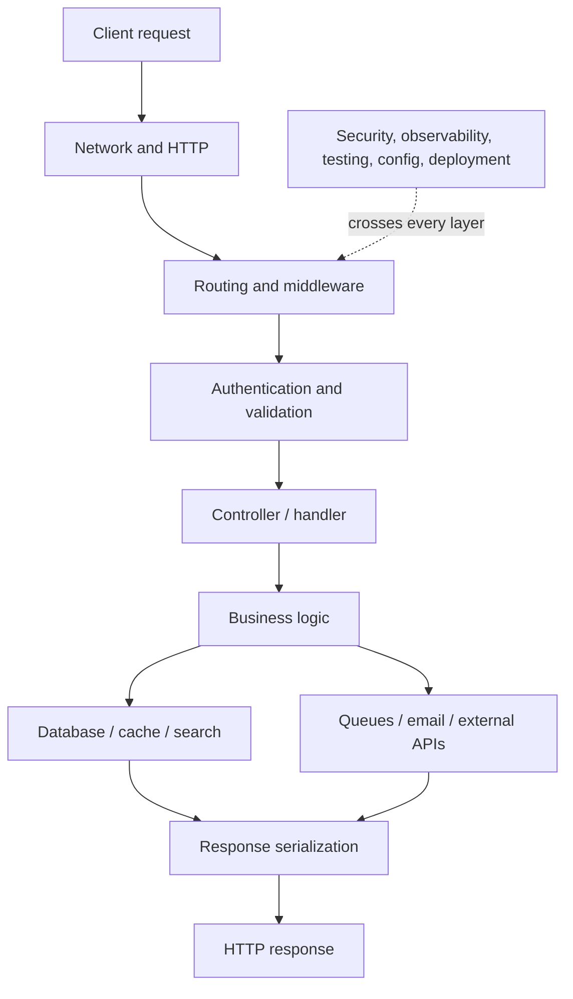

## Interview / learning tips

- Be able to explain why backend engineering is more than CRUD.
- When learning a tool, ask: **Which underlying problem does it solve? What existed before it? What trade-off does it introduce?**
- Do not memorize a framework's API without understanding the HTTP, concurrency, database, and security concepts beneath it.
- A useful learning outcome is not “I used Redis”; it is “I identified repeated expensive reads, selected a cache policy, handled invalidation, and measured the hit ratio.”

**Practice task:** Pick one project you have built. Draw the request path from the browser to the database and back. Mark each trust boundary, external dependency, and possible failure point.

---

# Chapter 02 — Walk the path of a true backend engineer

**Video:** [Walk the path of a true backend engineer](https://www.youtube.com/watch?v=3qFjZbFRSAU) · **3:53**

## Transcript notes

This short orientation video explains the intended learning journey as three connected stages:

1. **Story and philosophy:** understand language-agnostic principles and why backend systems are structured as they are.
2. **Implementation:** apply the same principles in concrete language ecosystems, with Node.js and Go used as examples.
3. **Production-level projects:** combine the concepts and implementation details in end-to-end applications that can be operated and maintained.

The instructor's point is that implementation becomes easier when the learner already understands the problem being solved. A database principle, for example, can be implemented with PostgreSQL through different drivers without changing the fundamental concepts of persistence, transactions, indexes, and consistency.

## Enhanced engineering notes

Use a deliberate learning loop rather than passively watching a playlist:

1. **Understand:** watch the chapter and write down the problem, not just the definition.
2. **Reconstruct:** explain the flow without looking at notes.
3. **Implement:** build the smallest working version in your primary stack.
4. **Break it:** introduce a timeout, malformed payload, duplicate request, unavailable database, or concurrent update.
5. **Observe:** inspect logs, metrics, traces, database queries, and network traffic.
6. **Compare:** identify how another language/framework solves the same problem.

This sequence turns conceptual knowledge into debugging ability.

## Diagram — learning progression

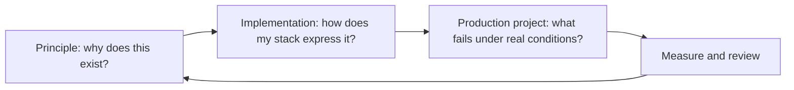

## Practical study template

For every topic, keep a one-page record:

| Prompt | What to write |
|---|---|
| Problem | What would break without this concept? |
| Mechanism | What happens step by step? |
| Trade-off | What does this improve, and what does it cost? |
| Failure mode | How can it fail in production? |
| Implementation | How does the chosen stack implement it? |
| Evidence | Which test, metric, log, or trace proves it works? |

**Practice task:** Implement one small API twice—once in FastAPI and once in a second framework. Compare the architecture, not just syntax.

---

# Chapter 03 — What is a backend, how does it work, and why do we need it?

**Video:** [What is a Backend, how do they work and why do we need them?](https://www.youtube.com/watch?v=6Ss4dJD9Kzg) · **19:01**

## Transcript notes

A backend is a computer or application process that listens for requests—commonly HTTP, but potentially WebSocket or gRPC—on a network port and performs work on behalf of clients. It may return static files or structured data, accept user input, apply business logic, and persist or retrieve data.

The video traces a request through a representative cloud deployment:

1. The browser resolves a domain name through DNS.
2. DNS returns an address that leads the client toward the cloud-hosted machine.
3. The cloud firewall/security group permits only configured ports (commonly 22 for SSH and 80/443 for web traffic; production access should be more restrictive than a demo setup).
4. A reverse proxy such as Nginx receives the public request and handles tasks such as TLS termination and forwarding.
5. The reverse proxy forwards the request to an application process listening on a private/local port.
6. A process manager such as PM2 keeps the application process alive and can restart it after failure.
7. The application executes logic and sends the response back through the proxy and network.

The video distinguishes a frontend server from a backend server. A frontend server commonly delivers HTML, CSS, and JavaScript; the browser then executes that code. A backend server executes server-side logic for each request.

The backend centralizes cross-user state and privileged operations. A single browser knows only its own local view; the backend can coordinate shared state such as who liked a post, who owns a resource, or who should receive a notification.

The browser sandbox is a security boundary. Browser code should not receive unrestricted filesystem, environment-variable, or database credentials. Direct database access from every browser would expose secrets and create connection-management and authorization problems.

## Diagram — request path in a simple VM deployment

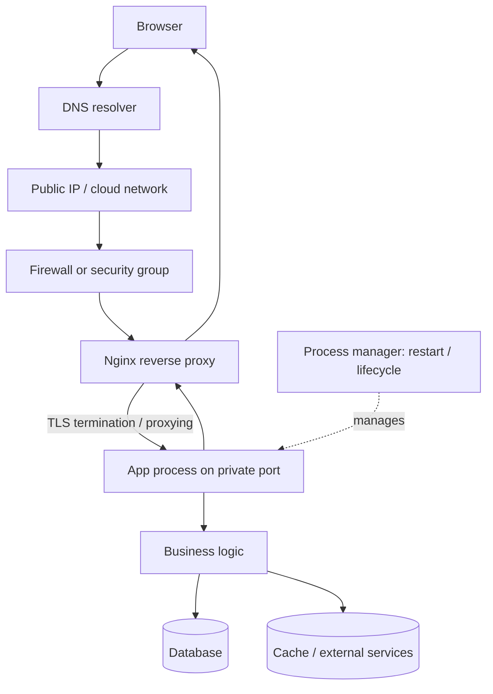

## Enhanced engineering notes

- **DNS is name resolution, not application routing.** DNS gets the client to an IP address; the reverse proxy and application router decide which service/handler receives the HTTP request.
- **A reverse proxy is not the same as a router inside your app.** Nginx may route by host/path to an upstream service; FastAPI/Express/Spring routing maps a request to an application handler.
- **TLS termination** at the proxy means the external connection is encrypted, while the proxy may use a separate internal connection to the app. That internal hop still needs an appropriate trust model.
- Keep application ports private where possible. Public exposure should normally be limited to the load balancer/reverse proxy.
- A process manager does not make an application fault-tolerant by itself. It can restart a crashed process, but it does not protect data from partial writes or make in-flight work safe.

## Frontend vs. backend responsibilities

| Frontend/browser | Backend/server |
|---|---|
| UI rendering and user interaction | Authoritative business rules |
| Immediate UX validation | Security and integrity validation |
| Holds short-lived UI state | Coordinates shared persistent state |
| Calls APIs | Owns database credentials and connections |
| Cannot be trusted as an authority | Must still validate every request |

## Interview tip

When asked “Why do we need a backend?”, do not answer only “to connect to the database.” Explain **centralized trust, shared state, privileged access, durable persistence, integration with external services, and controlled business logic**.

**Practice task:** Deploy a tiny FastAPI service behind Nginx. Trace DNS, TLS, firewall, reverse proxy, application port, and database access. Document which ports are public and why.

---

# Chapter 04 — Benefits of learning backend from first principles

**Video:** [Benefits of learning backend engineering from first principles](https://www.youtube.com/watch?v=6fqZs5Z3k9A) · **10:11**

## Transcript notes

The video motivates first-principles learning through the dilemma of a developer who knows one framework but struggles when the ecosystem changes. It presents the advantages of understanding common concepts beneath frameworks:

- **Seeing the big picture:** understand how routing, middleware, database access, authentication, caching, and error handling fit together.
- **Faster onboarding:** new frameworks become easier because the learner recognizes familiar responsibilities under different names.
- **Faster project execution:** the developer can reuse a mental model rather than rediscovering the same architecture for each project.
- **Less syntax fatigue:** the presenter illustrates moving from Node.js to Rust; the language syntax changes, but concepts such as request handling, validation, persistence, and error propagation remain recognizable.
- **Better tool selection:** choose a tool based on workload and trade-offs rather than familiarity or hype.
- **More employability:** transferable reasoning is useful across teams and technology stacks.

The video emphasizes that experience is not only years spent using a particular framework. It is also pattern recognition about the problems systems repeatedly face.

## Enhanced engineering notes

A framework-independent concept map is a career asset. For example:

| Need | Possible implementations |
|---|---|
| HTTP server | Express, FastAPI, Spring Boot, Go `net/http` |
| Schema validation | Pydantic, Zod, Joi, struct validators |
| Background work | Celery, BullMQ, Asynq |
| Cache | Redis, Memcached, in-process cache |
| Relational persistence | PostgreSQL, MySQL, SQL Server |
| Observability | OpenTelemetry, Prometheus, Grafana, Datadog |

Do not conclude that tools are interchangeable in every respect. Their APIs, performance profiles, operational costs, and ecosystem maturity differ. The transferable part is the **problem model**; the implementation still requires learning the tool.

## Diagram — portable knowledge

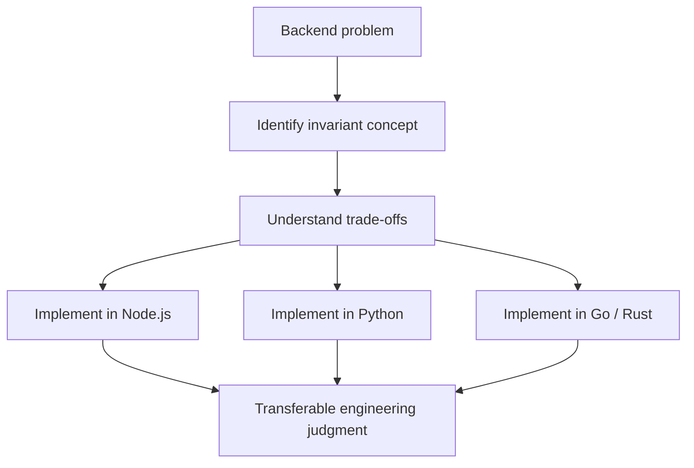

## Practical tips

- Learn one primary stack deeply enough to ship and debug production-like systems.
- Learn a second stack selectively to test whether your understanding transfers.
- When switching frameworks, map the new framework's components to known responsibilities: routing, dependency injection, middleware, lifecycle, persistence, and error handling.
- Prefer “why is this abstraction necessary?” over “what is the syntax?”

**Practice task:** Implement the same `POST /users` flow in two languages. Keep the architecture consistent and write down the differences that genuinely matter.

---

# Chapter 05 — Understanding HTTP

**Video:** [Understanding HTTP for backend engineers, where it all starts](https://www.youtube.com/watch?v=a3C1DMswClQ) · **1:18:13**

## Transcript notes

HTTP is an application-layer protocol that defines how clients and servers exchange requests and responses. The video starts with two core properties:

- **Client-server model:** the client initiates a request; the server processes it and sends a response.
- **Statelessness:** a request does not automatically carry memory of earlier requests. If the application needs continuity, it uses an explicit mechanism such as cookies, sessions, tokens, or stored state.

The video introduces the OSI model to locate HTTP at the application layer, then covers the evolution of HTTP, raw request/response structure, headers, methods, idempotency, CORS, response codes, caching, content negotiation, compression, persistent connections, multipart data, streaming, SSL/TLS, and HTTPS.

### HTTP messages

A request contains a start line, headers, a blank line, and an optional body. A response contains a status line, headers, a blank line, and an optional body.

```http
GET /v1/books?page=2&limit=20 HTTP/1.1
Host: api.example.com
Accept: application/json
Authorization: Bearer <access-token>

```

```http
HTTP/1.1 200 OK
Content-Type: application/json
Cache-Control: private, max-age=30

{"data": [{"id": 21, "title": "Distributed Systems"}], "page": 2}
```

Headers carry metadata about the request/response: content type, accepted formats, authorization, caching directives, language, compression, and security properties. The video groups headers into request, general, representation, and security-oriented categories.

### Methods and idempotency

- `GET`: retrieve a representation; should not change server state.
- `POST`: submit data or trigger an operation; often creates a resource and is not inherently idempotent.
- `PUT`: replace the target representation; intended to be idempotent.
- `PATCH`: apply a partial modification; idempotency depends on the patch operation.
- `DELETE`: request deletion; intended to be idempotent even if repeated calls return different response codes.
- `OPTIONS`: discover communication options; used in CORS preflight.

**Idempotent** means repeating the same request has the same intended effect on server state. It does not mean the response bytes or status code must be identical.

### CORS

CORS is a browser-enforced policy for cross-origin requests. It is not a general server-to-server firewall. A simple cross-origin request can be sent directly, after which the browser checks the response's CORS headers. A request requiring preflight first triggers an `OPTIONS` request; the browser sends the actual request only if the preflight response permits it.

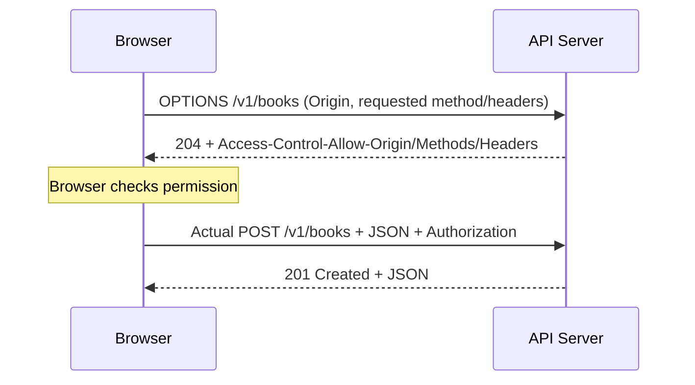

A common preflight trigger is a JSON request with `Content-Type: application/json`, a non-simple header such as `Authorization`, or a method other than GET/HEAD/POST. CORS must be configured with explicit trusted origins; wildcard origins are not compatible with credentialed requests.

### Status-code families

| Code | Meaning | Typical use |
|---|---|---|
| 200 | OK | Successful read/update with a body |
| 201 | Created | Resource created; often include `Location` |
| 202 | Accepted | Work accepted for asynchronous processing |
| 204 | No Content | Successful action with no response body |
| 301/302 | Redirect | Resource moved or temporary redirect |
| 304 | Not Modified | Conditional GET can use cached representation |
| 400 | Bad Request | Malformed or invalid client input |
| 401 | Unauthorized | Missing/invalid authentication credentials |
| 403 | Forbidden | Authenticated caller lacks permission |
| 404 | Not Found | Resource/route not found |
| 405 | Method Not Allowed | Method unsupported for this resource |
| 409 | Conflict | State conflict, e.g. duplicate unique value |
| 422 | Unprocessable Content | Syntactically valid payload fails semantic rules (API convention) |
| 429 | Too Many Requests | Rate limit exceeded |
| 500 | Internal Server Error | Unexpected application failure |
| 502 | Bad Gateway | Gateway received invalid upstream response |
| 503 | Service Unavailable | Temporarily unable to serve requests |
| 504 | Gateway Timeout | Upstream did not respond before deadline |

### HTTP caching

The video demonstrates `Cache-Control`, `ETag`, and `Last-Modified`. On a first request, the server returns a body and validators. A later request can send `If-None-Match` or `If-Modified-Since`. If the resource is unchanged, the server returns `304 Not Modified`, and the browser reuses its cached copy.

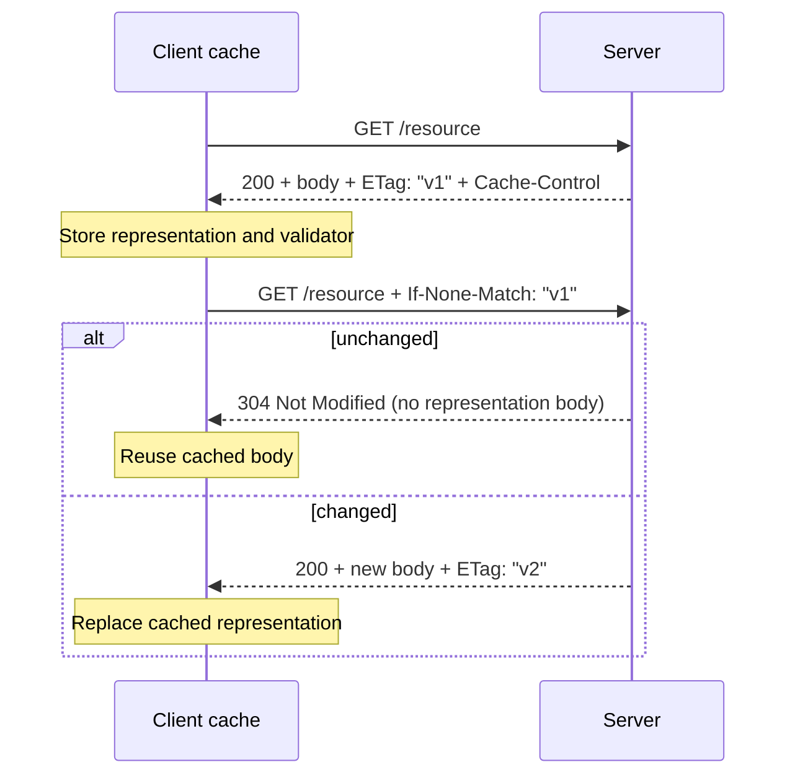

Other HTTP topics covered: `Accept`, `Accept-Language`, and `Accept-Encoding` for content negotiation; gzip/deflate/Brotli for compression; HTTP/1.1 persistent connections; multipart form uploads with a boundary; response streaming; and HTTPS, which is HTTP protected by TLS. SSL is obsolete and should not be deployed.

## Enhanced engineering notes

### TLS handshake at a high level

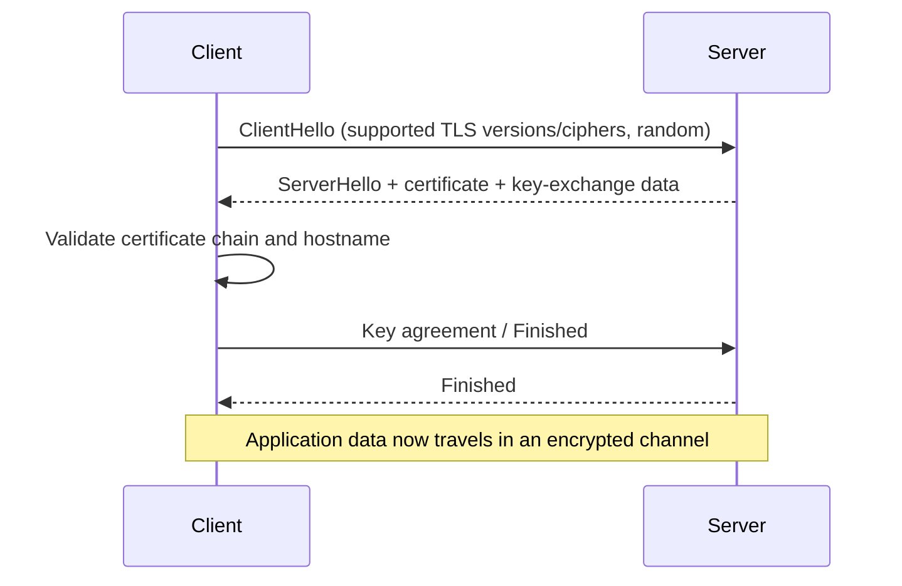

TLS provides confidentiality and integrity in transit and authenticates the server when certificate validation succeeds. HTTPS does **not** automatically make an application secure: authorization, input validation, secure cookies, and safe database access remain application responsibilities.

### Compression trade-off

Compression reduces network bytes but consumes CPU. It is usually useful for sufficiently large text responses; avoid compressing already-compressed formats (JPEG, MP4, ZIP) without evidence that it helps. Set response-size limits to avoid compression abuse and excessive memory use.

### Python example — conditional response with ETag

```python
from fastapi import FastAPI, Header, Response
import hashlib

app = FastAPI()
RESOURCE = b'{"message":"hello"}'
ETAG = '"' + hashlib.sha256(RESOURCE).hexdigest() + '"'

@app.get("/resource")
def get_resource(if_none_match: str | None = Header(default=None)):
    if if_none_match == ETAG:
        return Response(status_code=304, headers={"ETag": ETAG})
    return Response(
        content=RESOURCE,
        media_type="application/json",
        headers={"ETag": ETAG, "Cache-Control": "public, max-age=60"},
    )
```

### Practical HTTP debugging checklist

1. Inspect method, URL, query string, headers, and body.
2. Confirm the status code and `Content-Type`.
3. Check CORS preflight in browser DevTools; server-to-server clients do not enforce browser CORS.
4. Check cache headers and validators before assuming stale data is a backend bug.
5. Check whether compression is active and whether transfer size differs from decoded size.
6. For latency, separate DNS, connection/TLS, time-to-first-byte, server work, and download time.

**Interview tip:** Be able to distinguish HTTP statelessness from application statefulness, CORS from authentication, a `401` from a `403`, and an ETag validator from a cache lifetime (`max-age`).

---

# Chapter 06 — Routing in backend

**Video:** [What is Routing in Backend? How Requests Find Their Way Home](https://www.youtube.com/watch?v=SubuU1iOC2s) · **24:04**

## Transcript notes

Routing maps an incoming request to the server-side logic that should handle it. The method describes **what action** is requested; the route describes **which resource/location** is targeted. A route is therefore identified by the combination of HTTP method and path: `GET /books` and `POST /books` may map to different handlers.

The lesson walks through static routes, dynamic routes and path parameters, query parameters, pagination, nested routes, versioning/deprecation, and catch-all routes. It uses a demo frontend and inspects requests with an HTTP proxy rather than focusing on framework-specific syntax.

### Route types

- **Static:** `/api/books` — fixed path.
- **Dynamic:** `/api/books/{book_id}` — a variable path segment captured as a parameter.
- **Query parameters:** `/api/books?page=2&limit=20` — optional filters, search terms, sorting, or pagination metadata.
- **Nested:** `/api/users/123/posts/456` — expresses a relationship between a parent and child resource.
- **Catch-all:** a fallback route that handles requests not matched by earlier routes, typically returning a deliberate 404.

Use path parameters to identify a resource and query parameters to shape a collection request. Query strings are not limited to GET, but GET collection endpoints commonly use them because the resource selection is encoded in the URL.

### Pagination example

If there are 100 books and the page size is 20, there are five pages. Page 2 can be requested as `/api/books?page=2&limit=20`. Validate bounds and apply a stable ordering, ideally with a unique tie-breaker such as `id`, otherwise records can appear on multiple pages or be skipped while data changes.

### Versioning and deprecation

A route such as `/api/v1/books` allows a breaking change to be introduced as `/api/v2/books` while older clients migrate. Deprecation should be communicated with a timeline, migration guide, and (where appropriate) `Deprecation`/`Sunset` response headers. Versioning is not a substitute for thoughtful backwards-compatible evolution.

## Diagram — route matching

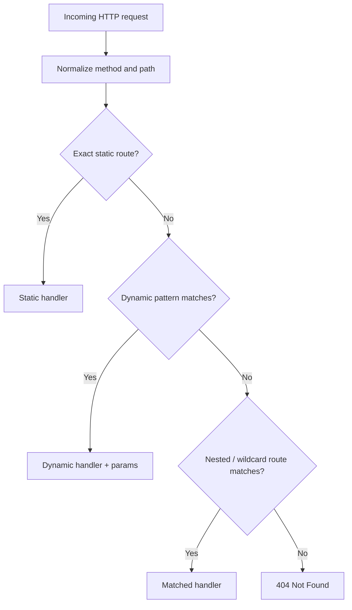

## Enhanced engineering notes

### FastAPI route examples

```python
from fastapi import FastAPI, HTTPException, Query

app = FastAPI()

@app.get("/v1/books")
def list_books(page: int = Query(1, ge=1), limit: int = Query(20, ge=1, le=100)):
    offset = (page - 1) * limit
    return {"page": page, "limit": limit, "offset": offset, "data": []}

@app.get("/v1/books/{book_id}")
def get_book(book_id: int):
    if book_id <= 0:
        raise HTTPException(status_code=400, detail="book_id must be positive")
    return {"id": book_id}
```

### Route design tips

- Register specific routes before catch-all routes where the framework uses ordered matching.
- Avoid ambiguous paths such as `/users/me` being captured by `/users/{user_id}` unless route precedence is clear.
- Validate and convert path/query strings into typed values at the boundary.
- Use plural nouns for resource collections; make route names consistent.
- Avoid putting secrets or large payloads in URLs; URLs can appear in logs, browser history, and referrer data.
- Use stable sorting for pagination; keyset/cursor pagination is often better than large offsets at scale.
- Route grouping can centralize version prefixes, authentication, permissions, and common middleware.

**Interview tip:** Explain the difference between a route, a handler, a path parameter, a query parameter, and an HTTP method. Then design `GET /users/{id}/orders` and discuss ownership checks and pagination.

---

# Chapter 07 — Serialization and deserialization

**Video:** [Serialization and Deserialization for backend engineers](https://www.youtube.com/watch?v=vzg90tY3uM0) · **21:48**

## Transcript notes

The problem is interoperability: a browser, Python service, Go service, and database may represent data differently in memory. They need an agreed representation for communication. **Serialization** converts an in-memory value into a wire format; **deserialization** converts the received representation into the receiver's native data structure.

The video places this within the application layer and gives a high-level OSI recap: application data is encoded into network payloads, segmented/packetized, transmitted, and reconstructed at the other end. For backend application work, the main concern is the application-level contract and payload correctness—not manually implementing physical transmission.

Text formats include JSON, XML, and YAML. Binary formats include Protocol Buffers (Protobuf). JSON is popular because it is readable and widely supported; binary formats can be smaller and faster in suitable workloads but are less human-readable and often require schema/tooling discipline.

JSON values include strings, numbers, booleans, arrays, objects, and null. Keys are strings. Nested values are valid. The video demonstrates a JSON request body and JSON response body marked with `Content-Type: application/json`.

## Diagram — serialization across services

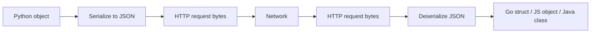

## Enhanced engineering notes

### Example JSON contract

```json
{
  "id": 42,
  "title": "Backend Engineering",
  "published": true,
  "tags": ["http", "databases"],
  "author": {"id": 7, "name": "Asha"},
  "published_at": "2026-11-02T10:30:00Z"
}
```

### Python serialization

```python
from datetime import datetime, timezone
from pydantic import BaseModel, ConfigDict

class Author(BaseModel):
    id: int
    name: str

class Book(BaseModel):
    model_config = ConfigDict(extra="forbid")
    id: int
    title: str
    published: bool
    tags: list[str]
    author: Author
    published_at: datetime

book = Book(
    id=42,
    title="Backend Engineering",
    published=True,
    tags=["http", "databases"],
    author={"id": 7, "name": "Asha"},
    published_at=datetime.now(timezone.utc),
)
payload = book.model_dump_json()
restored = Book.model_validate_json(payload)
```

### Common serialization pitfalls

- **Missing vs. null:** a missing field and a present field with `null` can mean different things, especially for PATCH.
- **Unknown fields:** decide whether to reject, ignore, or preserve them. Rejecting unexpected fields is useful for strict APIs; forward-compatible integrations may need a more tolerant policy.
- **Numbers:** JSON has one general number syntax; clients may lose precision for very large integers in JavaScript. Encode large identifiers as strings when necessary.
- **Dates:** use an unambiguous standard such as ISO 8601 with timezone information; do not send locale-dependent date strings.
- **Enums:** define allowed values and behavior when a new enum value appears.
- **Payload size:** omit unneeded fields, paginate collections, and compress large textual responses.
- **Security:** deserialization is not validation. Parse safely, validate schema and semantics, limit payload size/depth, and never assume a syntactically valid JSON object is trustworthy.

### Choosing JSON vs. Protobuf

| Use case | Usually sensible starting point |
|---|---|
| Public REST API / browser client | JSON |
| Human-inspected configuration/logs | JSON or YAML |
| Strongly typed service-to-service RPC with schema evolution | Protobuf/gRPC |
| Large high-volume messages | Benchmark JSON and binary formats |

**Interview tip:** Distinguish parsing, deserialization, validation, normalization, and business-rule enforcement. They are related stages, not synonyms.

**Practice task:** Define a versioned JSON schema for a `Book` resource. Test missing fields, extra fields, nulls, invalid dates, huge integers, and nested arrays.

---

# Chapter 08 — Authentication and authorization

**Video:** [Authentication and authorization for backend engineers](https://www.youtube.com/watch?v=A95rliroC8Q) · **1:35:57**

## Transcript notes

The foundational distinction is:

- **Authentication:** establish who the caller is.
- **Authorization:** decide what the authenticated caller may do.

The video uses a historical narrative to explain trust mechanisms: physical seals, passphrases, passwords, cryptographic techniques, multi-factor authentication, and biometrics. It then focuses on sessions, JWTs, cookies, stateful/stateless authentication, API keys, OAuth 2.0, OpenID Connect, role-based access control, generic error responses, and timing attacks.

### Sessions

A session-based flow stores session state on the server. After login, the server creates a random session ID and sends it to the browser, usually in a cookie. Subsequent requests carry the cookie; the server looks up the session and obtains the associated user identity and state. The session store may be a database or Redis.

### JWT

A JWT typically contains a header, claims payload, and signature. The signature lets the receiver verify integrity and issuer trust; a signed JWT is **not encrypted by default**, so sensitive secrets should not be placed in the payload. JWTs can reduce a per-request session lookup, but expiry, revocation, refresh-token rotation, and key management still need deliberate design.

### Cookies

Cookies carry data between browser requests. Security-sensitive session cookies should generally use `HttpOnly`, `Secure`, and an appropriate `SameSite` policy, with domain/path and expiry carefully scoped.

### Stateful vs. stateless

Stateful sessions offer central revocation and server-side control but require a shared session store in a multi-instance deployment. Stateless access tokens are easier to validate across services but are harder to revoke immediately. Real systems often combine short-lived access tokens with server-tracked refresh sessions.

### API keys, OAuth, OIDC, RBAC

- API keys commonly identify or authenticate an application/integration; they are not a replacement for a complete human login system.
- OAuth 2.0 is an authorization framework for delegated access, using scoped tokens rather than sharing a user's password.
- OpenID Connect adds an identity/authentication layer to OAuth 2.0, including an ID token.
- RBAC assigns users to roles and roles to permissions.

The video highlights generic authentication errors and response-time differences as potential information leaks. Returning “invalid username or password” avoids directly revealing which credential was wrong; constant-time verification and careful handling reduce timing leakage.

## Diagram — session login flow

```mermaid
sequenceDiagram
    participant B as Browser
    participant A as API
    participant R as Session store (Redis/DB)
    B->>A: POST /login (credentials)
    A->>A: Verify password hash
    A->>R: Create session record
    R-->>A: session_id
    A-->>B: Set-Cookie: session_id; HttpOnly; Secure; SameSite
    B->>A: GET /me + Cookie
    A->>R: Lookup session_id
    R-->>A: user_id, expiry, session state
    A-->>B: 200 user profile
```

## Diagram — authorization decision

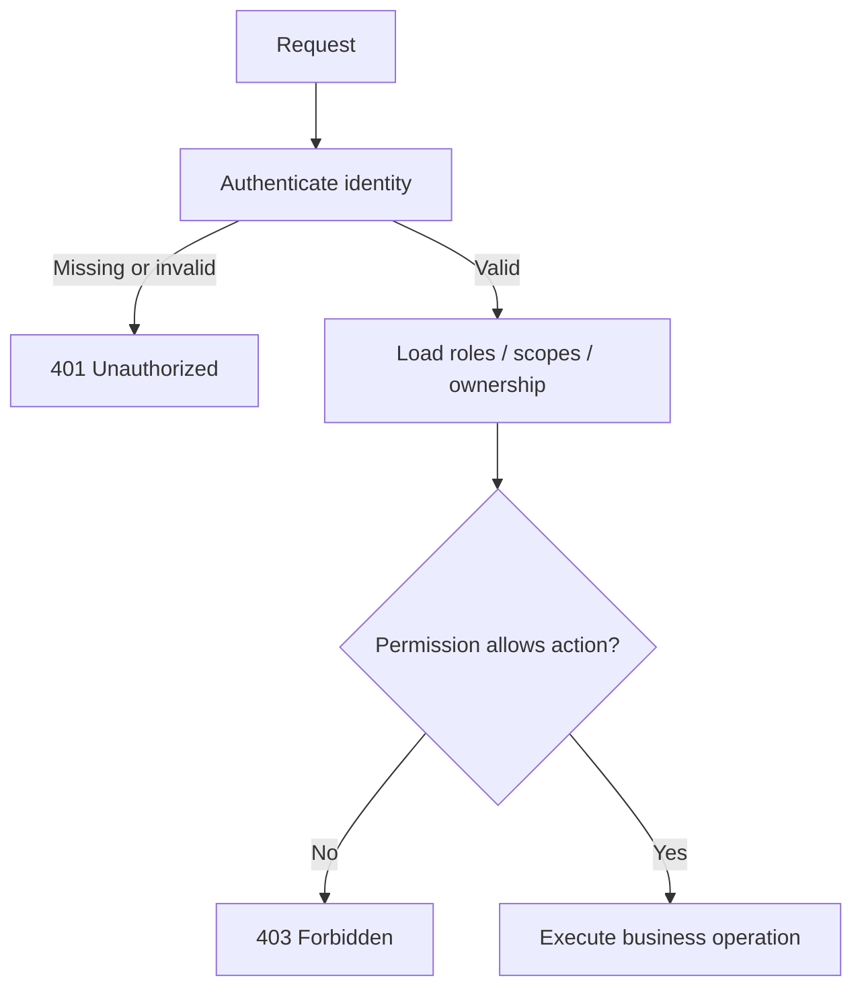

## Enhanced engineering notes

### Password storage

Never store plaintext passwords. Store a salted password hash using a password-hashing algorithm designed to be slow and resistant to brute force, such as **Argon2id** (or bcrypt/scrypt where appropriate). A general-purpose fast hash such as SHA-256 alone is not a password-storage solution.

### Secure cookie example

```http
Set-Cookie: session=opaque-random-id; Path=/; HttpOnly; Secure; SameSite=Lax; Max-Age=3600
```

`HttpOnly` blocks ordinary browser JavaScript from reading the cookie; `Secure` restricts sending to HTTPS; `SameSite` helps mitigate CSRF but must be selected based on actual cross-site login/redirect flows.

### RBAC example

```python
ROLE_PERMISSIONS = {
    "reader": {"book:read"},
    "editor": {"book:read", "book:update"},
    "admin": {"book:read", "book:update", "book:delete"},
}

def can(role: str, permission: str) -> bool:
    return permission in ROLE_PERMISSIONS.get(role, set())
```

Authorization must also check **resource ownership and tenant boundaries**. A user having `invoice:read` does not automatically mean they can read every tenant's invoice.

### Common mistakes

- Treating a JWT as encrypted data.
- Putting long-lived access tokens in browser local storage without considering XSS exposure.
- Forgetting token revocation and refresh-token rotation.
- Trusting user IDs or roles supplied in the request body.
- Confusing `401` (credentials absent/invalid) with `403` (identity known, permission denied).
- Applying roles without checking record-level ownership (BOLA/IDOR).

**Interview tip:** Be able to compare opaque sessions and JWTs by storage, revocation, scaling, payload exposure, and operational complexity. There is no universal “JWT is always better” answer.

---

# Chapter 09 — Validation and transformation

**Video:** [Validations and transformations for backend engineers](https://www.youtube.com/watch?v=qedj_JjjL-U) · **42:48**

## Transcript notes

Validation belongs at the boundary where untrusted client input enters the backend: after route matching and parsing/binding, but before controller business logic, service calls, or database writes. The video demonstrates that skipping validation can allow malformed data to reach a database constraint, producing a vague internal error rather than a useful client error.

The three broad validation categories are:

1. **Syntactic:** does the value have the expected form? Examples: email, phone, date structure.
2. **Semantic:** does the value make sense? Examples: date of birth is not in the future; age is within a valid range.
3. **Type:** is the value the expected type? Examples: string, integer, boolean, array, object.

Transformation converts data into the representation expected by the application. Query/path parameters arrive as text and often need type conversion. Other transformations include whitespace trimming, email normalization, phone normalization, and date conversion to a standard representation.

The video also covers cross-field validation (password and confirmation must match), conditional validation (a field is required only when another field has a particular value), array/object constraints, frontend and backend validation, and aggregation of useful validation errors.

## Diagram — trusted input pipeline

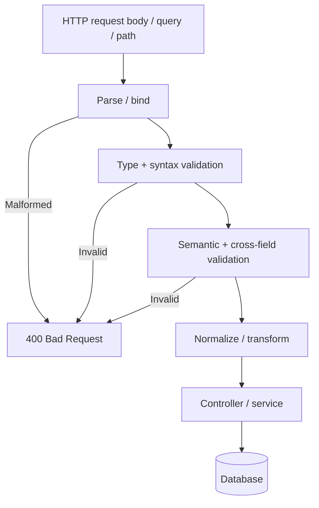

## Enhanced engineering notes

### FastAPI / Pydantic example

```python
from datetime import date
from pydantic import BaseModel, EmailStr, Field, field_validator, model_validator

class SignupRequest(BaseModel):
    email: EmailStr
    age: int = Field(ge=18, le=120)
    password: str = Field(min_length=12)
    confirm_password: str
    date_of_birth: date

    @field_validator("email")
    @classmethod
    def normalize_email(cls, value: str) -> str:
        return value.strip().lower()

    @model_validator(mode="after")
    def check_consistency(self):
        if self.password != self.confirm_password:
            raise ValueError("passwords do not match")
        if self.date_of_birth > date.today():
            raise ValueError("date_of_birth cannot be in the future")
        return self
```

### Validation vs. sanitization

Validation decides whether input is acceptable. Normalization transforms equivalent representations to one canonical form. Output encoding/sanitization is context-specific and prevents data from being interpreted as executable code. Do **not** try to “sanitize” SQL by stripping quote characters; use parameterized queries. For HTML, use context-aware output encoding and safe templating.

### Frontend and backend responsibilities

- Frontend validation improves usability and avoids needless round trips.
- Backend validation is mandatory because clients can be modified, bypassed, or replaced by scripts and direct HTTP clients.
- Database constraints remain the final integrity boundary for invariants such as uniqueness and foreign keys.

### Validation design tips

- Validate early and fail clearly.
- Bound input size and collection lengths.
- Return field-level errors in a consistent structure.
- Do not leak secrets or internal implementation details in errors.
- Keep validation schemas close to API contracts and test them.
- Avoid duplicate contradictory rules across frontend/backend; share schemas where technically appropriate, but never remove server-side enforcement.

**Interview tip:** Explain the difference between syntactic, semantic, and type validation, and why a form that passes browser validation can still be invalid at the backend.

---

# Chapter 10 — Controllers, services, repositories, middleware, request context

**Video:** [Controllers, services, repositories, middlewares and request context](https://www.youtube.com/watch?v=hyc-7w3pee8) · **59:57**

## Transcript notes

The video moves from the external HTTP request lifecycle to the internal organization of a backend. A representative request passes through routing and middleware, then a handler/controller, service layer, repository layer, and database. The response travels back through the controller.

### Controller / handler

The controller is the HTTP-facing boundary. It extracts request data, binds/deserializes it, validates it, applies appropriate defaults or transformations, calls the service, maps the result to an HTTP status, and serializes the response. It should not become a dumping ground for business logic.

### Service layer

The service layer expresses business operations and orchestrates repositories and external dependencies. Ideally it is transport-independent: it should not need an HTTP request object or choose HTTP response codes. It accepts validated data and returns domain/application results.

### Repository layer

The repository isolates persistence details. Its methods should have clear responsibilities and return predictable result shapes. A service can call multiple repository methods as part of one business operation.

### Middleware

Middleware sits around or between stages of request processing. Typical uses include CORS, security headers, authentication, rate limiting, request logging, parsing, compression, and global error handling. It receives request/response/control-flow information and either continues the chain or short-circuits it. Ordering matters.

### Request context

Request context is per-request metadata shared across the lifecycle: authenticated user, roles, request ID, trace ID, deadline, cancellation signal, and other request-scoped values. The identity used for a write must come from trusted authentication context, not a user ID submitted in the request body.

## Diagram — layered architecture

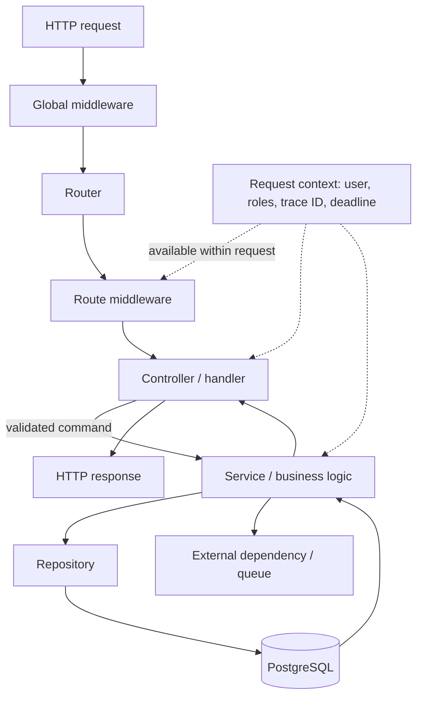

## Enhanced engineering notes — a small FastAPI structure

```text
app/
  main.py
  api/routes/books.py          # HTTP endpoints
  api/schemas/book.py          # request/response DTOs
  services/book_service.py     # business rules
  repositories/book_repo.py    # SQL/persistence
  middleware/request_id.py
  middleware/error_handler.py
  core/config.py
  core/security.py
```

```python
# api/routes/books.py
from fastapi import APIRouter, Depends, HTTPException
from app.services.book_service import BookService
from app.schemas.book import BookCreate, BookOut

router = APIRouter(prefix="/v1/books", tags=["books"])

@router.post("", response_model=BookOut, status_code=201)
def create_book(payload: BookCreate, service: BookService = Depends()):
    try:
        return service.create_book(payload)
    except ValueError as exc:
        raise HTTPException(status_code=409, detail=str(exc)) from exc
```

```python
# services/book_service.py
class BookService:
    def __init__(self, repository=None):
        self.repository = repository

    def create_book(self, payload):
        # Business invariants belong here, not in the HTTP route.
        if self.repository.title_exists(payload.title):
            raise ValueError("A book with this title already exists")
        return self.repository.insert(payload)
```

## Middleware ordering example

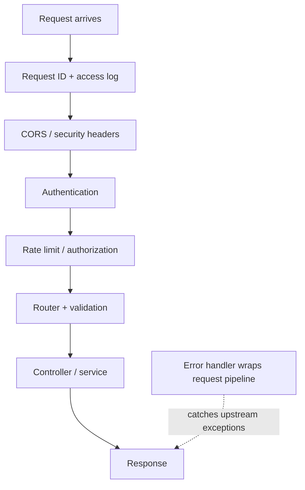

The exact order depends on framework semantics. In many frameworks, error middleware is registered so it wraps downstream work, not simply appended as the last normal handler. CORS may need to run early so errors also receive CORS headers.

## Design tips

- Keep controllers thin and HTTP-aware; keep services business-aware and transport-agnostic.
- Keep repositories focused on persistence, not authorization policy or presentation formatting.
- Avoid passing the whole request object deep into business logic.
- Put authenticated identity and trace metadata in request-scoped context; do not use context as an unstructured global variable store.
- Use explicit dependency injection for testability.
- Avoid a service/repository abstraction for every trivial function if it adds no useful separation. These are design tools, not mandatory ceremony.

**Interview tip:** Explain a create-order request from HTTP entry to SQL commit and back. Identify which layer validates the payload, checks business invariants, performs persistence, and chooses the HTTP status.

---

# Chapter 11 — Complete REST API design

**Video:** [Complete REST API Design](https://www.youtube.com/watch?v=RG6q57DwV8Y) · **2:03:34**

## Transcript notes

The video motivates API standards: an API is a contract used by clients and services that may evolve independently. Consistency makes the API predictable and reduces client-side special cases.

REST is introduced through its history and its emphasis on resources, representations, and a uniform interface. A representation is a format such as JSON; state is the current resource data; transfer is the exchange of that representation over HTTP. The video references the architectural constraints associated with REST: client-server separation, statelessness, cacheability, layered systems, a uniform interface, and optional code-on-demand.

### URL and resource conventions

- Use resource-oriented nouns, commonly plural: `/v1/organizations`, `/v1/projects`.
- A collection endpoint lists or creates resources; an item endpoint identifies one resource: `/v1/projects/{project_id}`.
- Keep naming and casing consistent. Use clear URL-safe slugs for human-readable names; avoid spaces and ad hoc abbreviations.
- Version the API deliberately, commonly via a path segment such as `/v1`.

### CRUD semantics

| Operation | Example | Typical method | Typical success |
|---|---|---|---|
| List | `/v1/projects` | GET | 200 |
| Retrieve | `/v1/projects/42` | GET | 200 |
| Create | `/v1/projects` | POST | 201 |
| Replace | `/v1/projects/42` | PUT | 200 or 204 |
| Partial update | `/v1/projects/42` | PATCH | 200 or 204 |
| Delete | `/v1/projects/42` | DELETE | 204 |

The live design walkthrough builds organization and project resources, covering list/create/retrieve/update/delete, pagination, sorting, filtering, and custom actions such as archiving.

### Collection behavior

A collection endpoint should have sensible defaults for page size and sort order. A list with zero matches normally returns `200` with an empty array; `404` is generally for a specific resource that does not exist. Use a response envelope consistently if clients need metadata such as total count and current page.

### Custom actions

Business actions that do not fit naturally into CRUD—archive, clone, invite, publish—can be modeled as an explicit action endpoint, often with POST, such as `POST /v1/projects/42/archive`. The response depends on what happened: a newly created resource can return 201; a completed action may return 200 or 204; queued work may return 202.

## Diagram — resource-oriented API design

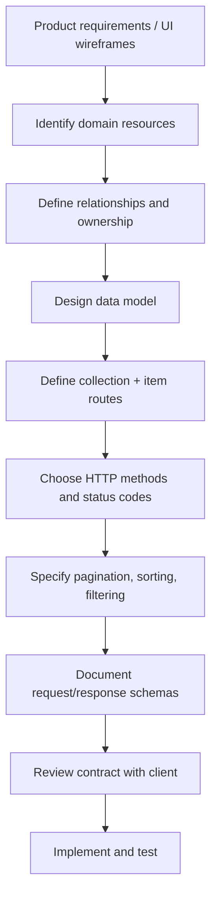

## Enhanced engineering notes

### Example response contract

```json
{
  "data": [
    {"id": "prj_42", "name": "Placement Portal", "status": "active"}
  ],
  "pagination": {
    "page": 1,
    "limit": 20,
    "total": 57,
    "total_pages": 3
  }
}
```

### Idempotency nuance

HTTP defines method semantics, but application details matter:

- GET is safe and idempotent when implemented correctly.
- PUT is intended to replace a resource and be idempotent.
- DELETE is idempotent in effect: deleting an already-deleted resource does not delete something extra, even if the second response is 404.
- POST is not generally idempotent. Payment/order creation often needs an **idempotency key** to make retries safe.
- PATCH is **not guaranteed** to be idempotent. Setting `status = "archived"` may be idempotent; incrementing a counter is not.

### Example: safe pagination, sorting, and filtering

```python
from fastapi import FastAPI, Query

app = FastAPI()
ALLOWED_SORTS = {"created_at", "name", "status"}

@app.get("/v1/projects")
def list_projects(
    page: int = Query(1, ge=1),
    limit: int = Query(20, ge=1, le=100),
    sort_by: str = "created_at",
    sort_order: str = "desc",
    status: str | None = None,
):
    if sort_by not in ALLOWED_SORTS:
        raise ValueError("Unsupported sort field")
    if sort_order not in {"asc", "desc"}:
        raise ValueError("sort_order must be asc or desc")
    offset = (page - 1) * limit
    # Build a query using bound parameters for values.
    # Only the column identifier is selected from the allowlist above.
    return {"page": page, "limit": limit, "offset": offset, "sort_by": sort_by}
```

Never interpolate an arbitrary client-provided field name into SQL. Parameterized queries bind values; they do not automatically bind SQL identifiers. Use an allowlist for sort fields.

## API design checklist

- Naming is consistent across resources and versions.
- Authentication and authorization are defined per operation and per resource.
- Errors have a consistent structure and meaningful status codes.
- Pagination is bounded; sorting is deterministic; filters are documented.
- Create endpoints define duplicate/idempotency behavior.
- PATCH semantics define how missing fields and explicit nulls work.
- Breaking changes have a version/deprecation strategy.
- API contracts are documented and tested before clients depend on them.

**Interview tip:** Design a project-management API from requirements. Start with resources and relationships, then routes and methods, then error semantics, pagination, ownership, and version evolution.

---

# Chapter 12 — Databases with PostgreSQL

**Video:** [Mastering Databases with Postgres](https://www.youtube.com/watch?v=F7Vwp2Xo5Do) · **2:45:25**

## Transcript notes

The video begins with the reason for persistent storage: process memory is fast but volatile; durable storage must survive process restarts and machine failures. A database is a structured persistent system that supports create/read/update/delete operations. A DBMS adds query execution, schema/constraints, concurrency control, integrity, and security—capabilities that ad hoc text files do not provide safely.

It compares relational systems such as PostgreSQL, MySQL, and SQL Server with non-relational systems such as MongoDB. Relational databases use a defined schema and relationships; document databases offer flexible document shapes but do not eliminate the need for data modeling and integrity checks.

The lesson chooses PostgreSQL as a strong default and walks through data types, schema migrations, enum types, users, user profiles, projects, tasks, and project-membership relations. It demonstrates applying migrations and seed data, listing users, parameterized queries, filtering/sorting/pagination, creating/updating records, indexes, and triggers.

### Relationships

- **One-to-one:** a profile belongs to one user. A unique foreign key or shared primary key enforces the relationship.
- **One-to-many:** one project has many tasks; the foreign key sits on the many-side (`tasks.project_id`).
- **Many-to-many:** users can belong to many projects and projects can have many users; use a join table such as `project_members`.

### Constraints

`PRIMARY KEY`, `NOT NULL`, `UNIQUE`, `CHECK`, and foreign keys enforce data integrity close to the data. Foreign-key actions such as `RESTRICT`, `CASCADE`, and `SET NULL` define what happens when referenced rows change or are deleted.

## Diagram — project management schema

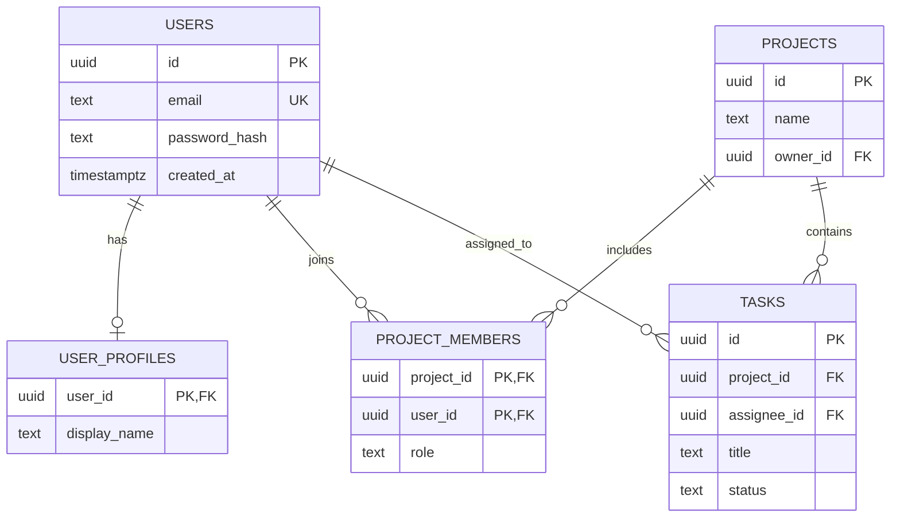

## Enhanced engineering notes

### Example PostgreSQL schema

```sql
CREATE TABLE users (
    id UUID PRIMARY KEY DEFAULT gen_random_uuid(),
    email TEXT NOT NULL UNIQUE,
    password_hash TEXT NOT NULL,
    created_at TIMESTAMPTZ NOT NULL DEFAULT now()
);

CREATE TABLE projects (
    id UUID PRIMARY KEY DEFAULT gen_random_uuid(),
    owner_id UUID NOT NULL REFERENCES users(id) ON DELETE RESTRICT,
    name TEXT NOT NULL,
    created_at TIMESTAMPTZ NOT NULL DEFAULT now()
);

CREATE TABLE tasks (
    id BIGSERIAL PRIMARY KEY,
    project_id UUID NOT NULL REFERENCES projects(id) ON DELETE CASCADE,
    title TEXT NOT NULL,
    status TEXT NOT NULL CHECK (status IN ('todo', 'doing', 'done')),
    created_at TIMESTAMPTZ NOT NULL DEFAULT now()
);

CREATE INDEX idx_tasks_project_status_created
    ON tasks (project_id, status, created_at DESC);
```

### Parameterized query

```python
# psycopg-style example
cursor.execute(
    "SELECT id, email FROM users WHERE email = %s",
    (email,),
)
```

The user value is treated as data, not executable SQL. Never construct SQL with f-strings containing user input.

### Indexes

An index can reduce lookup work for common `WHERE`, `JOIN`, and `ORDER BY` patterns. It costs disk space and adds write overhead because INSERT/UPDATE/DELETE operations may need to maintain indexes. Composite-index column order matters: an index on `(project_id, status, created_at)` is not equivalent to one on `(status, project_id, created_at)` for all query patterns.

Use `EXPLAIN (ANALYZE, BUFFERS)` on representative queries. Do not add indexes solely because a column exists or appears in an API response.

### Transactions and ACID — important extension

- **Atomicity:** all transaction operations happen or none do.
- **Consistency:** constraints and invariants remain true.
- **Isolation:** concurrent transactions behave according to the selected isolation level.
- **Durability:** committed data survives supported failure modes.

```sql
BEGIN;
UPDATE accounts SET balance = balance - 500 WHERE id = 1;
UPDATE accounts SET balance = balance + 500 WHERE id = 2;
COMMIT;
```

In real code, verify both rows exist and use constraints/locking or suitable isolation to prevent invalid concurrent updates. Roll back on failure.

### Migrations and triggers

Migrations are version-controlled schema changes applied in order. Keep schema changes separate from disposable seed data. Triggers can implement database-level bookkeeping (for example updating `updated_at`), but avoid hiding complex business rules in triggers where they become hard to discover and test.

### Data type notes

- Use `NUMERIC`/`DECIMAL` for exact monetary values.
- Use `TIMESTAMPTZ` for instants in time; store UTC and convert for display.
- Use UUIDs or generated numeric keys depending on requirements; neither is automatically “more secure.”
- PostgreSQL `TEXT` is often a good string type; enforce length/format requirements explicitly.
- Use JSONB for semi-structured attributes when relational structure is not appropriate, not as an excuse to avoid modeling queryable relationships.

**Interview tip:** Explain why a DBMS is needed, how a many-to-many relation is modeled, what an index costs, why parameterized queries prevent SQL injection, and how a transaction protects a multi-row invariant.

---

# Chapter 13 — Caching

**Video:** [Caching, the secret behind it all](https://www.youtube.com/watch?v=estH64OkwxU) · **1:04:23**

## Transcript notes

Caching stores a frequently used or expensive-to-recreate subset of data in a faster location. The video uses search results, video delivery, and trending topics to motivate avoiding repeated computation and moving data closer to consumers.

It groups caching into network-level caching (CDNs and DNS), hardware-level caching (CPU cache hierarchy and RAM), and software-level caching (Redis/Memcached). A CDN routes users toward an edge point of presence; a cache hit serves locally, while a cache miss retrieves from origin and may populate the edge cache. TTL controls how long cached data is considered fresh.

The lesson also explains DNS caching layers, L1/L2/L3 CPU caches, RAM's speed advantage over disk, in-memory key-value stores, lazy/cache-aside and write-through strategies, and eviction policies including no eviction, LRU, LFU, and TTL-based expiration.

Use cases include database query results, sessions, external API responses, and rate-limiting counters.

## Diagram — cache-aside pattern

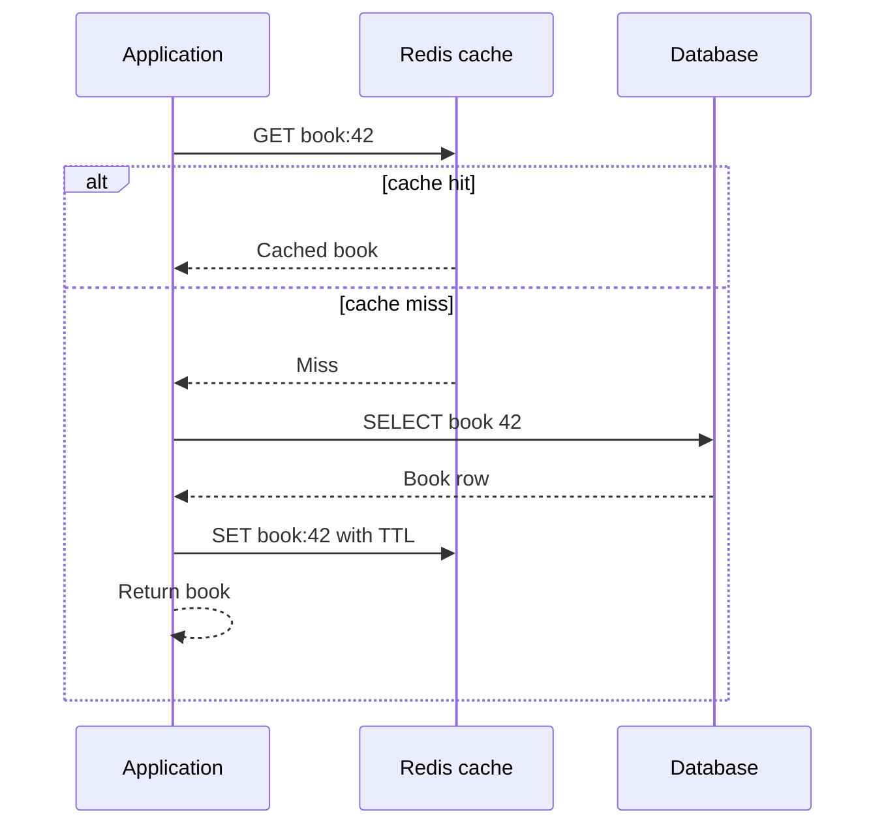

## Enhanced engineering notes

### Strategies

- **Cache-aside (lazy):** app checks cache, fetches DB on miss, then populates cache. Simple, but first request after expiry pays the DB cost.
- **Write-through:** update the primary store and cache as part of the write workflow. Improves read freshness but adds write work; failure coordination must be defined.
- **Write-behind:** write cache first and persist asynchronously. Faster writes but more complex durability and loss risks; only use when the data-loss/consistency contract permits it.
- **Read-through:** cache abstraction loads from the source on a miss.

### Invalidation is the hard problem

Ways to control staleness:

1. TTL bounds how long an entry can remain stale.
2. Explicit invalidation/deletion after writes reduces stale reads but every write path must participate.
3. Versioned/content-addressed keys avoid overwriting old values and can simplify immutable data.
4. Event-driven invalidation works well when event delivery and retries are reliable.

### Redis example

```python
import json
from redis import Redis

redis = Redis.from_url("redis://localhost:6379/0", decode_responses=True)

def get_book(book_id: int, db):
    key = f"book:{book_id}"
    cached = redis.get(key)
    if cached:
        return json.loads(cached)

    book = db.fetch_book(book_id)
    if book is None:
        return None

    redis.set(key, json.dumps(book), ex=300)
    return book

def update_book(book_id: int, payload: dict, db):
    updated = db.update_book(book_id, payload)
    redis.delete(f"book:{book_id}")
    return updated
```

Production considerations: serialize data consistently, include tenant/authorization dimensions in keys, avoid caching data across users accidentally, handle Redis outages, use timeouts, and protect against cache stampedes.

### Eviction

| Policy | Evicts | Good fit / risk |
|---|---|---|
| LRU | Least recently used | Recency correlates with future access |
| LFU | Least frequently used | Frequency predicts popularity |
| TTL | Expired entries | Time-bounded freshness |
| No eviction | Nothing | Writes fail when memory is full |

### Cache stampede / thundering herd — extension

When one popular key expires, many requests can simultaneously miss and hit the database. Use request coalescing/single-flight, a short lock, staggered TTLs, background refresh, or stale-while-revalidate where appropriate.

### Rate limiting with a Redis counter

```text
INCR rate:user:123
EXPIRE rate:user:123 60  # set expiry when creating the window
```

A robust implementation must make increment + expiry atomic (for example with Lua or a suitable Redis command pattern) and define fixed-window, sliding-window, or token-bucket semantics.

**Interview tip:** Never say “cache everything.” Explain access frequency, hit ratio, TTL, invalidation, consistency, eviction, memory cost, and fallback behavior.

---

# Chapter 14 — Task queues and background jobs

**Video:** [Task queues and background jobs](https://www.youtube.com/watch?v=r-nQsyguU1Y) · **55:47**

## Transcript notes

A background task performs work outside the immediate request/response lifecycle. The motivating example is a signup verification email. If the API waits for an external email provider, the user experiences the provider's latency and failures as part of signup. If the application responds before knowing whether the email was sent, it must not claim the email definitely succeeded.

The async pattern separates task creation from task execution:

- **Producer:** creates a task payload and enqueues it.
- **Broker/queue:** stores the task until a worker can process it.
- **Consumer/worker:** dequeues the task, deserializes the payload, and invokes a handler.
- **ACK:** worker acknowledges successful processing.
- **Visibility timeout:** an unacknowledged task can become visible again for retry after a timeout.

The lesson covers retry policies, exponential backoff, one-off/recurring/chained/batch jobs, and operational requirements such as idempotency, monitoring, ordering, scaling workers, and rate limiting external services. Examples include email, image/video processing, scheduled reports, and push notifications.

## Diagram — producer, broker, worker

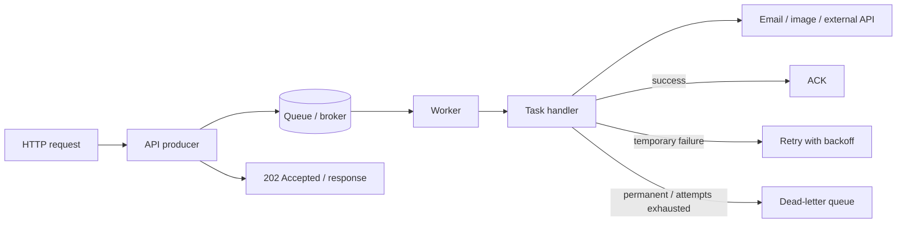

## Enhanced engineering notes

### Retry with exponential backoff and jitter

A typical delay grows exponentially (for example 1s, 2s, 4s, 8s) and is capped. Add random jitter so many workers do not retry at exactly the same instant. Retry only errors that may recover; invalid payloads and permission failures usually should not be retried indefinitely.

### Idempotent worker design

Queues often provide at-least-once delivery, meaning a task may execute more than once. Design handlers so duplicates do not create duplicate side effects. Use a stable task/idempotency key and record completion in a transaction or unique constraint.

### Celery example (Python)

```python
from celery import Celery

app = Celery("worker", broker="redis://localhost:6379/0")

@app.task(bind=True, autoretry_for=(TimeoutError,), retry_backoff=True,
          retry_jitter=True, max_retries=5)
def send_verification_email(self, user_id: int, email: str, task_key: str):
    # Check an idempotency record before sending a non-repeatable side effect.
    if already_sent(task_key):
        return "already_sent"
    email_provider.send_verification(email)
    mark_sent(task_key)
    return "sent"
```

The `already_sent` and `mark_sent` operations must be made atomic enough for the delivery semantics you require. For payments or other high-value operations, use a durable state machine and provider-side idempotency support where available.

### Transactional outbox — important extension

A common reliability problem is: database commit succeeds, but publishing the queue message fails. The **transactional outbox** writes the domain change and an outbox row in the same database transaction. A separate publisher reads outbox rows and sends messages, marking them delivered. Consumers still need idempotency.

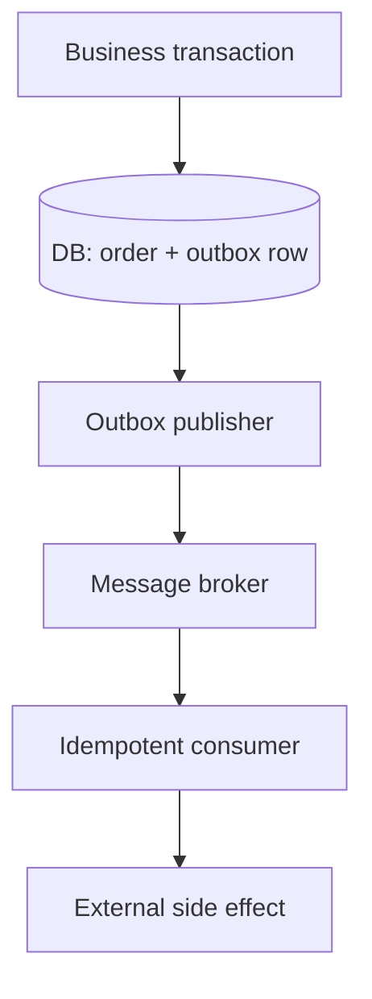

### Operational checklist

- Queue depth, oldest-message age, success/failure rate, retry count, worker concurrency, and dead-letter count are measured.
- Task payloads are small and versioned; store large files in object storage and pass references.
- Tasks have timeouts, bounded retries, and dead-letter handling.
- Worker shutdown stops fetching new work and lets in-flight work finish or requeue safely.
- External dependencies are rate-limited and time-bounded.
- Recurring schedulers use idempotency and distributed coordination to avoid duplicate schedules.

**Interview tip:** Explain why a queue improves perceived latency and isolation, then discuss at-least-once delivery, retries, idempotency, DLQs, and the database-to-queue dual-write problem.

---

# Chapter 15 — Full-text search with Elasticsearch

**Video:** [Full text search using Elasticsearch for blazingly fast search](https://www.youtube.com/watch?v=7_sovzAhRSM) · **32:08**

## Transcript notes

The video starts with an e-commerce/search scenario where `LIKE` or `ILIKE '%term%'` becomes expensive as the dataset grows. A naive substring search can scan many rows and does not naturally rank results by relevance.

Search engines solve this with an **inverted index**: instead of scanning each document for a query term, the index maps terms to the documents (and positions) where they appear. Elasticsearch uses Apache Lucene under the hood. The video discusses BM25 relevance scoring, typo-tolerant search, type-ahead, field mappings, and the ELK stack.

A benchmark compares Elasticsearch with PostgreSQL `ILIKE` over a dataset of reviews. The lesson is to understand what indexing changes and to benchmark the workload—not to assume Elasticsearch always outperforms a properly indexed relational search.

## Diagram — inverted index

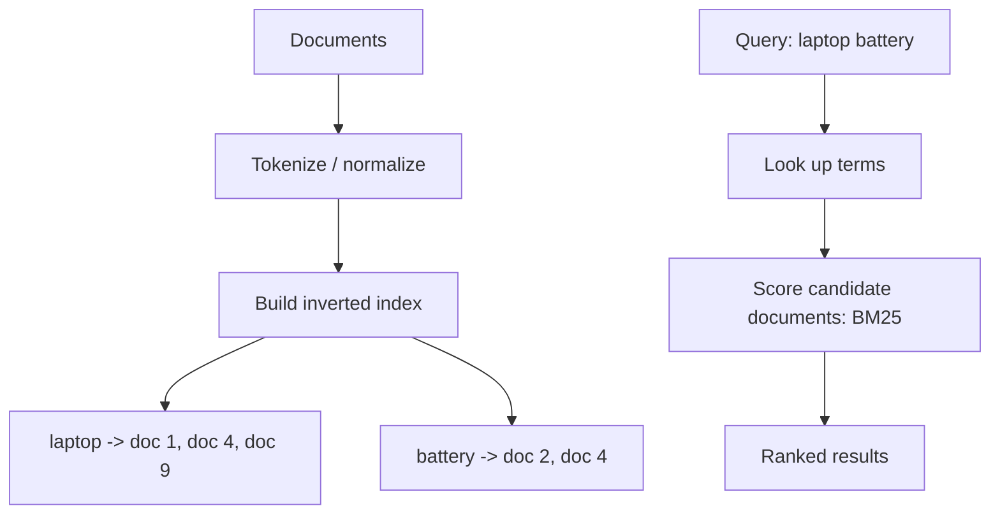

## Enhanced engineering notes

### Indexing pipeline

1. Ingest a source document.
2. Apply analyzers: tokenization, lowercasing, stemming/normalization, stop-word handling as configured.
3. Store terms in an inverted index, often with positions/frequencies.
4. Query the index, compute relevance, and return ranked documents.
5. Keep the search index synchronized with the source of truth.

### Example mapping and query

```json
PUT products
{
  "mappings": {
    "properties": {
      "name": {"type": "text"},
      "category": {"type": "keyword"},
      "price": {"type": "float"},
      "created_at": {"type": "date"}
    }
  }
}
```

```json
GET products/_search
{
  "query": {
    "multi_match": {
      "query": "wireless noise cancelling headphones",
      "fields": ["name^3", "description"]
    }
  }
}
```

`text` fields are analyzed for full-text matching; `keyword` fields are typically used for exact matching, filtering, and aggregations.

### PostgreSQL or Elasticsearch?

Use PostgreSQL first when the search needs are modest and transactional data is central. PostgreSQL supports full-text search and indexes such as GIN. Consider Elasticsearch/OpenSearch when search relevance, analyzers, facets, autocomplete, typo tolerance, or search traffic justify a separate search platform.

The search index is usually a **derived read model**, not the source of truth. It may be eventually consistent with the primary database. Design for reindexing, retries, and stale search results.

### Operational tips

- Define analyzers and mappings deliberately; changing field types often requires reindexing.
- Avoid returning huge `_source` payloads when only a few fields are needed.
- Use pagination limits; deep offset pagination is expensive. Search-after/cursors are preferable for deep traversal.
- Track indexing lag, rejected writes, query latency, heap pressure, shard health, and disk usage.
- Test relevance with a representative query set and judged results, not only raw speed.

**Interview tip:** Explain inverted indexes and BM25. Then state when PostgreSQL full-text search is enough and why Elasticsearch creates operational and consistency costs.

---

# Chapter 16 — Error handling and fault tolerance

**Video:** [Error Handling and Building Fault Tolerant Systems](https://www.youtube.com/watch?v=8NaM_9aKS24) · **1:09:25**

## Transcript notes

The core mindset is that failures are inevitable. The objective is not to eliminate all errors but to detect, classify, contain, recover from, and learn from them. The video distinguishes logic errors, database errors, external-service errors, input-validation errors, and configuration errors.

Database failures can include connection errors, constraint violations, malformed queries, and deadlocks. External services can fail because of network issues, invalid credentials, rate limits, or provider outages. Configuration mistakes can stop a service from starting or make it connect to the wrong dependency.

The lesson emphasizes proactive health checks and monitoring rather than waiting for users to report failures. It discusses immediate error responses, recovery strategies, controlled error propagation, and a global error handler as a final safety net. It also stresses not leaking internal details and not logging sensitive information.

## Diagram — classify and handle failures

```mermaid
flowchart TD
    A[Failure detected] --> B{Can this operation safely recover?}
    B -->|Transient: timeout / 503| C[Retry with timeout + backoff + jitter]
    C --> D{Retry budget left?}
    D -->|Yes| E[Retry dependency]
    D -->|No| F[Fallback / fail gracefully]
    B -->|Permanent: invalid input / permission| G[Return 4xx]
    B -->|Unexpected internal failure| H[Log details + correlation ID]
    H --> I[Generic 5xx response]
    F --> J[Alert / record degraded state]
```

## Enhanced engineering notes

### Common resilience patterns

- **Timeout:** bound how long a dependency call may wait. Timeouts should be shorter than the remaining request deadline.
- **Retry:** retry transient failures only; add backoff and jitter; keep a retry budget.
- **Circuit breaker:** stop calling a dependency that is repeatedly failing; probe recovery after a cool-down.
- **Bulkhead:** isolate resources so one slow dependency cannot exhaust every worker/connection.
- **Fallback:** serve cached or degraded output where business semantics allow it.
- **Health check:** separate liveness (process should be restarted if deadlocked/unhealthy) from readiness (safe to receive traffic now).

### FastAPI global error handler example

```python
import logging
from fastapi import FastAPI, Request
from fastapi.responses import JSONResponse

logger = logging.getLogger(__name__)
app = FastAPI()

@app.exception_handler(Exception)
async def unhandled_error_handler(request: Request, exc: Exception):
    request_id = getattr(request.state, "request_id", "unknown")
    logger.exception("unhandled_error", extra={"request_id": request_id})
    return JSONResponse(
        status_code=500,
        content={"error": {"code": "internal_error", "message": "An unexpected error occurred", "request_id": request_id}},
    )
```

Do not catch every exception and continue as if success occurred. A global handler formats unexpected failures; it does not replace explicit handling of expected domain errors.

### Status mapping guide

| Situation | Typical response |
|---|---|
| Invalid input | 400 or 422 (consistent API convention) |
| Missing/invalid credentials | 401 |
| Authenticated but denied | 403 |
| Resource missing | 404 |
| Duplicate/state conflict | 409 |
| Rate limit | 429 |
| Unexpected internal failure | 500 |
| Temporary overload/maintenance | 503 |
| Upstream timeout at gateway | 504 |

### Security and recovery

- Never expose SQL statements, stack traces, secret values, or internal topology to clients.
- Do not log passwords, access tokens, API keys, or payment data.
- Use correlation IDs so client reports can be tied to logs and traces.
- Back up irreplaceable data and test restoration, not just backup creation.
- Distinguish a retryable timeout from a validation error; blindly retrying invalid work worsens load.

**Interview tip:** Explain how you would handle a payment-provider timeout. Include idempotency, timeouts, bounded retries, state reconciliation, and observability—not just a `try/except` block.

---

# Chapter 17 — Production-grade configuration management

**Video:** [Production-grade Configuration Management](https://www.youtube.com/watch?v=GR9NtirPXyc) · **36:14**

## Transcript notes

Configuration controls how an application behaves in different environments and how it connects to its dependencies. The video frames configuration as much broader than a database URL: it includes application settings, database pools, external services, feature flags, infrastructure/security/performance settings, and business rules.

Modern backends depend on multiple services—databases, caches, queues, email providers, identity systems, and third-party APIs. Without a systematic configuration strategy, hardcoded values and scattered settings create configuration chaos: inconsistent environments, leaked secrets, difficult deployments, and bugs that cannot be reproduced.

The video surveys environment variables and `.env` files, JSON/YAML/TOML config files, key-value stores, cloud secret managers, and hybrid approaches. It compares dev/test/staging/production priorities and uses database connection-pool sizing to illustrate why values may vary by environment. It stresses security and, most importantly, validation of configuration at startup.

## Diagram — configuration loading

```mermaid
flowchart TD
    A[Application startup] --> B[Load defaults]
    B --> C[Load config file]
    C --> D[Load environment variables]
    D --> E[Load secret manager values]
    E --> F[Merge by explicit precedence]
    F --> G[Validate types, ranges, required keys]
    G -->|valid| H[Build clients / start service]
    G -->|invalid| I[Fail fast; do not accept traffic]
```

## Enhanced engineering notes

### Environment responsibilities

| Environment | Primary priority | Typical behavior |
|---|---|---|
| Development | Fast feedback | Debug logs, local dependencies, relaxed test data |
| Test | Deterministic validation | Isolated DB, fake external services, repeatable fixtures |
| Staging | Production rehearsal | Similar topology/configuration to prod, lower capacity |
| Production | Reliability/security | Least privilege, controlled rollout, alerting, backups |

Staging should resemble production in behavior, not necessarily scale. A staging environment that uses entirely different database types or auth flows may conceal release failures.

### Configuration categories

- Application: port, host, public URL, logging level.
- Database: DSN, pool size, timeout, TLS, migration behavior.
- External services: provider URL, API key, timeout, retry policy.
- Feature flags: gradual rollout, kill switches, experiment variants.
- Infrastructure/security: trusted proxies, allowed origins, CORS, TLS, secret references.
- Performance: worker count, queue concurrency, cache TTL, request limits.
- Business rules: thresholds, policy toggles, regional behavior.

### Pydantic Settings example

```python
from pydantic import Field, SecretStr
from pydantic_settings import BaseSettings, SettingsConfigDict

class Settings(BaseSettings):
    model_config = SettingsConfigDict(env_file=".env", extra="ignore")
    environment: str = "development"
    database_url: SecretStr
    redis_url: SecretStr
    port: int = Field(default=8000, ge=1, le=65535)
    db_pool_size: int = Field(default=10, ge=1, le=100)
    request_timeout_seconds: float = Field(default=5.0, gt=0, le=120)

settings = Settings()  # validation happens during startup
```

### Security tips

- Never commit secrets into source control or container images.
- Use a secret manager for production credentials; give each service only the permissions it needs.
- Rotate credentials and support controlled rotation without downtime.
- Do not print secret values during startup diagnostics.
- Validate allowed origins, hostnames, timeouts, connection limits, and feature flag values.
- Make configuration precedence explicit; do not let multiple overlapping sources create ambiguous behavior.

**Interview tip:** Explain why invalid configuration should normally stop startup rather than allow a partially configured service to accept traffic.

---

# Chapter 18 — Logging, monitoring, and observability

**Video:** [Logging, Monitoring and Observability](https://www.youtube.com/watch?v=5PEuwgLOQQM) · **39:51**

## Transcript notes

The video separates three related practices:

- **Logging:** recording events and contextual details that happened in the application.
- **Monitoring:** tracking known health/performance signals and alerting when thresholds or conditions are violated.
- **Observability:** inferring internal system behavior from emitted outputs, especially logs, metrics, and traces.

It explains the three pillars of observability—logs, metrics, and traces—and their combined role in debugging. It reviews log levels (debug, info, warn, error, fatal), structured vs. unstructured logs, instrumentation, OpenTelemetry, and a demo that traces a request through middleware and service logic into an observability dashboard.

The practical debugging flow is: an alert fires, inspect metrics to understand the symptom, find related logs, then follow a trace to locate the failing component.

## Diagram — three pillars

```mermaid
flowchart TD
    A[Application + infrastructure] --> B[Instrumentation]
    B --> C[Logs: events and context]
    B --> D[Metrics: numeric time series]
    B --> E[Traces: spans across components]
    C --> F[Investigate an incident]
    D --> F
    E --> F
    F --> G[Root cause / mitigation / follow-up]
```

## Enhanced engineering notes

### What each signal answers

| Signal | Best question | Example |
|---|---|---|
| Logs | What happened? | `payment_authorization_failed`, reason category, request ID |
| Metrics | How often/how much? | error rate, p95 latency, queue depth, CPU |
| Traces | Where was time spent? | API → auth → DB → payment provider spans |

### Structured JSON log

```json
{
  "timestamp": "2026-11-02T10:30:00Z",
  "level": "ERROR",
  "service": "orders-api",
  "event": "payment_authorization_failed",
  "request_id": "req_abc123",
  "trace_id": "4bf92f3577b34da6a3ce929d0e0e4736",
  "order_id": "ord_42",
  "dependency": "payment-provider",
  "duration_ms": 2100
}
```

Do not log credentials, full payment-card data, raw session cookies, authorization headers, or sensitive personal information. Prefer identifiers and safe reason codes.

### Useful metrics

- Request rate: requests/second.
- Error rate: percentage/count of failures by route and dependency.
- Latency percentiles: p50, p90, p95, p99.
- Saturation: CPU, memory, worker slots, DB connections, file descriptors.
- Queue: depth, oldest age, enqueue/dequeue rate, retry count.
- Dependency health: timeout rate, connection failures, provider latency.

### OpenTelemetry concepts

- **Instrumentation** adds measurements to code and frameworks.
- A **span** represents a timed operation; spans form a trace tree.
- A **trace ID** connects spans across service boundaries.
- Context propagation carries trace identifiers through HTTP headers or messaging metadata.
- Exporters send telemetry to a collector/backend.

### Alerting tips

- Alert on user-visible symptoms and saturation, not every noisy internal event.
- Use service-level indicators (SLIs), objectives (SLOs), and error budgets for reliability planning.
- Make dashboards answer operational questions: “Are users affected?”, “Which route?”, “Which dependency?”, “Since when?”
- Sample high-volume traces carefully, but preserve error/high-latency traces when possible.

**Interview tip:** A log tells you an individual event; a metric reveals a trend; a trace shows the path and latency distribution of one request. Explain how you combine all three to debug p99 latency.

---

# Chapter 19 — Graceful shutdown

**Video:** [Graceful Shutdown](https://www.youtube.com/watch?v=6rfBgphiCWM) · **35:56**

## Transcript notes

The motivating failure is a process being terminated while it is handling a payment or other important request. A graceful shutdown is a controlled lifecycle: stop accepting new work, let in-flight work finish within a defined deadline, release resources, and then exit.

The video explains process lifecycle management, Unix signals and inter-process communication, especially `SIGTERM`, `SIGINT`, and `SIGKILL`. `SIGTERM` requests termination and can be handled; `SIGINT` usually represents an interrupt such as Ctrl+C; `SIGKILL` cannot be caught or handled and terminates the process immediately.

The two major pillars are **connection draining** and **resource cleanup**. Existing HTTP requests, database transactions, background jobs, and WebSocket connections need appropriate handling. Cleanup includes closing database pools, network connections, file handles, queues, and temporary resources—often in reverse order of acquisition.

## Diagram — shutdown lifecycle

```mermaid
stateDiagram-v2
    [*] --> Running
    Running --> Draining: SIGTERM / SIGINT
    Draining: Mark instance not-ready
    Draining: Stop accepting new requests/jobs
    Draining --> Finishing: In-flight work continues
    Finishing --> Cleanup: Deadline reached or work complete
    Cleanup: Close DB, queue, files, sockets
    Cleanup --> Exited
    Running --> Killed: SIGKILL / crash
    Draining --> Killed: Hard deadline exceeded
    Killed --> [*]
    Exited --> [*]
```

## Enhanced engineering notes

### Shutdown sequence

1. Mark readiness false so the load balancer stops routing new requests.
2. Stop accepting new HTTP connections and queue jobs.
3. Allow in-flight HTTP requests and transactions to finish.
4. Stop workers after they finish or safely release in-flight messages.
5. Close database pools, Redis clients, HTTP clients, and file handles.
6. Flush critical telemetry/log buffers.
7. Exit before the platform's hard termination deadline.

Set a total shutdown budget and allocate time across stages. A 30-second deadline is a common starting point, not a universal rule; it must align with request durations and orchestrator settings.

### Python FastAPI lifecycle example

```python
from contextlib import asynccontextmanager
from fastapi import FastAPI

@asynccontextmanager
async def lifespan(app: FastAPI):
    app.state.db = await create_db_pool()
    app.state.redis = await create_redis_client()
    try:
        yield
    finally:
        await app.state.db.close()
        await app.state.redis.close()

app = FastAPI(lifespan=lifespan)
```

A web server/framework should also be configured to stop accepting new connections and drain requests. The lifespan hook handles owned resources; it does not alone implement the complete load-balancer/orchestrator shutdown protocol.

### Failure cases to test

- Deploy while a slow request is in progress.
- Terminate during a database transaction.
- Stop a worker while it owns a message that has not been ACKed.
- Ensure readiness changes before the process disappears.
- Confirm no new connections arrive after draining begins.
- Confirm logs/metrics flush and connections close within the deadline.

**Interview tip:** Explain why `SIGKILL` is a last resort and why “stop accepting new requests” must happen before “close the DB connection pool.”

---

# Chapter 20 — Backend security

**Video:** [Backend Security: Everything You Need to Know](https://www.youtube.com/watch?v=xB1C1xZZW4k) · **2:50:03**

## Transcript notes

The video takes the attacker's perspective: security failures often come from assumptions about who can call an endpoint, what input means, which identity a request represents, or which resources a caller may access.

It covers injection attacks, SQL injection, parameterized queries, command injection, password storage, hashing, rainbow tables, salting, slow password hashing, sessions, cookie flags, JWTs, rate limiting, authorization vulnerabilities (BOLA/IDOR and BFLA), horizontal/vertical authorization, XSS, CSRF, and security misconfiguration.

### Injection

Injection occurs when untrusted input is interpreted as part of an executable instruction. SQL injection commonly results from concatenating user input into SQL statements. Command injection occurs when untrusted input is incorporated into shell commands.

### Passwords

Plaintext storage is unsafe. Hashing is one-way in the intended security model, but fast hashes can be attacked at scale. Salts make equal passwords produce different hashes and prevent precomputed rainbow-table reuse. Password-specific algorithms such as Argon2id/bcrypt/scrypt intentionally increase attacker cost.

### Authorization vulnerabilities

- **BOLA / IDOR:** caller changes an object identifier and gains access to another user's object because ownership is not checked.
- **BFLA:** caller invokes a function/endpoint they should not be allowed to use, such as an admin operation.
- Sequential IDs can make enumeration easier, but random IDs alone do not fix missing authorization.
- Returning 403 vs. 404 can reveal resource existence; choose behavior based on the threat model and API semantics.

### Browser attacks

- **XSS:** attacker-controlled content is executed as script in another user's browser (stored, reflected, or DOM-based).
- **CSRF:** a browser is tricked into sending an authenticated request using ambient credentials such as cookies.
- Secure cookie flags, CSRF tokens or suitable SameSite policy, output encoding, CSP, and careful origin handling reduce risk.

## Diagram — security boundaries

```mermaid
flowchart TD
    A[Untrusted client input] --> B[Parse + validate]
    B --> C[Authenticate caller]
    C --> D[Authorize action]
    D --> E[Authorize object / tenant ownership]
    E --> F[Business logic]
    F --> G[Parameterized DB query]
    G --> H[(Database)]
    I[Rate limiting + audit logs + security headers] -. cross-cutting .-> C
```

## Enhanced engineering notes

### Safe SQL

```python
# Good: values are parameters, not SQL code.
cursor.execute("SELECT id, email FROM users WHERE email = %s", (email,))

# Bad: do not concatenate or interpolate untrusted input into SQL.
# cursor.execute(f"SELECT * FROM users WHERE email = '{email}'")
```

### Safe command execution

Prefer a library API over a shell. When a process must be launched, pass an argument array and validate each argument; do not build a shell command string from user-controlled data.

```python
import subprocess

subprocess.run(
    ["/usr/bin/convert", input_path, output_path],
    check=True,
    shell=False,
    timeout=10,
)
```

The paths must still be controlled and validated; `shell=False` is not a universal path-traversal defense.

### Object-level authorization

```python
def get_invoice_for_user(invoice_id: int, current_user, repository):
    invoice = repository.get(invoice_id)
    if invoice is None:
        return None
    if invoice.tenant_id != current_user.tenant_id:
        # Depending on policy, return 404 to avoid revealing existence.
        return None
    if not current_user.can("invoice:read"):
        raise PermissionError("forbidden")
    return invoice
```

Prefer querying by both object ID and authorized scope (`WHERE id = ? AND tenant_id = ?`) so an unauthorized record is never accidentally returned to application logic.

### Security checklist

- Passwords use a password-hashing scheme with unique salts and appropriate cost parameters.
- Secrets are never stored in source control or logs.
- Every request is authenticated where required and every action is authorized.
- Object ownership and tenant boundaries are checked server-side.
- SQL uses parameterized statements; commands avoid shell concatenation.
- Output is contextually encoded; rich HTML is sanitized with a proven sanitizer.
- Cookies have correct `HttpOnly`, `Secure`, and `SameSite` settings.
- CSRF protections are applied where cookie-based authentication creates ambient credentials.
- Rate limits protect login, password reset, sensitive actions, and expensive endpoints.
- Security headers, CORS, TLS, dependency patching, audit trails, and least privilege are configured.
- Errors do not disclose secrets, internal stack traces, or whether an account exists unnecessarily.

### Nuances to remember

- OAuth is delegated authorization; OIDC supplies identity/authentication semantics.
- A signed JWT is not encrypted.
- JWTs do not remove the need for revocation, refresh rotation, and key rotation.
- CORS is not authentication and does not stop non-browser clients.
- CSRF is mainly relevant when browsers automatically attach credentials; bearer tokens manually attached by scripts have a different threat profile, while XSS remains a major concern.
- Input validation does not replace parameterized queries, output encoding, or authorization.

**Interview tip:** For an endpoint `GET /users/{user_id}/documents/{document_id}`, explain authentication, role permission, tenant scope, object ownership, and response behavior against IDOR.

---

# Chapter 21 — Backend scaling and performance: Part 1

**Video:** [Backend Scaling and Performance Engineering: Part 1](https://www.youtube.com/watch?v=z7kt_p44rjs) · **1:47:31**

## Transcript notes

The video defines latency, throughput, and utilization, emphasizing that latency varies across requests and that averages can hide the slowest users. It introduces percentiles—especially p50, p90, and p99—and the nonlinear rise in latency as a system approaches saturation.

The lesson uses analogies (a busy shop/highway) to explain headroom. Real traffic is bursty; a service running continuously at maximum utilization has little room to absorb spikes. It emphasizes measuring bottlenecks before optimizing, then covers profiling, distributed tracing, the N+1 query problem, indexes, connection pooling, caching/invalidation, cache-hit ratio, and vertical vs. horizontal scaling.

## Core performance terms

- **Latency:** elapsed time for one operation/request.
- **Throughput:** amount of work completed per unit time (requests/sec, jobs/sec, MB/sec).
- **Utilization:** fraction of a resource's capacity in use (CPU, DB connections, workers, network).
- **Tail latency:** slow end of the latency distribution; p99 means 99% of requests are at or below that latency and 1% are slower.

## Diagram — latency distribution and saturation intuition

```mermaid
flowchart LR
    A[Increase offered load] --> B[Low utilization: stable latency]
    B --> C[Higher utilization: queues form]
    C --> D[Near saturation: latency rises sharply]
    D --> E[Overload: timeouts / errors / retry amplification]
```

## Enhanced engineering notes

### Why p99 matters

Suppose a service handles 1,000,000 requests per day. The slowest 1% represents 10,000 requests. A low average can conceal a meaningful number of users experiencing long delays. Track p50/p95/p99, but interpret them with traffic volume and route-level segmentation.

### Measure before optimizing

Use the golden signals as a starting point: latency, traffic, errors, saturation. Break down request timing into middleware, service logic, DB queries, cache calls, external APIs, serialization, and synchronous logging. Use a profiler for CPU hotspots and distributed tracing for time spent across IO boundaries.

### N+1 query problem

Bad pattern: fetch N projects, then issue one query per project to fetch tasks. Total = 1 + N database round trips. Better: fetch tasks for all project IDs in one query, use a join, or use ORM prefetch/bulk-loading support.

```sql
-- One bulk query after collecting project IDs
SELECT *
FROM tasks
WHERE project_id = ANY(:project_ids);
```

### Indexing workflow

1. Find slow queries from logs/metrics/traces.
2. Inspect query plan with `EXPLAIN (ANALYZE, BUFFERS)`.
3. Identify full scans, expensive sorts, or poor join strategies.
4. Add/adjust an index only when it supports a real access pattern.
5. Re-measure reads and writes after the change.

Indexes improve some reads but consume disk and increase write amplification. Composite indexes are order-sensitive; covering indexes can answer a query from index data but are larger.

### Connection pooling

Creating a new DB connection incurs handshake/authentication/session overhead and consumes DB resources. A pool reuses established connections. Once multiple backend instances are deployed, per-instance pools can collectively exceed database connection limits; an external pooler such as PgBouncer can centralize pooling.

### Cache hit ratio

`hit ratio = cache hits / (cache hits + cache misses)`. A poor hit ratio can indicate the wrong key design, TTL, capacity, or access pattern. High hit ratio does not prove correctness; stale data and invalidation still matter.

### Vertical vs. horizontal scaling

| Vertical (scale up) | Horizontal (scale out) |
|---|---|
| Larger machine | More instances |
| Simpler architecture | Requires distribution/load balancing |
| Hard hardware ceiling | More aggregate capacity in principle |
| Larger single failure domain | Better redundancy if designed correctly |
| Limited geographical distribution | Can place instances near users |

**Interview tip:** When an API is slow, do not immediately say “add Redis.” Explain how you would measure the bottleneck and why the measurement identifies the correct layer to optimize.

---

# Chapter 22 — Backend scaling and performance: Part 2

**Video:** [Backend Scaling and Performance Engineering: Part 2](https://www.youtube.com/watch?v=sOhAopEwjH4) · **2:18:11**

## Transcript notes

Part 2 continues horizontal scaling and explains why statelessness is a prerequisite for distributing requests across instances. Session data must be shared or represented by portable tokens; files must live in shared object storage; state should not exist only on one application instance.

The video covers load-balancer algorithms (round robin, weighted round robin, least connections, health checks), database scaling (read replicas and sharding), CDN and edge computing, asynchronous processing, monolith vs. microservices, and serverless computing including cold starts and runtime limits.

### Load balancing

- **Round robin:** distribute requests sequentially among healthy instances.
- **Weighted round robin:** send more traffic to stronger instances.
- **Least connections:** prefer the instance with fewer active connections.
- **Health checks:** remove unhealthy instances from routing and reintroduce them after recovery according to policy.

### Database scaling

- **Read replicas:** offload reads and potentially serve users in other regions. Replication lag means recent writes may not appear immediately.
- **Sharding:** partition rows across database nodes to spread storage and write load. It introduces routing, rebalancing, cross-shard query, and transaction complexity.

### CDN and edge computing

A CDN serves cacheable content from edge points of presence closer to users. Edge computing moves selected processing to those locations, but edge runtimes have constraints and should not be treated as a drop-in replacement for a full backend.

### Async work, microservices, serverless

Slow non-critical work can be queued and executed by workers. Microservices are primarily an organizational and deployment-independence choice, not an automatic performance optimization. Serverless shifts infrastructure lifecycle management to a provider but introduces cold starts, execution limits, and statelessness constraints.

## Diagram — horizontally scaled architecture

```mermaid
flowchart TD
    C[Clients] --> CDN[CDN / edge]
    CDN --> LB[Load balancer]
    LB --> A1[App instance 1]
    LB --> A2[App instance 2]
    LB --> A3[App instance 3]
    A1 --> R[(Shared Redis / session store)]
    A2 --> R
    A3 --> R
    A1 --> DB[(Primary DB)]
    A2 --> DB
    A3 --> DB
    DB --> RO1[(Read replica 1)]
    DB --> RO2[(Read replica 2)]
    A1 --> Q[(Queue)]
    Q --> W[Worker pool]
    W --> O[Object storage / external services]
```

## Enhanced engineering notes

### Statelessness does not mean “no state exists”

It means an individual application instance does not hold exclusive session/application state that is required for the next request. Durable state still exists in databases, shared caches, object storage, or signed tokens. A stateless service can still process stateful business workflows.

### Read-after-write consistency

After a write to the primary, a read replica may lag. Possible strategies:

- Route a user's immediate post-write reads to the primary for a short period.
- Wait for replication confirmation when supported and justified.
- Use version/consistency tokens.
- Accept eventual consistency and design the UI/workflow accordingly.

### Sharding strategies

Choose a shard key that distributes load and matches common access paths. Tenant ID is a common candidate for multi-tenant systems but can create hot tenants. Avoid shard keys that produce skew. Plan resharding and migrations before scale becomes urgent.

### Microservices decision test

Start with a modular monolith unless there is a demonstrated need for independent deployment, ownership, scaling, or technology boundaries. Microservices add network failures, partial outages, distributed tracing needs, data-consistency problems, and operational overhead.

### Serverless trade-offs

Good fit: event-driven, bursty, short-lived workloads with clear boundaries. Less suitable when workloads need stable low latency, long-lived connections, heavy local state, or long execution time. Connection reuse and provider limits require careful design.

### Scale systematically

```mermaid
flowchart TD
    A[Measure actual bottleneck] --> B{Where is the limit?}
    B -->|CPU| C[Profile / optimize / parallelize / scale compute]
    B -->|DB reads| D[Indexes / query fixes / cache / read replicas]
    B -->|DB writes| E[Transactions / partitioning / sharding]
    B -->|Network / geography| F[CDN / edge / regional placement]
    B -->|Slow external work| G[Queue / worker / timeout / retry]
    C --> H[Re-measure]
    D --> H
    E --> H
    F --> H
    G --> H
```

**Interview tip:** Explain why a stateless app tier enables load balancing, then discuss what still remains stateful and shared: database, sessions, cache, object storage, and queue state.

---

# Chapter 23 — Concurrency and parallelism

**Video:** [Concurrency & Parallelism: IO Bound vs CPU Bound](https://www.youtube.com/watch?v=bs9MEYRTA30) · **1:28:06**

## Transcript notes

The video motivates concurrency by the time a backend spends waiting for IO such as database/network/file operations. A sequential server can waste CPU while waiting for one request's dependency. It distinguishes:

- **Concurrency:** structure a program so multiple tasks can make progress over overlapping time, even on one CPU core.
- **Parallelism:** execute multiple operations literally at the same time, generally requiring multiple cores or processors.

It distinguishes IO-bound work (waiting for network, DB, disk, or other external operations) from CPU-bound work (image processing, encryption, large computations). It compares OS threads, event loops, async/await, callbacks, Go goroutines/virtual threads, and state-machine mechanics. It closes with race conditions, lost updates, locks/mutexes, and channels.

## Diagram — concurrency vs. parallelism

```mermaid
flowchart TD
    A[Multiple tasks] --> B{What is the bottleneck?}
    B -->|IO waiting| C[Concurrency: overlap waits]
    B -->|CPU computation| D[Parallelism: use multiple cores]
    C --> E[Event loop / async IO / threads / goroutines]
    D --> F[Worker processes / threads / native parallel compute]
```

## Execution models

| Model | How it works | Main trade-off |
|---|---|---|
| Thread-per-request | OS thread handles each request | Simple model; many threads cost memory/scheduling |
| Thread pool | Fixed workers process tasks | Bounded resources; queueing under load |
| Event loop | One/few threads drive many IO tasks | Excellent IO concurrency; blocking work stalls loop |
| Async/await | Syntax over nonblocking task scheduling | Requires async-compatible dependencies |
| Goroutines | Go runtime schedules lightweight tasks onto OS threads | Efficient concurrency; still need synchronization |
| Processes | Separate address spaces and CPU scheduling | Isolation/parallelism; IPC and memory overhead |

The video notes that native OS threads carry stack, creation, and context-switch costs. Event loops use OS readiness interfaces (such as epoll/kqueue) to manage many IO operations without one OS thread per request. Go's runtime schedules goroutines across a pool of OS threads. Python/JavaScript async runtimes and language implementations differ, so do not generalize one runtime's internals to every language.

## Enhanced engineering notes

### Python async IO example

```python
import asyncio
import httpx

async def fetch(client: httpx.AsyncClient, url: str) -> int:
    response = await client.get(url, timeout=5.0)
    response.raise_for_status()
    return len(response.content)

async def main():
    urls = ["https://example.com/a", "https://example.com/b"]
    async with httpx.AsyncClient() as client:
        sizes = await asyncio.gather(*(fetch(client, u) for u in urls))
    print(sizes)

asyncio.run(main())
```

This overlaps IO waits; it does not automatically run Python CPU-heavy code in parallel. Use processes or suitable native/vectorized libraries for CPU-bound work, with careful resource limits.

### Lost update race

Two requests read the same balance, both calculate a new balance, and then overwrite each other's update. The result loses one operation. This can occur with threads and even single-threaded async code if execution yields between a read and write.

```mermaid
sequenceDiagram
    participant A as Request A
    participant B as Request B
    participant DB as Shared balance
    A->>DB: Read 100
    B->>DB: Read 100
    A->>A: Calculate 100 - 30 = 70
    B->>B: Calculate 100 - 50 = 50
    A->>DB: Write 70
    B->>DB: Write 50
    Note over DB: Final 50; one update was lost
```

### Database-safe update

Use an atomic SQL update or transaction/locking strategy rather than a separate read-compute-write sequence:

```sql
UPDATE accounts
SET balance = balance - 30
WHERE id = 1 AND balance >= 30;
```

Check affected-row count. For more complex invariants, use transactions, row locks, optimistic version columns, or serializable isolation as appropriate.

### Synchronization mechanisms

- **Mutex/lock:** guard a critical section so only one thread/task accesses a resource at a time.
- **Semaphore:** limit concurrent access to a fixed number of slots.
- **Channel/message passing:** transfer ownership or communicate between tasks rather than sharing mutable state.
- **Atomic operation:** perform a small state change indivisibly.

### Event-loop rules

- Never call blocking IO from an event-loop thread.
- Avoid long CPU computations in the event loop; offload them.
- Put timeouts on awaited dependencies.
- Limit concurrency with semaphores/backpressure; spawning unlimited tasks is not a capacity plan.
- Cancellation must be propagated and cleanup must run.

**Interview tip:** Give examples of IO-bound and CPU-bound work. Explain why adding threads may help one and hurt the other, and why `async/await` does not eliminate race conditions.

---

# Chapter 24 — Object storage: Part 1

**Video:** [Object Storage — Everything You Need to Know: Part 1](https://www.youtube.com/watch?v=Ie0TjKI9cDI) · **1:29:29**

## Transcript notes

The video explains why user-uploaded files should not be treated like ordinary JSON or stored only on a backend instance's local disk. The naive design is to save a file locally and put its path in the database. This breaks when files are large, containers are ephemeral, multiple instances are used, disks fill up, a single disk fails, or every download is proxied through the application server.

It compares block, file, and object storage:

- **Block storage:** raw addressable blocks, commonly used underneath databases and attached volumes.
- **File storage:** directory/file interface with familiar filesystem operations.
- **Object storage:** objects identified by keys, with a deliberately small interface such as PUT/GET/DELETE/LIST and metadata.

An object is a key, byte value, system metadata (size, last-modified, content type, ETag), and optional user metadata. Objects are generally immutable: update by replacing the object, not editing bytes in place. “Folders” are often a console illusion created by grouping keys by prefix.

The video explains data and metadata planes, durability/erasure coding, conditional writes (`If-None-Match` and `If-Match`), streaming uploads, pre-signed URLs, upload policies, two-phase database coordination, incomplete-upload cleanup, and CORS.

## Diagram — direct upload architecture

```mermaid
sequenceDiagram
    participant B as Browser
    participant API as Backend API
    participant DB as Database
    participant S3 as Object storage
    B->>API: Request upload authorization
    API->>DB: Create pending upload row
    API->>S3: Create signed upload permission
    S3-->>API: Pre-signed URL / policy
    API-->>B: Upload URL + constraints
    B->>S3: PUT object directly
    S3-->>B: Upload result
    B->>API: Complete upload (object key)
    API->>S3: HEAD object / verify metadata
    S3-->>API: Size, content type, checksum/ETag
    API->>DB: Mark upload complete
    API-->>B: Upload complete
```

## Enhanced engineering notes

### Why application-local disk is risky

- Containers/instances may be replaced on deploy or restart.
- A load balancer can send the next request to a different instance.
- Disk capacity is bounded and must be provisioned/maintained.
- A single disk failure can destroy files without replication/backups.
- Proxying all downloads consumes application workers and bandwidth.

### Object key design

Use a generated opaque key, not the raw user filename. Example:

```text
tenants/tenant_81/users/user_42/2026/11/obj_7f82c1a9.bin
```

Keep the original filename as sanitized metadata for display. Avoid path traversal and collisions. Random/high-entropy key segments can help distribute load in systems that partition by key prefix. Do not rely on a key prefix alone for authorization; check ownership in the backend.

### Conditional writes

- `If-None-Match: *` can express “create only if no current object exists.”
- `If-Match: <etag>` can express compare-and-swap semantics when the provider supports it.
- A failed precondition (often 412) means another writer changed the object or the create precondition was not met.

Conditional writes can support coordination primitives, but distributed locks built on object storage require careful lease/expiry and failure analysis.

### Multipart form upload vs. object-storage multipart upload

Do not confuse HTTP `multipart/form-data`—a form containing parts such as fields and files—with an object-storage multipart upload protocol that splits one object into independently uploaded parts. Both are “multipart,” but solve different layers of the problem.

### Pre-signed upload security

A pre-signed URL is a time-limited capability. Constrain method, key, expiry, content type, and size where the storage service supports it. Treat it as a bearer credential: anyone who obtains it may be able to use it until expiry. Verify object metadata/checksum after upload before marking the file trusted/available.

### Data plane and metadata plane

The data plane handles object bytes and durability. The metadata plane manages object identity, listings, metadata, and consistency. Keep your application's own relational index of uploaded files; do not list an entire bucket on every user-facing request.

**Interview tip:** Explain why an API should issue a pre-signed upload rather than stream every large file through an application worker. Mention authorization, constraints, verification, orphan cleanup, and the pending/complete state transition.

---

# Chapter 25 — Object storage: Part 2

**Video:** [Object Storage — Everything You Need to Know: Part 2](https://www.youtube.com/watch?v=iWrVCxexUWY) · **49:37**

## Transcript notes

Part 2 focuses on large file uploads and downloads. A single PUT becomes unsuitable for very large files because of size limits, all-or-nothing failure behavior, poor retry granularity, and the inability to fully use the network with one stream. Multipart upload divides a file into independently uploaded parts.

The storage workflow has three calls:

1. **Create multipart upload:** receive an upload ID; the final object is not yet visible as a completed object.
2. **Upload parts:** upload parts independently, possibly in parallel and out of order; each returns an ETag.
3. **Complete multipart upload:** send the ordered part identifiers; storage assembles the final object.

The video covers part-size selection and the 10,000-part cap, why multipart ETags are not necessarily the whole-file MD5, abandoned upload cleanup, pre-signed part URLs, a 2 GB/125-part demonstration, direct downloads, public/CDN and signed-GET patterns, HTTP range requests (206/Content-Range/416), resumable downloads, HLS/DASH segmented streaming, and storage/operation/egress costs.

## Diagram — multipart upload

```mermaid
sequenceDiagram
    participant B as Browser
    participant API as Backend
    participant S as Object storage
    B->>API: Start upload (file metadata)
    API->>S: CreateMultipartUpload
    S-->>API: UploadId
    API-->>B: UploadId + signed part URLs
    par Parallel part transfers
      B->>S: Upload part 1
      S-->>B: ETag 1
      B->>S: Upload part 2
      S-->>B: ETag 2
      B->>S: Upload part N
      S-->>B: ETag N
    end
    B->>API: Complete with part numbers + ETags
    API->>S: CompleteMultipartUpload
    S-->>API: Final object metadata
    API->>S: HEAD object / verify
    API->>API: Mark DB row complete
    API-->>B: Success
```

## Enhanced engineering notes

### Choosing part size and concurrency

A simple lower bound is:

`part_size >= ceil(file_size / 10,000)`

Then choose a practical floor/target (often tens of megabytes) based on retry cost, network conditions, memory constraints, and provider-specific limits. A browser uploading 4–6 parts at once is a common starting point, not a universal optimum. Benchmark across realistic networks.

Memory should be bounded by `part_size × concurrency`, not the full file size. In browsers, `Blob.slice()` can create part ranges without loading the entire file into JavaScript memory.

### ETag is not a reliable whole-file checksum

For multipart objects, the ETag is generally derived from per-part values and may include a part count. Do not assume it equals the MD5 of the original file. Use provider-supported checksum features (CRC32C/SHA-256 or full-object checksums) or compute and store your own trusted digest.

### Abandoned uploads

Incomplete multipart uploads can consume billable storage while remaining absent from ordinary completed-object listings. Configure a lifecycle rule to abort stale uploads (the transcript gives a seven-day example) and also maintain application-side pending-upload expiration/cleanup.

### Direct downloads

Avoid proxying large downloads through application workers unless access policy or transformation requires it. Prefer bucket/CDN delivery. For private objects, pre-signed GETs provide temporary access. A unique signed URL per request can reduce CDN cache reuse; edge-signed URLs/cookies or carefully controlled expiry buckets can improve caching while preserving authorization.

### Range requests

- `Range: bytes=0-1048575` asks for a byte range.
- `206 Partial Content` returns the requested range.
- `Content-Range` identifies the returned byte interval and total size.
- `416 Range Not Satisfiable` indicates an invalid/unavailable range.

Range requests enable video seeking, download resume, and parallel chunk downloads.

### HLS / DASH

These streaming formats package media into a manifest and many segments at different qualities. The player can adapt quality as network throughput changes. Object storage just serves the manifest and segment objects; the difficult pipeline is encoding/transcoding and segment generation.

### Storage cost model

Total cost may include:

1. Stored GB/month.
2. Request/operation count (PUT/LIST/GET/part operations).
3. Data egress (bytes delivered out of the provider).
4. Replication, lifecycle, retrieval, and monitoring features.

A design that minimizes application CPU but creates excessive small-part requests or expensive egress may still be costly.

## Production checklist

- Restrict uploads by user/tenant authorization.
- Generate object keys; do not trust raw filenames.
- Enforce maximum size and content-type policy at the storage layer where possible.
- Verify the completed object with HEAD and checksum metadata.
- Store a pending/completed/failed state in the database.
- Clean up abandoned multipart uploads and expired pending rows.
- Use a bounded number of parallel parts and pre-sign URLs in batches.
- Expose required response headers such as ETag through CORS when browser completion requires them.
- Support retry/resume via stored upload ID and part listing.
- Deliver downloads directly via bucket/CDN when suitable.
- Use range requests for large media and resumable downloads.

**Interview tip:** Be able to draw the three-call multipart flow and explain why `ETag` is not always an MD5 checksum, why orphaned parts cost money, and why downloads should usually bypass your application process.

---

# 31-roadmap-topic coverage map

The opening roadmap video enumerates 31 **subject areas**. The linked playlist's transcript index groups some of those subjects into combined lessons and includes multipart installments. Therefore, 31 roadmap entries do not equal 31 separate video uploads.

| Roadmap # | Original roadmap subject | Where it is developed in these notes |
|---:|---|---|
| 1 | High-level understanding | Chapters 1–4 |
| 2 | HTTP protocol | Chapter 5 |
| 3 | Routing | Chapter 6 |
| 4 | Serialization and deserialization | Chapter 7 |
| 5 | Authentication and authorization | Chapter 8; security detail in Chapter 20 |
| 6 | Validation and transformation | Chapter 9 |
| 7 | Middlewares | Chapter 10 |
| 8 | Request context | Chapter 10 |
| 9 | Handlers, controllers, and services | Chapter 10 |
| 10 | CRUD deep dive | Chapters 11–12 |
| 11 | RESTful architecture and best practices | Chapter 11 |
| 12 | Databases | Chapter 12 |
| 13 | Business logic layer (BLL) | Chapter 10 |
| 14 | Caching | Chapter 13; HTTP cache behavior in Chapter 5 |
| 15 | Transactional emails | Chapter 14 (background-job use case) |
| 16 | Task queuing and scheduling | Chapter 14; scaling connection in Chapter 22 |
| 17 | Elasticsearch | Chapter 15 |
| 18 | Error handling | Chapter 16 |
| 19 | Configuration management | Chapter 17 |
| 20 | Logging, monitoring, and observability | Chapter 18 |
| 21 | Graceful shutdown | Chapter 19 |
| 22 | Security | Chapters 8 and 20 |
| 23 | Scaling and performance | Chapters 21–22 |
| 24 | Concurrency and parallelism | Chapter 23 |
| 25 | Object storage and large files | Chapters 24–25 |
| 26 | Real-time backend systems | Referenced by the roadmap; related concepts in Chapters 5, 22, and 23. Not a standalone lesson in the 25-entry transcript index. |
| 27 | Testing and code quality | Cross-cutting practice added throughout; not a standalone lesson in the 25-entry transcript index. |
| 28 | 12-Factor App principles | Related configuration/deployment ideas in Chapters 17 and 22; not a standalone lesson in the 25-entry transcript index. |
| 29 | OpenAPI standard | Related API-contract work in Chapter 11; not a standalone lesson in the 25-entry transcript index. |
| 30 | Webhooks | Related async/integration concepts in Chapters 14 and 22; not a standalone lesson in the 25-entry transcript index. |
| 31 | DevOps for backend engineers | Related lifecycle, config, observability, and scaling ideas in Chapters 17–19 and 21–22; not a standalone lesson in the 25-entry transcript index. |

**Important:** The rows marked “not a standalone lesson” are not missing from the roadmap. They are subjects named in the introductory plan but are not represented as individual video chapters in the 25-upload transcript index used to structure this handbook. The implementation guidance in this handbook is an enhancement, not a claim that those separate videos exist.

---

# Production backend checklist

Use this as a review checklist when building or auditing a backend project.

## API and request handling

- [ ] Routes and HTTP methods follow consistent resource semantics.
- [ ] Request/response schemas are explicit and versioned where needed.
- [ ] Inputs are parsed, typed, bounded, validated, and normalized server-side.
- [ ] Authentication and authorization are separate checks.
- [ ] Object-level ownership and tenant boundaries are enforced.
- [ ] Errors use consistent response structures and suitable status codes.
- [ ] Pagination has limits and deterministic ordering.
- [ ] API contracts are documented and tested.

## Data and reliability

- [ ] Database schema uses appropriate types, constraints, and foreign keys.
- [ ] Multi-step invariants use transactions.
- [ ] SQL values are parameterized; dynamic identifiers are allowlisted.
- [ ] Indexes are justified by measured query plans.
- [ ] Connection pools and timeouts are bounded.
- [ ] Backups and restore procedures are tested.
- [ ] Cache invalidation, TTL, and stale-data behavior are documented.
- [ ] Queue consumers are idempotent and have bounded retries/DLQ handling.
- [ ] Database-to-message dual writes are addressed (e.g. transactional outbox).

## Operations and security

- [ ] Config is validated at startup; secrets are not in source control or logs.
- [ ] Logs are structured and carry request/correlation IDs.
- [ ] Metrics cover latency, traffic, errors, and saturation.
- [ ] Traces propagate across service boundaries.
- [ ] Health/readiness checks are meaningful.
- [ ] Graceful shutdown drains requests and workers before cleanup.
- [ ] TLS, cookie flags, CORS, rate limits, and security headers are configured deliberately.
- [ ] Dependencies are patched and permissions follow least privilege.
- [ ] Object uploads have size/type constraints, verification, and cleanup.
- [ ] Load tests and failure tests cover expected operating conditions.

---

# High-value interview questions

Use these as active-recall prompts after finishing the corresponding chapter. Answer each in your own words, then support it with an example or diagram.

## Foundations, HTTP, routing, serialization

1. What responsibilities make a backend more than a collection of CRUD endpoints?
2. Walk through a browser request from DNS resolution to an application process behind a reverse proxy.
3. What does HTTP statelessness mean? How do sessions create continuity?
4. What is the difference between HTTP/1.1 persistent connections and HTTP/2 multiplexing?
5. Why does a browser send a CORS preflight? Why is CORS not an authentication mechanism?
6. Explain safe and idempotent HTTP methods. Is every PATCH idempotent?
7. When should an API return 201, 202, 204, 304, 409, 429, 503, and 504?
8. Explain ETag-based conditional requests and `304 Not Modified`.
9. What is the difference between a path parameter and a query parameter?
10. How would you design pagination for a large, continuously changing collection?
11. Why is serialization needed when two services use different programming languages?
12. What can go wrong with JSON dates, nulls, missing fields, and large integers?

## Authentication, validation, architecture, REST

13. Differentiate authentication, authorization, and resource ownership checks.
14. Compare server-side sessions with JWT access tokens. What are the revocation trade-offs?
15. What do OAuth 2.0 and OpenID Connect each provide?
16. Why must passwords use a password-hashing algorithm rather than SHA-256 alone?
17. Explain syntactic, semantic, and type validation with examples.
18. Why is frontend validation insufficient?
19. What belongs in a controller, service, and repository?
20. What should be stored in request context, and what should not?
21. Why does middleware ordering matter?
22. Design REST endpoints for projects, tasks, members, and an archive action.
23. Is DELETE idempotent if the second call returns 404? Explain.
24. Why should dynamic sort fields be allowlisted?

## Databases, caching, queues, search, failures

25. Model one-to-one, one-to-many, and many-to-many relationships in PostgreSQL.
26. What does a database index accelerate, and what does it cost?
27. How do parameterized queries prevent SQL injection?
28. Explain ACID and give a backend operation that needs a transaction.
29. Compare cache-aside, write-through, and write-behind.
30. What are stale cache data, cache stampedes, and cache invalidation strategies?
31. Explain LRU vs. LFU and when TTL is important.
32. Draw producer-broker-consumer architecture. What does ACK mean?
33. Why must queue consumers be idempotent?
34. What problem does a transactional outbox solve?
35. Explain an inverted index and BM25.
36. When is PostgreSQL full-text search sufficient, and when might Elasticsearch be justified?
37. Differentiate retry, timeout, circuit breaker, bulkhead, and fallback.
38. What is the difference between liveness and readiness?

## Operations, security, scaling, concurrency, storage

39. Why validate configuration at process startup?
40. Explain logs, metrics, and traces using one production incident.
41. Walk through a correct graceful-shutdown sequence.
42. Explain SQL injection, command injection, XSS, CSRF, BOLA, and BFLA.
43. Why do JWTs not automatically solve authorization?
44. Why are p99 latency and saturation often more useful than average latency?
45. How would you diagnose an endpoint with high p99 latency?
46. Explain the N+1 query problem and two fixes.
47. Compare vertical and horizontal scaling.
48. Why is statelessness important for a horizontally scaled application tier?
49. Compare round robin, weighted round robin, and least connections.
50. What consistency issue do read replicas introduce?
51. When should a monolith be split into microservices?
52. Differentiate concurrency and parallelism with IO-bound and CPU-bound examples.
53. Why can async code still have race conditions?
54. Why should large files go to object storage instead of an app container's local disk?
55. Explain pre-signed uploads and the pending-to-complete database state transition.
56. Explain multipart upload, the 10,000-part constraint, and the ETag trap.
57. How do HTTP range requests support resumable downloads and video seeking?

---

# Suggested hands-on capstone

Build a **multi-tenant project-management backend** that applies the playlist's core ideas.

## Functional scope

- Users can create organizations and projects.
- Organization members have roles such as owner, admin, editor, and viewer.
- Projects contain tasks with assignees and status.
- Users can upload project attachments directly to object storage.
- Creating a project triggers a background email/notification task.
- Project list/search supports pagination, filtering, sorting, and full-text search.
- Audit events and request traces make user actions observable.

## Architecture sketch

```mermaid
flowchart TD
    C[Web / mobile client] --> CDN[CDN / TLS edge]
    CDN --> LB[Reverse proxy / load balancer]
    LB --> API[FastAPI application]
    API --> AUTH[Auth + RBAC + tenant scope]
    API --> SVC[Service layer]
    SVC --> DB[(PostgreSQL)]
    SVC --> CACHE[(Redis)]
    SVC --> Q[(Task queue)]
    Q --> W[Workers]
    W --> EMAIL[Email / notification provider]
    C -->|Pre-signed upload| OBJ[(Object storage)]
    API -->|HEAD verify + DB metadata| OBJ
    API --> SEARCH[(Search index)]
    API --> OBS[Logs / metrics / traces]
    W --> OBS
```

## Acceptance tests

1. A viewer cannot update a task even if they guess its ID.
2. A user from organization A cannot retrieve an attachment belonging to organization B.
3. Invalid task status is rejected before SQL execution.
4. Duplicate project-create requests with the same idempotency key do not create duplicate projects.
5. Redis outage causes a safe cache fallback, not a total API outage.
6. A queue retry does not send duplicate notifications.
7. A slow email provider does not keep the project-create HTTP request waiting.
8. A database transaction preserves consistency when task creation fails midway.
9. A graceful shutdown stops taking new requests and finishes in-flight work within the configured deadline.
10. A 2 GB upload resumes after a failed part without restarting the entire file.
11. Dashboard metrics expose p95/p99 latency, error rate, DB pool utilization, and queue age.
12. A trace connects the API request to the database and background task using correlation metadata.

---

## Source and scope notes

The playlist order and video metadata in this handbook follow the public [transcript-based playlist index](https://github.com/shubhamscifi/backend_from_first_principles_notes), which lists 25 playlist entries, their titles, durations, and video links. The initial [roadmap notes](https://github.com/hammadpathan/Learning-Backend-from-First-Principles) list 31 planned subject areas. The linked playlist itself is the primary learning resource; these notes paraphrase the transcript-derived material and add separate engineering explanations and examples.

**Study rule:** Watch a chapter, read its notes, redraw its diagram from memory, implement the smallest example, then test one failure case. Do not move on until you can explain both the happy path and what happens when a dependency fails.
