# Backend Engineering — Complete Study Notes

**Playlist:** [Backend Engineering — Caleb Curry](https://www.youtube.com/playlist?list=PL_c9BZzLwBRIHUNeoywVJXViXGEsk6PDr)  
**Playlist inventory:** 7 videos · approximately 3 hours 55 minutes  
**Primary stack in the implementation lesson:** Python, FastAPI, SQL databases  
**Purpose:** turn the seven lessons into a structured learning chapter per video, with diagrams, flowcharts, implementation examples, production notes, interview questions, and practical exercises.

---

## Source and transcript-fidelity note

The playlist inventory and timestamped chapter outlines are publicly indexed for the first six lessons. The seventh lesson's title and duration are indexed, but a timestamped outline and full caption text were not retrievable in this pass. Therefore:

- Chapters 1–6 follow the published video order, titles, and timestamped lesson outlines. Explanations and code below are expanded study notes, not a verbatim transcript.
- Chapter 7 is a clearly labelled expanded study chapter based on the video's title, **Intro to Authentication — User and API Auth**. Its subsections should not be read as verified timestamps or a word-for-word account of the video.
- Added engineering guidance is labelled **Enhancement / production note** where it goes beyond the lesson outline.
- The course's original lesson sequence is preserved. No videos have been invented or split into artificial extra chapters.

To make these notes genuinely transcript-faithful at sentence/example level, provide the YouTube captions (`.srt`, `.vtt`, or `.txt`) for the videos and the notes can be reconciled against them.

## Playlist index

| Chapter | Video | Duration | Main coverage |
|---:|---|---:|---|
| 1 | [API Design and Architecture — Backend Engineering Intro](https://www.youtube.com/watch?v=XvFmUE-36Kc) | 51:43 | What APIs are, API styles, JSON, REST resources, HTTP methods, URL/body design, requests and status codes |
| 2 | [API Status Codes and OpenAPI Documentation](https://www.youtube.com/watch?v=doR604EaOhM) | 26:40 | Response structure, CRUD status codes, client flow, middleware, OpenAPI and API documentation |
| 3 | [FastAPI Intro — Full CRUD REST API Tutorial](https://www.youtube.com/watch?v=k5abZLzsQc0) | 1:12:07 | FastAPI setup, routes, path parameters, mock CRUD, SQL database, lifespan, schemas, seed data and full CRUD |
| 4 | [API Pagination — Offset and Cursor Pagination Explained](https://www.youtube.com/watch?v=mvlzhBgGS4s) | 25:46 | Pagination models, page/offset/cursor approaches, trade-offs and client-side pagination |
| 5 | [Offset and Limit Pagination Tutorial](https://www.youtube.com/watch?v=nZGkKGK1dwg) | 18:57 | Pagination approach, next/previous links, removing total count, SQL limit and offset |
| 6 | [API Cursor Pagination — Infinite Scroll](https://www.youtube.com/watch?v=6W5_HoOKMPg) | 16:08 | Offset review, cursor implementation, cursor encoding and limit-plus-one |
| 7 | [Intro to Authentication — User and API Auth](https://www.youtube.com/watch?v=wGBQTpGqc5c) | 23:24 | User authentication versus API/client authentication; expanded notes on secure implementation |

---

# Chapter 1 — API Design and Architecture

**Video:** [Watch lesson](https://www.youtube.com/watch?v=XvFmUE-36Kc) · **Duration:** 51:43  
**Lesson sections:** Intro; what is an API; types of APIs; SOAP; GraphQL; gRPC; WebSockets; JSON; collection/resource examples; GET, POST, GET-by-ID, PUT, PATCH, DELETE; nested data versus filtering; query/path/body; complete request; status codes.

## 1.1 What is an API?

An **Application Programming Interface (API)** is a defined contract through which one software component requests capabilities or data from another component.

An API specifies more than a URL. It normally defines:

- **Operations:** what a caller can ask the system to do.
- **Inputs:** path parameters, query parameters, headers, and request body.
- **Outputs:** response body and metadata.
- **Rules:** validation, authentication, authorization, rate limits, and error behavior.
- **Compatibility:** what clients can rely on when the implementation changes.

An API is an interface, not the internal implementation. A client should not need to know whether the server uses PostgreSQL, Redis, a Python service, or a Java service.

### API call mental model

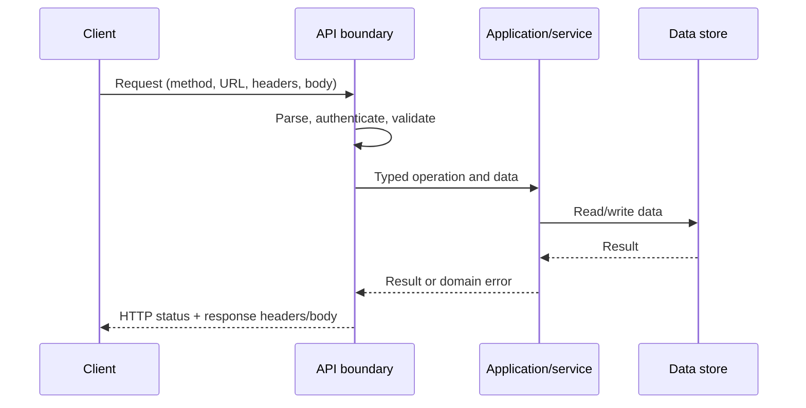

**Important distinction:** an endpoint is one addressable operation exposed by an API. For example, `GET /v1/campaigns/{campaign_id}` is an endpoint; the API is the broader contract containing all campaign operations.

## 1.2 Common API styles and communication models

The video surveys several API styles. They solve different communication problems; they are not interchangeable labels for the same thing.

| Style | Core idea | Typical payload/transport | Strong use cases | Main trade-off |
|---|---|---|---|---|
| REST-style HTTP API | Model resources and expose uniform HTTP operations | Often JSON over HTTP | Public/product APIs, browser/mobile clients | Requires careful resource and representation design |
| SOAP | Formal XML-based messaging protocol with contracts and defined operation envelopes | XML, commonly HTTP; WSDL contracts | Legacy enterprise integrations, formal enterprise contracts | Verbose and comparatively heavy |
| GraphQL | Client sends a query describing the data fields it needs | GraphQL query over HTTP, commonly JSON response | Many clients needing different data shapes; graph-shaped data | More complex caching, authorization, query-cost control |
| gRPC | Call typed remote service methods defined in a schema | Protocol Buffers, HTTP/2 | Internal service-to-service communication, low-latency typed RPC | Browser support and human readability are less straightforward |
| WebSocket | Maintain a full-duplex connection after an HTTP upgrade | Frames over a persistent TCP connection | Chat, live collaboration, live dashboards, games | Connection lifecycle, fan-out and reconnect behavior must be managed |

### REST-style resource example

```http
GET /v1/campaigns/42 HTTP/1.1
Host: api.example.com
Accept: application/json
Authorization: Bearer <access-token>
```

### SOAP example (illustrative)

```xml
<soap:Envelope xmlns:soap="http://schemas.xmlsoap.org/soap/envelope/">
  <soap:Body>
    <GetCampaignRequest>
      <CampaignId>42</CampaignId>
    </GetCampaignRequest>
  </soap:Body>
</soap:Envelope>
```

### GraphQL example

```graphql
query CampaignDetails($id: ID!) {
  campaign(id: $id) {
    id
    name
    status
    owner { id displayName }
  }
}
```

### gRPC / Protocol Buffers example (illustrative)

```protobuf
syntax = "proto3";

service CampaignService {
  rpc GetCampaign(GetCampaignRequest) returns (Campaign);
}

message GetCampaignRequest {
  string id = 1;
}

message Campaign {
  string id = 1;
  string name = 2;
  string status = 3;
}
```

### WebSocket example

```javascript
const socket = new WebSocket("wss://api.example.com/events");

socket.addEventListener("open", () => {
  socket.send(JSON.stringify({ type: "subscribe", topic: "campaign:42" }));
});

socket.addEventListener("message", (event) => {
  const message = JSON.parse(event.data);
  console.log("Live update:", message);
});
```

**Selection shortcut:** if the client asks for a resource and receives a response, REST is a natural default. If the client needs a custom graph-shaped response, evaluate GraphQL. If trusted services need typed RPC, evaluate gRPC. If updates must flow continuously in both directions, evaluate WebSockets. Select SOAP when an existing contract or integration requires it, not merely because it is another API technology.

## 1.3 JSON as a wire format

JSON (JavaScript Object Notation) is a text-based data-interchange format. It is language-independent even though its name contains JavaScript.

Supported JSON values:

- String: `"campaign"`
- Number: `42`, `19.95`
- Boolean: `true`, `false`
- Null: `null`
- Array: `["draft", "active"]`
- Object: `{ "id": 42, "name": "Launch" }`

Example resource representation:

```json
{
  "id": 42,
  "name": "Autumn launch",
  "status": "active",
  "budget": 25000.00,
  "tags": ["email", "web"],
  "owner": {
    "id": 7,
    "display_name": "Aarav"
  }
}
```

**Rules to remember:** object keys are double-quoted strings; JSON has no comments; trailing commas are invalid; JSON has no native date type, so dates should use an explicit string format such as ISO 8601; JSON numbers do not preserve a programming language's special numeric types.

The media type for JSON is usually `application/json`.

## 1.4 Resource and endpoint design

REST-style APIs normally expose **nouns/resources** in the URL and use the HTTP method to express the operation.

| Operation | Method | Endpoint | Meaning |
|---|---|---|---|
| List campaigns | GET | `/v1/campaigns` | Read a collection |
| Create campaign | POST | `/v1/campaigns` | Create a new resource |
| Read one campaign | GET | `/v1/campaigns/42` | Read resource 42 |
| Replace campaign | PUT | `/v1/campaigns/42` | Replace the resource representation |
| Partially update campaign | PATCH | `/v1/campaigns/42` | Modify supplied fields |
| Delete campaign | DELETE | `/v1/campaigns/42` | Remove or deactivate resource 42 |

Prefer consistent plural nouns such as `/campaigns`, `/users`, and `/orders`. Avoid action-heavy URLs such as `/getCampaign`, `/createCampaign`, and `/deleteCampaign` for ordinary CRUD operations. A domain action that is not a normal CRUD operation can be modelled explicitly, for example `POST /v1/campaigns/42/archive`.

### HTTP method semantics

| Method | Safe? | Idempotent by definition? | Typical meaning |
|---|---:|---:|---|
| GET | Yes | Yes | Retrieve a representation |
| HEAD | Yes | Yes | Retrieve headers without a response body |
| POST | No | No, normally | Submit a command or create subordinate resource |
| PUT | No | Yes | Create/replace the target representation |
| PATCH | No | Not necessarily | Apply a partial modification |
| DELETE | No | Yes in intended effect | Remove the target resource |
| OPTIONS | Yes | Yes | Discover communication options |

**Idempotency nuance:** idempotent means repeating the same request has the same intended effect on server state. It does not guarantee identical responses. A repeated DELETE can return 204 first and 404 later while still having an idempotent intended effect. PATCH is not automatically idempotent; a patch that sets `status="active"` can be idempotent, whereas a patch that increments a counter is not.

## 1.5 Nested data versus filtering

Use nested routes when the child resource is naturally scoped by or belongs to a parent:

```http
GET /v1/campaigns/42/recipients
GET /v1/campaigns/42/recipients/900
```

Use query parameters when the caller is selecting a subset of a collection:

```http
GET /v1/recipients?campaign_id=42&status=delivered
```

### Decision flow

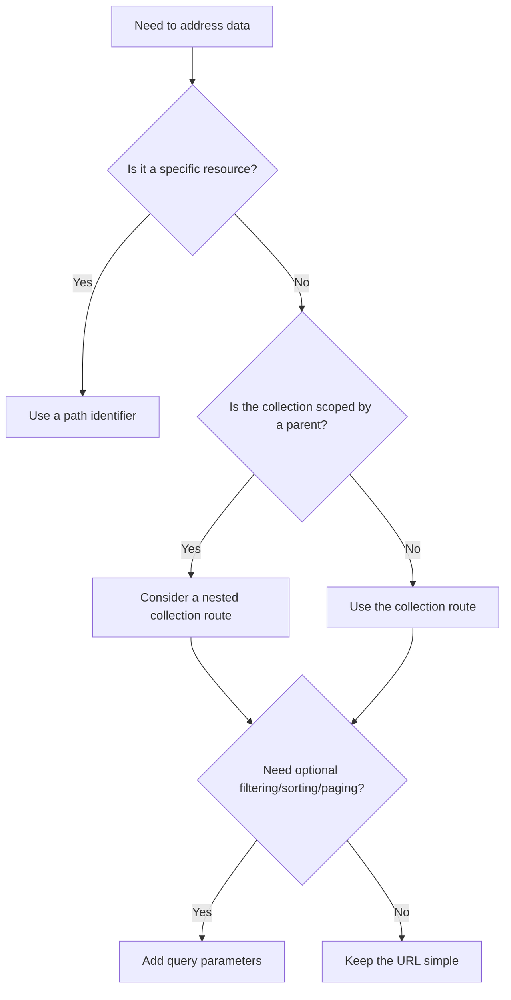

Avoid very deep nesting. If a route has four or five parent identifiers, reconsider whether the final resource has its own top-level endpoint. Use filtering for arbitrary combinations of attributes instead of creating a unique route for every filter combination.

## 1.6 Path parameters, query parameters, and request bodies

| Location | Primary role | Example | Good for |
|---|---|---|---|
| Path | Identify a resource or hierarchy | `/campaigns/42` | Resource ID, parent ID |
| Query | Modify selection of a collection | `?status=active&limit=20` | Filtering, sorting, pagination, search options |
| Body | Carry structured input for an operation | JSON object in POST/PATCH | Create and update data, complex commands |
| Header | Carry metadata or protocol controls | `Authorization`, `If-Match` | Authentication, content type, caching, tracing |

### Full request example

```http
PATCH /v1/campaigns/42?notify=false HTTP/1.1
Host: api.example.com
Content-Type: application/json
Accept: application/json
Authorization: Bearer <access-token>
X-Request-ID: 8f13bbd1

{
  "name": "Autumn launch — revised",
  "status": "paused"
}
```

The path selects campaign 42. The query parameter modifies this operation's optional behavior. The body carries the fields to update. The headers describe the representation, identity, and request metadata.

### When not to place data in a URL

- Do not put passwords, API secrets, access tokens, or other sensitive information in query strings. URLs are often recorded in browser history, reverse-proxy logs, analytics, and referrer data.
- Do not put large or complex update payloads in a path or query string.
- Do not use query parameters to represent an operation that has a complex structured command body.
- Do not put a resource's identity only in a body when the URL should clearly identify the target resource.

## 1.7 A complete API request lifecycle

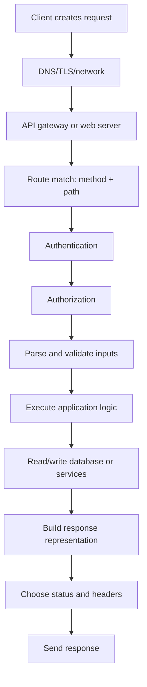

The video focuses on the API contract. A production implementation normally adds observability, timeouts, transaction boundaries, rate limiting, and centralized error handling around the same flow.

## 1.8 Status-code fundamentals

| Code | Meaning | Common use |
|---:|---|---|
| 200 | OK | Successful read or update with response body |
| 201 | Created | A new resource was created; include `Location` when appropriate |
| 202 | Accepted | Work accepted for asynchronous processing, not necessarily complete |
| 204 | No Content | Successful operation with no response body, commonly DELETE |
| 400 | Bad Request | Malformed or invalid client request |
| 401 | Unauthorized | Missing/invalid authentication credentials |
| 403 | Forbidden | Authenticated caller lacks permission |
| 404 | Not Found | Target resource does not exist or is intentionally hidden |
| 409 | Conflict | Request conflicts with current resource state or uniqueness constraint |
| 422 | Unprocessable Content | Syntactically valid content fails semantic validation (common in FastAPI) |
| 429 | Too Many Requests | Rate limit exceeded |
| 500 | Internal Server Error | Unexpected server-side failure |
| 503 | Service Unavailable | Temporarily unable to serve the request |

**401 versus 403:** 401 asks the client to authenticate or provide valid credentials. 403 means the server understood the identity but will not permit the requested action. A system may deliberately return 404 for a resource the caller must not discover; choose this consistently as a security policy.

## 1.9 Chapter 1 interview checks

1. What is the difference between an API and an endpoint?
2. Why is REST not simply “JSON over HTTP”?
3. When would you choose GraphQL over REST?
4. What problem does gRPC solve?
5. Why are WebSockets different from ordinary HTTP request/response?
6. Explain GET versus POST, PUT versus PATCH, and safe versus idempotent.
7. When should a relationship be represented by a nested route versus a query parameter?
8. Why should secrets not be sent in query strings?
9. Explain 401 versus 403, and 200 versus 201 versus 204.
10. What makes an API backward-compatible?

## 1.10 Practical exercises

- Design endpoints for users, projects, tasks, and project-membership.
- For each endpoint, identify method, path, query, headers, body, response status, and error statuses.
- Create the same operation as REST and GraphQL; compare response shape and caching concerns.
- Write example requests for create, list, read-one, update, and delete.

---

# Chapter 2 — API Status Codes and OpenAPI Documentation

**Video:** [Watch lesson](https://www.youtube.com/watch?v=doR604EaOhM) · **Duration:** 26:40  
**Lesson sections:** Server response basics; body structure; status codes; CRUD status codes; GET many, GET one, POST, PUT/PATCH and DELETE responses; client flow; middleware; API docs and OpenAPI specifications; when documentation is useful.

## 2.1 Anatomy of an HTTP response

An HTTP response has three main pieces:

1. **Status line:** protocol version, numeric status code, and reason phrase.
2. **Headers:** metadata such as content type, cache controls, request IDs, and location.
3. **Body:** the representation returned to the client, when one is present.

```http
HTTP/1.1 201 Created
Content-Type: application/json
Location: /v1/campaigns/42
Cache-Control: no-store

{
  "data": {
    "id": 42,
    "name": "Autumn launch",
    "status": "draft"
  }
}
```

The status code is not decoration. It is a machine-readable part of the API contract. Clients, proxies, monitoring systems, and retry logic rely on it.

## 2.2 Consistent response-body structure

A useful pattern is to keep successful data and pagination metadata predictable:

```json
{
  "data": {
    "id": 42,
    "name": "Autumn launch"
  },
  "meta": {
    "request_id": "8f13bbd1"
  }
}
```

For collections:

```json
{
  "data": [
    { "id": 42, "name": "Autumn launch" },
    { "id": 43, "name": "Winter launch" }
  ],
  "pagination": {
    "limit": 20,
    "offset": 0,
    "has_more": true
  }
}
```

For errors:

```json
{
  "error": {
    "code": "VALIDATION_ERROR",
    "message": "One or more fields are invalid.",
    "details": [
      { "field": "name", "reason": "must not be empty" }
    ]
  },
  "meta": {
    "request_id": "8f13bbd1"
  }
}
```

**Enhancement / production note:** consistency is more important than adopting one exact envelope. Some APIs return the resource directly, others use `data`/`meta`. Pick a policy, document it, and avoid mixing styles across endpoints. Do not return internal stack traces, SQL text, secrets, or raw exception messages to clients.

## 2.3 CRUD status-code policy

| Operation | Success | Other likely results | Body guidance |
|---|---:|---|---|
| GET collection | 200 | 400 for invalid filter; 401/403; 429; 500 | Return an array, even if empty |
| GET single | 200 | 404 if absent; 401/403 | Return resource representation |
| POST create | 201 | 400/422; 409 conflict; 401/403 | Return created resource and ideally `Location` |
| PUT replace | 200 or 204 | 404 if update-only and absent; 400/422; 409 | 200 includes representation; 204 includes no body |
| PATCH partial update | 200 or 204 | 404; 400/422; 409 | Return changed resource or no content |
| DELETE | 204 or 200 | 404; 401/403; 409 if blocked by state | 204 must not include a response body |

For asynchronous operations, consider **202 Accepted** and a job/status resource:

```http
POST /v1/reports
HTTP/1.1 202 Accepted
Location: /v1/jobs/job_91
Retry-After: 2
```

The client can poll `GET /v1/jobs/job_91` until the job completes. A 202 response does not mean the work has already finished.

## 2.4 Client flow: status codes drive behavior

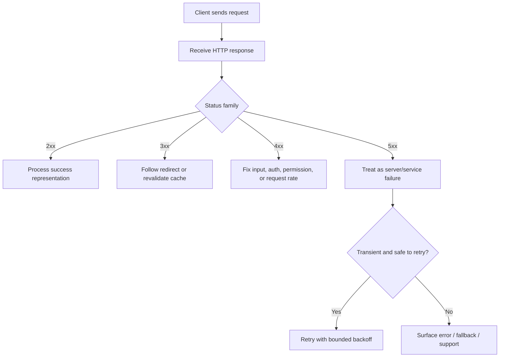

Never retry every failure blindly. A 400 is usually not fixed by retrying. A 429 should respect `Retry-After` when present. A 503 may be transient. A POST may create duplicate side effects if retried after a timeout unless an idempotency key or another deduplication mechanism is used.

## 2.5 Middleware in the API lifecycle

Middleware runs around a request and response. It is useful for cross-cutting behavior shared across endpoints:

- Request logging and correlation IDs.
- Authentication and security headers.
- CORS handling.
- Rate limiting.
- Compression.
- Global exception handling.
- Metrics and tracing.

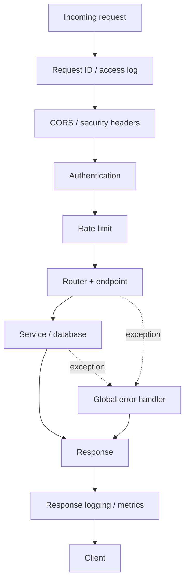

Middleware order matters. For example, a request ID should exist before logging; authentication must occur before authorization; an exception handler must be positioned so it can catch failures from the processing stages it protects.

## 2.6 What is OpenAPI?

**OpenAPI** is a machine-readable specification for describing HTTP APIs. It can describe:

- Paths and operations.
- Query/path/header parameters.
- Request bodies and schemas.
- Response bodies and status codes.
- Authentication schemes.
- Reusable components and data types.
- Examples and descriptions.

Tools can use the contract to generate interactive documentation, client SDKs, mocks, contract tests, and API review workflows. **Swagger UI** is a popular interactive viewer/editor experience for an OpenAPI document; OpenAPI is the specification, while Swagger is a tooling ecosystem.

### Small OpenAPI 3.1 example

```yaml
openapi: 3.1.0
info:
  title: Campaign API
  version: 1.0.0
servers:
  - url: https://api.example.com
paths:
  /v1/campaigns/{campaign_id}:
    get:
      summary: Get a campaign
      parameters:
        - name: campaign_id
          in: path
          required: true
          schema:
            type: integer
      responses:
        "200":
          description: Campaign found
          content:
            application/json:
              schema:
                $ref: "#/components/schemas/Campaign"
        "404":
          description: Campaign not found
components:
  schemas:
    Campaign:
      type: object
      required: [id, name, status]
      properties:
        id:
          type: integer
        name:
          type: string
        status:
          type: string
          enum: [draft, active, paused, completed]
```

## 2.7 When should you document an API?

Document an API when another person, service, team, or future version of the application needs to understand and consume it. This includes public APIs, partner integrations, internal microservices, and APIs used by multiple frontend clients.

Even an internal API benefits from generated OpenAPI documentation because it reduces guesswork about request and response contracts.

Documentation should answer:

- What does this operation do?
- What authentication is required?
- What inputs are accepted and what are the constraints?
- What is the success response?
- What errors can occur?
- Are pagination, sorting, filtering, or idempotency supported?
- Are there examples and migration/deprecation notes?

## 2.8 FastAPI documentation behavior

FastAPI derives an OpenAPI schema from route declarations and Pydantic models. Common default development endpoints are:

- `/openapi.json` — machine-readable OpenAPI specification.
- `/docs` — Swagger UI.
- `/redoc` — ReDoc documentation UI.

These paths can be changed or disabled. For production, consider authentication or network restrictions for internal documentation, and do not assume that hiding docs secures the API itself.

## 2.9 Chapter 2 interview checks

1. What are the three main parts of an HTTP response?
2. When should POST return 201 versus 202?
3. Why is 204 incompatible with a response body?
4. When would you return 409 instead of 400?
5. Why is a 404 for an empty collection usually incorrect?
6. What is middleware, and why does ordering matter?
7. What is OpenAPI, and how does it differ from Swagger UI?
8. How can an OpenAPI document be used beyond human-readable docs?
9. Why is retrying a POST dangerous?

---

# Chapter 3 — FastAPI: Building a Full CRUD REST API

**Video:** [Watch lesson](https://www.youtube.com/watch?v=k5abZLzsQc0) · **Duration:** 1:12:07  
**Lesson sections:** What is FastAPI; setup; build an API; paths and path parameters; GET; mock dictionary data; retrieve one campaign; interact with API; mocked POST/PUT/DELETE; database integration; SQL databases; GET multiple; lifespan events; data types; seed database; GET and GET-by-ID; generic response type; POST/create type; PUT/update; DELETE.

## 3.1 What FastAPI provides

FastAPI is a Python framework for building HTTP APIs. It combines Python type annotations, request parsing, validation, dependency injection, and OpenAPI schema generation.

Core ideas:

- **Application object:** the FastAPI instance registers routes and application configuration.
- **Path operation:** a function bound to an HTTP method and path.
- **Path/query/body parameters:** framework extracts request data and converts/validates it against declared types.
- **Pydantic models:** define and validate request/response data structures.
- **Dependencies:** reusable components such as database sessions and authenticated user lookup.
- **Lifespan:** explicit startup/shutdown lifecycle for resources.

## 3.2 Request flow in a FastAPI application

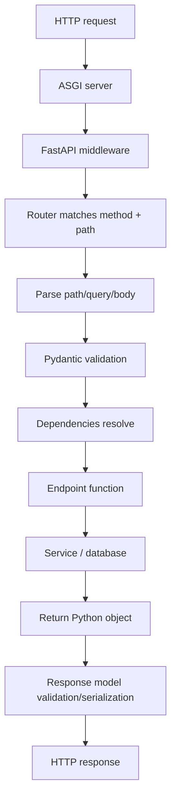

An ASGI server such as Uvicorn hosts the FastAPI application. FastAPI is the application framework; Uvicorn is the server process that speaks ASGI and accepts network connections.

## 3.3 Project setup

Example environment:

```bash
python -m venv .venv

# macOS / Linux
source .venv/bin/activate

# Windows PowerShell
# .venv\Scripts\Activate.ps1

pip install fastapi uvicorn sqlalchemy pydantic
```

Save a small app as `main.py`:

```python
from fastapi import FastAPI

app = FastAPI(title="Campaign API", version="1.0.0")

@app.get("/health")
def health_check():
    return {"status": "ok"}
```

Run it:

```bash
uvicorn main:app --reload
```

- `main` is the Python module (`main.py`).
- `app` is the FastAPI instance inside that module.
- `--reload` watches for code changes and is intended for development, not production.

Open `http://127.0.0.1:8000/docs` to try the endpoint.

## 3.4 Path operation and path parameters

```python
from fastapi import FastAPI

app = FastAPI()

@app.get("/campaigns/{campaign_id}")
def get_campaign(campaign_id: int):
    return {"id": campaign_id, "name": "Example campaign"}
```

The `{campaign_id}` placeholder is a path parameter. The `int` annotation asks FastAPI to parse it as an integer and return a validation error when it cannot.

A path parameter identifies the target. Query parameters usually refine the selection:

```python
@app.get("/campaigns")
def list_campaigns(status: str | None = None, limit: int = 20):
    return {"status_filter": status, "limit": limit}
```

## 3.5 Start with mock data

Starting with a dictionary is a useful teaching technique because it isolates API behavior from database setup:

```python
campaigns = {
    1: {"id": 1, "name": "Launch", "status": "draft"},
    2: {"id": 2, "name": "Retention", "status": "active"},
}

@app.get("/campaigns")
def get_campaigns():
    return list(campaigns.values())

@app.get("/campaigns/{campaign_id}")
def get_campaign(campaign_id: int):
    campaign = campaigns.get(campaign_id)
    if campaign is None:
        raise HTTPException(status_code=404, detail="Campaign not found")
    return campaign
```

A dictionary is not persistent and is not safe as the source of truth for multiple workers. It is only a starter implementation. Restarting the process loses changes, and different worker processes may have separate copies.

## 3.6 CRUD semantics in the application

- **Create:** accept validated create input, persist a new record, return 201 and the created resource.
- **Read:** return a list or one resource; missing single resources return 404.
- **Update:** distinguish full replacement (PUT) from partial update (PATCH).
- **Delete:** delete or mark the target resource deleted; return 204 when no body is required.

The following enhanced teaching example uses SQLite and synchronous SQLAlchemy 2.x. It is deliberately compact so the entire data flow is visible. For a real production system, use migrations (for example Alembic), configuration from environment variables/secret management, and a managed database such as PostgreSQL.

## 3.7 Complete teaching implementation — FastAPI + SQLAlchemy

```python
from __future__ import annotations

from contextlib import asynccontextmanager
from datetime import datetime, timezone
from typing import Annotated, Literal

from fastapi import Depends, FastAPI, HTTPException, Response, status
from pydantic import BaseModel, ConfigDict, Field
from sqlalchemy import DateTime, Integer, String, create_engine, select
from sqlalchemy.orm import DeclarativeBase, Mapped, Session, mapped_column, sessionmaker

DATABASE_URL = "sqlite:///./campaigns.db"
engine = create_engine(
    DATABASE_URL,
    connect_args={"check_same_thread": False},  # SQLite-specific setting
)
SessionLocal = sessionmaker(bind=engine, autoflush=False, expire_on_commit=False)

class Base(DeclarativeBase):
    pass

class Campaign(Base):
    __tablename__ = "campaigns"

    id: Mapped[int] = mapped_column(Integer, primary_key=True, index=True)
    name: Mapped[str] = mapped_column(String(120), nullable=False)
    status: Mapped[str] = mapped_column(String(20), nullable=False, default="draft")
    created_at: Mapped[datetime] = mapped_column(
        DateTime(timezone=True),
        default=lambda: datetime.now(timezone.utc),
        nullable=False,
    )

class CampaignCreate(BaseModel):
    name: str = Field(min_length=1, max_length=120)
    status: Literal["draft", "active", "paused", "completed"] = "draft"

class CampaignUpdate(BaseModel):
    # PATCH-friendly: fields are optional; exclude_unset distinguishes omitted fields.
    name: str | None = Field(default=None, min_length=1, max_length=120)
    status: Literal["draft", "active", "paused", "completed"] | None = None

class CampaignOut(BaseModel):
    model_config = ConfigDict(from_attributes=True)

    id: int
    name: str
    status: str
    created_at: datetime

@asynccontextmanager
async def lifespan(app: FastAPI):
    # Teaching shortcut only. Production schema changes belong in migrations.
    Base.metadata.create_all(bind=engine)
    yield
    engine.dispose()

app = FastAPI(title="Campaign API", version="1.0.0", lifespan=lifespan)

def get_db():
    db = SessionLocal()
    try:
        yield db
    finally:
        db.close()

DB = Annotated[Session, Depends(get_db)]

@app.get("/v1/campaigns", response_model=list[CampaignOut])
def list_campaigns(db: DB, limit: int = 20, offset: int = 0):
    if not 1 <= limit <= 100:
        raise HTTPException(status_code=400, detail="limit must be between 1 and 100")
    if offset < 0:
        raise HTTPException(status_code=400, detail="offset cannot be negative")

    statement = select(Campaign).order_by(Campaign.id).limit(limit).offset(offset)
    return db.scalars(statement).all()

@app.get("/v1/campaigns/{campaign_id}", response_model=CampaignOut)
def get_campaign(campaign_id: int, db: DB):
    campaign = db.get(Campaign, campaign_id)
    if campaign is None:
        raise HTTPException(status_code=404, detail="Campaign not found")
    return campaign

@app.post(
    "/v1/campaigns",
    response_model=CampaignOut,
    status_code=status.HTTP_201_CREATED,
)
def create_campaign(payload: CampaignCreate, db: DB):
    campaign = Campaign(**payload.model_dump())
    db.add(campaign)
    db.commit()
    db.refresh(campaign)
    return campaign

@app.put("/v1/campaigns/{campaign_id}", response_model=CampaignOut)
def replace_campaign(campaign_id: int, payload: CampaignCreate, db: DB):
    campaign = db.get(Campaign, campaign_id)
    if campaign is None:
        raise HTTPException(status_code=404, detail="Campaign not found")

    campaign.name = payload.name
    campaign.status = payload.status
    db.commit()
    db.refresh(campaign)
    return campaign

@app.patch("/v1/campaigns/{campaign_id}", response_model=CampaignOut)
def patch_campaign(campaign_id: int, payload: CampaignUpdate, db: DB):
    campaign = db.get(Campaign, campaign_id)
    if campaign is None:
        raise HTTPException(status_code=404, detail="Campaign not found")

    changes = payload.model_dump(exclude_unset=True)
    for field, value in changes.items():
        if value is not None:
            setattr(campaign, field, value)

    db.commit()
    db.refresh(campaign)
    return campaign

@app.delete("/v1/campaigns/{campaign_id}", status_code=status.HTTP_204_NO_CONTENT)
def delete_campaign(campaign_id: int, db: DB):
    campaign = db.get(Campaign, campaign_id)
    if campaign is None:
        raise HTTPException(status_code=404, detail="Campaign not found")

    db.delete(campaign)
    db.commit()
    return Response(status_code=status.HTTP_204_NO_CONTENT)
```

Run and inspect:

```bash
uvicorn main:app --reload
```

Try the routes in Swagger UI or with curl:

```bash
# List
curl http://127.0.0.1:8000/v1/campaigns

# Create
curl -X POST http://127.0.0.1:8000/v1/campaigns \
  -H 'Content-Type: application/json' \
  -d '{"name":"Autumn launch","status":"draft"}'

# Read one
curl http://127.0.0.1:8000/v1/campaigns/1

# Partial update
curl -X PATCH http://127.0.0.1:8000/v1/campaigns/1 \
  -H 'Content-Type: application/json' \
  -d '{"status":"active"}'

# Delete
curl -i -X DELETE http://127.0.0.1:8000/v1/campaigns/1
```

### Important implementation notes

- `CampaignCreate` is a **request schema**. It describes accepted create input.
- `CampaignOut` is a **response schema**. It prevents internal columns from leaking and defines the API representation.
- `ConfigDict(from_attributes=True)` lets Pydantic serialize ORM objects by reading their attributes.
- `exclude_unset=True` is important for PATCH. It distinguishes “the caller omitted this field” from “the caller explicitly supplied a value”.
- `db.commit()` persists changes; `db.refresh()` reloads values generated by the database.
- `get_db()` creates one database session for the request and closes it at the end.
- Lifespan is for resources whose lifetime is tied to the application process. Do not create a new database engine per request.
- The SQLite connection option in this example is SQLite-specific. PostgreSQL URLs and connection behavior differ.
- `create_all()` is appropriate for a small teaching example, not a replacement for reviewed schema migrations in a team or production environment.

## 3.8 Why SQL databases?

A relational database stores structured records in tables and supports constraints, transactions, joins, indexes, and concurrent access. A dictionary or in-memory list is useful for a demo, but a real API generally needs persistence and safe multi-client writes.

The database should enforce important invariants too. Examples:

- `NOT NULL` for mandatory attributes.
- `UNIQUE` for values that must not be duplicated.
- Foreign keys for referential integrity.
- `CHECK` constraints for domain limits where appropriate.
- Transactions for operations that must succeed or fail together.

## 3.9 Lifespan events

Application lifespan has two phases:

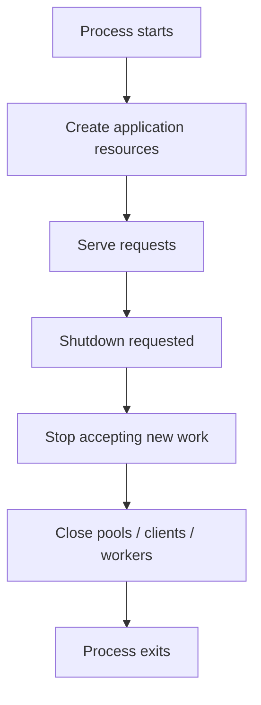

Use lifespan for database engine setup/disposal, long-lived HTTP clients, message-broker clients, and other application-scoped resources. For each resource, define who creates it and who closes it.

## 3.10 Generic response models

A generic envelope can keep response structure consistent across endpoints:

```python
from typing import Generic, TypeVar
from pydantic import BaseModel

T = TypeVar("T")

class ApiResponse(BaseModel, Generic[T]):
    data: T
    request_id: str | None = None

# Example type declarations:
# ApiResponse[CampaignOut]
# ApiResponse[list[CampaignOut]]
```

Use generics to reduce duplicated schema definitions, not to hide meaningful differences between response types.

## 3.11 Chapter 3 interview checks

1. What is the difference between FastAPI and Uvicorn?
2. How does FastAPI turn type hints into request validation?
3. What is the purpose of a Pydantic request model?
4. Why should request and response schemas often be separate?
5. What does a path parameter represent?
6. How does a dependency such as `get_db()` work?
7. Why should a database session be scoped to a request?
8. What is an application lifespan event?
9. Why is `create_all()` not a full production migration strategy?
10. Explain the difference between PUT and PATCH in the implementation above.

## 3.12 Practical exercises

- Add `owner_id` to Campaign and create a `users` table with a foreign key.
- Add filtering by status and sorting by `created_at`.
- Add pagination and return a consistent `meta` object.
- Add a unique constraint and map duplicate-name errors to 409.
- Write tests for create, read, update, delete, missing ID, and invalid payload.
- Replace SQLite with PostgreSQL using configuration rather than a hard-coded URL.

---

# Chapter 4 — API Pagination: Offset and Cursor Pagination Explained

**Video:** [Watch lesson](https://www.youtube.com/watch?v=mvlzhBgGS4s) · **Duration:** 25:46  
**Lesson sections:** Intro; what is pagination; API structure; pagination types; page-based pagination; offset-based pagination; offset limitations; cursor-based pagination; cursor limitations; client-side pagination; choosing what to use.

## 4.1 Why pagination exists

Returning every matching record in a single response becomes expensive as the dataset grows. Pagination divides a large collection into bounded responses.

Benefits:

- Limits response size and memory usage.
- Reduces serialization and network transfer cost.
- Provides predictable response-time behavior.
- Lets clients load more records progressively.
- Avoids downloading data the user never sees.

Pagination is part of API design, not merely a frontend widget.

## 4.2 Common pagination models

### Page-based

The client asks for a page number and page size:

```http
GET /v1/campaigns?page=3&page_size=20
```

The offset is calculated as:

\[
\text{offset} = (\text{page} - 1) \times \text{pageSize}
\]

For page 3 with page size 20, offset = 40.

### Offset-based

The client directly controls the number of rows to skip:

```http
GET /v1/campaigns?limit=20&offset=40
```

The database concept is commonly:

```sql
SELECT id, name, status
FROM campaigns
ORDER BY id
LIMIT 20 OFFSET 40;
```

### Cursor-based

The client supplies a pointer to the last item seen:

```http
GET /v1/campaigns?limit=20&cursor=eyJpZCI6NDJ9
```

The server interprets the cursor and returns the next segment after that position. A cursor may encode an ID, a timestamp and ID pair, or another stable ordering key.

### Client-side pagination

The client first loads a small complete dataset, then displays one local page at a time. This is acceptable only when the collection is genuinely small and the full set is safe and reasonable to transfer.

## 4.3 Pagination response design

Offset-style response:

```json
{
  "data": [
    { "id": 41, "name": "Campaign 41" },
    { "id": 42, "name": "Campaign 42" }
  ],
  "pagination": {
    "limit": 20,
    "offset": 40,
    "total": 147,
    "has_next": true,
    "next": "/v1/campaigns?limit=20&offset=60",
    "previous": "/v1/campaigns?limit=20&offset=20"
  }
}
```

Cursor-style response:

```json
{
  "data": [
    { "id": 41, "name": "Campaign 41" },
    { "id": 42, "name": "Campaign 42" }
  ],
  "pagination": {
    "limit": 20,
    "next_cursor": "eyJjcmVhdGVkX2F0Ijoi...",
    "has_more": true
  }
}
```

The exact envelope is a design choice. The key is that clients should not have to infer navigation state from undocumented conventions.

## 4.4 Offset pagination: strengths and weaknesses

**Strengths:** easy to implement, easy to inspect, supports page-number UI, works well for small/medium collections, and can support arbitrary page jumps.

**Weaknesses:**

1. Deep offsets can be expensive because the database may need to walk past many rows before returning the requested page.
2. Concurrent inserts/deletes can shift rows between page requests. A client may see duplicates or miss records while navigating.
3. Exact total counts may require an additional expensive `COUNT(*)` query.
4. Stable ordering is mandatory. Without `ORDER BY`, the database is free to return rows in an unspecified order.

Example of page drift:

```text
Initial ordering:       A B C D E F G H
Client reads page 1:    A B C D
New row inserted:       X A B C D E F G H
Client reads page 2:    D E F G     (D appears twice)
```

## 4.5 Cursor pagination: strengths and weaknesses

**Strengths:** efficient for feeds and large datasets; avoids scanning and discarding a huge number of prior rows; behaves better under inserts before the cursor; natural for infinite scroll.

**Weaknesses:** harder to implement; arbitrary page-number jumps are not natural; cursor design must reflect a stable order; previous-page navigation is more involved; cursor values must be validated and should be treated as opaque API state.

A cursor must be tied to a deterministic ordering. If many records share the same timestamp, use a unique tie-breaker such as the primary key.

Good order:

```sql
ORDER BY created_at DESC, id DESC
```

A cursor should carry both `created_at` and `id`, not only `created_at`.

## 4.6 Client-side versus server-side pagination

| Situation | Recommendation | Reason |
|---|---|---|
| 20 static options already fetched | Client-side can be fine | No need for another network request |
| 100,000 records | Server-side | Bound response and database work |
| Infinite-scroll activity feed | Cursor-based server-side | Stable continuation and efficient next page |
| Admin table with arbitrary page jump | Offset/page-based may be suitable | User expects direct page navigation |
| Small reference list | Client-side | Full list is small and bounded |

### Decision flow

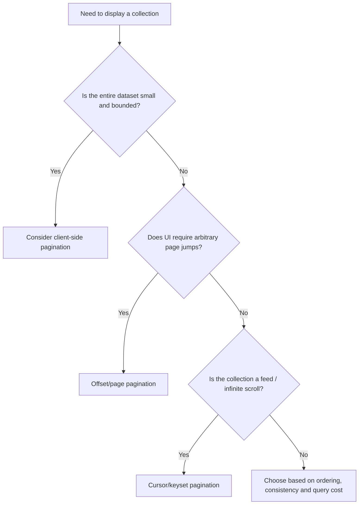

## 4.7 Production details that are easy to miss

- Cap `limit` to prevent clients from requesting millions of rows.
- Always use a deterministic `ORDER BY`.
- Whitelist sort fields; never insert arbitrary client input into SQL structure.
- Apply filters consistently to every page request.
- Decide whether exact totals are actually necessary.
- Decide whether pagination promises a snapshot or merely best-effort navigation through a changing collection.
- Keep cursor semantics stable when the API evolves; consider a cursor version.

## 4.8 Chapter 4 interview checks

1. Why do APIs paginate?
2. Explain page-based, offset-based, and cursor-based pagination.
3. What is the page-to-offset formula?
4. Why do deep offset queries become expensive?
5. How can concurrent writes cause duplicate or missing results?
6. Why should cursor pagination include a tie-breaker?
7. When is client-side pagination appropriate?
8. Why can `COUNT(*)` be a performance bottleneck?

---

# Chapter 5 — Offset and Limit Pagination Tutorial

**Video:** [Watch lesson](https://www.youtube.com/watch?v=nZGkKGK1dwg) · **Duration:** 18:57  
**Lesson sections:** Intro; pagination approach; calculating next/previous URL; removing the count; limit and offset; next steps.

## 5.1 The limit/offset contract

- `limit` = maximum number of rows returned.
- `offset` = number of rows skipped before returning results.

Example:

```http
GET /v1/campaigns?limit=10&offset=20
```

This asks for at most 10 rows after skipping the first 20 rows in the chosen order.

SQL:

```sql
SELECT id, name, created_at
FROM campaigns
ORDER BY created_at DESC, id DESC
LIMIT 10 OFFSET 20;
```

The `ORDER BY` is essential. Pagination without stable ordering does not define reliable pages.

## 5.2 Calculating next and previous URLs

Assume:

```text
limit = 10
offset = 20
```

Then:

```text
next_offset = offset + limit = 30
previous_offset = max(offset - limit, 0) = 10
```

General formula:

\[
\text{nextOffset} = \text{offset} + \text{limit}
\]

\[
\text{previousOffset} = \max(\text{offset} - \text{limit}, 0)
\]

### Link construction

```python
from urllib.parse import urlencode


def page_url(base_path: str, *, limit: int, offset: int, status: str | None = None) -> str:
    params = {"limit": limit, "offset": offset}
    if status is not None:
        params["status"] = status
    return f"{base_path}?{urlencode(params)}"


def pagination_links(base_path: str, *, limit: int, offset: int, has_next: bool):
    return {
        "next": page_url(
            base_path,
            limit=limit,
            offset=offset + limit,
        ) if has_next else None,
        "previous": page_url(
            base_path,
            limit=limit,
            offset=max(offset - limit, 0),
        ) if offset > 0 else None,
    }
```

**Important enhancement:** preserve active filters and sort order in next/previous links. If the first request used `?status=active&sort=created_at`, the next link must keep those parameters or the client will navigate to a different collection.

## 5.3 Determining whether another page exists

There are two common strategies.

### Strategy A — exact count

```sql
SELECT COUNT(*)
FROM campaigns
WHERE status = 'active';
```

The server can calculate the total number of pages:

\[
\text{totalPages} = \left\lceil \frac{\text{totalCount}}{\text{limit}} \right\rceil
\]

Advantages: supports “page 4 of 12” and exact totals.  
Disadvantages: the count query may be expensive on large or complex filtered datasets; it may not share the same snapshot as the page query unless transaction/isolation decisions are made carefully.

### Strategy B — fetch one extra row

Ask the database for `limit + 1` rows:

```sql
SELECT id, name
FROM campaigns
ORDER BY id
LIMIT 11 OFFSET 20;
```

If 11 rows are returned, there is another page. Return only the first 10 rows.

This avoids an exact count query and is often a better fit when the client only needs a “Next” button.

```python
rows = db.execute(statement.limit(limit + 1).offset(offset)).all()
has_next = len(rows) > limit
items = rows[:limit]
```

Do not return the extra row to the client; it exists only to determine whether another page is available.

## 5.4 FastAPI-style offset endpoint

```python
from fastapi import HTTPException
from sqlalchemy import select

@app.get("/v1/campaigns")
def list_campaigns(db: DB, limit: int = 20, offset: int = 0):
    if not 1 <= limit <= 100:
        raise HTTPException(400, "limit must be between 1 and 100")
    if offset < 0:
        raise HTTPException(400, "offset must be non-negative")

    statement = (
        select(Campaign)
        .order_by(Campaign.created_at.desc(), Campaign.id.desc())
        .limit(limit + 1)
        .offset(offset)
    )
    rows = db.scalars(statement).all()
    has_next = len(rows) > limit
    items = rows[:limit]

    return {
        "data": items,
        "pagination": {
            "limit": limit,
            "offset": offset,
            "has_next": has_next,
            "next_offset": offset + limit if has_next else None,
            "previous_offset": max(offset - limit, 0) if offset > 0 else None,
        },
    }
```

The endpoint above omits the count for efficiency. If product requirements demand exact totals, add a count query deliberately and measure its cost.

## 5.5 Limitations of offset pagination

### Deep offset cost

A request with `OFFSET 500000` can require the database to walk past a large number of qualifying rows before returning the next page. An index can help with filtering and ordering, but it does not make arbitrary large offsets free.

### Page drift under concurrent writes

The contents of “page 2” are not a stable identity. When records are inserted or removed before the requested offset, rows shift.

### No guaranteed snapshot

A multi-page browsing session normally consists of separate requests and may observe different database states. If the product needs a consistent snapshot, it needs an explicit snapshot/versioning or transaction strategy; pagination parameters alone do not provide one.

## 5.6 Practical decision

Use offset/limit for straightforward tables, administrative interfaces, and datasets where page numbers and arbitrary jumps matter. Use cursor/keyset pagination when navigating deep, changing, or high-volume feeds.

## 5.7 Chapter 5 interview checks

1. Define limit and offset.
2. Derive the next and previous offset formulas.
3. Why must filters be preserved in pagination links?
4. How can `limit + 1` determine `has_next`?
5. Why might an exact count query be expensive?
6. What happens when the dataset changes between page requests?
7. Why should API limit values be bounded?

---

# Chapter 6 — API Cursor Pagination for Infinite Scroll

**Video:** [Watch lesson](https://www.youtube.com/watch?v=6W5_HoOKMPg) · **Duration:** 16:08  
**Lesson sections:** Intro; preview; offset review; building cursor pagination; encoding cursor; limit plus one; next steps.

## 6.1 Cursor pagination mental model

Offset pagination asks: “Skip the first N rows.”  
Cursor pagination asks: “Continue after this specific ordered record.”

```text
Offset:
  page 1 -> OFFSET 0
  page 2 -> OFFSET 20
  page 3 -> OFFSET 40

Cursor:
  page 1 -> no cursor
  page 2 -> after cursor from last item in page 1
  page 3 -> after cursor from last item in page 2
```

A cursor is an opaque continuation token. The client should store it and send it back, not parse or construct it.

## 6.2 Stable keyset ordering

A naive cursor based only on `created_at` can fail when multiple rows have the same timestamp. Use a unique tie-breaker.

Example ordering:

```sql
ORDER BY created_at DESC, id DESC
```

If the last item on the current page has `(created_at = T, id = 42)`, the next page should contain rows with an older timestamp, or the same timestamp and a smaller ID:

```sql
WHERE created_at < :cursor_created_at
   OR (created_at = :cursor_created_at AND id < :cursor_id)
ORDER BY created_at DESC, id DESC
LIMIT :limit_plus_one;
```

This is keyset pagination. It uses the ordering key to seek forward rather than skipping a large number of rows.

## 6.3 Cursor encoding

A cursor can encode the values needed to continue the query:

```json
{
  "v": 1,
  "created_at": "2026-10-31T12:30:00+00:00",
  "id": 42
}
```

Base64 URL-safe encoding makes the token transport-friendly:

```python
import base64
import json


def encode_cursor(payload: dict) -> str:
    raw = json.dumps(payload, separators=(",", ":")).encode("utf-8")
    return base64.urlsafe_b64encode(raw).decode("ascii").rstrip("=")


def decode_cursor(token: str) -> dict:
    padding = "=" * (-len(token) % 4)
    raw = base64.urlsafe_b64decode(token + padding)
    payload = json.loads(raw.decode("utf-8"))
    if payload.get("v") != 1:
        raise ValueError("Unsupported cursor version")
    return payload
```

**Security clarification:** Base64 is encoding, not encryption or authentication. A user can decode and alter a Base64 cursor. Validate its structure and values. If tampering could cause meaningful problems, add an HMAC signature or use a server-side opaque token. Never put secrets in a cursor.

### Cursor pipeline

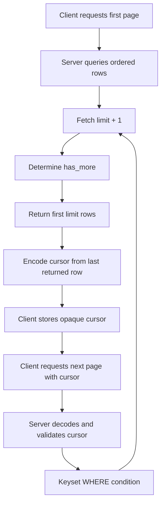

## 6.4 Complete cursor pagination query (SQLAlchemy)

The example below assumes the same `Campaign` ORM model from Chapter 3.

```python
from datetime import datetime
from sqlalchemy import and_, or_, select


def campaign_page_statement(limit: int, cursor: dict | None):
    statement = select(Campaign)

    if cursor is not None:
        cursor_time = datetime.fromisoformat(cursor["created_at"])
        cursor_id = int(cursor["id"])
        statement = statement.where(
            or_(
                Campaign.created_at < cursor_time,
                and_(
                    Campaign.created_at == cursor_time,
                    Campaign.id < cursor_id,
                ),
            )
        )

    return (
        statement
        .order_by(Campaign.created_at.desc(), Campaign.id.desc())
        .limit(limit + 1)
    )
```

A route can then build the next token:

```python
import json
from datetime import timezone
from fastapi import HTTPException

@app.get("/v1/campaigns/feed")
def campaign_feed(db: DB, limit: int = 20, cursor: str | None = None):
    if not 1 <= limit <= 100:
        raise HTTPException(400, "limit must be between 1 and 100")

    decoded = None
    if cursor:
        try:
            decoded = decode_cursor(cursor)
            # Validate shape and expected types before using the values.
            if not {"created_at", "id", "v"}.issubset(decoded):
                raise ValueError("Missing cursor fields")
            int(decoded["id"])
            datetime.fromisoformat(decoded["created_at"])
        except (ValueError, TypeError, KeyError, json.JSONDecodeError):
            raise HTTPException(400, "Invalid cursor")

    rows = db.scalars(campaign_page_statement(limit, decoded)).all()
    has_more = len(rows) > limit
    items = rows[:limit]

    next_cursor = None
    if has_more and items:
        last = items[-1]
        created_at = last.created_at
        if created_at.tzinfo is None:
            created_at = created_at.replace(tzinfo=timezone.utc)
        next_cursor = encode_cursor({
            "v": 1,
            "created_at": created_at.isoformat(),
            "id": last.id,
        })

    return {
        "data": items,
        "pagination": {
            "limit": limit,
            "has_more": has_more,
            "next_cursor": next_cursor,
        },
    }
```

For a complete project, put cursor encoding/decoding in a reusable utility, sign tokens where required, validate filters/sort versions, and make timestamp precision consistent with the database.

## 6.5 The limit-plus-one technique

Suppose the page size is 20. Query for 21 rows:

```sql
SELECT id, created_at, name
FROM campaigns
WHERE (created_at, id) < (:created_at, :id)
ORDER BY created_at DESC, id DESC
LIMIT 21;
```

- If 21 rows arrive, set `has_more = true` and return only the first 20.
- If 20 or fewer arrive, set `has_more = false`.
- The next cursor is usually based on the last item actually returned, not the extra row.

This removes the need for a total-count query when the UI only needs to know whether more items exist.

## 6.6 Client implementation: infinite scroll

Conceptual JavaScript:

```javascript
let cursor = null;
let loading = false;
let hasMore = true;
const items = [];

async function loadNextPage() {
  if (loading || !hasMore) return;
  loading = true;

  try {
    const params = new URLSearchParams({ limit: "20" });
    if (cursor) params.set("cursor", cursor);

    const response = await fetch(`/v1/campaigns/feed?${params}`);
    if (!response.ok) throw new Error(`HTTP ${response.status}`);

    const result = await response.json();
    items.push(...result.data);
    cursor = result.pagination.next_cursor;
    hasMore = result.pagination.has_more;
    render(items);
  } finally {
    loading = false;
  }
}
```

A production client should also cancel stale requests, deduplicate records, handle retry/backoff, and protect against two scroll events firing concurrently.

## 6.7 Common cursor bugs

- **Non-unique sort key:** records with equal timestamps can be skipped or duplicated if no unique tie-breaker is included.
- **Wrong cursor boundary:** using `<=` instead of `<` can repeat the last row.
- **Changed filters:** a cursor generated for one filter set should not be reused with a different filter set unless the API explicitly supports it.
- **Wrong ordering direction:** the cursor predicate must match the `ORDER BY` direction.
- **Unvalidated cursor:** malformed or oversized tokens can become a parsing or resource-exhaustion problem.
- **Exposed internals:** do not rely on a client keeping the cursor secret. Treat it as untrusted input.
- **Mutable ordering values:** if the sort field changes between requests, the record can move across the cursor boundary. Prefer immutable or monotonic ordering keys for feeds.

## 6.8 Chapter 6 interview checks

1. What is a cursor?
2. Why is cursor pagination good for infinite scroll?
3. Why should cursors be opaque to clients?
4. Why does Base64 not secure a cursor?
5. Explain keyset pagination using `(created_at, id)`.
6. Why do we query `limit + 1` rows?
7. What happens if the cursor uses a non-unique timestamp only?
8. How should filters and sort order relate to a cursor?

---

# Chapter 7 — Intro to Authentication: User Auth and API Auth

**Video:** [Watch lesson](https://www.youtube.com/watch?v=wGBQTpGqc5c) · **Duration:** 23:24  
**Transcript limitation:** the public index confirms the title and lesson length but does not expose a timestamped lesson outline in the sources accessible here. This chapter is therefore an expanded study treatment of the distinction in the video title, with standard production patterns added. It is not a claimed reconstruction of the instructor's exact narration.

## 7.1 Authentication versus authorization

- **Authentication (AuthN):** verify who or what is making the request.
- **Authorization (AuthZ):** decide what the authenticated identity is allowed to do.

Examples:

- A user logs in as `parth@example.com`: authentication.
- The API checks whether that user can edit campaign 42: authorization.
- A reporting service presents its client credential to call an internal report API: machine/client authentication.
- The service may be permitted to read reports but not delete them: authorization.

## 7.2 User authentication versus API/client authentication

| Dimension | User authentication | API/client authentication |
|---|---|---|
| Identity | Human user | Application, service, integration, or client |
| Typical flow | Login, session, access token | API key, OAuth client credentials, signed request, mTLS |
| Credential owner | User | Developer/team/service operator |
| Example | User signs in to a dashboard | Backend service calls a partner API |
| Authorization context | User roles, tenant, ownership, scopes | Client scopes, service role, allowed operations |

**Do not confuse an API key with a user's password.** An API key commonly identifies an application or integration. It does not automatically prove which human user is behind a request. If a service acts on behalf of a user, the system needs an appropriate delegated authorization model.

## 7.3 User login flow

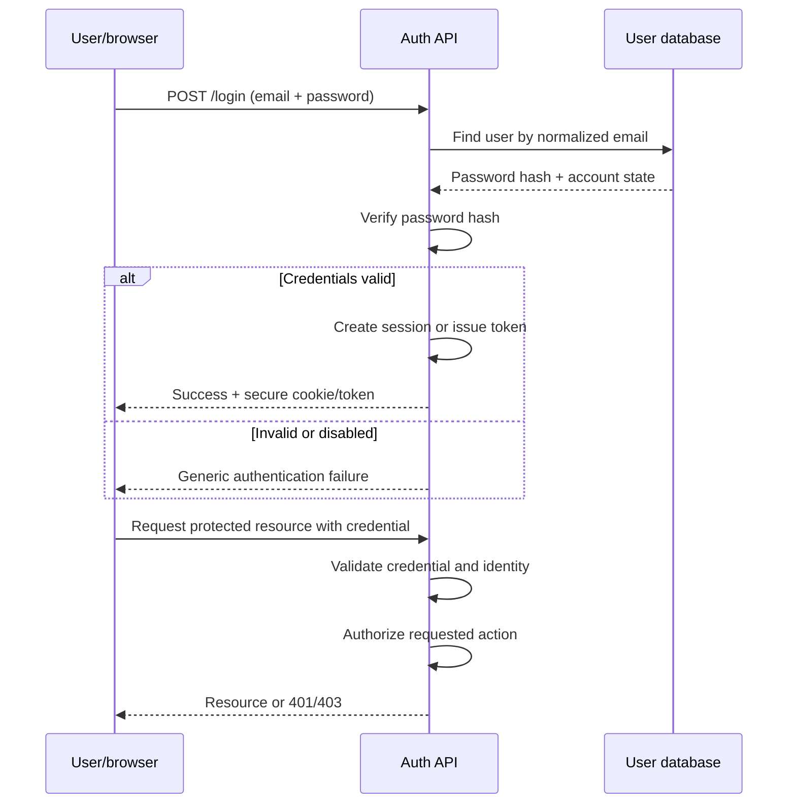

## 7.4 Password storage

Never store plaintext passwords. Store a salted password hash produced by a password-hashing algorithm designed to be slow and memory-hard, such as **Argon2id**. Alternatives may include bcrypt or scrypt, depending on platform and current security guidance.

Password hashing is not the same as ordinary hashing for checksums. A fast hash such as SHA-256 is unsuitable by itself for password storage because attackers can test guesses extremely quickly.

Security requirements:

- Unique salt per password (handled by suitable password-hashing libraries).
- Appropriate cost parameters calibrated for the deployment environment.
- Rate limits and abuse detection on login endpoints.
- Generic failure messages so the endpoint does not disclose whether an email exists.
- Password reset tokens that are random, single-use, and expire.
- Multi-factor authentication for sensitive accounts/actions where appropriate.

## 7.5 Session-based user authentication

A common browser session flow:

1. User submits credentials.
2. Server verifies them.
3. Server creates a random session identifier and stores session state in a server-side store.
4. Browser receives the session ID in a secure cookie.
5. On each request, browser sends the cookie.
6. Server looks up the session and derives the user identity.
7. Logout or expiry invalidates the session.

Cookie flags to understand:

- `HttpOnly`: prevents ordinary JavaScript from reading the cookie.
- `Secure`: send only over HTTPS.
- `SameSite`: controls cross-site cookie sending and helps reduce CSRF exposure.
- `Path` and `Domain`: scope cookie delivery.

**Enhancement / production note:** cookie-based sessions still need CSRF protection appropriate to the application's architecture. `HttpOnly` prevents JavaScript access but does not itself prevent the browser from attaching the cookie to a forged cross-site request.

## 7.6 Token-based authentication and JWT

A JSON Web Token (JWT) commonly carries signed claims such as subject (`sub`), issuer (`iss`), audience (`aud`), expiry (`exp`), and scopes/roles. A signed JWT is not automatically encrypted; its payload can generally be decoded by whoever possesses it.

A resource server should validate:

- Signature using an expected algorithm and trusted key.
- Issuer and audience.
- Expiry and not-before times when present.
- Expected token type and required scopes/claims.
- Key rotation and token-revocation strategy.

Use short-lived access tokens. Refresh tokens need stronger protection and rotation/reuse-detection practices. A JWT's self-contained nature does not make revocation magically easy; early invalidation usually needs additional server-side state or short expiry.

## 7.7 API key authentication

An API key can authenticate a service or integration to an API. A key is a bearer secret: whoever possesses it may be able to use it.

Good practices:

- Generate high-entropy random keys.
- Show the full key only once at creation.
- Store a cryptographic hash or verifier, not the raw key, where feasible.
- Give keys narrow scopes and quotas.
- Include key owner, creation time, expiry, last-used time, and status.
- Support revocation and rotation.
- Never embed privileged server API keys in browser JavaScript or a public mobile app.
- Do not send keys in query strings; use a header such as `Authorization` or a documented API-key header.
- Log a key identifier/prefix, not the secret itself.

Example header:

```http
GET /v1/partner/reports HTTP/1.1
Host: api.example.com
X-API-Key: <secret-key>
```

An API key is not a substitute for fine-grained authorization. After identifying the client, the server must still decide whether that client can access this resource and perform this action.

## 7.8 OAuth 2.0 and OpenID Connect: where they fit

These concepts are broader than the playlist's title-level evidence, but are important for understanding real systems:

- **OAuth 2.0** is an authorization framework for delegated access. It lets a client obtain tokens representing allowed access without receiving the user's password.
- **OpenID Connect (OIDC)** adds an identity layer on top of OAuth 2.0, including an ID token for authentication.
- **Authorization Code + PKCE** is the normal direction for public clients such as browser/mobile apps that cannot safely store a client secret.
- **Client Credentials** is used for machine-to-machine access by a confidential service.

Do not implement an OAuth/OIDC provider from scratch for a real product unless there is a compelling reason and the security expertise to review it. Prefer a mature identity provider/library.

## 7.9 Authentication in a FastAPI service — safe integration pattern

The following is a **shape of the integration**, not a complete identity provider. It assumes an established token issuer and a correctly configured public key.

```python
from typing import Annotated

import jwt
import json
from jwt import PyJWTError
from fastapi import Depends, HTTPException, status
from fastapi.security import HTTPAuthorizationCredentials, HTTPBearer

bearer_scheme = HTTPBearer(auto_error=False)


def get_current_claims(
    credentials: Annotated[
        HTTPAuthorizationCredentials | None,
        Depends(bearer_scheme),
    ],
):
    if credentials is None or credentials.scheme.lower() != "bearer":
        raise HTTPException(
            status_code=status.HTTP_401_UNAUTHORIZED,
            detail="Authentication required",
            headers={"WWW-Authenticate": "Bearer"},
        )

    try:
        claims = jwt.decode(
            credentials.credentials,
            key=ACCESS_TOKEN_PUBLIC_KEY,
            algorithms=["RS256"],  # Explicit allow-list; do not trust token's choice.
            issuer=EXPECTED_ISSUER,
            audience=EXPECTED_AUDIENCE,
            options={"require": ["exp", "sub", "iss", "aud"]},
        )
    except PyJWTError:
        raise HTTPException(
            status_code=status.HTTP_401_UNAUTHORIZED,
            detail="Invalid authentication credentials",
            headers={"WWW-Authenticate": "Bearer"},
        )

    return claims
```

`ACCESS_TOKEN_PUBLIC_KEY`, `EXPECTED_ISSUER`, and `EXPECTED_AUDIENCE` must come from trusted configuration. Never choose the verification algorithm based only on an untrusted JWT header. For production, also consider key rotation/JWKS caching, token revocation/rotation policy, scopes, tenant boundaries, and audit logging.

Authorization example:

```python
from fastapi import HTTPException, status


def require_scope(claims: dict, required_scope: str) -> None:
    granted = set(claims.get("scope", "").split())
    if required_scope not in granted:
        raise HTTPException(
            status_code=status.HTTP_403_FORBIDDEN,
            detail="Insufficient permissions",
        )
```

## 7.10 Threats and defensive checks

| Threat | What goes wrong | Defensive direction |
|---|---|---|
| Brute force | Many guesses against login | Rate limits, progressive delays, MFA, monitoring |
| Credential stuffing | Reused leaked passwords | MFA/passkeys, risk checks, breached-password screening |
| Session theft | Attacker obtains a live session | HTTPS, secure cookie flags, rotation, short idle/absolute expiry |
| CSRF | Browser is tricked into sending authenticated action | SameSite policy, CSRF token/pattern, origin checks |
| XSS | Script steals or misuses application access | Output encoding, sanitization, CSP, avoid unsafe DOM APIs |
| API key leakage | Secret exposed in source/logs/URLs | Secret manager, rotation, narrow scopes, hash-at-rest, scanning |
| Broken object authorization | Caller changes ID to read another user's record | Check ownership/tenant/permission on every object operation |
| Token confusion | Token accepted for wrong issuer/audience/type | Strict signature, issuer, audience, algorithm and claim validation |

## 7.11 User auth and API auth decision flow

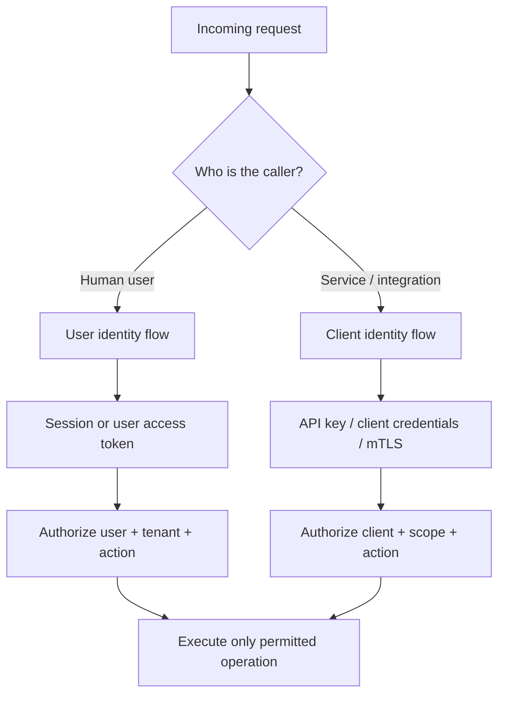

## 7.12 Chapter 7 interview checks

1. What is authentication, and how is it different from authorization?
2. Why is an API key not the same as a user's password?
3. Explain the difference between user identity and client/application identity.
4. Compare server-side sessions and JWT access tokens.
5. Why is a JWT not encrypted by default?
6. What claims should a resource server validate?
7. Why should passwords use Argon2id/bcrypt/scrypt rather than raw SHA-256?
8. What do HttpOnly, Secure, and SameSite cookie flags do?
9. What is OAuth 2.0 versus OpenID Connect?
10. What are the risks of embedding an API key in frontend code?
11. Why must authorization be checked on every resource access?

---

# Integrated capstone — Campaign Management API

The seven lessons fit together into one coherent backend exercise. Build a campaign API that supports REST resource design, predictable response codes, OpenAPI documentation, FastAPI CRUD, pagination, and separate user/client authentication.

## A. Requirements

- Create, read, update, and delete campaigns.
- List campaigns with filters and pagination.
- Support offset pagination for table-style admin navigation.
- Support cursor pagination for a recent-activity feed.
- Document all endpoints in OpenAPI.
- Authenticate human users separately from trusted service clients.
- Authorize by owner/tenant and required scope.
- Keep error response shapes consistent.

## B. Endpoint proposal

| Method | Route | Purpose | Success |
|---|---|---|---:|
| GET | `/v1/campaigns` | List/filter/paginate | 200 |
| POST | `/v1/campaigns` | Create | 201 |
| GET | `/v1/campaigns/{id}` | Get one | 200 |
| PUT | `/v1/campaigns/{id}` | Replace | 200 |
| PATCH | `/v1/campaigns/{id}` | Partial update | 200 |
| DELETE | `/v1/campaigns/{id}` | Delete | 204 |
| GET | `/v1/campaigns/feed` | Cursor-based feed | 200 |
| GET | `/v1/health` | Health check | 200 |

## C. End-to-end architecture

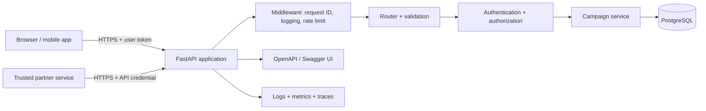

## D. Minimum test matrix

| Area | Test | Expected behavior |
|---|---|---|
| CRUD | Create valid campaign | 201 and created representation |
| CRUD | Get existing ID | 200 and matching resource |
| CRUD | Get missing ID | 404 |
| CRUD | Patch one field | Other fields unchanged |
| CRUD | Delete existing ID | 204 with no body |
| Validation | Empty campaign name | 400/422 according to documented policy |
| Pagination | Negative offset | 400 |
| Pagination | Limit above max | 400 |
| Pagination | No further page | `has_next=false` / `next_cursor=null` |
| Cursor | Malformed token | 400, no stack trace |
| Auth | Missing user token | 401 |
| Auth | Invalid token | 401 |
| AuthZ | Valid user, wrong owner | 403 or deliberately concealed 404 per policy |
| API auth | Revoked API key | 401 |
| Security | SQL injection-like input | Treated as data; no query structure alteration |
| Reliability | Database unavailable | Controlled 5xx, logged with request ID |

## E. Production-readiness checklist

### API contract
- [ ] Resource naming, method semantics, and versioning are consistent.
- [ ] Every route has documented success and error responses.
- [ ] Request and response schemas are separate and explicit.
- [ ] Pagination filters and ordering remain stable across pages.
- [ ] OpenAPI is generated, reviewed, and tested for breaking changes.

### Application
- [ ] Business logic is separated from HTTP handlers.
- [ ] Database sessions are scoped and always closed.
- [ ] Migrations replace schema creation shortcuts.
- [ ] Transactions protect multi-step state changes.
- [ ] Timeouts and dependency failures are handled intentionally.

### Security
- [ ] Passwords are hashed with a password-hashing algorithm.
- [ ] Secrets are not hard-coded or logged.
- [ ] User authentication and API-client authentication are distinct.
- [ ] Authorization is enforced at the resource/action level.
- [ ] Rate limiting and login abuse protection exist.
- [ ] HTTPS is enforced; cookies/tokens are handled securely.

### Operations
- [ ] Structured logs include request/correlation IDs.
- [ ] Metrics capture latency, throughput, and error rate.
- [ ] Traces can follow a request across dependencies.
- [ ] Health/readiness behavior is defined.
- [ ] Database backups and recovery are tested.
- [ ] API changes have compatibility and deprecation plans.

---

# Quick revision sheet

## API design

- API = contract; endpoint = one operation.
- Use resource nouns and HTTP method semantics.
- Path identifies; query filters/pages/sorts; body carries structured input; headers carry metadata.
- GET is safe/idempotent. PUT is idempotent. POST usually is not. PATCH is not automatically idempotent. DELETE is idempotent in intended effect.
- REST, SOAP, GraphQL, gRPC, and WebSockets solve different communication problems.

## Status codes and OpenAPI

- 200 OK; 201 Created; 202 Accepted; 204 No Content.
- 400 bad request; 401 unauthenticated; 403 forbidden; 404 absent/hidden; 409 conflict; 422 validation; 429 rate limited.
- 500 unexpected server error; 503 temporary unavailability.
- OpenAPI is the machine-readable API contract; Swagger UI is a tooling/viewer experience.

## FastAPI

- Uvicorn hosts the ASGI app; FastAPI defines routes and dependencies.
- Type hints + Pydantic models define validation and schemas.
- Use request/response models, dependencies, and lifespan intentionally.
- Use database migrations in real projects; `create_all()` is just a teaching shortcut.

## Pagination

- Page to offset: `(page - 1) * page_size`.
- Offset: `LIMIT n OFFSET k`; simple but deep offsets and page drift are problems.
- Cursor/keyset: continue after an ordered key; better for feeds and large collections.
- Use a stable unique order such as `(created_at DESC, id DESC)`.
- `limit + 1` tells you whether another page exists without an exact count.
- Base64 is not encryption or integrity protection.

## Authentication

- Authentication = identity; authorization = permission.
- User auth and service/client auth are different identity problems.
- Never store plaintext passwords; use Argon2id or another dedicated password hash.
- JWTs are signed, not automatically encrypted; validate signature, issuer, audience and expiry.
- API keys are secrets; scope, rotate, revoke, and never expose privileged keys in frontend code.

---

# Source references

## Playlist and lesson inventory

- [YouTube playlist](https://www.youtube.com/playlist?list=PL_c9BZzLwBRIHUNeoywVJXViXGEsk6PDr)
- [CourseHive — Backend Engineering course inventory and lesson durations](https://coursehive.io/courses/backend-engineering-3735)
- [Class Central — API Design and Architecture syllabus](https://www.classcentral.com/course/youtube-api-design-and-architecture-backend-engineering-intro-1-hour-479072)
- [Class Central — API Status Codes and OpenAPI syllabus](https://www.classcentral.com/course/youtube-api-status-codes-and-openapi-documentation-backend-engineering-480251)
- [Class Central — FastAPI CRUD syllabus](https://www.classcentral.com/course/youtube-fastapi-intro-full-crud-api-tutorial-1-hour-backend-engineering-481046)
- [Class Central — Offset and cursor pagination syllabus](https://www.classcentral.com/course/youtube-api-pagination-offset-and-cursor-pagination-explained-backend-engineering-482433)
- [Class Central — Offset and limit pagination syllabus](https://www.classcentral.com/course/youtube-offset-and-limit-pagination-tutorial-api-design-backend-engineering-482434)
- [Class Central — Cursor pagination syllabus](https://www.classcentral.com/course/youtube-api-cursor-pagination-infinite-scroll-backend-engineering-483827)
- [Caleb Curry channel listing — Intro to Authentication](https://zolotube.com/channel?id=UCZUyPT9DkJWmS_DzdOi7RIA)

## Additional technical references for implementation accuracy

- [FastAPI documentation](https://fastapi.tiangolo.com/)
- [Pydantic documentation](https://docs.pydantic.dev/)
- [SQLAlchemy 2.0 documentation](https://docs.sqlalchemy.org/en/20/)
- [OpenAPI Specification](https://spec.openapis.org/oas/latest.html)
- [HTTP Semantics — RFC 9110](https://www.rfc-editor.org/rfc/rfc9110)
- [JSON Web Token — RFC 7519](https://www.rfc-editor.org/rfc/rfc7519)
- [OAuth 2.0 — RFC 6749](https://www.rfc-editor.org/rfc/rfc6749)
- [OpenID Connect Core](https://openid.net/specs/openid-connect-core-1_0.html)

---

**End of handbook.**
