# System Design – Low-Level Design (LLD)
## Complete 40-Video Study Handbook | Coder Army

**Playlist:** [System Design Full Course – Coder Army](https://www.youtube.com/playlist?list=PLQEaRBV9gAFvzp6XhcNFpk1WdOcyVo9qT)  
**Coverage:** 40 videos · 1 day, 10 hours, 26 minutes, 6 seconds at 1× (playlist snapshot: 28 October 2026)  
**Primary implementation language in the course:** C++, with Java companion implementations available for many lessons.

---

## How to use this handbook

Each chapter corresponds to exactly one video in playlist order. The explanations are paraphrased and organized as study notes; code and diagrams are added to make the design ideas easier to implement and revise. The course-aligned topic sequence is based on timestamped lesson summaries and the companion implementation repositories listed in **Sources and verification**. These materials do not expose the raw YouTube caption files in this environment, so this document is **not presented as a verbatim transcript**. Where a detail is an engineering enhancement beyond the lesson summary, it is marked as an *Enhancement*.

Code is illustrative C++20 unless noted. It is intended to teach class boundaries and object interactions; it is not a complete production application. For complete lecture implementations, consult the companion C++/Java repository rather than treating these excerpts as a replacement for it.

### Course map

| # | Video / chapter | Duration | Main outcome |
|---:|---|---:|---|
| 1 | [Introduction to System Design](https://www.youtube.com/watch?v=AK0hu0Zxua4) | 24:46 | Distinguish DSA, LLD and HLD; learn the LLD problem-solving mindset |
| 2 | [OOPs Real-World Examples: Abstraction and Encapsulation](https://www.youtube.com/watch?v=QbGoqAgP_zg) | 54:01 | Model objects; apply abstraction and encapsulation |
| 3 | [Inheritance and Polymorphism](https://www.youtube.com/watch?v=KGOEK0-XBIg) | 44:39 | Model is-a relationships and runtime/static polymorphism |
| 4 | [UML Class and Sequence Diagrams](https://www.youtube.com/watch?v=nPJyyO9pb5s) | 1:12:10 | Draw static class structure and dynamic interactions |
| 5 | [SOLID Design Principles – Part 1](https://www.youtube.com/watch?v=UsNl8kcU4UA) | 1:07:32 | SRP, OCP and LSP foundations |
| 6 | [SOLID Design Principles – Part 2](https://www.youtube.com/watch?v=hU9koy6A2I0) | 1:17:11 | LSP rules, ISP and DIP |
| 7 | [Build Google Docs / Document Editor](https://www.youtube.com/watch?v=MT9qZFGQXOU) | 45:20 | Refactor a monolith into extensible document elements and persistence |
| 8 | [Strategy Design Pattern](https://www.youtube.com/watch?v=PpKvPrl_gRg) | 32:40 | Encapsulate interchangeable algorithms/behaviours |
| 9 | [Factory Design Pattern](https://www.youtube.com/watch?v=dMK4TbG29fk) | 32:10 | Separate object creation from business logic |
| 10 | [Singleton Design Pattern](https://www.youtube.com/watch?v=CD3meit-WDc) | 32:35 | Control instance creation and understand thread safety |
| 11 | [Build Zomato Food Delivery App](https://www.youtube.com/watch?v=2SAUqTn3TrU) | 1:07:20 | Model a food-ordering flow using entities and patterns |
| 12 | [Observer Design Pattern](https://www.youtube.com/watch?v=Jpmp4GY8r3Q) | 28:31 | Notify multiple dependents after a state change |
| 13 | [Decorator Design Pattern](https://www.youtube.com/watch?v=Z9rFlZClYNI) | 29:20 | Add responsibilities dynamically through wrapping |
| 14 | [Build Your Own Notification Engine](https://www.youtube.com/watch?v=t-4r2AsJz_Q) | 42:27 | Compose channels, templates, users and delivery policies |
| 15 | [Command Design Pattern](https://www.youtube.com/watch?v=cnQZsN0jxEY) | 29:55 | Turn requests into objects; support queueing and undo |
| 16 | [Adapter Design Pattern](https://www.youtube.com/watch?v=FV3x69rpwm0) | 21:53 | Make incompatible interfaces work together |
| 17 | [Facade Design Pattern](https://www.youtube.com/watch?v=0KlnSdvsojc) | 18:53 | Expose a simple API over multiple subsystems |
| 18 | [Build Spotify Music Player](https://www.youtube.com/watch?v=DkLwFqbCsu8) | 1:15:01 | Design playlists, playback, devices and strategies |
| 19 | [Composite Design Pattern / File System](https://www.youtube.com/watch?v=xaaiMGmyDJk) | 38:04 | Treat leaves and containers uniformly in a tree |
| 20 | [Template Method Pattern](https://www.youtube.com/watch?v=8-vE_bmEt18) | 20:22 | Fix algorithm order while allowing step customization |
| 21 | [Proxy Design Pattern](https://www.youtube.com/watch?v=xuT6OOYVJTQ) | 37:25 | Control, defer or virtualize access to a resource |
| 22 | [Chain of Responsibility / Cash Dispenser](https://www.youtube.com/watch?v=LXVKB6deQMo) | 29:50 | Pass requests through a sequence of handlers |
| 23 | [Build Payment Gateway System](https://www.youtube.com/watch?v=36FDqIRBGRg) | 1:00:49 | Integrate providers behind a stable payment contract |
| 24 | [Build Discount Coupon Engine](https://www.youtube.com/watch?v=jbVevoGN_pM) | 1:23:19 | Combine discount strategies and coupon rules safely |
| 25 | [Bridge Design Pattern](https://www.youtube.com/watch?v=KVf8dwgTbiM) | 31:22 | Separate abstractions from implementations |
| 26 | [Build Zepto / Quick Commerce](https://www.youtube.com/watch?v=FcbsppIX0bg) | 1:36:13 | Model dark stores, inventory and split fulfillment |
| 27 | [Build Tinder / Dating App](https://www.youtube.com/watch?v=IcgLSo6--ok) | 1:21:59 | Model profiles, swipes, matching, location and chat |
| 28 | [Builder Design Pattern](https://www.youtube.com/watch?v=G4Ntl9KzIxY) | 1:49:04 | Construct complex objects safely and fluently |
| 29 | [Iterator Design Pattern](https://www.youtube.com/watch?v=30fveBRLqMw) | 40:09 | Separate traversal from collection storage |
| 30 | [Flyweight Design Pattern](https://www.youtube.com/watch?v=vNSRcegCO8E) | 55:24 | Share intrinsic state to reduce memory use |
| 31 | [Build Splitwise Clone](https://www.youtube.com/watch?v=cWtBZUAQpcc) | 1:36:20 | Manage groups, expenses, split strategies and settlements |
| 32 | [State Pattern / Vending Machine](https://www.youtube.com/watch?v=bJPmvie_p4w) | 1:14:45 | Encapsulate state-dependent behaviour and transitions |
| 33 | [Build Tic-Tac-Toe](https://www.youtube.com/watch?v=BGFzYjGtRP4) | 52:12 | Design configurable rules, turns and game lifecycle |
| 34 | [Build Snake and Ladder](https://www.youtube.com/watch?v=1NJB54UB8nE) | 1:08:21 | Model board effects, players, dice and setup strategies |
| 35 | [Mediator Pattern / Chat Room](https://www.youtube.com/watch?v=3lGIICzgyQQ) | 48:05 | Centralize coordination between interacting objects |
| 36 | [Prototype Design Pattern](https://www.youtube.com/watch?v=KMQFNV8LFec) | 31:31 | Clone expensive-to-create objects correctly |
| 37 | [Build Chess Game](https://www.youtube.com/watch?v=eULHvaMZUks) | 1:53:15 | Model board, pieces, legal moves, matches and matchmaking |
| 38 | [Visitor Design Pattern](https://www.youtube.com/watch?v=DnmsxnlCyl0) | 40:54 | Add operations over a stable object hierarchy |
| 39 | [Memento Design Pattern](https://www.youtube.com/watch?v=p8-ile_nWnY) | 34:31 | Capture and restore object snapshots |
| 40 | [Null Object Pattern and Anti-Patterns](https://www.youtube.com/watch?v=iXHlc_S3Ae4) | 25:48 | Avoid scattered null handling and recognize bad design habits |

---

# Part I — Foundations of Low-Level Design

# Chapter 1 — Introduction to System Design

## 1.1 What the lesson establishes

The opening lesson separates three kinds of engineering work that are often confused:

- **DSA:** solves a bounded computational problem efficiently. Its outputs are algorithms and data structures.
- **LLD:** defines the internal software model: objects, responsibilities, interfaces, state, relationships and interactions. Its outputs are class designs, sequence diagrams and executable code.
- **HLD:** defines the system boundary and major infrastructure: services, databases, caches, networks, deployment, scaling and cost. Its outputs are architecture and deployment diagrams.

A ride-booking application illustrates the distinction. Finding a shortest route or selecting a nearby driver involves algorithms, but a real app also needs `Rider`, `Driver`, `Trip`, `Location`, `Payment`, `Notification` and their collaborations. LLD makes that structure explicit before the implementation grows.

## 1.2 A practical LLD loop

1. Clarify the problem and ask what is in scope.
2. Write functional and non-functional requirements separately.
3. Identify the main use cases and happy paths.
4. Discover entities and value objects from the domain language.
5. Assign one clear responsibility to each class.
6. Define relationships and public contracts.
7. Draw a class diagram and the most important sequence diagram.
8. Implement the smallest working design.
9. Test edge cases and revise abstractions only when the design needs them.

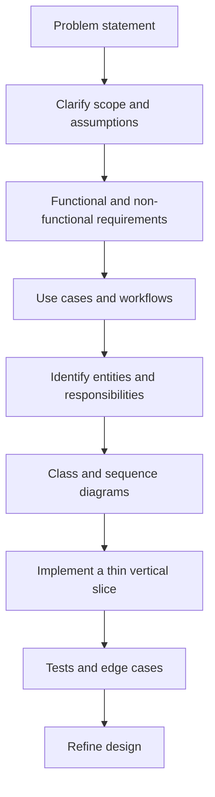

## 1.3 Coupling, cohesion and quality

**Cohesion** measures how strongly a module's responsibilities belong together. High cohesion is desirable. **Coupling** measures how strongly modules depend on one another. Lower coupling usually makes change safer. Reusability is not achieved by making every class generic; it comes from stable interfaces and clear responsibilities.

An LLD answer should state trade-offs. For example, adding an interface for a single implementation may be unnecessary until there is a genuine variation point. Conversely, hard-coding a payment provider in an order class creates avoidable coupling when multiple providers are already required.

## 1.4 Interview checklist

- What is explicitly in scope, and what is assumed to be an external service?
- What are the core entities and their lifecycle?
- Which class owns each piece of mutable state?
- Which behaviour varies and should be injected behind an interface?
- What happens for invalid input, retries, duplicate calls and concurrent requests?

**Practice:** Design the object model for a ride booking with rider, driver, trip, fare calculation and payment. Do not start with Dijkstra's algorithm; first define the domain and the workflow.

---

# Chapter 2 — OOP Real-World Examples: Abstraction and Encapsulation

## 2.1 Why OOP appears in LLD

The lesson traces a progression from machine code and assembly through procedural programming to object-oriented modelling. OOP is useful when an application contains many interacting domain concepts whose data and behaviour should remain close together.

A **class** is a type/blueprint; an **object** is a particular instance. A car object may have state (`brand`, `model`, `speed`, `engineOn`) and behaviour (`start()`, `accelerate()`, `brake()`). The object exposes a contract to other objects without requiring them to understand its internals.

## 2.2 Abstraction

Abstraction exposes the operations a caller needs and hides implementation detail. A driver uses a car's steering wheel and pedals without needing the internal combustion or motor-control algorithm. In code, interfaces and abstract classes define this boundary.

```cpp
#include <iostream>
#include <memory>

struct PaymentMethod {
    virtual ~PaymentMethod() = default;
    virtual bool pay(int amountInPaise) = 0;
};

class UpiPayment final : public PaymentMethod {
public:
    bool pay(int amountInPaise) override {
        if (amountInPaise <= 0) return false;
        std::cout << "UPI payment: " << amountInPaise << " paise\n";
        return true;
    }
};

void checkout(PaymentMethod& method, int amountInPaise) {
    if (!method.pay(amountInPaise)) {
        throw std::runtime_error("Payment failed");
    }
}
```

The caller depends on `PaymentMethod`, not on the internal UPI implementation. Another provider can implement the same contract.

## 2.3 Encapsulation

Encapsulation bundles data and operations while controlling access to internal state. It is not merely adding getters and setters. The goal is to make invalid states difficult or impossible to create.

```cpp
class BankAccount {
private:
    long long balancePaise_ = 0;
public:
    explicit BankAccount(long long openingBalancePaise)
        : balancePaise_(openingBalancePaise) {
        if (openingBalancePaise < 0) throw std::invalid_argument("negative balance");
    }

    long long balance() const noexcept { return balancePaise_; }

    void deposit(long long amountPaise) {
        if (amountPaise <= 0) throw std::invalid_argument("amount must be positive");
        balancePaise_ += amountPaise;
    }

    bool withdraw(long long amountPaise) {
        if (amountPaise <= 0) throw std::invalid_argument("amount must be positive");
        if (amountPaise > balancePaise_) return false;
        balancePaise_ -= amountPaise;
        return true;
    }
};
```

`balancePaise_` cannot be assigned by arbitrary callers. Operations preserve invariants. **Enhancement:** use integer minor currency units (paise/cents) or a decimal-money type, not floating point, for financial amounts.

## 2.4 Keep the concepts distinct

- Abstraction answers: **what can this object do?**
- Encapsulation answers: **how is its state protected and kept valid?**
- Data hiding is a technique often used to achieve encapsulation; abstraction is about a useful simplified interface.

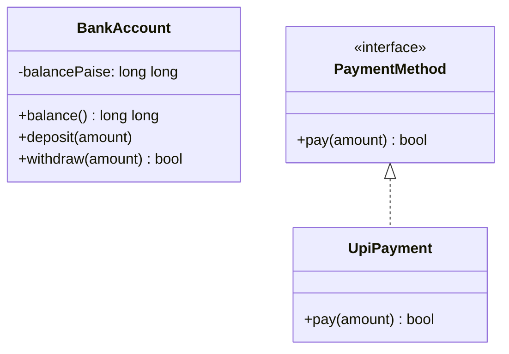

**Interview tip:** Avoid saying abstraction and encapsulation are identical. Give one sentence and one code-level example for each.

**Practice:** Implement `TemperatureSensor` with a private raw reading and a public `readCelsius()` contract. Add validation and explain why client code should not set an arbitrary raw sensor state.

---

# Chapter 3 — Inheritance and Polymorphism

## 3.1 Inheritance

Inheritance represents an **is-a** relationship and reuses a parent contract. The car example separates common behaviour (`startEngine`, `stopEngine`, `accelerate`, `brake`) from specialised behaviour such as `shiftGear()` for a manual car or `chargeBattery()` for an electric car.

```cpp
class Car {
protected:
    int speedKph_ = 0;
public:
    virtual ~Car() = default;
    virtual void start() = 0;
    void brake() { speedKph_ = 0; }
};

class ManualCar final : public Car {
    int gear_ = 1;
public:
    void start() override { /* start engine */ }
    void shiftGear(int next) {
        if (next < 1 || next > 6) throw std::out_of_range("gear");
        gear_ = next;
    }
};

class ElectricCar final : public Car {
public:
    void start() override { /* energize electric drivetrain */ }
    void charge() { /* charging workflow */ }
};
```

Access control (public, protected, private) determines which members a caller or derived class can use. A derived class cannot directly access private base-class members. In C++, the inheritance mode (`public`, `protected`, `private`) additionally controls how inherited public/protected members are exposed through the child type.

## 3.2 Polymorphism

**Compile-time/static polymorphism** commonly includes function overloading and templates. **Runtime/dynamic polymorphism** uses virtual functions and dynamic dispatch: the implementation invoked depends on the concrete object behind a base reference/pointer.

```cpp
void startAll(const std::vector<std::unique_ptr<Car>>& cars) {
    for (const auto& car : cars) car->start();
}
```

The loop does not need a `switch` for every car subtype. This is useful only when every subtype can honestly satisfy the base contract.

## 3.3 Liskov caution

Do not model every code reuse opportunity with inheritance. If a subtype cannot honour the parent's behavioural contract, it is not a valid subtype. A `Square` inheriting mutable `Rectangle` can violate the expectation that width and height are independently changeable. Prefer composition or a more accurate abstraction when behaviour does not substitute cleanly.

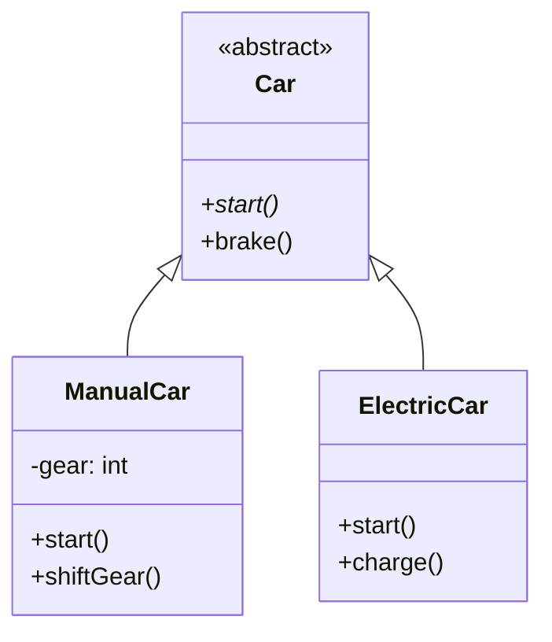

**Pitfalls:** missing virtual destructor in polymorphic C++ base classes; object slicing when derived values are copied into base values; overusing protected mutable state; overriding without `override`; deep inheritance trees that are difficult to reason about.

**Practice:** Create `Shape` with `area()` and `Circle`/`Rectangle` implementations. Then explain why a `Shape` interface should not expose circle-only operations.

---

# Chapter 4 — UML Class and Sequence Diagrams

## 4.1 Why UML

UML is a shared visual notation for communicating structure and behaviour. The course prioritizes two diagrams for LLD practice:

- **Class diagram:** classes, attributes, methods and relationships (static structure).
- **Sequence diagram:** participants and messages over time for one scenario (dynamic behaviour).

## 4.2 Class box and visibility

A class rectangle usually has three compartments: name, attributes and operations. Visibility symbols are `+` public, `-` private and `#` protected. Abstract classes may be marked with `«abstract»` or italicized names. Types and return values should be shown when they clarify the design.

## 4.3 Relationships

- **Association:** two classes know or use one another.
- **Inheritance/generalization:** an is-a relationship; hollow triangle points to the base type.
- **Aggregation:** weak whole-part relationship; the part can live independently (hollow diamond at the whole).
- **Composition:** strong ownership/lifecycle relationship; the part's lifetime is controlled by the whole (filled diamond at the whole).
- **Dependency:** one element temporarily uses another.

Multiplicity examples: `1`, `0..1`, `*`, `1..*`. Do not use composition just because a class contains a pointer; choose it based on lifecycle ownership.

## 4.4 Sequence diagram

A sequence diagram has actors/objects across the top, lifelines vertically, and messages in time order. Solid arrows usually show calls; dashed arrows often show returns. Activation bars show execution. `alt`, `opt` and `loop` frames represent branches, optional behaviour and repetition.

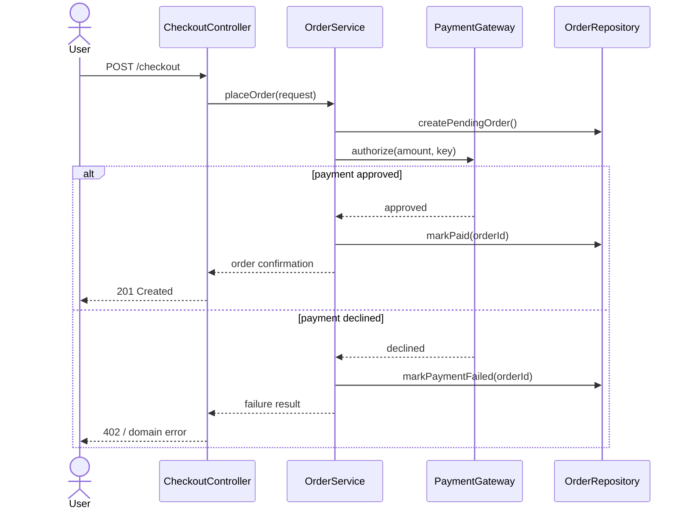

## 4.5 Drawing workflow

1. Draw the main domain classes and keep fields private by default.
2. Add only relationships needed by the use cases.
3. Label multiplicity and lifecycle ownership.
4. Select one important use case and draw its sequence.
5. Verify every message has a plausible receiver and method.
6. Check whether class responsibilities match the interactions.

**Interview tip:** Use a class diagram to show *what exists* and a sequence diagram to show *how a scenario runs*. Neither replaces the other.

---

# Chapter 5 — SOLID Design Principles, Part 1

## 5.1 Why SOLID

As projects grow, tightly coupled responsibilities make changes risky. SOLID is a set of design guidelines for managing change, not a checklist that every class must mechanically satisfy. The first part covers SRP, OCP and LSP.

## 5.2 Single Responsibility Principle (SRP)

A class should have one coherent responsibility and one primary reason to change. A shopping cart should manage cart items and totals; invoice formatting and persistence are separate responsibilities.

```cpp
class Cart {
public:
    void add(Product product);
    Money total() const;
private:
    std::vector<CartItem> items_;
};

class InvoiceFormatter {
public:
    std::string format(const Cart& cart) const;
};

class CartRepository {
public:
    void save(const Cart& cart);
};
```

SRP is not “one method per class.” It is a cohesion principle. A class can have many related methods and still have one responsibility.

## 5.3 Open/Closed Principle (OCP)

Software entities should be open to extension but closed to repeated modification for each new variation. If adding a new shipping or pricing option requires editing a large `if/else` block in checkout, introduce a stable strategy or policy abstraction where the variation belongs.

```cpp
struct DiscountPolicy {
    virtual ~DiscountPolicy() = default;
    virtual Money apply(Money subtotal) const = 0;
};
class NoDiscount final : public DiscountPolicy {
public: Money apply(Money value) const override { return value; }
};
class TenPercentDiscount final : public DiscountPolicy {
public: Money apply(Money value) const override { return value * 0.90; }
};
```

*Enhancement:* Production money arithmetic should use integer minor units or an exact decimal type, not a `double`-based `Money` implementation.

## 5.4 Liskov Substitution Principle (LSP)

A subtype must be usable wherever its base type is expected without breaking correctness. The bank-account example illustrates that a child account must not unexpectedly reject operations the parent contract promises. Avoid strengthening preconditions or weakening postconditions in ways that surprise callers.

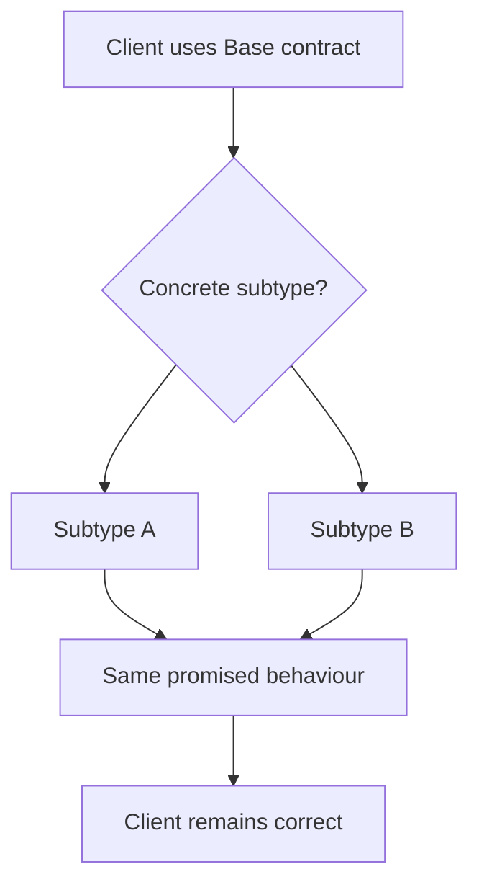

**Review questions:** Does the subtype preserve invariants? Does it honour method promises? Does it throw only contract-compatible exceptions? Can client code use the parent abstraction safely?

---

# Chapter 6 — SOLID Design Principles, Part 2

## 6.1 LSP rules in more detail

The lesson expands LSP beyond a slogan. A substitutable subtype should preserve the parent's method contract:

- **Method signature:** overriding must be type-compatible. In languages with covariant return rules, a child may return a more specific subtype where allowed; it must not surprise callers with an incompatible contract.
- **Preconditions:** a child must not require *more* from callers than the parent promised.
- **Postconditions:** a child must deliver at least what the parent promised.
- **Invariants:** constraints that hold before and after operations must remain valid.
- **History constraints:** a subtype must not allow state changes that violate guarantees assumed by the base abstraction (immutability is one example).

These are behavioural principles; compiler type checking catches only a subset of violations.

## 6.2 Interface Segregation Principle (ISP)

Clients should not be forced to depend on methods they do not use. A single `Machine` interface with `print()`, `scan()` and `fax()` is a poor fit for a printer-only device. Split it into small role interfaces (`Printer`, `Scanner`, `Fax`) and compose the capabilities a device supports.

```cpp
struct Printer { virtual ~Printer() = default; virtual void print() = 0; };
struct Scanner { virtual ~Scanner() = default; virtual void scan() = 0; };
class OfficePrinter final : public Printer, public Scanner {
public:
    void print() override { /* ... */ }
    void scan() override { /* ... */ }
};
class BasicPrinter final : public Printer {
public: void print() override { /* ... */ }
};
```

## 6.3 Dependency Inversion Principle (DIP)

High-level policy should depend on abstractions, not low-level implementation details. Both sides depend on a contract; implementation details are injected from outside. This enables tests to supply fakes and production to supply real adapters.

```cpp
struct EmailSender {
    virtual ~EmailSender() = default;
    virtual void send(std::string_view to, std::string_view body) = 0;
};
class SignupService {
    EmailSender& email_;
public:
    explicit SignupService(EmailSender& email) : email_(email) {}
    void welcome(std::string_view address) { email_.send(address, "Welcome!"); }
};
```

**Do not confuse DIP with dependency injection.** DIP is a design principle; dependency injection is one way to supply the dependencies.

## 6.4 SOLID review checklist

- SRP: Does this class represent one coherent reason to change?
- OCP: Can I add a new variation without rewriting stable policy code?
- LSP: Can every implementation honour the abstraction's contract?
- ISP: Are clients forced to implement irrelevant methods?
- DIP: Does high-level policy depend on stable abstractions?

**Practice:** Refactor a `ReportService` that queries a database, formats CSV, sends email and writes logs. Separate responsibilities, then inject interfaces for persistence and delivery.

---

# Chapter 7 — Build Google Docs: Document Editor LLD

## 7.1 Requirements and scope

The exercise begins with a deliberately narrow document editor: add text, add images, render the document and save it. The design should later accommodate tables, videos, line breaks and additional formatting without turning one class into a giant conditional statement.

## 7.2 Start with a bad design, then refactor

The first design puts content storage, element type detection, rendering and file saving in `DocumentEditor`. Storing text and image paths as plain strings forces suffix checks and violates SRP/OCP. A better design introduces polymorphic document elements and a persistence abstraction.

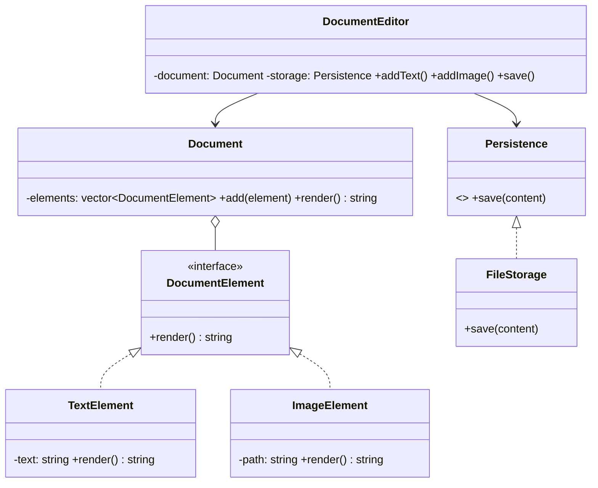

## 7.3 C++ implementation sketch

```cpp
#include <memory>
#include <string>
#include <vector>

struct DocumentElement {
    virtual ~DocumentElement() = default;
    virtual std::string render() const = 0;
};
class TextElement final : public DocumentElement {
    std::string text_;
public:
    explicit TextElement(std::string text) : text_(std::move(text)) {}
    std::string render() const override { return text_; }
};
class ImageElement final : public DocumentElement {
    std::string path_;
public:
    explicit ImageElement(std::string path) : path_(std::move(path)) {}
    std::string render() const override { return "[image: " + path_ + "]"; }
};
class Document {
    std::vector<std::unique_ptr<DocumentElement>> elements_;
public:
    void add(std::unique_ptr<DocumentElement> e) { elements_.push_back(std::move(e)); }
    std::string render() const {
        std::string out;
        for (const auto& e : elements_) out += e->render();
        return out;
    }
};
struct Persistence {
    virtual ~Persistence() = default;
    virtual void save(const std::string& data) = 0;
};
```

`DocumentEditor` can now delegate element management/rendering to `Document` and saving to `Persistence`. `FileStorage` and `DatabaseStorage` implement the persistence contract.

## 7.4 Interview reasoning

- Use **bottom-up** when smaller stable components are easy to identify; use **top-down** when the problem is naturally decomposed from a clear workflow.
- Prefer a `DocumentElement` abstraction over checking whether a string ends in `.png` or `.jpg`.
- Separate storage destination from document rendering.
- Discuss ownership: a `Document` owns its elements, so `unique_ptr` is a natural C++ choice.

**Enhancements:** document elements should carry structured metadata and stable IDs; rendering should be separate from persistence; images should be stored by object key rather than embedding huge binary data in a text document; saving should be atomic or versioned if concurrent edits are supported.

---

# Part II — Core Design Patterns

# Chapter 8 — Strategy Design Pattern

## 8.1 Problem

A robot simulation starts with a base `Robot` class that implements walking and talking, while subclasses vary the visual projection. New robot variants introduce different capabilities: some fly, some do not, and flying styles differ. Pushing every behaviour into the base class gives invalid behaviour to some subclasses; creating subclasses for every combination creates class explosion.

## 8.2 Strategy solution

Define a family of behaviours, encapsulate each behaviour behind an interface, and compose the selected implementation into the context. Runtime behaviour can change by replacing the strategy object.

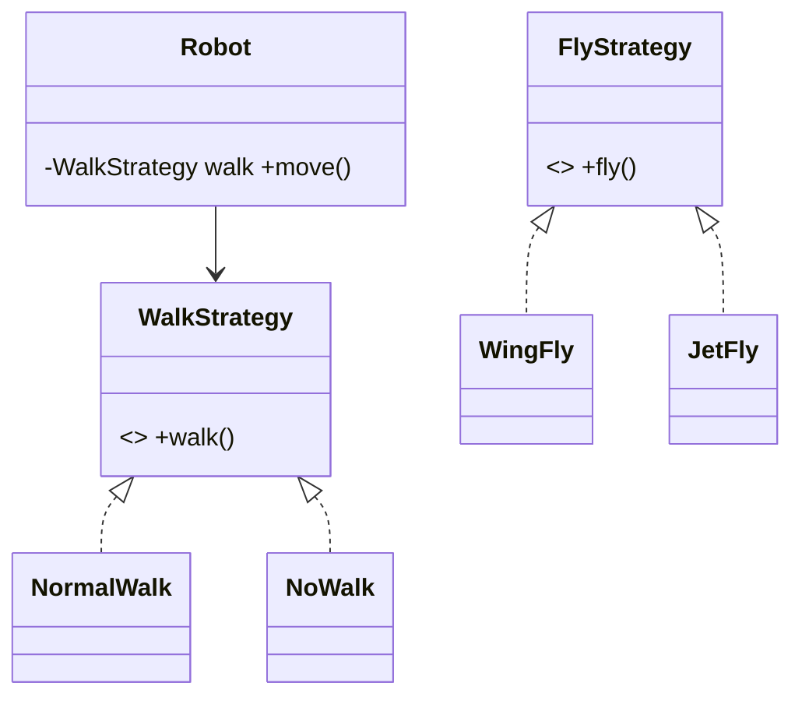

```cpp
struct WalkStrategy { virtual ~WalkStrategy() = default; virtual void walk() = 0; };
class NormalWalk final : public WalkStrategy {
public: void walk() override { /* normal movement */ }
};
class NoWalk final : public WalkStrategy {
public: void walk() override { /* no-op or report unsupported */ }
};
class Robot {
    std::unique_ptr<WalkStrategy> walking_;
public:
    explicit Robot(std::unique_ptr<WalkStrategy> s) : walking_(std::move(s)) {}
    void move() { walking_->walk(); }
    void setWalking(std::unique_ptr<WalkStrategy> s) { walking_ = std::move(s); }
};
```

## 8.3 When it fits

Use Strategy when an algorithm or policy varies independently from the context: payment selection, route planning, compression algorithms, tax calculation, matchmaking scoring, retry policy or pricing. A strategy should represent a meaningful alternative, not a class for every trivial `if` branch.

**Pitfalls:** strategy objects with hidden mutable shared state; leaking concrete strategy selection throughout clients; adding strategies where a simple function suffices; poor default strategy handling.

**Interview tip:** Explain the variation that motivates the pattern, then show the interface and the composition relationship. Name the trade-off: more classes/indirection in exchange for isolated behaviour changes.

---

# Chapter 9 — Factory Design Pattern

## 9.1 Purpose

Strategy explains how behaviour is swapped, but a client still needs to create the strategy object. Factory moves object creation decisions out of business logic. The lesson uses a burger shop analogy and distinguishes:

- **Simple Factory:** one object decides which concrete class to instantiate based on a parameter. Useful, but commonly considered an idiom rather than a GoF pattern.
- **Factory Method:** a creator abstraction defers product creation to subclasses.
- **Abstract Factory:** creates a family of related products that should be compatible with one another.

## 9.2 Simple Factory sketch

```cpp
struct Burger { virtual ~Burger() = default; virtual void prepare() = 0; };
class BasicBurger final : public Burger {
public: void prepare() override { /* ... */ }
};
class PremiumBurger final : public Burger {
public: void prepare() override { /* ... */ }
};
class BurgerFactory {
public:
    static std::unique_ptr<Burger> create(std::string_view kind) {
        if (kind == "basic") return std::make_unique<BasicBurger>();
        if (kind == "premium") return std::make_unique<PremiumBurger>();
        throw std::invalid_argument("unknown burger type");
    }
};
```

## 9.3 Factory Method vs Abstract Factory

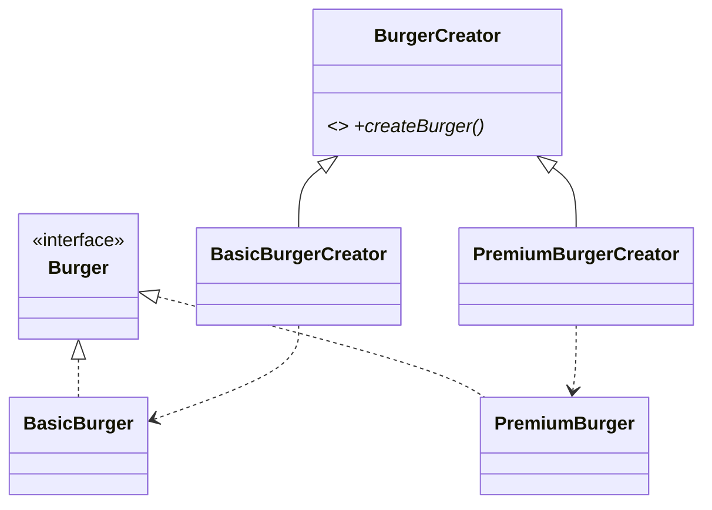

Factory Method varies the product created by a creator. Abstract Factory is useful when a family must remain consistent, e.g. `WindowsButton + WindowsCheckbox` versus `MacButton + MacCheckbox`.

**Pitfalls:** a giant factory switch can become a maintenance hotspot; configuration keys should be validated; do not use factories just to wrap `new` without a real creation policy.

**Practice:** Build a notification factory that creates SMS, email and push adapters, then a provider-specific factory that returns compatible provider clients.

---

# Chapter 10 — Singleton Design Pattern

## 10.1 Intent and basic construction

Singleton restricts a type to one shared instance and provides a global access point. The lesson explains private construction, a static instance holder and a public `getInstance()` method, then identifies the race condition in naive lazy initialization.

## 10.2 Thread safety

The double-check pattern is easy to get wrong because safe publication and memory ordering matter. In modern C++, a function-local static is initialized exactly once in a thread-safe manner (since C++11), making it a simpler default:

```cpp
class AppConfig {
public:
    static AppConfig& instance() {
        static AppConfig value;
        return value;
    }
    AppConfig(const AppConfig&) = delete;
    AppConfig& operator=(const AppConfig&) = delete;
private:
    AppConfig() = default;
};
```

## 10.3 Trade-offs and alternatives

Singleton can be appropriate for process-wide immutable configuration or a deliberately shared registry, but it often hides dependencies, complicates parallel tests, creates global mutable state and makes lifecycle management unclear. A dependency-injected object scoped by the application container is often a better choice.

```mermaid
flowchart TD
 A[Call instance()] --> B{Local static initialized?}
 B -- No --> C[Construct once]
 B -- Yes --> D[Reuse instance]
 C --> D
 D --> E[Return reference]
```

**Interview correction:** “One instance” means one per process/runtime in this implementation—not one across multiple servers, containers or machines. Distributed singleton behaviour needs coordination such as a lease/leader-election mechanism and is a different problem.

---

# Chapter 11 — Build Zomato: Food Delivery Application

## 11.1 Requirement discovery

The course models a scoped food-delivery flow (referred to as a sample “Tomato” application):

1. User searches restaurants by location.
2. User opens a restaurant and views its menu.
3. User adds menu items to a cart.
4. User checks out and pays through an external payment provider.
5. User chooses delivery or pickup.
6. The order is saved and the user is notified.

A delivery-agent workflow is explicitly outside the initial scope. Clarifying this boundary is part of the interview solution, not an omission.

## 11.2 Core model

- `Restaurant`: ID, name, address, menu.
- `MenuItem`: code, name, price.
- `User`: identity, address, cart.
- `Cart`: one restaurant, selected items, computed total.
- `Order`: user, restaurant, items, payment and schedule metadata.
- `DeliveryOrder` / `PickupOrder`: specialised order details.
- `RestaurantManager` / `OrderManager`: collection management.
- `PaymentStrategy`: UPI/card or other payment provider behaviour.
- `OrderFactory`: creates an order appropriate to the selected fulfillment mode.
- `NotificationService`: delegates to an external notification provider.

## 11.3 Relationships and flow

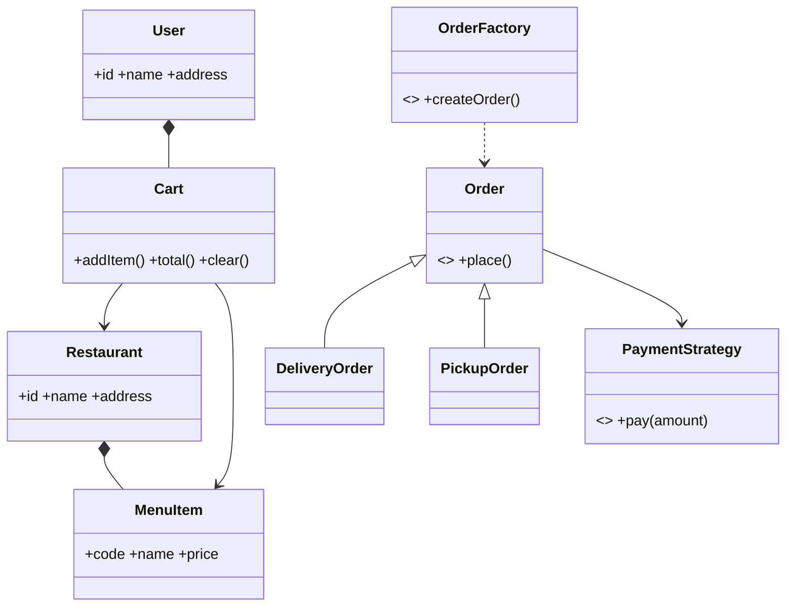

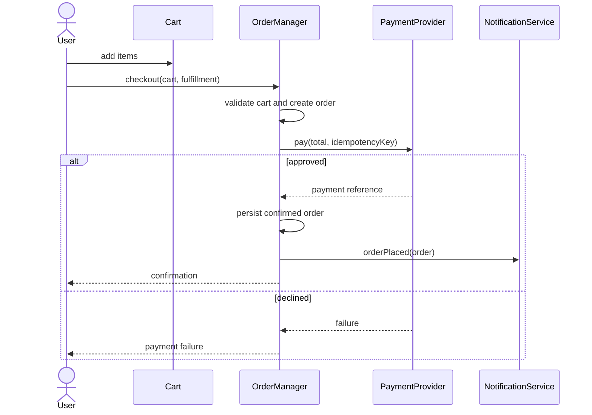

## 11.4 Design points

- A cart should not mix menu items from multiple restaurants unless the product requirement explicitly allows multi-restaurant checkout.
- `totalCost` should be derived from item prices and quantities, not freely overwritten by a client.
- Use a payment strategy behind an interface; do not implement banking rails yourself in an LLD interview.
- The order manager should not send raw SMS/email itself; delegate to a notification interface.
- A factory may separate immediate orders from scheduled orders.

**Enhancements:** model `OrderStatus` explicitly (`PENDING_PAYMENT`, `CONFIRMED`, `CANCELLED`, `FULFILLING`, `COMPLETED`); store an immutable price snapshot on order items; make checkout idempotent; do not hold a database lock while waiting on a third-party payment network; add an outbox/event strategy for reliable notifications.

---

# Chapter 12 — Observer Design Pattern

## 12.1 Intent

Observer establishes a one-to-many dependency: when a subject changes state, its registered observers receive notification. The YouTube-channel analogy maps one channel to many subscribers. Push notification avoids subscribers repeatedly polling the channel to ask whether a new video exists.

## 12.2 Structure

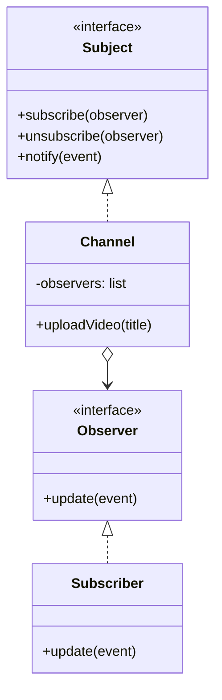

## 12.3 Implementation sketch

```cpp
#include <functional>
#include <unordered_map>

class EventSource {
    using Callback = std::function<void(const std::string&)>;
    std::unordered_map<int, Callback> listeners_;
    int nextId_ = 1;
public:
    int subscribe(Callback cb) {
        const int id = nextId_++;
        listeners_.emplace(id, std::move(cb));
        return id;
    }
    void unsubscribe(int id) { listeners_.erase(id); }
    void publish(const std::string& event) {
        // Copy callbacks first if callbacks may subscribe/unsubscribe during delivery.
        auto snapshot = listeners_;
        for (const auto& [id, cb] : snapshot) cb(event);
    }
};
```

*Enhancement:* real systems need observer-lifetime management, exception isolation, thread-safety, ordering decisions and backpressure. Do not let one failing subscriber prevent all other observers from receiving an event. For durable notifications, a broker/outbox is more reliable than synchronous in-process callbacks.

**Observer vs polling:** observer is event-driven push; polling repeatedly asks for changes. Polling can still be appropriate when consumers need periodic reconciliation or when events may be missed.

---

# Chapter 13 — Decorator Design Pattern

## 13.1 Motivation

The Mario power-up example shows why inheritance creates class explosion. With height, weapon, invincibility and future powers, a subclass for each combination grows combinatorially. Decorator wraps an object implementing the same interface and adds behaviour before/after delegating.

## 13.2 Structure

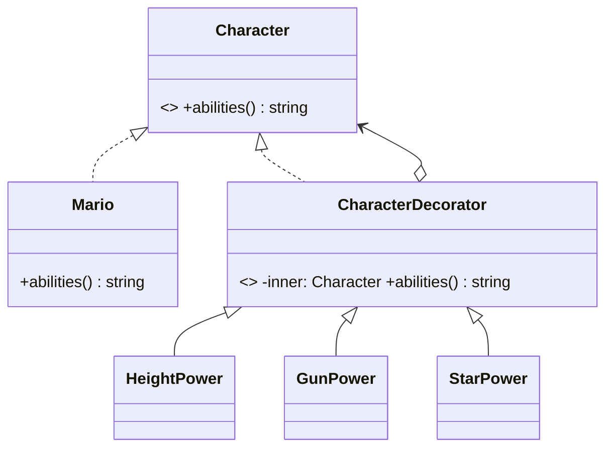

```cpp
struct Coffee {
    virtual ~Coffee() = default;
    virtual int costPaise() const = 0;
};
class Espresso final : public Coffee {
public: int costPaise() const override { return 18000; }
};
class Milk final : public Coffee {
    std::unique_ptr<Coffee> inner_;
public:
    explicit Milk(std::unique_ptr<Coffee> c) : inner_(std::move(c)) {}
    int costPaise() const override { return inner_->costPaise() + 3000; }
};
```

## 13.3 Where it fits

Logging, compression, encryption, stream wrappers, UI styling and pricing add-ons can be decorators. Each wrapper should preserve the component contract and delegate. Use explicit configuration or a builder when arbitrary decorator stacking becomes hard to inspect.

**Pitfall:** decorator order can matter (compress then encrypt differs from encrypt then compress). Document ordering and avoid hidden side effects.

---

# Chapter 14 — Build a Notification Engine

## 14.1 Scope and model

The lesson turns notification delivery into a reusable engine rather than embedding email/SMS/push code in application classes. Think in terms of:

- `User` / `Recipient` and contact preferences.
- `Notification` or `NotificationRequest` (recipient, template, variables, channel, priority).
- `NotificationChannel` interface and concrete Email/SMS/Push senders.
- `Template` / `TemplateRenderer`.
- `NotificationService` or orchestrator.
- A provider adapter at the boundary to Twilio, email API or push service.

## 14.2 Flow

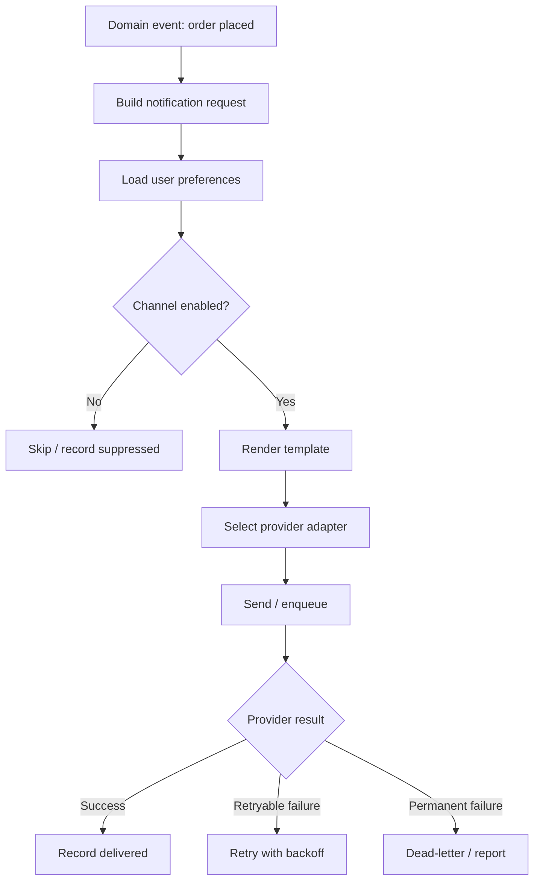

## 14.3 Sample interface

```cpp
struct Notification {
    std::string recipient;
    std::string subject;
    std::string body;
};
struct NotificationChannel {
    virtual ~NotificationChannel() = default;
    virtual void send(const Notification&) = 0;
};
class EmailChannel final : public NotificationChannel {
public:
    void send(const Notification& n) override { /* email provider adapter */ }
};
class SmsChannel final : public NotificationChannel {
public:
    void send(const Notification& n) override { /* SMS provider adapter */ }
};
```

A factory/provider registry can select channel implementation. Observer can react to a domain event; Strategy can choose a channel or priority policy; Adapter translates provider-specific SDK contracts.

**Enhancements:** add preference/consent enforcement, template versioning, rate limits, deduplication keys, retries, delivery receipts, provider failover and PII redaction. Do not send sensitive content to a channel the user has not consented to receive.

---

# Chapter 15 — Command Design Pattern

## 15.1 Intent

Command converts a request into an object. This decouples the invoker from the receiver and allows requests to be queued, logged, retried, scheduled or undone. The command object encapsulates the receiver and the arguments needed to execute a specific action.

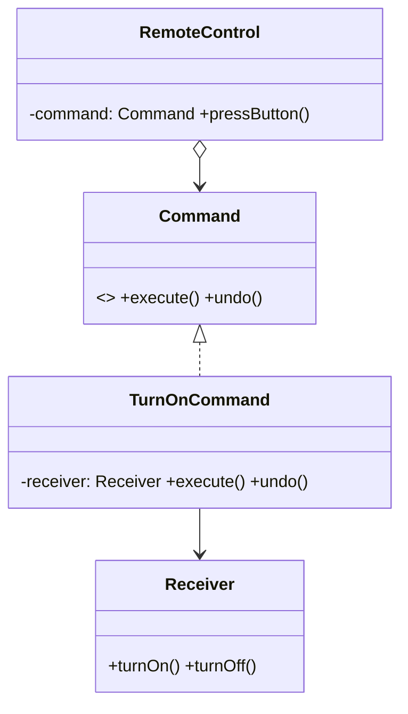

```cpp
struct Command {
    virtual ~Command() = default;
    virtual void execute() = 0;
    virtual void undo() = 0;
};
class Light {
    bool on_ = false;
public:
    void turnOn() { on_ = true; }
    void turnOff() { on_ = false; }
    bool isOn() const { return on_; }
};
class TurnOnLight final : public Command {
    Light& light_;
public:
    explicit TurnOnLight(Light& l) : light_(l) {}
    void execute() override { light_.turnOn(); }
    void undo() override { light_.turnOff(); }
};
```

## 15.2 Important distinctions

- **Invoker:** triggers a command but need not know the receiver's internals.
- **Command:** stores the operation and needed parameters.
- **Receiver:** performs the actual work.
- **Client:** wires the command to the receiver.

Undo is not always possible. A destructive remote API call may require a compensating command rather than an exact inverse. Commands should capture enough prior state to undo safely, and repeated execution should be considered explicitly.

**Use cases:** editor undo/redo, job queues, remote controls, macro recording, audit trails and workflow engines.

---

# Chapter 16 — Adapter Design Pattern

## 16.1 Intent

Adapter makes an existing class with an incompatible interface usable through the interface a client expects. The music-player/device example is a natural fit: Bluetooth speaker, wired speaker and headphones may expose different vendor APIs, while the application wants one `AudioOutputDevice` contract.

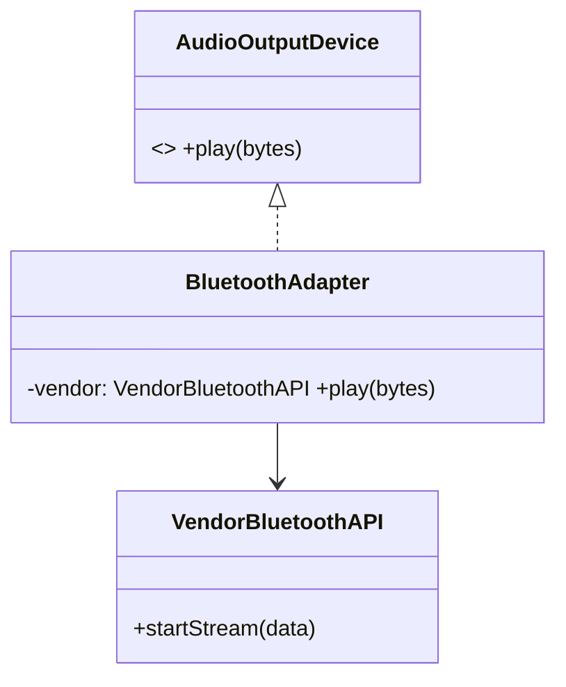

```cpp
struct AudioOutputDevice {
    virtual ~AudioOutputDevice() = default;
    virtual void play(const std::vector<std::byte>& data) = 0;
};
class LegacySpeaker {
public:
    void startStream(const std::vector<std::byte>& data) { /* vendor API */ }
};
class LegacySpeakerAdapter final : public AudioOutputDevice {
    LegacySpeaker& device_;
public:
    explicit LegacySpeakerAdapter(LegacySpeaker& d) : device_(d) {}
    void play(const std::vector<std::byte>& data) override { device_.startStream(data); }
};
```

## 16.2 Adapter vs related patterns

- Adapter changes an interface to match a client expectation.
- Decorator keeps the interface and adds responsibilities.
- Facade offers a simplified high-level interface to a subsystem.
- Bridge splits two independently varying hierarchies.

**Pitfalls:** leaking vendor-specific types into the common interface; hiding important failure semantics; ignoring data-format conversions; assuming every provider supports identical capabilities.

---

# Chapter 17 — Facade Design Pattern

## 17.1 Intent

Facade provides one simple entry point to a collection of subsystems. It does not necessarily hide every subsystem or prevent advanced clients from using lower-level APIs; it offers a convenient, cohesive route for common workflows.

A music-player facade might coordinate `DeviceManager`, `AudioEngine`, `PlaylistManager` and `PlaybackStrategyManager`.

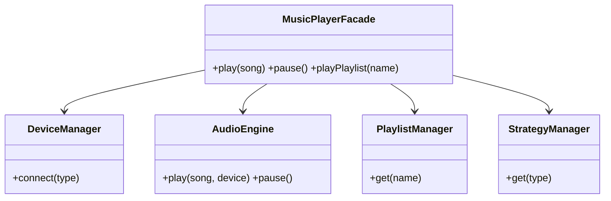

## 17.2 Design guidance

- Keep facade methods use-case oriented, not a giant pass-through class with dozens of unrelated methods.
- Delegate actual responsibilities to subsystem components.
- Avoid storing multiple copies of state that can diverge.
- Use a facade to improve client ergonomics, not to conceal failure or transaction boundaries.

**Interview tip:** State which complexity the facade removes from its caller and which subsystem still owns each responsibility.

---

# Chapter 18 — Build Spotify: Music Player Application

## 18.1 Requirements

Model a local music player that can connect to output devices, play/pause songs, create playlists, add songs, and choose sequential/random/custom playback. The lecture's architecture demonstrates multiple patterns working together rather than treating each pattern as an isolated exercise.

## 18.2 Core classes

- `Song`: name, artist, media path or stream reference.
- `Playlist`: ordered songs and playlist metadata.
- `AudioOutputDevice`: common output interface.
- `BluetoothSpeakerAdapter`, `WiredSpeakerAdapter`, `HeadphonesAdapter`: adapt vendor/device interfaces.
- `AudioEngine`: playback state and play/pause control.
- `DeviceManager`: connect/disconnect and manage active output.
- `PlaylistManager`: create, store, retrieve playlists.
- `PlayingStrategy`: sequential, random and custom queue.
- `MusicPlayerFacade`: coordinates common actions.

## 18.3 Combined patterns

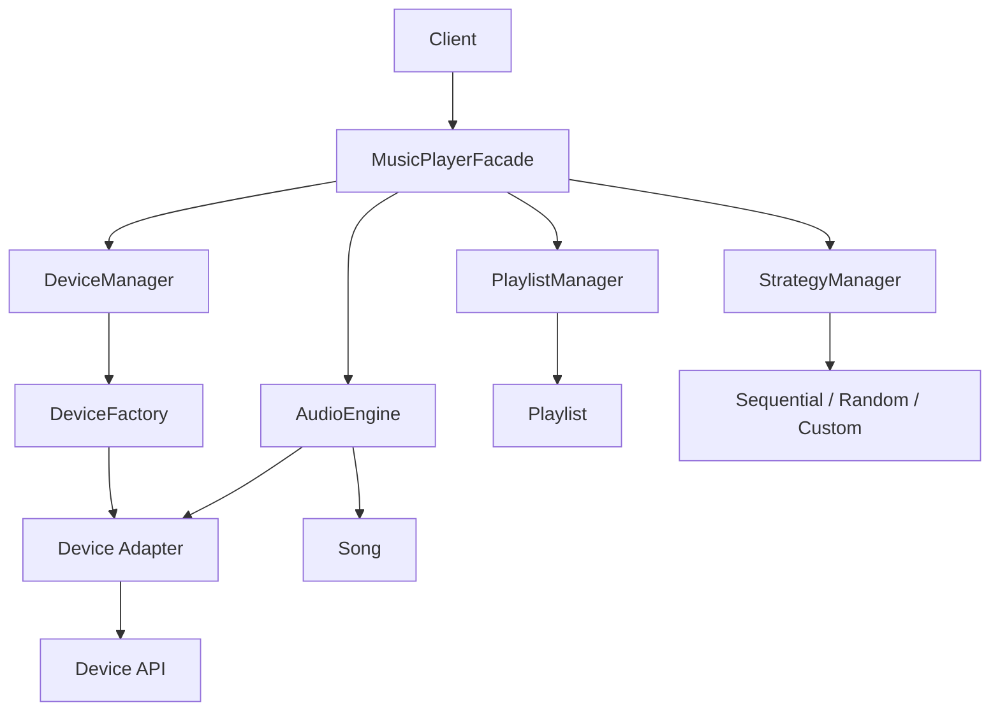

- **Strategy:** playback order is swappable.
- **Adapter:** different output devices share one interface.
- **Factory:** select the appropriate adapter/device implementation.
- **Singleton:** the lesson applies single-instance managers/facade as a teaching example; real applications should consider dependency-injection scopes.
- **Facade:** gives the app one small orchestration API.

## 18.4 Sequence

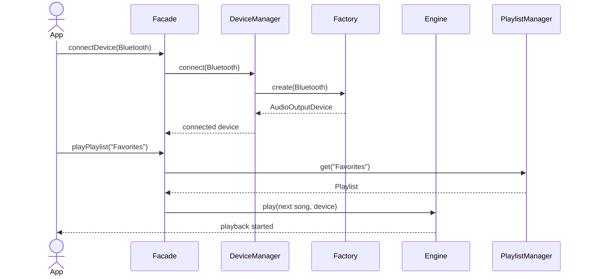

**Enhancements:** media playback needs buffering, decoder lifecycle, device disconnect recovery, queue mutation semantics, file permissions and clear ownership for background playback. For a streaming service, also discuss catalog, user library, DRM, CDN delivery and playback sessions—but keep those HLD details out of an LLD-only question unless requested.

---

# Chapter 19 — Composite Design Pattern: File System

## 19.1 Intent

Composite lets clients treat individual objects and groups uniformly in a tree. A file is a leaf; a folder is a composite containing files and other folders. Both implement a shared `FileSystemItem` interface.

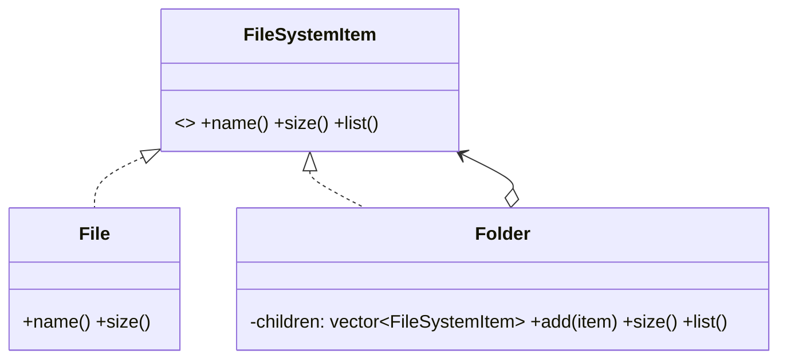

## 19.2 Recursive behaviour

- `File::size()` returns its own size.
- `Folder::size()` sums the sizes of its children recursively.
- `Folder::list()` visits its children; `File::list()` simply displays itself.
- A `Folder` can add/remove children; a `File` cannot.

**Enhancement:** Do not force meaningless methods onto leaves. A strict common interface may return errors for unsupported operations; a separate `Container` interface can expose `add/remove` only on folders. Consider cycles, duplicate names, permissions, symlinks and very deep trees for real file systems.

**Use cases:** file/folder trees, UI component trees, nested menus, organization charts and bill-of-material structures.

---

# Chapter 20 — Template Method Design Pattern

## 20.1 Intent

Template Method defines the skeleton of an algorithm in a base class, keeping the step order fixed while subclasses customize selected steps. The machine-learning pipeline example uses load → preprocess → train → evaluate → save.

```mermaid
flowchart TD
 A[trainPipeline] --> B[loadData]
 B --> C[preprocess]
 C --> D[trainModel]
 D --> E[evaluate]
 E --> F[saveModel]
```

```cpp
class ModelTrainer {
public:
    virtual ~ModelTrainer() = default;
    void runPipeline() { // template method
        loadData();
        preprocess();
        train();
        evaluate();
        save();
    }
protected:
    virtual void loadData() = 0;
    virtual void preprocess() = 0;
    virtual void train() = 0;
    virtual void evaluate() = 0;
    virtual void save() = 0;
};
```

In production C++, expose `runPipeline()` as non-virtual and keep customization hooks protected to preserve order. Some steps may have default hooks. The pattern fits common workflows where order is invariant but specific operations vary.

**Template Method vs Strategy:** Template Method varies steps through subclass overrides while retaining an inherited algorithm skeleton; Strategy composes a separate interchangeable algorithm object at runtime.

---

# Chapter 21 — Proxy Design Pattern

## 21.1 Intent and proxy types

A proxy implements the same interface as a real subject and controls access to it. The lesson covers:

- **Virtual proxy:** delays creation/loading of an expensive object (e.g., an image is loaded only when displayed).
- **Protection proxy:** checks authorization before forwarding access (e.g., protected PDF/document access).
- **Remote proxy:** represents a remote service and hides request/transport details behind a local-looking interface.

```mermaid
classDiagram
 class Image { <<interface>> +display() }
 class RealImage { -loadFromDisk() +display() }
 class ImageProxy { -real: RealImage +display() }
 Image <|.. RealImage
 Image <|.. ImageProxy
 ImageProxy --> RealImage
```

## 21.2 Use and trade-offs

Proxy is appropriate for lazy initialization, access control, caching, retry or remote invocation. A proxy can centralize policy, but a remote proxy must not pretend network failure is impossible. Expose timeouts and errors honestly. Protection proxies should authorize each operation with the correct principal and resource, not merely check that a user is logged in.

**Enhancement:** distinguish a proxy from a service mesh/gateway. The pattern is an object-level design technique; the infrastructure components may operate at different layers.

---

# Chapter 22 — Chain of Responsibility: ATM Cash Dispenser

## 22.1 Intent

A request is passed along a chain of handlers. Each handler may process its part and forward the remainder, or reject/stop the request. The ATM example uses denominations such as ₹1000, ₹500, ₹200 and ₹100.

```mermaid
flowchart LR
 A[Withdraw amount] --> B[1000 handler]
 B --> C[500 handler]
 C --> D[200 handler]
 D --> E[100 handler]
 E --> F{Remainder = 0?}
 F -- Yes --> G[Success]
 F -- No --> H[Reject / insufficient denominations]
```

## 22.2 Implementation shape

```cpp
class CashHandler {
protected:
    CashHandler* next_ = nullptr;
public:
    virtual ~CashHandler() = default;
    CashHandler& setNext(CashHandler& next) { next_ = &next; return next; }
    virtual int dispense(int amount) {
        return next_ ? next_->dispense(amount) : amount;
    }
};
```

A denomination handler would dispense the maximum possible notes of its denomination, then pass the remainder to `next_`. Production logic must also validate available cash, exact change, transaction limits and rollback if notes cannot be delivered.

## 22.3 Pattern fit

Other uses: logging level filters, approval hierarchies, HTTP middleware, validation pipelines and request routing. Do not confuse it with a linked list: the structure may look like a linked list, but the intent is processing responsibility.

**Interview discussion:** What does a handler do if it cannot handle the request? Does it forward, reject or partially process? Is order fixed? Can handlers be added dynamically?

---

# Chapter 23 — Build a Payment Gateway System

## 23.1 Scope and domain boundary

A payment gateway integrates an application with payment providers; it is not the bank's ledger or the entire banking system. A stable gateway contract allows providers such as Paytm/Razorpay-like integrations to be plugged in without changing checkout logic.

## 23.2 Payment lifecycle

The course models a common ordered process: validate request → initiate payment → confirm/finalize payment. A template-method-like flow preserves order while concrete gateways implement provider-specific operations. A factory selects the concrete provider. A proxy wraps calls with retry behaviour.

```mermaid
sequenceDiagram
 actor Client
 participant Gateway as PaymentGatewayProxy
 participant Provider as ProviderAdapter
 participant Bank as BankingSystem
 Client->>Gateway: processPayment(request, key)
 Gateway->>Gateway: validate request
 Gateway->>Provider: initiate(request)
 Provider->>Bank: authorize/debit
 Bank-->>Provider: result
 Provider-->>Gateway: provider result
 alt approved
  Gateway->>Provider: confirm(reference)
  Provider-->>Gateway: confirmed
  Gateway-->>Client: success + reference
 else failed
  Gateway-->>Client: failed / retryable status
 end
```

## 23.3 Robustness additions

- Use provider idempotency keys so retries do not double-charge.
- Separate `PaymentAttempt` from `Order`; one order may have multiple attempts.
- Model statuses such as `CREATED`, `INITIATED`, `AUTHORIZED`, `CAPTURED`, `FAILED`, `CANCELLED`, `REFUNDED`.
- Do not assume an HTTP timeout means the payment failed; query provider status/reconcile before retrying a potentially successful charge.
- Retry only safe/idempotent steps and use bounded exponential backoff with jitter.
- Store provider references and immutable audit records; never log PAN/CVV or secret credentials.

**Pitfall:** retrying an ambiguous charge with a new idempotency key can create duplicate payments. This is a critical interview edge case.

---

# Chapter 24 — Build a Discount Coupon Engine

## 24.1 Requirements

The engine must support runtime coupon registration, cart-wide and item/category discounts, several discount types (flat, percentage, capped percentage), combination/exclusivity rules, usage limits and concurrent redemption.

## 24.2 Main abstractions

- `Product`, `CartItem`, `Cart`.
- `DiscountStrategy`: computes a discount according to a pricing formula.
- `Coupon`: checks eligibility and controls whether processing continues.
- `CouponManager`: stores configured coupons and orchestrates application.
- `StrategyFactory`: creates a discount calculation strategy.
- `RedemptionRepository`: atomically tracks usage and idempotency.

The course combines Strategy for discount calculation, Chain of Responsibility for sequential eligibility/application, and Template Method-like steps for the coupon lifecycle.

```mermaid
flowchart TD
 A[Cart subtotal] --> B[Coupon manager]
 B --> C[Coupon 1: eligibility]
 C --> D{Eligible and combinable?}
 D -- Yes --> E[Discount strategy]
 D -- No --> F[Skip / stop]
 E --> G[Update running total]
 G --> H[Next coupon]
 H --> I[Final total]
```

## 24.3 Important rules

- Validate start/end time, minimum cart value, category applicability and user eligibility.
- Define stacking order and whether discounts apply sequentially or on the original subtotal.
- Clamp discounts so final payable value cannot be negative.
- Use an atomic conditional update for redemption caps; checking the count and incrementing later is race-prone.
- Return a breakdown of applied/rejected coupon reasons to support customer service and debugging.

**Enhancement:** represent a price calculation as immutable inputs and outputs, and persist a quote/price snapshot at checkout. Do not rely on a client-calculated final price.

---

# Chapter 25 — Bridge Design Pattern

## 25.1 Intent

Bridge separates an abstraction from its implementation so that both can vary independently. The car example uses car body/type (SUV, sedan, hatchback) and engine (petrol, diesel, electric). Without Bridge, `m` body types and `n` engines can require `m × n` combinations; Bridge can model two hierarchies with about `m + n` types.

```mermaid
classDiagram
 class Engine { <<interface>> +start() }
 class PetrolEngine
 class ElectricEngine
 class Car { <<abstract>> -engine: Engine +drive() }
 class Sedan
 class SUV
 Engine <|.. PetrolEngine
 Engine <|.. ElectricEngine
 Car <|-- Sedan
 Car <|-- SUV
 Car o--> Engine
```

```cpp
struct Engine {
    virtual ~Engine() = default;
    virtual void start() = 0;
};
class ElectricEngine final : public Engine {
public: void start() override { /* energize */ }
};
class Car {
protected:
    Engine& engine_;
public:
    explicit Car(Engine& e) : engine_(e) {}
    virtual ~Car() = default;
    virtual void drive() = 0;
};
class SUV final : public Car {
public:
    using Car::Car;
    void drive() override { engine_.start(); /* SUV driving behaviour */ }
};
```

## 25.2 Bridge vs Strategy

They can have similar class diagrams, but the intent differs. Strategy selects an interchangeable algorithm/policy for a context. Bridge separates two independent dimensions of variation (abstraction and implementation) to prevent a combinatorial inheritance hierarchy.

**Use cases:** platform-specific UI controls, database driver abstraction, message transport, remote controls and device families.

---

# Chapter 26 — Build Zepto: Quick-Commerce Inventory Management

## 26.1 Domain requirements

Quick-commerce applications use nearby **dark stores** (small local warehouses) and inventory availability varies by location. A customer may order several products; no single store may have sufficient stock, so the order may need to be split across nearby stores and delivery agents.

## 26.2 Main classes

- `User`, `Product`, `CartItem`, `Cart`, `Order`, `OrderLine`.
- `DarkStore`: location and inventory.
- `InventoryManager`: orchestrates stock lookup and reservation.
- `InventoryStore` interface with in-memory/database implementations (Bridge-like abstraction).
- `DarkStoreManager`, `OrderManager`.
- `ReplenishmentStrategy` and `ProductFactory`.

## 26.3 Fulfillment flow

```mermaid
flowchart TD
 A[User cart] --> B[Find nearby dark stores]
 B --> C[Sort/filter stores by distance]
 C --> D[Check available stock]
 D --> E{All quantities fulfilled?}
 E -- Yes --> F[Reserve stock]
 E -- No --> G[Try next store]
 G --> D
 F --> H[Create store-specific suborders]
 H --> I[Assign riders / delivery tasks]
 I --> J[Confirm order]
```

A map keyed by product ID supports efficient stock lookup. Nearby-store filtering should use a location index or geospatial query at scale; a linear scan is adequate only for a small in-memory demo.

## 26.4 Concurrency and inventory correctness

- Inventory reservation must be atomic: concurrent requests must not oversell the final unit.
- Use a reservation/hold state with expiry for checkout workflows.
- If a multi-store order fails partway, define compensation/release semantics.
- Avoid double-subtracting stock when payment callbacks are retried.
- Separate physical on-hand stock, reserved stock and sellable stock.

**Enhancements:** nearest-first greedy allocation is easy but may not minimize delivery cost or number of suborders. Discuss optimization objectives (fewest stores, shortest distance, rider capacity) and constraints in an interview.

---

# Chapter 27 — Build Tinder: Dating Application

## 27.1 Requirements

The model includes profile creation/update, preferences, left/right swipes, mutual-like matching, nearby profiles, match notifications and chat. The course uses top-down decomposition to identify broad services and then smaller value objects.

## 27.2 Core components

`User`, `Profile`, `Preferences`, `Location`, `Swipe`, `SwipeHistory`, `Matcher`, `Match`, `ChatRoom`, `Message`, `NotificationService` and observer interfaces.

- **Observer:** notify users when a match or message occurs.
- **Strategy:** choose location filtering/scoring algorithms.
- **Chain of Responsibility:** add independent match-scoring criteria (distance, interests, age preference, etc.).
- **Mediator-like chat coordination:** route messages without users holding every peer reference.

```mermaid
sequenceDiagram
 actor A as User A
 participant SwipeSvc
 participant MatchSvc
 participant B as User B
 participant Notify as NotificationService
 A->>SwipeSvc: rightSwipe(B)
 SwipeSvc->>MatchSvc: checkMutualLike(A,B)
 MatchSvc->>MatchSvc: inspect reverse swipe
 alt mutual right swipe
  MatchSvc->>MatchSvc: create Match + ChatRoom
  MatchSvc->>Notify: publish MatchCreated
  Notify-->>A: match notification
  Notify-->>B: match notification
 else no mutual like
  MatchSvc-->>SwipeSvc: no match yet
 end
```

## 27.3 Location and scoring

A `LocationStrategy` can use Haversine distance for a simple demonstration. For a sphere of radius `R`, the Haversine formula uses latitude/longitude differences to compute great-circle distance. At scale, use a geospatial database index rather than calculating distance against every user.

**Enhancements:** privacy and consent, block/report flows, rate limits, duplicate swipe idempotency, moderation, anti-spam, match expiration and secure chat delivery. A match score should not silently override hard eligibility constraints (e.g., blocked users or age restrictions).

---

# Chapter 28 — Builder Design Pattern

## 28.1 Problem

Objects with many optional parameters create telescoping constructors and unclear call sites. Setters allow partially initialized or invalid objects to escape. Validation duplicated across clients is easy to forget.

## 28.2 Builder solution

Builder separates construction from the final object. It provides fluent methods, validates required fields in `build()`, and returns a completed object. An optional **Director** can provide common presets; a **Step Builder** uses staged interfaces to require a specific sequence at compile time.

```cpp
class HttpRequest {
public:
    const std::string url;
    const std::string method;
    const std::string body;
private:
    HttpRequest(std::string u, std::string m, std::string b)
        : url(std::move(u)), method(std::move(m)), body(std::move(b)) {}
    friend class HttpRequestBuilder;
};
class HttpRequestBuilder {
    std::string url_;
    std::string method_ = "GET";
    std::string body_;
public:
    HttpRequestBuilder& url(std::string value) { url_ = std::move(value); return *this; }
    HttpRequestBuilder& method(std::string value) { method_ = std::move(value); return *this; }
    HttpRequestBuilder& body(std::string value) { body_ = std::move(value); return *this; }
    HttpRequest build() const {
        if (url_.empty()) throw std::invalid_argument("URL required");
        return HttpRequest(url_, method_, body_);
    }
};
```

## 28.3 Builder checklist

- Make target construction controlled (private/protected constructor if needed).
- Validate cross-field invariants in one place.
- Return an immutable or effectively immutable object.
- Use sensible defaults for optional fields.
- Do not use Builder for simple objects with two obvious parameters.

**Interview distinction:** Factory chooses *which type* to create; Builder controls *how a complex instance is assembled*.

---

# Chapter 29 — Iterator Design Pattern

## 29.1 Intent

Iterator provides a standard way to traverse a collection without exposing its underlying representation. The lesson demonstrates a shared traversal interface for lists, trees and playlists.

```mermaid
classDiagram
 class Iterator~T~ { <<interface>> +hasNext() bool +next() T }
 class Iterable~T~ { <<interface>> +getIterator() Iterator }
 class Playlist
 class PlaylistIterator
 Iterable <|.. Playlist
 Iterator <|.. PlaylistIterator
 Playlist --> PlaylistIterator
 PlaylistIterator --> Playlist
```

```cpp
template<class T>
struct Iterator {
    virtual ~Iterator() = default;
    virtual bool hasNext() const = 0;
    virtual T next() = 0;
};
```

## 29.2 Why it helps

- Decouples traversal from storage.
- Allows multiple traversal orders over the same tree.
- Lets the client use one protocol over different collections.
- Supports reverse/bidirectional traversal when the underlying data structure supports it.

**Enhancement:** specify iterator invalidation rules. What happens if the collection is modified while iterating? Is the iterator fail-fast, snapshot-based or weakly consistent? C++ standard iterators and Java iterators make different guarantees.

---

# Chapter 30 — Flyweight Design Pattern

## 30.1 Intent

Flyweight reduces memory use when many objects share common data. Split object state into:

- **Intrinsic state:** shared, context-independent data (e.g. asteroid model, texture, colour).
- **Extrinsic state:** per-instance data supplied from outside (e.g. position, velocity, current health).

A flyweight factory reuses shared immutable instances.

```mermaid
flowchart TD
 A[Millions of asteroid instances] --> B[Flyweight factory]
 B --> C[Shared model / texture A]
 B --> D[Shared model / texture B]
 B --> E[Shared model / texture C]
 A --> F[Per-instance position, rotation, speed]
```

```cpp
struct AsteroidType {
    std::string texture;
    int polygonCount;
};
class AsteroidTypeFactory {
    std::unordered_map<std::string, std::shared_ptr<const AsteroidType>> cache_;
public:
    std::shared_ptr<const AsteroidType> get(std::string key) {
        auto it = cache_.find(key);
        if (it != cache_.end()) return it->second;
        auto value = std::make_shared<const AsteroidType>(AsteroidType{key, 120});
        cache_.emplace(std::move(key), value);
        return value;
    }
};
```

## 30.2 Benefits and trade-offs

Flyweight is valuable when there are many similar instances and the shared state is small, stable and reusable. It adds lookup/indirection complexity and requires careful separation of intrinsic/extrinsic data. Shared flyweights should generally be immutable or safely synchronized.

**Use cases:** game particles/trees/asteroids, glyphs in a text editor, repeated icons, cached immutable metadata.

---

# Part III — Larger LLD Projects

# Chapter 31 — Build Splitwise: Expense Sharing System

## 31.1 Functional scope

- Create users and groups.
- Add expenses, optionally inside a group.
- Split an expense equally, by exact amount or by percentage.
- Track net balances between members.
- Notify affected group members.
- Simplify debts into fewer settlement payments.

## 31.2 Model

`User`, `Group`, `Expense`, `Split`, `SplitStrategy`, `SplitFactory`, `TransactionSimplifier` and `NotificationService`. Group/user relationships and expense records must remain explicit; don't collapse everything into a single `Splitwise` class.

```mermaid
classDiagram
 class User
 class Group
 class Expense
 class Split { +userId +amount }
 class SplitStrategy { <<interface>> +split(total, participants) }
 class EqualSplit
 class ExactSplit
 class PercentageSplit
 class TransactionSimplifier { +simplify(balances) }
 Group o--> User
 Group o--> Expense
 Expense *-- Split
 Expense --> SplitStrategy
 SplitStrategy <|.. EqualSplit
 SplitStrategy <|.. ExactSplit
 SplitStrategy <|.. PercentageSplit
```

## 31.3 Balance calculation

For an expense of `T`, each participant gets a share `s_i`. If user A paid the whole amount, then A is credited for the amount paid and each participant is debited by their share. Store net balances consistently (e.g. `balance[u] > 0` means user is owed money; `< 0` means user owes money).

For equal split, convert into minor currency units first. When `T` is not divisible evenly, distribute the remainder deterministically so shares sum exactly to `T`.

## 31.4 Greedy debt simplification

A common greedy algorithm repeatedly pairs the largest creditor with the largest debtor and settles the minimum of the two absolute balances. This often reduces the number of transactions, but is not guaranteed to find the globally minimum number of edges in every possible instance.

```mermaid
flowchart TD
 A[Compute net balance per user] --> B[Separate creditors and debtors]
 B --> C[Pick largest creditor and largest debtor]
 C --> D[Transfer min(credit, abs(debt))]
 D --> E[Update both balances]
 E --> F{Any balance non-zero?}
 F -- Yes --> C
 F -- No --> G[Settlement plan complete]
```

**Enhancements:** immutable expense ledger as source of truth; idempotent expense creation; prevent group departure with unsettled balances or define how settlement is handled; ensure precision and currency support; audit every edit/deletion; use transactions for balance updates.

---

# Chapter 32 — State Design Pattern: Vending Machine

## 32.1 Intent

State encapsulates state-dependent behaviour into separate state objects. Instead of one class with a long `if/else`/`switch`, the context delegates each operation to its current state. The vending machine example includes operations such as insert coin, select item, dispense, return coin and refill.

## 32.2 States and transitions

```mermaid
stateDiagram-v2
 [*] --> Idle
 Idle --> HasMoney: insertCoin
 HasMoney --> ItemSelected: selectItem
 ItemSelected --> Dispensing: dispense
 Dispensing --> Idle: complete
 HasMoney --> Idle: returnCoin
 ItemSelected --> HasMoney: cancel
 Idle --> OutOfStock: inventory empty
 OutOfStock --> Idle: refill
```

State objects may be shared if they are stateless; state-specific data such as current balance, selected item and inventory belongs in the context or an explicit session object. Avoid putting per-user/per-machine state in a global shared state object.

## 32.3 Design and testing

- Define legal states and operations for each state.
- Define a transition table before coding.
- Specify what happens for invalid actions (reject, no-op, return error).
- Test every valid transition and every invalid transition.
- Keep money and inventory invariants in the context/domain model.

**Use cases:** vending machines, order/payment lifecycle, document workflows, connection state machines and ATM flows.

---

# Chapter 33 — Build Tic-Tac-Toe

## 33.1 Requirements

The project generalizes the board to `n × n`, supports two or more players if desired, allows rules to evolve (e.g. diagonal wins enabled/disabled), validates moves, detects win/draw and notifies participants.

## 33.2 Components

- `Board`: cell state and board dimensions.
- `Player`: identity and assigned symbol.
- `Rule` / `StandardRule`: legal moves, win and draw conditions.
- `Game`: owns game status and orchestrates turns.
- `GameObserver` / `Notifier`: sends move and result updates.
- A deque/queue can rotate players after each turn.

```mermaid
classDiagram
 class Game { -board: Board -players: deque~Player~ -rule: Rule +playMove() }
 class Board { -cells: vector +isFull() }
 class Player
 class Rule { <<interface>> +isValidMove() +checkWin() +checkDraw() }
 class StandardRule
 class GameObserver { <<interface>> +update(message) }
 Game *-- Board
 Game o--> Player
 Game --> Rule
 Rule <|.. StandardRule
 Game o--> GameObserver
```

## 33.3 Algorithm considerations

For a small board, scan rows, columns and diagonals after each move. For large `n`, maintain row/column/diagonal counters to reduce win checking to O(1) per move. Ensure counters are reset between games and support multiple symbols correctly.

**Enhancements:** reject moves after terminal state; handle draw before next player's turn; prevent duplicate cell occupation; make board dimensions and winning-line length explicit rule configuration; add undo only if requirements ask for it.

---

# Chapter 34 — Build Snake and Ladder

## 34.1 Model

The board has `n × n` numbered cells. Snakes move a player downward; ladders move a player upward. Players roll a die, advance, then resolve any landing effect. The course models board entities sparsely using a map from start position to snake/ladder rather than an entire matrix when only a few cells contain special transitions.

## 34.2 Main objects

`Game`, `Board`, `BoardEntity` (abstract), `Snake`, `Ladder`, `Player`, `Dice`, `Rule`, `BoardSetupStrategy`, `GameFactory` and observers.

```mermaid
flowchart TD
 A[Current player's turn] --> B[Roll dice]
 B --> C[Validate move / overshoot rule]
 C --> D[Compute tentative position]
 D --> E{Snake or ladder at cell?}
 E -- Yes --> F[Move to mapped destination]
 E -- No --> G[Keep tentative position]
 F --> H{Reached final cell?}
 G --> H
 H -- Yes --> I[Declare winner]
 H -- No --> J[Notify and rotate player]
```

## 34.3 Edge cases

- Exact final square vs. overshoot behaviour.
- Snake/ladder chain resolution and cycles.
- Invalid setup (snake going upward, ladder going downward, start equals end).
- Duplicate starting cells.
- Multiple players on the same square.
- Dice roll bounds and deterministic test seeding.

**Enhancements:** model setup as a strategy (random, predefined, difficulty-specific); separate board configuration from gameplay; make event notifications observer-based; use a queue for turn order.

---

# Chapter 35 — Mediator Design Pattern: Chat Room

## 35.1 Problem

Without a mediator, each user may store references to every other user. With `n` users, potential peer-to-peer links grow as `n(n−1)/2`. Adding mute, block, broadcast or moderation logic then changes many user classes.

## 35.2 Solution

A `ChatMediator` stores participants and coordinates message delivery. Each `User` knows the mediator, not all other users. The mediator centralizes broadcast/private routing and policies such as mute.

```mermaid
classDiagram
 class ChatMediator { <<interface>> +send(message, sender, recipient) }
 class ChatRoom { -members: list +send() +join() +leave() }
 class User { -mediator: ChatMediator +send() +receive() }
 ChatMediator <|.. ChatRoom
 User --> ChatMediator
 ChatRoom o--> User
```

## 35.3 Mediator vs Observer

Observer broadcasts state-change notifications from a subject to dependents. Mediator centralizes coordination among peer objects and can decide who communicates with whom. Both reduce direct coupling, but their intent differs.

**Enhancements:** keep chat persistence, delivery and presence separate from the in-memory mediator; authorize room membership; define message ordering, offline delivery, retries, typing indicators and moderation policy.

---

# Chapter 36 — Prototype Design Pattern

## 36.1 Intent

Prototype creates new objects by cloning an existing, configured object. It helps when initialization is expensive and many objects share most of their state, such as game NPC templates.

## 36.2 Clone correctness

- **Shallow copy:** copies values and pointer/reference addresses; referenced objects remain shared.
- **Deep copy:** recursively duplicates the referenced object graph where independent ownership is required.

The course uses copy constructors/clone methods. In C++, polymorphic cloning is often expressed as `virtual std::unique_ptr<Base> clone() const = 0;` so the caller receives an owned copy of the concrete type.

```cpp
struct Enemy {
    virtual ~Enemy() = default;
    virtual std::unique_ptr<Enemy> clone() const = 0;
};
class Orc final : public Enemy {
    int health_;
public:
    explicit Orc(int health) : health_(health) {}
    std::unique_ptr<Enemy> clone() const override {
        return std::make_unique<Orc>(*this);
    }
};
```

**Enhancement:** cloning objects that contain mutexes, file handles, sockets or unique ownership requires explicit semantics; blind copying is usually wrong. Define whether resources are duplicated, reset or shared.

---

# Chapter 37 — Build Chess Game

## 37.1 Scope

The project models multiple concurrent matches, matchmaking by score, standard chess rules, turn-taking, move history, chat and game states such as waiting, in-progress, completed and aborted. It also handles quitting and score updates.

## 37.2 Model

`User`, `Lobby`, `Matchmaker`, `Game`, `Board`, `Square`, `Piece` and concrete piece classes, `Move`, `RuleEngine`, `MoveHistory`, `GameState`, `ChatRoom` and `ScoreService`.

```mermaid
classDiagram
 class Game { -board: Board -players: Player[2] -state: GameState +makeMove() }
 class Board { -squares: Square[8][8] }
 class Piece { <<abstract>> +legalMoves() }
 class King
 class Queen
 class Rook
 class Bishop
 class Knight
 class Pawn
 class Move { +from +to +promotion }
 class RuleEngine { +validate(move) +checkmate() +stalemate() }
 Piece <|-- King
 Piece <|-- Queen
 Piece <|-- Rook
 Piece <|-- Bishop
 Piece <|-- Knight
 Piece <|-- Pawn
 Game *-- Board
 Board *-- Piece
 Game --> RuleEngine
 Game --> Move
```

## 37.3 Match and gameplay flow

1. User joins a waiting lobby.
2. Matchmaker selects an opponent within an acceptable rating difference.
3. A match is created; players receive colours.
4. Board and initial pieces are constructed.
5. Player submits a move; validate turn, piece movement, occupancy and king safety.
6. Apply move and update history/game status.
7. Notify both players and update chat/game state.
8. End on checkmate, stalemate, resignation/quit or other terminal rule.

## 37.4 Critical chess correctness

- A move is not legal merely because a piece can move geometrically; it must not leave the mover's king in check.
- Special moves include castling, en passant and pawn promotion.
- Checkmate differs from stalemate.
- Matchmaking must avoid pairing the same user twice and should handle queue timeouts.
- A game must be protected against simultaneous move submissions; use a turn/version check or serialized command processing.

**Enhancement:** isolate `Piece::pseudoLegalMoves()` from `RuleEngine::legalMoves()`; use immutable move objects; persist FEN/PGN or an event history for restoration and audit.

---

# Chapter 38 — Visitor Design Pattern

## 38.1 Intent

Visitor adds new operations over a stable set of element types without placing every operation into the element classes. The document-element example has `TextElement`, `ImageElement` and other elements; new operations such as exporting, counting or measuring can be implemented as visitors.

## 38.2 Double dispatch

Each element has `accept(Visitor&)`. The concrete element calls the matching overloaded visitor method, so dispatch depends on both the concrete element and concrete visitor type.

```mermaid
classDiagram
 class Element { <<interface>> +accept(visitor) }
 class TextElement
 class ImageElement
 class Visitor { <<interface>> +visitText(text) +visitImage(image) }
 class HtmlExportVisitor
 class WordCountVisitor
 Element <|.. TextElement
 Element <|.. ImageElement
 Visitor <|.. HtmlExportVisitor
 Visitor <|.. WordCountVisitor
```

**When to use:** element types are relatively stable, while operations are expected to grow. **Trade-off:** adding a new element type requires changing every visitor interface/implementation, so Visitor is a poor fit when element types change frequently.

**Visitor vs Strategy:** Strategy varies one behaviour used by a context; Visitor adds operations across a set of different element types.

---

# Chapter 39 — Memento Design Pattern

## 39.1 Intent and roles

Memento captures an object's state snapshot without exposing its internal representation. It is useful for undo/rollback. Three roles:

- **Originator:** owns state and creates/restores snapshots.
- **Memento:** stores a state snapshot.
- **Caretaker:** keeps snapshots and controls when to restore them; it should not inspect internal state.

## 39.2 Workflow

```mermaid
sequenceDiagram
 participant Client
 participant Originator
 participant Caretaker
 Client->>Originator: begin change
 Originator->>Originator: mutate state
 Client->>Originator: saveState()
 Originator-->>Caretaker: Memento snapshot
 Client->>Originator: further mutation
 Client->>Caretaker: rollback()
 Caretaker->>Originator: restore(memento)
 Originator-->>Client: previous state restored
```

The course uses a database-like transaction example: capture state before mutation, commit by discarding the snapshot, or rollback by restoring it. A real database should use database transaction facilities rather than copying an entire database map in application memory; Memento is the object-design analogy.

**Enhancements:** snapshots can be large; use copy-on-write, command logs or event sourcing where appropriate. Define snapshot retention, version compatibility and privacy handling.

---

# Chapter 40 — Null Object Pattern and Design Anti-Patterns

## 40.1 Anti-pattern mindset

An anti-pattern is a recurring design approach that looks convenient but causes long-term problems. The lesson surveys common mistakes including God Objects, spaghetti code, hard-coded values, gold plating, excessive constructor overloads, excessive getters/setters, premature optimization and inheritance overuse.

## 40.2 Null Object

Instead of returning `nullptr` and forcing every client to write null checks, return a safe implementation of the expected interface. The null object provides neutral behaviour (or a clearly defined no-op) while keeping the contract valid.

```cpp
struct Logger {
    virtual ~Logger() = default;
    virtual void info(std::string_view message) = 0;
};
class ConsoleLogger final : public Logger {
public: void info(std::string_view msg) override { std::cout << msg << '\n'; }
};
class NullLogger final : public Logger {
public: void info(std::string_view) override {} // intentionally no-op
};
```

## 40.3 When it is safe

Null Object is appropriate only when “do nothing” is a valid semantic choice. It must not conceal a required dependency failure. For a payment provider, database repository or security authorizer, silently returning a null implementation may be dangerous. Make the no-op explicit and observable where needed.

## 40.4 Anti-pattern → better direction

| Anti-pattern | Better direction |
|---|---|
| God Object | Split responsibilities; delegate to cohesive components |
| Spaghetti code | Clear dependency direction, boundaries and naming |
| Hard-coded configuration | Externalize configuration and validate it |
| Gold plating | Implement current requirements; add abstractions at real variation points |
| Constructor overload explosion | Builder or named factory methods |
| Excessive getters/setters | Encapsulate invariants and expose intent-based operations |
| Premature optimization | Measure first; optimize demonstrated bottlenecks |
| Inheritance overuse | Prefer composition and small interfaces when behaviour varies |
| Repeated null checks | Null Object only where a neutral implementation is valid |

**Final takeaway:** design principles and patterns are tools, not goals. A good design is the simplest design that satisfies the current requirements while leaving sensible extension points for likely changes.

---

# Consolidated Interview Revision

## A. Pattern quick-reference table

| Pattern | Core intent | Typical use case | Main trade-off |
|---|---|---|---|
| Strategy | Swap an algorithm/policy | Pricing, payment, routing | Extra strategy types/selection |
| Simple Factory | Centralize concrete creation | Select product based on input | Conditional factory can grow |
| Factory Method | Defer creation to subclasses | Provider-specific creation | More creator classes |
| Abstract Factory | Create compatible product families | Platform UI widgets | More abstractions |
| Singleton | One instance per runtime | Shared immutable config/registry | Hidden global state, testability |
| Observer | Notify dependents on change | Subscriptions, events | Lifecycle, delivery/backpressure |
| Decorator | Add behaviour by wrapping | Middleware, stream wrappers | Ordering and wrapper complexity |
| Command | Represent a request as an object | Undo, queue, audit, retry | Command history/state management |
| Adapter | Translate incompatible interfaces | Third-party SDK/device integration | Mapping and semantic mismatches |
| Facade | Simplify subsystem access | Application service façade | Can become a God Object |
| Composite | Uniform tree operations | Files and folders | Leaf/container API trade-offs |
| Template Method | Fix algorithm skeleton | Pipelines with invariant order | Inheritance coupling |
| Proxy | Control access to subject | Lazy load, auth, remote calls | Hidden latency/failure risk |
| Chain of Responsibility | Pass request through handlers | Middleware, approvals | Ordering and unhandled requests |
| Bridge | Separate two dimensions of variation | Car × engine, platform × control | More indirection |
| Builder | Assemble complex objects | HTTP request/config construction | Extra builder type |
| Iterator | Standardize traversal | Lists, trees, playlists | Invalidation semantics |
| Flyweight | Share intrinsic state | Large sets of similar objects | State separation and lookup |
| State | Delegate behaviour to current state | Vending machine, order lifecycle | More state types/transitions |
| Mediator | Centralize peer coordination | Chat room, UI components | Mediator may become overloaded |
| Prototype | Clone configured instances | Game NPCs/templates | Deep/shallow copy semantics |
| Visitor | Add operations across stable element types | Export/analytics over AST/documents | New element types affect visitors |
| Memento | Snapshot and restore internal state | Undo/rollback | Snapshot size/lifecycle |
| Null Object | Replace valid absence with neutral object | Optional logger/metrics sink | Can hide missing required dependencies |

## B. LLD interview framework (use on every project)

1. **Clarify scope:** users, actions, constraints and explicit exclusions.
2. **List functional requirements:** phrase each as a user-visible capability.
3. **List non-functional requirements:** correctness, performance, concurrency, extensibility, security and availability where relevant.
4. **Identify entities/value objects:** distinguish identity-bearing entities from immutable value types.
5. **Define invariants:** what must always be true (e.g. cart items from one restaurant; no negative stock; one active turn in a game).
6. **Assign responsibilities:** use SRP and high cohesion.
7. **Identify variation points:** use Strategy, Factory, Adapter or interfaces only where requirements justify them.
8. **Draw UML class diagram:** attributes, operations, visibility, multiplicity and ownership.
9. **Draw one or two sequence diagrams:** happy path, then failure/concurrency path.
10. **Implement core use case:** do not write every class before validating the first workflow.
11. **Test edges:** invalid input, empty collections, duplicate requests, resource exhaustion, failure halfway through and concurrent calls.
12. **Discuss trade-offs:** why this design; what would change at greater scale; what you intentionally did not build.

## C. C++ implementation quality checklist

- Give polymorphic base classes a `virtual` destructor.
- Mark overriding methods with `override`; prevent unwanted subclassing with `final` where appropriate.
- Prefer `std::unique_ptr` for exclusive ownership and `std::shared_ptr` only for genuine shared ownership.
- Pass read-only objects by `const&` or `std::string_view` where lifetime rules permit.
- Avoid raw owning pointers and unmanaged `new`/`delete`.
- Make invalid object states difficult to construct.
- Keep data private; expose intent-based methods rather than unrestricted setters.
- Avoid hidden mutable global state; inject dependencies.
- Use value objects for IDs, money, time ranges and coordinates where they improve correctness.
- Add unit tests for invariants and transitions, not only happy-path output.

## D. Project edge-case matrix

| Project | Must-discuss edge cases |
|---|---|
| Zomato | Empty cart, multiple restaurants, price changes, payment timeout, duplicate checkout, scheduled order cancellation |
| Notification engine | Invalid recipient, disabled channel, provider outage, retry exhaustion, duplicate event, unsubscribe/consent |
| Spotify | Device disconnect, empty playlist, deleted song, concurrent queue edits, shuffle history, pause/resume |
| Payment gateway | Ambiguous timeout, duplicate callback, idempotency, provider partial failure, refund, currency mismatch |
| Coupon engine | Expired coupon, stacking conflict, usage cap race, negative total, rounding, user eligibility |
| Zepto | Concurrent stock reservation, partial store fulfilment, stale inventory, reservation expiry, rider unavailability |
| Tinder | Duplicate swipe, blocked user, preference mismatch, location permission, match race, spam/report |
| Splitwise | Uneven minor-unit split, self-expense, group member removal, duplicate expense, settlement rounding |
| Tic-Tac-Toe | Invalid cell, move after win, draw, turn race, configurable board/rules |
| Snake & Ladder | Overshoot, chained effects, invalid board setup, cyclic effects, repeated square occupancy |
| Chess | Check, checkmate, stalemate, castling, en passant, promotion, simultaneous moves, resign/timeout |

## E. Suggested revision sequence

**Foundation:** Chapters 1–7. Be able to explain OOP, relationships, UML and SOLID without notes.  
**Patterns:** Chapters 8–10, 12–13, 15–17, 19–22, 25, 28–30, 32, 35–36, 38–40. Build a one-page intent/trade-off sheet for each.  
**Projects:** Chapters 11, 14, 18, 23–24, 26–27, 31, 33–34 and 37. Redesign each from a blank page in 35–60 minutes: requirements → model → UML → sequence → code → edge cases.

---

# Sources and verification

1. **Original playlist and inventory:** [Coder Army – System Design Full Course](https://www.youtube.com/playlist?list=PLQEaRBV9gAFvzp6XhcNFpk1WdOcyVo9qT). Video count, order, durations and titles were checked against the [playlist inventory page](https://playlistduration.com/playlist/PLQEaRBV9gAFvzp6XhcNFpk1WdOcyVo9qT); the snapshot is dated 28 October 2026.
2. **Timestamped lesson summaries:** [ashupandey1620/Low-Level-Design](https://github.com/ashupandey1620/Low-Level-Design) — chapter-by-chapter notes corresponding to the 40 videos. These are secondary study notes, not the raw YouTube transcript files.
3. **Course-aligned code and UML assets:** [SaisagarYT/System-Design-LLD](https://github.com/SaisagarYT/System-Design-LLD) — C++ and Java code, diagrams and lecture assets for the LLD playlist.
4. **Alternative implementation collection:** [adityatandon15/Low-Level-Design-Course](https://github.com/adityatandon15/Low-Level-Design-Course) — lecture notes and source-code examples.

## Accuracy and scope note

The 40 chapter titles, playlist order and durations are based on the verified playlist inventory. Chapter explanations are paraphrases of the available timestamped lesson summaries and are cross-checked against companion project notes/code structure. The raw caption text for every YouTube video was not directly retrievable in this environment; therefore, the document is **transcript-aligned rather than a verified line-by-line transcript extraction**. The explicitly labelled enhancements (for example, idempotent payment handling, stock reservation, concurrency controls and lifecycle management) add production-oriented context and should not be attributed as verbatim instructor statements.
