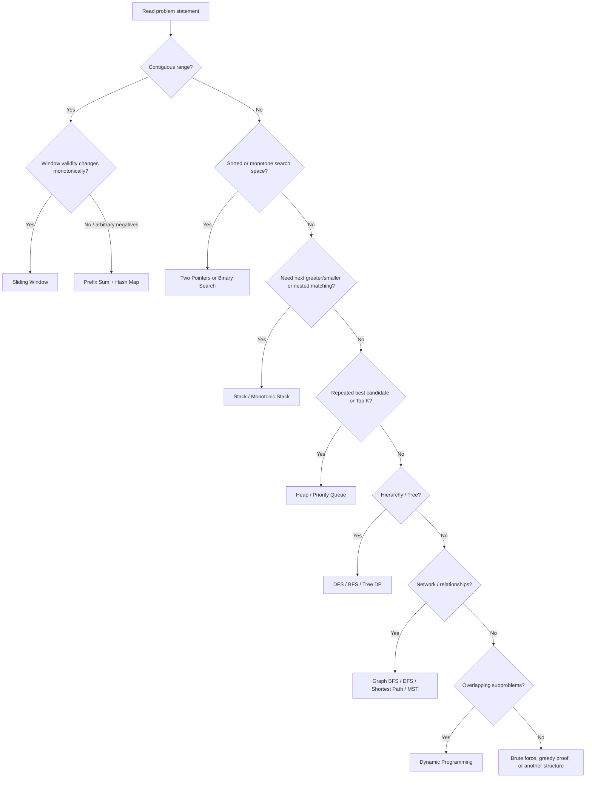
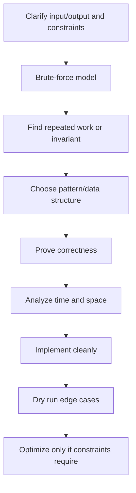
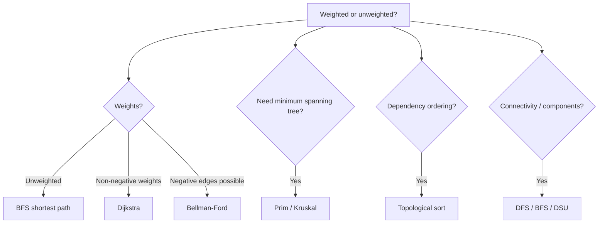
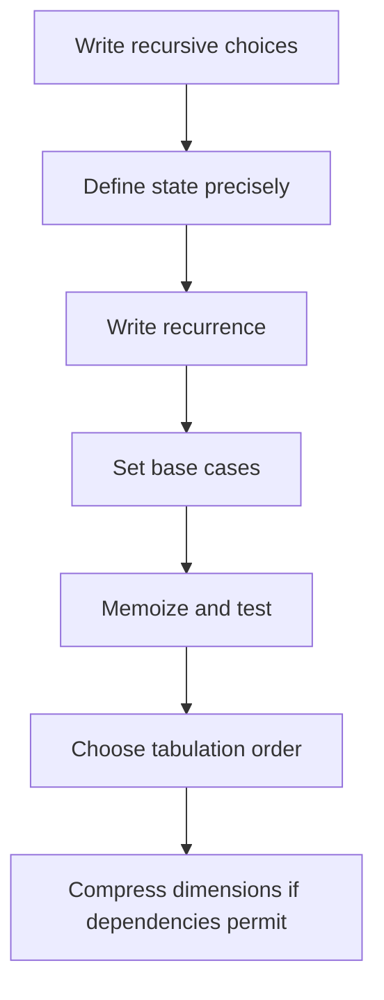

# DSA Patterns 2026 — Complete Video-by-Video Study Handbook

**Playlist:** [DSA Patterns 2026 | Crack FAANG in 3 Months | Padho with Pratyush](https://www.youtube.com/playlist?list=PLbJhGqY-mq47k_WLUtzVjmarUm1EuXPj2)  
**Archive snapshot used:** 114 playlist entries (the course is actively updated; playlist content can change).  
**Language for implementations:** C++17/20 by default; the ideas transfer to Java and Python.

---

## Important source and transcript note

This workbook is organized around **114 individual playlist entries**, preserving the archive's order, title, and duration. I could verify playlist metadata and consult public pattern notes, problem lists, and code examples from companion repositories. I could **not retrieve the full spoken caption/transcript text for all 114 videos** in this session. Therefore, this is a detailed **playlist-aligned study workbook**, not a verified verbatim transcript extraction. The per-video focus notes below are mapped from the listed title and pattern grouping; where an exact example or instructor-specific explanation cannot be verified, it is not attributed to the instructor. The substantial pattern chapters are independent enhancements for mastering the techniques.

**How to use:** read the pattern chapter before the related videos, watch the exact video in order, annotate the example/problem actually used by the instructor, then solve the practice set without looking at notes. Mark mistakes in an error log and revisit after 1, 3, 7, and 14 days.

## Contents

1. Playlist inventory and chapter index (114 individual video chapters)
2. Pattern mastery notes with diagrams and C++ templates
3. Complexity and proof toolkit
4. Interview execution framework
5. Revision and practice plan

## 1. Playlist inventory

| Position | Pattern / section | Duration | Video title |
|---:|---|---:|---|
| 1 | Course orientation | 19:17 | [The Best Way To Learn DSA in 2025 | DSA Patterns by IITian](https://www.youtube.com/playlist?list=PLbJhGqY-mq47k_WLUtzVjmarUm1EuXPj2&index=1) |
| 2 | Course orientation | 8:36 | [Episode 2 – DSA Patterns Roadmap 2025 (Beginner to Advanced)](https://www.youtube.com/playlist?list=PLbJhGqY-mq47k_WLUtzVjmarUm1EuXPj2&index=2) |
| 3 | Two Pointers | 47:21 | [Episode 3 – Master DSA Patterns with 2 Pointers Technique](https://www.youtube.com/playlist?list=PLbJhGqY-mq47k_WLUtzVjmarUm1EuXPj2&index=3) |
| 4 | Two Pointers | 30:11 | [Episode 4 | Master DSA Patterns with the 2 Pointer Technique](https://www.youtube.com/playlist?list=PLbJhGqY-mq47k_WLUtzVjmarUm1EuXPj2&index=4) |
| 5 | Two Pointers | 50:42 | [Episode 5 - 2 Pointer DSA Pattern | DSA PATTERNS ROADMAP 2025](https://www.youtube.com/playlist?list=PLbJhGqY-mq47k_WLUtzVjmarUm1EuXPj2&index=5) |
| 6 | Complexity analysis | 34:07 | [DSA Patterns Episode 6 - What If You Could Master Time Complexity in Just 30 Minutes?](https://www.youtube.com/playlist?list=PLbJhGqY-mq47k_WLUtzVjmarUm1EuXPj2&index=6) |
| 7 | Two Pointers | 43:02 | [DSA Patterns Episode 7: Two Pointers Pattern: More Interview Questions](https://www.youtube.com/playlist?list=PLbJhGqY-mq47k_WLUtzVjmarUm1EuXPj2&index=7) |
| 8 | Two Pointers | 41:16 | [DSA PATTERNS Episode 8 | Two Pointers Pattern: Most Important Questions](https://www.youtube.com/playlist?list=PLbJhGqY-mq47k_WLUtzVjmarUm1EuXPj2&index=8) |
| 9 | Two Pointers revision | 9:34 | [DSA PAtterns Episode 9 | Two Pointers Pattern: Complete Revision in One Video](https://www.youtube.com/playlist?list=PLbJhGqY-mq47k_WLUtzVjmarUm1EuXPj2&index=9) |
| 10 | Sliding Window | 11:34 | [DSA PATTERNS Episode 10 | Introduction to Sliding Window](https://www.youtube.com/playlist?list=PLbJhGqY-mq47k_WLUtzVjmarUm1EuXPj2&index=10) |
| 11 | Sliding Window | 1:09:42 | [DSA PATTERNS Episode 11 Sliding Window Pattern: Easy & Medium Questions](https://www.youtube.com/playlist?list=PLbJhGqY-mq47k_WLUtzVjmarUm1EuXPj2&index=11) |
| 12 | Sliding Window | 1:02:05 | [DSA PATTERNS Episode 12 Sliding Window Pattern: Core Interview Questions](https://www.youtube.com/playlist?list=PLbJhGqY-mq47k_WLUtzVjmarUm1EuXPj2&index=12) |
| 13 | Sliding Window | 32:27 | [DSA PATTERNS Episode 13 Sliding Window Pattern: Important Questions](https://www.youtube.com/playlist?list=PLbJhGqY-mq47k_WLUtzVjmarUm1EuXPj2&index=13) |
| 14 | Sliding Window revision | 25:32 | [DSA PATTERNS Episode 14 Sliding Window Pattern Revision (Part 1)](https://www.youtube.com/playlist?list=PLbJhGqY-mq47k_WLUtzVjmarUm1EuXPj2&index=14) |
| 15 | Sliding Window revision | 24:11 | [DSA PATTERNS Episode 15 | Sliding Window Pattern Revision (Part 2)](https://www.youtube.com/playlist?list=PLbJhGqY-mq47k_WLUtzVjmarUm1EuXPj2&index=15) |
| 16 | Sliding Window | 19:53 | [DSA PATTERNS Episode 16 | Sliding Window Pattern: Amazon Interview Question](https://www.youtube.com/playlist?list=PLbJhGqY-mq47k_WLUtzVjmarUm1EuXPj2&index=16) |
| 17 | Fast & Slow Pointers | 33:18 | [DSA PATTERNS Episode 17 | Linked List Slow & Fast Pointer Technique: Introduction](https://www.youtube.com/playlist?list=PLbJhGqY-mq47k_WLUtzVjmarUm1EuXPj2&index=17) |
| 18 | Course guidance | 14:21 | [My 4 Year DSA Learning JOURNEY | Mistakes | Striver Love Babbar Pepcoding Apna College](https://www.youtube.com/playlist?list=PLbJhGqY-mq47k_WLUtzVjmarUm1EuXPj2&index=18) |
| 19 | Fast & Slow Pointers | 24:19 | [DSA PATTERNS Episode 18 | Linked List Slow-Fast Pointer: Important Questions](https://www.youtube.com/playlist?list=PLbJhGqY-mq47k_WLUtzVjmarUm1EuXPj2&index=19) |
| 20 | Linked Lists | 33:53 | [DSA PATTERNS Episode 19 | Linked List Basics for Beginners](https://www.youtube.com/playlist?list=PLbJhGqY-mq47k_WLUtzVjmarUm1EuXPj2&index=20) |
| 21 | Fast & Slow Pointers | 29:34 | [DSA PATTERNS Episode 20 | Linked List Slow-Fast Pointer: Important Questions](https://www.youtube.com/playlist?list=PLbJhGqY-mq47k_WLUtzVjmarUm1EuXPj2&index=21) |
| 22 | Linked List revision | 10:23 | [DSA PATTERNS Episode 21 | Linked List Slow-Fast Pointer Complete Revision](https://www.youtube.com/playlist?list=PLbJhGqY-mq47k_WLUtzVjmarUm1EuXPj2&index=22) |
| 23 | Kadane's Algorithm | 36:20 | [DSA PATTERNS Episode 22 | Kadane's Algorithm Pattern: Introduction & Intuition](https://www.youtube.com/playlist?list=PLbJhGqY-mq47k_WLUtzVjmarUm1EuXPj2&index=23) |
| 24 | Course guidance | 12:50 | [The DSA Revolution Has Started – And People Are Not Happy](https://www.youtube.com/playlist?list=PLbJhGqY-mq47k_WLUtzVjmarUm1EuXPj2&index=24) |
| 25 | Kadane's Algorithm | 27:57 | [DSA PATTERNS Episode 23 | Kadane's Algorithm: Most Important Interview Question](https://www.youtube.com/playlist?list=PLbJhGqY-mq47k_WLUtzVjmarUm1EuXPj2&index=25) |
| 26 | Kadane's Algorithm revision | 38:14 | [DSA PATTERNS Episode 24 | Kadane's Algorithm Pattern: Quick Revision](https://www.youtube.com/playlist?list=PLbJhGqY-mq47k_WLUtzVjmarUm1EuXPj2&index=26) |
| 27 | Fast & Slow Pointers | 17:04 | [DSA PATTERNS Episode 25 | Linked List Start of Cycle Logic Explained](https://www.youtube.com/playlist?list=PLbJhGqY-mq47k_WLUtzVjmarUm1EuXPj2&index=27) |
| 28 | Course guidance | 13:30 | [DSA Patterns Course 2025 | Big Announcement | Best Way To Learn DSA in 2025](https://www.youtube.com/playlist?list=PLbJhGqY-mq47k_WLUtzVjmarUm1EuXPj2&index=28) |
| 29 | Prefix Sum | 38:50 | [DSA PATTERNS Episode 26 | Prefix Sum Pattern Introduction | DSA ROADMAP 2025](https://www.youtube.com/playlist?list=PLbJhGqY-mq47k_WLUtzVjmarUm1EuXPj2&index=29) |
| 30 | Prefix Sum | 22:37 | [DSA Patterns Episode 27 | Master DSA Patterns With Prefix Sum | Leetcode Patterns](https://www.youtube.com/playlist?list=PLbJhGqY-mq47k_WLUtzVjmarUm1EuXPj2&index=30) |
| 31 | Prefix Sum | 32:47 | [DSA Patterns Lecture 28 | Master DSA Patterns With Prefix Sum | Interview Questions FAANG](https://www.youtube.com/playlist?list=PLbJhGqY-mq47k_WLUtzVjmarUm1EuXPj2&index=31) |
| 32 | Prefix Sum | 28:26 | [Lecture 29 | The ABSOLUTE BEST Prefix Sum Pattern Hacks for Amazon Interviews](https://www.youtube.com/playlist?list=PLbJhGqY-mq47k_WLUtzVjmarUm1EuXPj2&index=32) |
| 33 | Prefix Sum revision | 12:36 | [DSA Patterns Lecture 30 | Master Prefix Sum Pattern in 10 Minutes](https://www.youtube.com/playlist?list=PLbJhGqY-mq47k_WLUtzVjmarUm1EuXPj2&index=33) |
| 34 | Merge Intervals | 48:09 | [DSA Patterns L31 | Master Merge Interval DSA Patterns | MERGE INTERVALS LEETCODE](https://www.youtube.com/playlist?list=PLbJhGqY-mq47k_WLUtzVjmarUm1EuXPj2&index=34) |
| 35 | Merge Intervals | 22:07 | [L32 | Master DSA Pattern Merge Interval | Leetcode Merge Intervals](https://www.youtube.com/playlist?list=PLbJhGqY-mq47k_WLUtzVjmarUm1EuXPj2&index=35) |
| 36 | Merge Intervals | 36:27 | [DSA Patterns L33 | Merge Intervals | Master DSA Patterns in 2025](https://www.youtube.com/playlist?list=PLbJhGqY-mq47k_WLUtzVjmarUm1EuXPj2&index=36) |
| 37 | Merge Intervals | 3:56 | [L34 DSA Patterns 2025 | Merge Overlapping Intervals | Merge Interval DSA Pattern](https://www.youtube.com/playlist?list=PLbJhGqY-mq47k_WLUtzVjmarUm1EuXPj2&index=37) |
| 38 | Merge Intervals | 33:01 | [35. DSA PATTERNS 2025 | Master Merge Interval With Interview Questions | FAANG](https://www.youtube.com/playlist?list=PLbJhGqY-mq47k_WLUtzVjmarUm1EuXPj2&index=38) |
| 39 | Stack | 23:42 | [Master STACK in DSA Patterns 2025 | Introduction to Stack | CPP JAVA PYTHON](https://www.youtube.com/playlist?list=PLbJhGqY-mq47k_WLUtzVjmarUm1EuXPj2&index=39) |
| 40 | Stack | 27:10 | [Learn DSA Like Never Before | Master Stack DSA Pattern With This Simple Trick](https://www.youtube.com/playlist?list=PLbJhGqY-mq47k_WLUtzVjmarUm1EuXPj2&index=40) |
| 41 | Stack | 32:56 | [Most Important STACK Question For FAANG Interviews | Master DSA Patterns](https://www.youtube.com/playlist?list=PLbJhGqY-mq47k_WLUtzVjmarUm1EuXPj2&index=41) |
| 42 | Stack | 34:38 | [Next Greater Element | Stack and Queue DSA Pattern 2025](https://www.youtube.com/playlist?list=PLbJhGqY-mq47k_WLUtzVjmarUm1EuXPj2&index=42) |
| 43 | Stack | 57:27 | [Master Stack DSA Pattern With 3 Questions | DSA Patterns Course](https://www.youtube.com/playlist?list=PLbJhGqY-mq47k_WLUtzVjmarUm1EuXPj2&index=43) |
| 44 | Stack revision | 13:46 | [Revise Stack Data Structure in 10 Minutes | DSA Patterns Course](https://www.youtube.com/playlist?list=PLbJhGqY-mq47k_WLUtzVjmarUm1EuXPj2&index=44) |
| 45 | Hash Maps | 31:18 | [The Only Video You Need TO Master HASHMAPS | DSA Patterns Course Cpp JAVA Python](https://www.youtube.com/playlist?list=PLbJhGqY-mq47k_WLUtzVjmarUm1EuXPj2&index=45) |
| 46 | Hash Maps | 1:26:02 | [4 Questions to Master HASHMAPS in C++ JAVA Python | DSA Patterns Course 2026](https://www.youtube.com/playlist?list=PLbJhGqY-mq47k_WLUtzVjmarUm1EuXPj2&index=46) |
| 47 | Linked List reversal | 52:23 | [Linked List Reversal In the Easiest Way Possible | DSA Patterns Course 2026 CPP JAVA Python](https://www.youtube.com/playlist?list=PLbJhGqY-mq47k_WLUtzVjmarUm1EuXPj2&index=47) |
| 48 | Kadane's Algorithm | 44:37 | [Best Explanation Of Kadane One Deletion On The Internet | DSA Pattern Course CPP JAVA](https://www.youtube.com/playlist?list=PLbJhGqY-mq47k_WLUtzVjmarUm1EuXPj2&index=48) |
| 49 | Linked List reversal | 52:24 | [Best Explanation on Reverse LinkList Nodes in K Group | DSA Patterns CPP JAVA Python](https://www.youtube.com/playlist?list=PLbJhGqY-mq47k_WLUtzVjmarUm1EuXPj2&index=49) |
| 50 | Linked List reversal | 39:34 | [Rotate A Linked List | Master DSA in 2026 With DSA Patterns](https://www.youtube.com/playlist?list=PLbJhGqY-mq47k_WLUtzVjmarUm1EuXPj2&index=50) |
| 51 | Binary Search | 38:53 | [Believe Me, You DON'T Know The Binary Search Algorithm | DSA Patterns Course 2026](https://www.youtube.com/playlist?list=PLbJhGqY-mq47k_WLUtzVjmarUm1EuXPj2&index=51) |
| 52 | Binary Search | 50:15 | [This is The Best Intro To Binary Search | DSA Patterns 2026](https://www.youtube.com/playlist?list=PLbJhGqY-mq47k_WLUtzVjmarUm1EuXPj2&index=52) |
| 53 | Binary Search | 21:58 | [Most Important Question in BINARY Search Algorithm | Find Mountain peak Leetcode](https://www.youtube.com/playlist?list=PLbJhGqY-mq47k_WLUtzVjmarUm1EuXPj2&index=53) |
| 54 | Binary Search | 26:45 | [I Will make Binary Search Easy For You | DSA Patterns Course | C++ Java Python](https://www.youtube.com/playlist?list=PLbJhGqY-mq47k_WLUtzVjmarUm1EuXPj2&index=54) |
| 55 | Binary Search | 42:15 | [Don't Miss This Binary Search Interview Question | DSA Patterns 2026 Cpp Java Python](https://www.youtube.com/playlist?list=PLbJhGqY-mq47k_WLUtzVjmarUm1EuXPj2&index=55) |
| 56 | Binary Search | 37:40 | [One Video To Solve All Binary Search Interview Questions | DSA Patterns 2026](https://www.youtube.com/playlist?list=PLbJhGqY-mq47k_WLUtzVjmarUm1EuXPj2&index=56) |
| 57 | Binary Search | 36:52 | [Best Explanation of Aggressive Cows Leetcode | Binary Search DSA Pattern](https://www.youtube.com/playlist?list=PLbJhGqY-mq47k_WLUtzVjmarUm1EuXPj2&index=57) |
| 58 | Binary Search | 32:10 | [Do Not Miss This Amazon Interview Question | Binary Search DSA Patterns Cpp Java Python](https://www.youtube.com/playlist?list=PLbJhGqY-mq47k_WLUtzVjmarUm1EuXPj2&index=58) |
| 59 | Binary Search | 34:56 | [Binary Search on 2D Array | Best Video On Binary Search DSA Patterns CPP Java Python](https://www.youtube.com/playlist?list=PLbJhGqY-mq47k_WLUtzVjmarUm1EuXPj2&index=59) |
| 60 | Binary Search | 1:10:49 | [I Failed a 40 LPA Interview Because Of This Binary Search Question | Do not Miss This](https://www.youtube.com/playlist?list=PLbJhGqY-mq47k_WLUtzVjmarUm1EuXPj2&index=60) |
| 61 | Heap | 34:08 | [Introduction To Heap DSA Pattern | One Of The Most Important Patterns For Coding Interviews](https://www.youtube.com/playlist?list=PLbJhGqY-mq47k_WLUtzVjmarUm1EuXPj2&index=61) |
| 62 | Heap | 28:33 | [The Best Video To Learn HEAP Data Structure | DSA Patterns 2026 CPP JAVA Python](https://www.youtube.com/playlist?list=PLbJhGqY-mq47k_WLUtzVjmarUm1EuXPj2&index=62) |
| 63 | Heap | 51:31 | [HEAP On Pairs Explained in One Shot | CPP JAVA PYTHON | DSA Patterns](https://www.youtube.com/playlist?list=PLbJhGqY-mq47k_WLUtzVjmarUm1EuXPj2&index=63) |
| 64 | Heap | 41:07 | [Solve Any HEAP Question By This Template | Top K frequent Elements Leetcode](https://www.youtube.com/playlist?list=PLbJhGqY-mq47k_WLUtzVjmarUm1EuXPj2&index=64) |
| 65 | Heap | 28:43 | [5 Step Template To Solve any HEAP Problem | DSA PATTERNS 2026](https://www.youtube.com/playlist?list=PLbJhGqY-mq47k_WLUtzVjmarUm1EuXPj2&index=65) |
| 66 | Heap & Greedy | 33:52 | [You Will Never Forget The HEAP Greedy DSA Pattern After This Video](https://www.youtube.com/playlist?list=PLbJhGqY-mq47k_WLUtzVjmarUm1EuXPj2&index=66) |
| 67 | Heap | 29:38 | [Google Interview Question On Heap Dsa Pattern Made Simple | IPO Leetcode](https://www.youtube.com/playlist?list=PLbJhGqY-mq47k_WLUtzVjmarUm1EuXPj2&index=67) |
| 68 | Heap | 24:32 | [Best Explanation Of Merge K Sorted Lists | HEAP DSA Pattern](https://www.youtube.com/playlist?list=PLbJhGqY-mq47k_WLUtzVjmarUm1EuXPj2&index=68) |
| 69 | Heap | 42:19 | [Let's Revise HEAP Data Structure With This Leetcode Hard Question | CPU Task Scheduler](https://www.youtube.com/playlist?list=PLbJhGqY-mq47k_WLUtzVjmarUm1EuXPj2&index=69) |
| 70 | Recursion & Backtracking | 25:33 | [Intro To Recursion DSA Pattern | Beginner To Advanced | Best Recursion Series](https://www.youtube.com/playlist?list=PLbJhGqY-mq47k_WLUtzVjmarUm1EuXPj2&index=70) |
| 71 | Recursion & Backtracking | 16:56 | [Recursion Fixed Template For All Questions | One Template To Solve Recursion Problems](https://www.youtube.com/playlist?list=PLbJhGqY-mq47k_WLUtzVjmarUm1EuXPj2&index=71) |
| 72 | Recursion & Backtracking | 26:24 | [Recursion & Backtracking Explained Once and For All | DSA for Beginners](https://www.youtube.com/playlist?list=PLbJhGqY-mq47k_WLUtzVjmarUm1EuXPj2&index=72) |
| 73 | Recursion & Backtracking | 36:02 | [Learn Recursion Like A Pro](https://www.youtube.com/playlist?list=PLbJhGqY-mq47k_WLUtzVjmarUm1EuXPj2&index=73) |
| 74 | Recursion & Backtracking | 30:18 | [What If You Could Master Recursion in 3 Easy Questions](https://www.youtube.com/playlist?list=PLbJhGqY-mq47k_WLUtzVjmarUm1EuXPj2&index=74) |
| 75 | Recursion & Backtracking | 32:57 | [Start Learning Recursion Backtracking With This Question | Best Recursion Explanation](https://www.youtube.com/playlist?list=PLbJhGqY-mq47k_WLUtzVjmarUm1EuXPj2&index=75) |
| 76 | Recursion & Backtracking | 47:27 | [5 Point Template To Crack any Recursion Leetcode Question | DSA Patterns 2026](https://www.youtube.com/playlist?list=PLbJhGqY-mq47k_WLUtzVjmarUm1EuXPj2&index=76) |
| 77 | Recursion & Backtracking | 26:05 | [Stop Struggling with Recursion: Combination Sum Explained Simply](https://www.youtube.com/playlist?list=PLbJhGqY-mq47k_WLUtzVjmarUm1EuXPj2&index=77) |
| 78 | Course guidance | 10:27 | [Next Phase Plan For The DSA Pattern Series | Comment Your Thoughts](https://www.youtube.com/playlist?list=PLbJhGqY-mq47k_WLUtzVjmarUm1EuXPj2&index=78) |
| 79 | Trees | 20:36 | [Starting TREE Series!](https://www.youtube.com/playlist?list=PLbJhGqY-mq47k_WLUtzVjmarUm1EuXPj2&index=79) |
| 80 | Trees | 26:25 | [Tree Traversals Made Simple! Preorder Inorder Postorder](https://www.youtube.com/playlist?list=PLbJhGqY-mq47k_WLUtzVjmarUm1EuXPj2&index=80) |
| 81 | Trees | 45:30 | [EP 03: Level Order Traversal In Binary Tree | Intuition and Template](https://www.youtube.com/playlist?list=PLbJhGqY-mq47k_WLUtzVjmarUm1EuXPj2&index=81) |
| 82 | Trees | 23:41 | [One Pattern To Solve Any Tree Question On Leetcode!](https://www.youtube.com/playlist?list=PLbJhGqY-mq47k_WLUtzVjmarUm1EuXPj2&index=82) |
| 83 | Trees | 39:52 | [Tree Series Ep-05: Check for Symmetrical Binary Trees | C++ | Java](https://www.youtube.com/playlist?list=PLbJhGqY-mq47k_WLUtzVjmarUm1EuXPj2&index=83) |
| 84 | Trees | 27:42 | [Better Than STRIVER ! LCA in Binary TREE Explanation with Intuition](https://www.youtube.com/playlist?list=PLbJhGqY-mq47k_WLUtzVjmarUm1EuXPj2&index=84) |
| 85 | Trees / BST | 23:32 | [Introduction to Binary Search Tree! Don't Miss](https://www.youtube.com/playlist?list=PLbJhGqY-mq47k_WLUtzVjmarUm1EuXPj2&index=85) |
| 86 | Trees / BST | 21:11 | [LCA in Binary Search Tree – Don't Miss This Trick! | Trees Ep 08 | DSA Series](https://www.youtube.com/playlist?list=PLbJhGqY-mq47k_WLUtzVjmarUm1EuXPj2&index=86) |
| 87 | Trees / BST | 56:42 | [Definitely Better Than Striver.. Two Sum in Binary search Tree!](https://www.youtube.com/playlist?list=PLbJhGqY-mq47k_WLUtzVjmarUm1EuXPj2&index=87) |
| 88 | Trees | 30:32 | [Path Sum Problem in 5 Minutes - No Confusion](https://www.youtube.com/playlist?list=PLbJhGqY-mq47k_WLUtzVjmarUm1EuXPj2&index=88) |
| 89 | Trees | 43:56 | [Diameter of Binary Tree | Check Complete Binary Tree | Tree DSA Series](https://www.youtube.com/playlist?list=PLbJhGqY-mq47k_WLUtzVjmarUm1EuXPj2&index=89) |
| 90 | Trees / BST | 42:11 | [The BST Validation Problem Everyone Gets Wrong](https://www.youtube.com/playlist?list=PLbJhGqY-mq47k_WLUtzVjmarUm1EuXPj2&index=90) |
| 91 | Trees | 27:55 | [Tree Series Last Video Construct a Binary Tree from Preorder and Inorder Traversal](https://www.youtube.com/playlist?list=PLbJhGqY-mq47k_WLUtzVjmarUm1EuXPj2&index=91) |
| 92 | Graphs | 20:45 | [Intro To Graphs DSA Pattern | Master Graphs in 12 Days | Zero](https://www.youtube.com/playlist?list=PLbJhGqY-mq47k_WLUtzVjmarUm1EuXPj2&index=92) |
| 93 | Graphs | 39:46 | [Graph Representation: Adjacency Matrix vs Adjacency List – Which is Better?](https://www.youtube.com/playlist?list=PLbJhGqY-mq47k_WLUtzVjmarUm1EuXPj2&index=93) |
| 94 | Graphs | 46:58 | [Master DFS/BFS in Graphs | Graph series DSA Patterns](https://www.youtube.com/playlist?list=PLbJhGqY-mq47k_WLUtzVjmarUm1EuXPj2&index=94) |
| 95 | Graphs | 37:49 | [Most Asked Graphs Question in FAANG Interviews | Number of Islands Leetcode](https://www.youtube.com/playlist?list=PLbJhGqY-mq47k_WLUtzVjmarUm1EuXPj2&index=95) |
| 96 | Graphs | 36:00 | [Rotten Oranges: Multi-Source BFS | Graph Series](https://www.youtube.com/playlist?list=PLbJhGqY-mq47k_WLUtzVjmarUm1EuXPj2&index=96) |
| 97 | Graphs | 49:38 | [DFS Cycle Detection | From Basics to Advanced | DSA Pattern Graph Series](https://www.youtube.com/playlist?list=PLbJhGqY-mq47k_WLUtzVjmarUm1EuXPj2&index=97) |
| 98 | Graphs | 32:46 | [No one has explained Topological sort like This!](https://www.youtube.com/playlist?list=PLbJhGqY-mq47k_WLUtzVjmarUm1EuXPj2&index=98) |
| 99 | Graphs | 23:39 | [The Graph Algorithm Used In Amazon! Bipartite graph/ Graph Coloring| CPP JAVA Python](https://www.youtube.com/playlist?list=PLbJhGqY-mq47k_WLUtzVjmarUm1EuXPj2&index=99) |
| 100 | Graphs | 17:24 | [Easiest Graphs question Surrounded Regions | DSA Patterns 2026](https://www.youtube.com/playlist?list=PLbJhGqY-mq47k_WLUtzVjmarUm1EuXPj2&index=100) |
| 101 | Graphs | 29:30 | [Graph Series Episode 10 - Shortest Path In Non Weighted graph](https://www.youtube.com/playlist?list=PLbJhGqY-mq47k_WLUtzVjmarUm1EuXPj2&index=101) |
| 102 | Graphs | 51:57 | [No one Has Explained Dijkstra's Algorithm Like This On The Internet!](https://www.youtube.com/playlist?list=PLbJhGqY-mq47k_WLUtzVjmarUm1EuXPj2&index=102) |
| 103 | Graphs | 43:14 | [2 Of The Most Important Questions in Dijkstra's Algorithm | Graph series DSA Patterns 2026](https://www.youtube.com/playlist?list=PLbJhGqY-mq47k_WLUtzVjmarUm1EuXPj2&index=103) |
| 104 | Graphs | 34:53 | [We Crossed 50K! Let's Study Bellman-Ford NOW](https://www.youtube.com/playlist?list=PLbJhGqY-mq47k_WLUtzVjmarUm1EuXPj2&index=104) |
| 105 | Graphs | 35:47 | [Graph Leetcode Hard Question Explained Like Crazy! Swim in Rising Water Leetcode](https://www.youtube.com/playlist?list=PLbJhGqY-mq47k_WLUtzVjmarUm1EuXPj2&index=105) |
| 106 | Graphs | 41:33 | [Prim's Algorithm - Minimum Spanning Tree - C++ JAVA DSA Patterns Graph Series 2026](https://www.youtube.com/playlist?list=PLbJhGqY-mq47k_WLUtzVjmarUm1EuXPj2&index=106) |
| 107 | Graphs | 32:34 | [Master Bellman-Ford: Cheapest Flights Within K Stops](https://www.youtube.com/playlist?list=PLbJhGqY-mq47k_WLUtzVjmarUm1EuXPj2&index=107) |
| 108 | Graphs | 31:39 | [Word Ladder Explained Like a Pro! DSA Patterns Graph Series](https://www.youtube.com/playlist?list=PLbJhGqY-mq47k_WLUtzVjmarUm1EuXPj2&index=108) |
| 109 | Dynamic Programming | 16:16 | [Introduction To Dynamic Programming | Dynamic Programming in 15 days](https://www.youtube.com/playlist?list=PLbJhGqY-mq47k_WLUtzVjmarUm1EuXPj2&index=109) |
| 110 | Dynamic Programming | 31:07 | [DP Series Episode-2 : When And How To Use DP](https://www.youtube.com/playlist?list=PLbJhGqY-mq47k_WLUtzVjmarUm1EuXPj2&index=110) |
| 111 | Dynamic Programming | 40:32 | [DP in 15 Days Episode 3: Climbing Stairs | Learn 1D Dynamic Programming](https://www.youtube.com/playlist?list=PLbJhGqY-mq47k_WLUtzVjmarUm1EuXPj2&index=111) |
| 112 | Dynamic Programming | 40:32 | [DP Series - House Robber](https://www.youtube.com/playlist?list=PLbJhGqY-mq47k_WLUtzVjmarUm1EuXPj2&index=112) |
| 113 | Dynamic Programming | 21:31 | [DP In 15 Days Episode 5 : 0/1 Knapsack | Master Dynamic Programming](https://www.youtube.com/playlist?list=PLbJhGqY-mq47k_WLUtzVjmarUm1EuXPj2&index=113) |
| 114 | Dynamic Programming | 34:27 | [DP in 15 Days Episode 06 : No One Has Explained Tabulation Like This](https://www.youtube.com/playlist?list=PLbJhGqY-mq47k_WLUtzVjmarUm1EuXPj2&index=114) |

## 2. Individual video chapters

Each playlist entry has its own chapter. These notes state the learning target suggested by the title and pattern grouping; add the instructor's exact walkthrough, examples, and timestamps while watching.

### Chapter 001 — The Best Way To Learn DSA in 2025 | DSA Patterns by IITian

**Playlist position:** 1 · **Section:** Course orientation · **Duration:** 19:17 · [Open this lesson](https://www.youtube.com/playlist?list=PLbJhGqY-mq47k_WLUtzVjmarUm1EuXPj2&index=1)

**Chapter focus**

Course orientation: pattern-first preparation, deliberate practice, spaced revision, and learning to recognize a reusable invariant rather than memorizing isolated solutions.

**Core ideas to capture**

- What is the input structure and the target output?
- What observation makes the brute-force solution avoidable?
- What state is maintained (pointers, window counts, prefix map, stack, heap, recursion state, tree return value, graph distance, or DP state)?
- What invariant proves that the algorithm does not discard a valid answer?
- What are the time and auxiliary-space costs, including sorting, recursion depth, and output size?

**Pattern connection:** Course organization, study workflow, or instructor update; keep process advice separate from algorithmic facts.

**Mastery checkpoint:** Update the study plan only where the lesson provides new course structure or learning guidance.

**After watching, add:** exact problem name(s) from the video; one dry run; one edge case; the instructor's key insight; and any variation that changes the template.

### Chapter 002 — Episode 2 – DSA Patterns Roadmap 2025 (Beginner to Advanced)

**Playlist position:** 2 · **Section:** Course orientation · **Duration:** 8:36 · [Open this lesson](https://www.youtube.com/playlist?list=PLbJhGqY-mq47k_WLUtzVjmarUm1EuXPj2&index=2)

**Chapter focus**

Roadmap: understand the intended progression from foundational array/string patterns to pointer techniques, range queries, trees, graphs, and DP. Treat the roadmap as a sequence, not a deadline.

**Core ideas to capture**

- What is the input structure and the target output?
- What observation makes the brute-force solution avoidable?
- What state is maintained (pointers, window counts, prefix map, stack, heap, recursion state, tree return value, graph distance, or DP state)?
- What invariant proves that the algorithm does not discard a valid answer?
- What are the time and auxiliary-space costs, including sorting, recursion depth, and output size?

**Pattern connection:** Course organization, study workflow, or instructor update; keep process advice separate from algorithmic facts.

**Mastery checkpoint:** Update the study plan only where the lesson provides new course structure or learning guidance.

**After watching, add:** exact problem name(s) from the video; one dry run; one edge case; the instructor's key insight; and any variation that changes the template.

### Chapter 003 — Episode 3 – Master DSA Patterns with 2 Pointers Technique

**Playlist position:** 3 · **Section:** Two Pointers · **Duration:** 47:21 · [Open this lesson](https://www.youtube.com/playlist?list=PLbJhGqY-mq47k_WLUtzVjmarUm1EuXPj2&index=3)

**Chapter focus**

Study the Two Pointers technique shown by the lesson title: identify its invariant, derive the transition/decision rule, implement the core template, and compare it with the brute-force approach.

**Core ideas to capture**

- What is the input structure and the target output?
- What observation makes the brute-force solution avoidable?
- What state is maintained (pointers, window counts, prefix map, stack, heap, recursion state, tree return value, graph distance, or DP state)?
- What invariant proves that the algorithm does not discard a valid answer?
- What are the time and auxiliary-space costs, including sorting, recursion depth, and output size?

**Pattern connection:** Sorted input; pair/triplet with a target; palindrome; in-place removal/compaction; partitioning; need to compare both ends.

**Mastery checkpoint:** Be able to explain the invariant and solve one representative problem from this pattern without looking at a template.

**After watching, add:** exact problem name(s) from the video; one dry run; one edge case; the instructor's key insight; and any variation that changes the template.

### Chapter 004 — Episode 4 | Master DSA Patterns with the 2 Pointer Technique

**Playlist position:** 4 · **Section:** Two Pointers · **Duration:** 30:11 · [Open this lesson](https://www.youtube.com/playlist?list=PLbJhGqY-mq47k_WLUtzVjmarUm1EuXPj2&index=4)

**Chapter focus**

Study the Two Pointers technique shown by the lesson title: identify its invariant, derive the transition/decision rule, implement the core template, and compare it with the brute-force approach.

**Core ideas to capture**

- What is the input structure and the target output?
- What observation makes the brute-force solution avoidable?
- What state is maintained (pointers, window counts, prefix map, stack, heap, recursion state, tree return value, graph distance, or DP state)?
- What invariant proves that the algorithm does not discard a valid answer?
- What are the time and auxiliary-space costs, including sorting, recursion depth, and output size?

**Pattern connection:** Sorted input; pair/triplet with a target; palindrome; in-place removal/compaction; partitioning; need to compare both ends.

**Mastery checkpoint:** Be able to explain the invariant and solve one representative problem from this pattern without looking at a template.

**After watching, add:** exact problem name(s) from the video; one dry run; one edge case; the instructor's key insight; and any variation that changes the template.

### Chapter 005 — Episode 5 - 2 Pointer DSA Pattern | DSA PATTERNS ROADMAP 2025

**Playlist position:** 5 · **Section:** Two Pointers · **Duration:** 50:42 · [Open this lesson](https://www.youtube.com/playlist?list=PLbJhGqY-mq47k_WLUtzVjmarUm1EuXPj2&index=5)

**Chapter focus**

Study the Two Pointers technique shown by the lesson title: identify its invariant, derive the transition/decision rule, implement the core template, and compare it with the brute-force approach.

**Core ideas to capture**

- What is the input structure and the target output?
- What observation makes the brute-force solution avoidable?
- What state is maintained (pointers, window counts, prefix map, stack, heap, recursion state, tree return value, graph distance, or DP state)?
- What invariant proves that the algorithm does not discard a valid answer?
- What are the time and auxiliary-space costs, including sorting, recursion depth, and output size?

**Pattern connection:** Sorted input; pair/triplet with a target; palindrome; in-place removal/compaction; partitioning; need to compare both ends.

**Mastery checkpoint:** Be able to explain the invariant and solve one representative problem from this pattern without looking at a template.

**After watching, add:** exact problem name(s) from the video; one dry run; one edge case; the instructor's key insight; and any variation that changes the template.

### Chapter 006 — DSA Patterns Episode 6 - What If You Could Master Time Complexity in Just 30 Minutes?

**Playlist position:** 6 · **Section:** Complexity analysis · **Duration:** 34:07 · [Open this lesson](https://www.youtube.com/playlist?list=PLbJhGqY-mq47k_WLUtzVjmarUm1EuXPj2&index=6)

**Chapter focus**

Complexity analysis: count operations, distinguish time from auxiliary space, compare O(1), O(log n), O(n), O(n log n), O(n²), and exponential growth. Practice deriving rather than guessing complexity.

**Core ideas to capture**

- What is the input structure and the target output?
- What observation makes the brute-force solution avoidable?
- What state is maintained (pointers, window counts, prefix map, stack, heap, recursion state, tree return value, graph distance, or DP state)?
- What invariant proves that the algorithm does not discard a valid answer?
- What are the time and auxiliary-space costs, including sorting, recursion depth, and output size?

**Pattern connection:** Input size, loop nesting, halving/doubling, recursion trees, amortized analysis, and auxiliary space.

**Mastery checkpoint:** Derive complexity for a nested loop, binary search, merge sort, and a recursion tree; distinguish O, Θ, and Ω.

**After watching, add:** exact problem name(s) from the video; one dry run; one edge case; the instructor's key insight; and any variation that changes the template.

### Chapter 007 — DSA Patterns Episode 7: Two Pointers Pattern: More Interview Questions

**Playlist position:** 7 · **Section:** Two Pointers · **Duration:** 43:02 · [Open this lesson](https://www.youtube.com/playlist?list=PLbJhGqY-mq47k_WLUtzVjmarUm1EuXPj2&index=7)

**Chapter focus**

Study the Two Pointers technique shown by the lesson title: identify its invariant, derive the transition/decision rule, implement the core template, and compare it with the brute-force approach.

**Core ideas to capture**

- What is the input structure and the target output?
- What observation makes the brute-force solution avoidable?
- What state is maintained (pointers, window counts, prefix map, stack, heap, recursion state, tree return value, graph distance, or DP state)?
- What invariant proves that the algorithm does not discard a valid answer?
- What are the time and auxiliary-space costs, including sorting, recursion depth, and output size?

**Pattern connection:** Sorted input; pair/triplet with a target; palindrome; in-place removal/compaction; partitioning; need to compare both ends.

**Mastery checkpoint:** Be able to explain the invariant and solve one representative problem from this pattern without looking at a template.

**After watching, add:** exact problem name(s) from the video; one dry run; one edge case; the instructor's key insight; and any variation that changes the template.

### Chapter 008 — DSA PATTERNS Episode 8 | Two Pointers Pattern: Most Important Questions

**Playlist position:** 8 · **Section:** Two Pointers · **Duration:** 41:16 · [Open this lesson](https://www.youtube.com/playlist?list=PLbJhGqY-mq47k_WLUtzVjmarUm1EuXPj2&index=8)

**Chapter focus**

Study the Two Pointers technique shown by the lesson title: identify its invariant, derive the transition/decision rule, implement the core template, and compare it with the brute-force approach.

**Core ideas to capture**

- What is the input structure and the target output?
- What observation makes the brute-force solution avoidable?
- What state is maintained (pointers, window counts, prefix map, stack, heap, recursion state, tree return value, graph distance, or DP state)?
- What invariant proves that the algorithm does not discard a valid answer?
- What are the time and auxiliary-space costs, including sorting, recursion depth, and output size?

**Pattern connection:** Sorted input; pair/triplet with a target; palindrome; in-place removal/compaction; partitioning; need to compare both ends.

**Mastery checkpoint:** Be able to explain the invariant and solve one representative problem from this pattern without looking at a template.

**After watching, add:** exact problem name(s) from the video; one dry run; one edge case; the instructor's key insight; and any variation that changes the template.

### Chapter 009 — DSA PAtterns Episode 9 | Two Pointers Pattern: Complete Revision in One Video

**Playlist position:** 9 · **Section:** Two Pointers revision · **Duration:** 9:34 · [Open this lesson](https://www.youtube.com/playlist?list=PLbJhGqY-mq47k_WLUtzVjmarUm1EuXPj2&index=9)

**Chapter focus**

Consolidate opposite-direction and same-direction pointer invariants, pointer movement proofs, duplicate handling, and edge-case tests.

**Core ideas to capture**

- What is the input structure and the target output?
- What observation makes the brute-force solution avoidable?
- What state is maintained (pointers, window counts, prefix map, stack, heap, recursion state, tree return value, graph distance, or DP state)?
- What invariant proves that the algorithm does not discard a valid answer?
- What are the time and auxiliary-space costs, including sorting, recursion depth, and output size?

**Pattern connection:** Sorted input; pair/triplet with a target; palindrome; in-place removal/compaction; partitioning; need to compare both ends.

**Mastery checkpoint:** Be able to explain the invariant and solve one representative problem from this pattern without looking at a template.

**After watching, add:** exact problem name(s) from the video; one dry run; one edge case; the instructor's key insight; and any variation that changes the template.

### Chapter 010 — DSA PATTERNS Episode 10 | Introduction to Sliding Window

**Playlist position:** 10 · **Section:** Sliding Window · **Duration:** 11:34 · [Open this lesson](https://www.youtube.com/playlist?list=PLbJhGqY-mq47k_WLUtzVjmarUm1EuXPj2&index=10)

**Chapter focus**

Study the Sliding Window technique shown by the lesson title: identify its invariant, derive the transition/decision rule, implement the core template, and compare it with the brute-force approach.

**Core ideas to capture**

- What is the input structure and the target output?
- What observation makes the brute-force solution avoidable?
- What state is maintained (pointers, window counts, prefix map, stack, heap, recursion state, tree return value, graph distance, or DP state)?
- What invariant proves that the algorithm does not discard a valid answer?
- What are the time and auxiliary-space costs, including sorting, recursion depth, and output size?

**Pattern connection:** Longest/shortest substring or subarray; contiguous segment; maximum/minimum over every length-k block; at most K distinct; frequency constraints.

**Mastery checkpoint:** Be able to explain the invariant and solve one representative problem from this pattern without looking at a template.

**After watching, add:** exact problem name(s) from the video; one dry run; one edge case; the instructor's key insight; and any variation that changes the template.

### Chapter 011 — DSA PATTERNS Episode 11 Sliding Window Pattern: Easy & Medium Questions

**Playlist position:** 11 · **Section:** Sliding Window · **Duration:** 1:09:42 · [Open this lesson](https://www.youtube.com/playlist?list=PLbJhGqY-mq47k_WLUtzVjmarUm1EuXPj2&index=11)

**Chapter focus**

Study the Sliding Window technique shown by the lesson title: identify its invariant, derive the transition/decision rule, implement the core template, and compare it with the brute-force approach.

**Core ideas to capture**

- What is the input structure and the target output?
- What observation makes the brute-force solution avoidable?
- What state is maintained (pointers, window counts, prefix map, stack, heap, recursion state, tree return value, graph distance, or DP state)?
- What invariant proves that the algorithm does not discard a valid answer?
- What are the time and auxiliary-space costs, including sorting, recursion depth, and output size?

**Pattern connection:** Longest/shortest substring or subarray; contiguous segment; maximum/minimum over every length-k block; at most K distinct; frequency constraints.

**Mastery checkpoint:** Be able to explain the invariant and solve one representative problem from this pattern without looking at a template.

**After watching, add:** exact problem name(s) from the video; one dry run; one edge case; the instructor's key insight; and any variation that changes the template.

### Chapter 012 — DSA PATTERNS Episode 12 Sliding Window Pattern: Core Interview Questions

**Playlist position:** 12 · **Section:** Sliding Window · **Duration:** 1:02:05 · [Open this lesson](https://www.youtube.com/playlist?list=PLbJhGqY-mq47k_WLUtzVjmarUm1EuXPj2&index=12)

**Chapter focus**

Study the Sliding Window technique shown by the lesson title: identify its invariant, derive the transition/decision rule, implement the core template, and compare it with the brute-force approach.

**Core ideas to capture**

- What is the input structure and the target output?
- What observation makes the brute-force solution avoidable?
- What state is maintained (pointers, window counts, prefix map, stack, heap, recursion state, tree return value, graph distance, or DP state)?
- What invariant proves that the algorithm does not discard a valid answer?
- What are the time and auxiliary-space costs, including sorting, recursion depth, and output size?

**Pattern connection:** Longest/shortest substring or subarray; contiguous segment; maximum/minimum over every length-k block; at most K distinct; frequency constraints.

**Mastery checkpoint:** Be able to explain the invariant and solve one representative problem from this pattern without looking at a template.

**After watching, add:** exact problem name(s) from the video; one dry run; one edge case; the instructor's key insight; and any variation that changes the template.

### Chapter 013 — DSA PATTERNS Episode 13 Sliding Window Pattern: Important Questions

**Playlist position:** 13 · **Section:** Sliding Window · **Duration:** 32:27 · [Open this lesson](https://www.youtube.com/playlist?list=PLbJhGqY-mq47k_WLUtzVjmarUm1EuXPj2&index=13)

**Chapter focus**

Study the Sliding Window technique shown by the lesson title: identify its invariant, derive the transition/decision rule, implement the core template, and compare it with the brute-force approach.

**Core ideas to capture**

- What is the input structure and the target output?
- What observation makes the brute-force solution avoidable?
- What state is maintained (pointers, window counts, prefix map, stack, heap, recursion state, tree return value, graph distance, or DP state)?
- What invariant proves that the algorithm does not discard a valid answer?
- What are the time and auxiliary-space costs, including sorting, recursion depth, and output size?

**Pattern connection:** Longest/shortest substring or subarray; contiguous segment; maximum/minimum over every length-k block; at most K distinct; frequency constraints.

**Mastery checkpoint:** Be able to explain the invariant and solve one representative problem from this pattern without looking at a template.

**After watching, add:** exact problem name(s) from the video; one dry run; one edge case; the instructor's key insight; and any variation that changes the template.

### Chapter 014 — DSA PATTERNS Episode 14 Sliding Window Pattern Revision (Part 1)

**Playlist position:** 14 · **Section:** Sliding Window revision · **Duration:** 25:32 · [Open this lesson](https://www.youtube.com/playlist?list=PLbJhGqY-mq47k_WLUtzVjmarUm1EuXPj2&index=14)

**Chapter focus**

Revision: fixed versus variable windows, state maintenance, valid/invalid conditions, and answer-update timing.

**Core ideas to capture**

- What is the input structure and the target output?
- What observation makes the brute-force solution avoidable?
- What state is maintained (pointers, window counts, prefix map, stack, heap, recursion state, tree return value, graph distance, or DP state)?
- What invariant proves that the algorithm does not discard a valid answer?
- What are the time and auxiliary-space costs, including sorting, recursion depth, and output size?

**Pattern connection:** Longest/shortest substring or subarray; contiguous segment; maximum/minimum over every length-k block; at most K distinct; frequency constraints.

**Mastery checkpoint:** Be able to explain the invariant and solve one representative problem from this pattern without looking at a template.

**After watching, add:** exact problem name(s) from the video; one dry run; one edge case; the instructor's key insight; and any variation that changes the template.

### Chapter 015 — DSA PATTERNS Episode 15 | Sliding Window Pattern Revision (Part 2)

**Playlist position:** 15 · **Section:** Sliding Window revision · **Duration:** 24:11 · [Open this lesson](https://www.youtube.com/playlist?list=PLbJhGqY-mq47k_WLUtzVjmarUm1EuXPj2&index=15)

**Chapter focus**

Revision: translate each problem statement into a window invariant; compare brute force, optimized window, and when sliding window does not apply.

**Core ideas to capture**

- What is the input structure and the target output?
- What observation makes the brute-force solution avoidable?
- What state is maintained (pointers, window counts, prefix map, stack, heap, recursion state, tree return value, graph distance, or DP state)?
- What invariant proves that the algorithm does not discard a valid answer?
- What are the time and auxiliary-space costs, including sorting, recursion depth, and output size?

**Pattern connection:** Longest/shortest substring or subarray; contiguous segment; maximum/minimum over every length-k block; at most K distinct; frequency constraints.

**Mastery checkpoint:** Be able to explain the invariant and solve one representative problem from this pattern without looking at a template.

**After watching, add:** exact problem name(s) from the video; one dry run; one edge case; the instructor's key insight; and any variation that changes the template.

### Chapter 016 — DSA PATTERNS Episode 16 | Sliding Window Pattern: Amazon Interview Question

**Playlist position:** 16 · **Section:** Sliding Window · **Duration:** 19:53 · [Open this lesson](https://www.youtube.com/playlist?list=PLbJhGqY-mq47k_WLUtzVjmarUm1EuXPj2&index=16)

**Chapter focus**

Study the Sliding Window technique shown by the lesson title: identify its invariant, derive the transition/decision rule, implement the core template, and compare it with the brute-force approach.

**Core ideas to capture**

- What is the input structure and the target output?
- What observation makes the brute-force solution avoidable?
- What state is maintained (pointers, window counts, prefix map, stack, heap, recursion state, tree return value, graph distance, or DP state)?
- What invariant proves that the algorithm does not discard a valid answer?
- What are the time and auxiliary-space costs, including sorting, recursion depth, and output size?

**Pattern connection:** Longest/shortest substring or subarray; contiguous segment; maximum/minimum over every length-k block; at most K distinct; frequency constraints.

**Mastery checkpoint:** Be able to explain the invariant and solve one representative problem from this pattern without looking at a template.

**After watching, add:** exact problem name(s) from the video; one dry run; one edge case; the instructor's key insight; and any variation that changes the template.

### Chapter 017 — DSA PATTERNS Episode 17 | Linked List Slow & Fast Pointer Technique: Introduction

**Playlist position:** 17 · **Section:** Fast & Slow Pointers · **Duration:** 33:18 · [Open this lesson](https://www.youtube.com/playlist?list=PLbJhGqY-mq47k_WLUtzVjmarUm1EuXPj2&index=17)

**Chapter focus**

Study the Fast & Slow Pointers technique shown by the lesson title: identify its invariant, derive the transition/decision rule, implement the core template, and compare it with the brute-force approach.

**Core ideas to capture**

- What is the input structure and the target output?
- What observation makes the brute-force solution avoidable?
- What state is maintained (pointers, window counts, prefix map, stack, heap, recursion state, tree return value, graph distance, or DP state)?
- What invariant proves that the algorithm does not discard a valid answer?
- What are the time and auxiliary-space costs, including sorting, recursion depth, and output size?

**Pattern connection:** Linked-list cycle detection; cycle entry; middle node; palindrome list; happy number; repeated state in a deterministic function.

**Mastery checkpoint:** Be able to explain the invariant and solve one representative problem from this pattern without looking at a template.

**After watching, add:** exact problem name(s) from the video; one dry run; one edge case; the instructor's key insight; and any variation that changes the template.

### Chapter 018 — My 4 Year DSA Learning JOURNEY | Mistakes | Striver Love Babbar Pepcoding Apna College

**Playlist position:** 18 · **Section:** Course guidance · **Duration:** 14:21 · [Open this lesson](https://www.youtube.com/playlist?list=PLbJhGqY-mq47k_WLUtzVjmarUm1EuXPj2&index=18)

**Chapter focus**

Learning-process reflection: convert advice into an execution system—one primary sheet, repeated implementation without looking, error log, revision intervals, and timed mocks. This is course guidance rather than a DSA algorithm chapter.

**Core ideas to capture**

- What is the input structure and the target output?
- What observation makes the brute-force solution avoidable?
- What state is maintained (pointers, window counts, prefix map, stack, heap, recursion state, tree return value, graph distance, or DP state)?
- What invariant proves that the algorithm does not discard a valid answer?
- What are the time and auxiliary-space costs, including sorting, recursion depth, and output size?

**Pattern connection:** Course organization, study workflow, or instructor update; keep process advice separate from algorithmic facts.

**Mastery checkpoint:** Update the study plan only where the lesson provides new course structure or learning guidance.

**After watching, add:** exact problem name(s) from the video; one dry run; one edge case; the instructor's key insight; and any variation that changes the template.

### Chapter 019 — DSA PATTERNS Episode 18 | Linked List Slow-Fast Pointer: Important Questions

**Playlist position:** 19 · **Section:** Fast & Slow Pointers · **Duration:** 24:19 · [Open this lesson](https://www.youtube.com/playlist?list=PLbJhGqY-mq47k_WLUtzVjmarUm1EuXPj2&index=19)

**Chapter focus**

Study the Fast & Slow Pointers technique shown by the lesson title: identify its invariant, derive the transition/decision rule, implement the core template, and compare it with the brute-force approach.

**Core ideas to capture**

- What is the input structure and the target output?
- What observation makes the brute-force solution avoidable?
- What state is maintained (pointers, window counts, prefix map, stack, heap, recursion state, tree return value, graph distance, or DP state)?
- What invariant proves that the algorithm does not discard a valid answer?
- What are the time and auxiliary-space costs, including sorting, recursion depth, and output size?

**Pattern connection:** Linked-list cycle detection; cycle entry; middle node; palindrome list; happy number; repeated state in a deterministic function.

**Mastery checkpoint:** Be able to explain the invariant and solve one representative problem from this pattern without looking at a template.

**After watching, add:** exact problem name(s) from the video; one dry run; one edge case; the instructor's key insight; and any variation that changes the template.

### Chapter 020 — DSA PATTERNS Episode 19 | Linked List Basics for Beginners

**Playlist position:** 20 · **Section:** Linked Lists · **Duration:** 33:53 · [Open this lesson](https://www.youtube.com/playlist?list=PLbJhGqY-mq47k_WLUtzVjmarUm1EuXPj2&index=20)

**Chapter focus**

Study the Linked Lists technique shown by the lesson title: identify its invariant, derive the transition/decision rule, implement the core template, and compare it with the brute-force approach.

**Core ideas to capture**

- What is the input structure and the target output?
- What observation makes the brute-force solution avoidable?
- What state is maintained (pointers, window counts, prefix map, stack, heap, recursion state, tree return value, graph distance, or DP state)?
- What invariant proves that the algorithm does not discard a valid answer?
- What are the time and auxiliary-space costs, including sorting, recursion depth, and output size?

**Pattern connection:** Reorder, reverse, merge, split, rotate, remove, cycle or k-group operations on nodes.

**Mastery checkpoint:** Be able to explain the invariant and solve one representative problem from this pattern without looking at a template.

**After watching, add:** exact problem name(s) from the video; one dry run; one edge case; the instructor's key insight; and any variation that changes the template.

### Chapter 021 — DSA PATTERNS Episode 20 | Linked List Slow-Fast Pointer: Important Questions

**Playlist position:** 21 · **Section:** Fast & Slow Pointers · **Duration:** 29:34 · [Open this lesson](https://www.youtube.com/playlist?list=PLbJhGqY-mq47k_WLUtzVjmarUm1EuXPj2&index=21)

**Chapter focus**

Study the Fast & Slow Pointers technique shown by the lesson title: identify its invariant, derive the transition/decision rule, implement the core template, and compare it with the brute-force approach.

**Core ideas to capture**

- What is the input structure and the target output?
- What observation makes the brute-force solution avoidable?
- What state is maintained (pointers, window counts, prefix map, stack, heap, recursion state, tree return value, graph distance, or DP state)?
- What invariant proves that the algorithm does not discard a valid answer?
- What are the time and auxiliary-space costs, including sorting, recursion depth, and output size?

**Pattern connection:** Linked-list cycle detection; cycle entry; middle node; palindrome list; happy number; repeated state in a deterministic function.

**Mastery checkpoint:** Be able to explain the invariant and solve one representative problem from this pattern without looking at a template.

**After watching, add:** exact problem name(s) from the video; one dry run; one edge case; the instructor's key insight; and any variation that changes the template.

### Chapter 022 — DSA PATTERNS Episode 21 | Linked List Slow-Fast Pointer Complete Revision

**Playlist position:** 22 · **Section:** Linked List revision · **Duration:** 10:23 · [Open this lesson](https://www.youtube.com/playlist?list=PLbJhGqY-mq47k_WLUtzVjmarUm1EuXPj2&index=22)

**Chapter focus**

Revision: middle node, cycle detection, cycle entry, and linked-list invariants. Re-derive Floyd's proof and null-safety conditions.

**Core ideas to capture**

- What is the input structure and the target output?
- What observation makes the brute-force solution avoidable?
- What state is maintained (pointers, window counts, prefix map, stack, heap, recursion state, tree return value, graph distance, or DP state)?
- What invariant proves that the algorithm does not discard a valid answer?
- What are the time and auxiliary-space costs, including sorting, recursion depth, and output size?

**Pattern connection:** Reorder, reverse, merge, split, rotate, remove, cycle or k-group operations on nodes.

**Mastery checkpoint:** Be able to explain the invariant and solve one representative problem from this pattern without looking at a template.

**After watching, add:** exact problem name(s) from the video; one dry run; one edge case; the instructor's key insight; and any variation that changes the template.

### Chapter 023 — DSA PATTERNS Episode 22 | Kadane's Algorithm Pattern: Introduction & Intuition

**Playlist position:** 23 · **Section:** Kadane's Algorithm · **Duration:** 36:20 · [Open this lesson](https://www.youtube.com/playlist?list=PLbJhGqY-mq47k_WLUtzVjmarUm1EuXPj2&index=23)

**Chapter focus**

Study the Kadane's Algorithm technique shown by the lesson title: identify its invariant, derive the transition/decision rule, implement the core template, and compare it with the brute-force approach.

**Core ideas to capture**

- What is the input structure and the target output?
- What observation makes the brute-force solution avoidable?
- What state is maintained (pointers, window counts, prefix map, stack, heap, recursion state, tree return value, graph distance, or DP state)?
- What invariant proves that the algorithm does not discard a valid answer?
- What are the time and auxiliary-space costs, including sorting, recursion depth, and output size?

**Pattern connection:** Maximum contiguous subarray sum; circular maximum; optional deletion; best segment over a sequence.

**Mastery checkpoint:** Be able to explain the invariant and solve one representative problem from this pattern without looking at a template.

**After watching, add:** exact problem name(s) from the video; one dry run; one edge case; the instructor's key insight; and any variation that changes the template.

### Chapter 024 — The DSA Revolution Has Started – And People Are Not Happy

**Playlist position:** 24 · **Section:** Course guidance · **Duration:** 12:50 · [Open this lesson](https://www.youtube.com/playlist?list=PLbJhGqY-mq47k_WLUtzVjmarUm1EuXPj2&index=24)

**Chapter focus**

Course commentary/learning mindset. Extract only study-process lessons; do not treat motivational claims as algorithmic evidence.

**Core ideas to capture**

- What is the input structure and the target output?
- What observation makes the brute-force solution avoidable?
- What state is maintained (pointers, window counts, prefix map, stack, heap, recursion state, tree return value, graph distance, or DP state)?
- What invariant proves that the algorithm does not discard a valid answer?
- What are the time and auxiliary-space costs, including sorting, recursion depth, and output size?

**Pattern connection:** Course organization, study workflow, or instructor update; keep process advice separate from algorithmic facts.

**Mastery checkpoint:** Update the study plan only where the lesson provides new course structure or learning guidance.

**After watching, add:** exact problem name(s) from the video; one dry run; one edge case; the instructor's key insight; and any variation that changes the template.

### Chapter 025 — DSA PATTERNS Episode 23 | Kadane's Algorithm: Most Important Interview Question

**Playlist position:** 25 · **Section:** Kadane's Algorithm · **Duration:** 27:57 · [Open this lesson](https://www.youtube.com/playlist?list=PLbJhGqY-mq47k_WLUtzVjmarUm1EuXPj2&index=25)

**Chapter focus**

Study the Kadane's Algorithm technique shown by the lesson title: identify its invariant, derive the transition/decision rule, implement the core template, and compare it with the brute-force approach.

**Core ideas to capture**

- What is the input structure and the target output?
- What observation makes the brute-force solution avoidable?
- What state is maintained (pointers, window counts, prefix map, stack, heap, recursion state, tree return value, graph distance, or DP state)?
- What invariant proves that the algorithm does not discard a valid answer?
- What are the time and auxiliary-space costs, including sorting, recursion depth, and output size?

**Pattern connection:** Maximum contiguous subarray sum; circular maximum; optional deletion; best segment over a sequence.

**Mastery checkpoint:** Be able to explain the invariant and solve one representative problem from this pattern without looking at a template.

**After watching, add:** exact problem name(s) from the video; one dry run; one edge case; the instructor's key insight; and any variation that changes the template.

### Chapter 026 — DSA PATTERNS Episode 24 | Kadane's Algorithm Pattern: Quick Revision

**Playlist position:** 26 · **Section:** Kadane's Algorithm revision · **Duration:** 38:14 · [Open this lesson](https://www.youtube.com/playlist?list=PLbJhGqY-mq47k_WLUtzVjmarUm1EuXPj2&index=26)

**Chapter focus**

Revision: maximum subarray invariant, all-negative arrays, circular subarray handling, and variants where one deletion is allowed.

**Core ideas to capture**

- What is the input structure and the target output?
- What observation makes the brute-force solution avoidable?
- What state is maintained (pointers, window counts, prefix map, stack, heap, recursion state, tree return value, graph distance, or DP state)?
- What invariant proves that the algorithm does not discard a valid answer?
- What are the time and auxiliary-space costs, including sorting, recursion depth, and output size?

**Pattern connection:** Maximum contiguous subarray sum; circular maximum; optional deletion; best segment over a sequence.

**Mastery checkpoint:** Be able to explain the invariant and solve one representative problem from this pattern without looking at a template.

**After watching, add:** exact problem name(s) from the video; one dry run; one edge case; the instructor's key insight; and any variation that changes the template.

### Chapter 027 — DSA PATTERNS Episode 25 | Linked List Start of Cycle Logic Explained

**Playlist position:** 27 · **Section:** Fast & Slow Pointers · **Duration:** 17:04 · [Open this lesson](https://www.youtube.com/playlist?list=PLbJhGqY-mq47k_WLUtzVjmarUm1EuXPj2&index=27)

**Chapter focus**

Floyd cycle detection and entry recovery. Prove why the reset-pointer phase finds the cycle entry; handle acyclic lists and self-loops.

**Core ideas to capture**

- What is the input structure and the target output?
- What observation makes the brute-force solution avoidable?
- What state is maintained (pointers, window counts, prefix map, stack, heap, recursion state, tree return value, graph distance, or DP state)?
- What invariant proves that the algorithm does not discard a valid answer?
- What are the time and auxiliary-space costs, including sorting, recursion depth, and output size?

**Pattern connection:** Linked-list cycle detection; cycle entry; middle node; palindrome list; happy number; repeated state in a deterministic function.

**Mastery checkpoint:** Be able to explain the invariant and solve one representative problem from this pattern without looking at a template.

**After watching, add:** exact problem name(s) from the video; one dry run; one edge case; the instructor's key insight; and any variation that changes the template.

### Chapter 028 — DSA Patterns Course 2025 | Big Announcement | Best Way To Learn DSA in 2025

**Playlist position:** 28 · **Section:** Course guidance · **Duration:** 13:30 · [Open this lesson](https://www.youtube.com/playlist?list=PLbJhGqY-mq47k_WLUtzVjmarUm1EuXPj2&index=28)

**Chapter focus**

Course announcement and study-process context. Keep it separate from technical material and update your personal roadmap if the instructor changes the sequence.

**Core ideas to capture**

- What is the input structure and the target output?
- What observation makes the brute-force solution avoidable?
- What state is maintained (pointers, window counts, prefix map, stack, heap, recursion state, tree return value, graph distance, or DP state)?
- What invariant proves that the algorithm does not discard a valid answer?
- What are the time and auxiliary-space costs, including sorting, recursion depth, and output size?

**Pattern connection:** Course organization, study workflow, or instructor update; keep process advice separate from algorithmic facts.

**Mastery checkpoint:** Update the study plan only where the lesson provides new course structure or learning guidance.

**After watching, add:** exact problem name(s) from the video; one dry run; one edge case; the instructor's key insight; and any variation that changes the template.

### Chapter 029 — DSA PATTERNS Episode 26 | Prefix Sum Pattern Introduction | DSA ROADMAP 2025

**Playlist position:** 29 · **Section:** Prefix Sum · **Duration:** 38:50 · [Open this lesson](https://www.youtube.com/playlist?list=PLbJhGqY-mq47k_WLUtzVjmarUm1EuXPj2&index=29)

**Chapter focus**

Prefix sums: transform a range aggregate into a difference of cumulative aggregates; use a frequency map of prior prefix states for counting subarrays.

**Core ideas to capture**

- What is the input structure and the target output?
- What observation makes the brute-force solution avoidable?
- What state is maintained (pointers, window counts, prefix map, stack, heap, recursion state, tree return value, graph distance, or DP state)?
- What invariant proves that the algorithm does not discard a valid answer?
- What are the time and auxiliary-space costs, including sorting, recursion depth, and output size?

**Pattern connection:** Many range-sum queries; count subarrays with sum K; equal 0/1 counts; divisibility/remainder grouping; 2D rectangle sums.

**Mastery checkpoint:** Be able to explain the invariant and solve one representative problem from this pattern without looking at a template.

**After watching, add:** exact problem name(s) from the video; one dry run; one edge case; the instructor's key insight; and any variation that changes the template.

### Chapter 030 — DSA Patterns Episode 27 | Master DSA Patterns With Prefix Sum | Leetcode Patterns

**Playlist position:** 30 · **Section:** Prefix Sum · **Duration:** 22:37 · [Open this lesson](https://www.youtube.com/playlist?list=PLbJhGqY-mq47k_WLUtzVjmarUm1EuXPj2&index=30)

**Chapter focus**

Prefix sums: transform a range aggregate into a difference of cumulative aggregates; use a frequency map of prior prefix states for counting subarrays.

**Core ideas to capture**

- What is the input structure and the target output?
- What observation makes the brute-force solution avoidable?
- What state is maintained (pointers, window counts, prefix map, stack, heap, recursion state, tree return value, graph distance, or DP state)?
- What invariant proves that the algorithm does not discard a valid answer?
- What are the time and auxiliary-space costs, including sorting, recursion depth, and output size?

**Pattern connection:** Many range-sum queries; count subarrays with sum K; equal 0/1 counts; divisibility/remainder grouping; 2D rectangle sums.

**Mastery checkpoint:** Be able to explain the invariant and solve one representative problem from this pattern without looking at a template.

**After watching, add:** exact problem name(s) from the video; one dry run; one edge case; the instructor's key insight; and any variation that changes the template.

### Chapter 031 — DSA Patterns Lecture 28 | Master DSA Patterns With Prefix Sum | Interview Questions FAANG

**Playlist position:** 31 · **Section:** Prefix Sum · **Duration:** 32:47 · [Open this lesson](https://www.youtube.com/playlist?list=PLbJhGqY-mq47k_WLUtzVjmarUm1EuXPj2&index=31)

**Chapter focus**

Prefix sums: transform a range aggregate into a difference of cumulative aggregates; use a frequency map of prior prefix states for counting subarrays.

**Core ideas to capture**

- What is the input structure and the target output?
- What observation makes the brute-force solution avoidable?
- What state is maintained (pointers, window counts, prefix map, stack, heap, recursion state, tree return value, graph distance, or DP state)?
- What invariant proves that the algorithm does not discard a valid answer?
- What are the time and auxiliary-space costs, including sorting, recursion depth, and output size?

**Pattern connection:** Many range-sum queries; count subarrays with sum K; equal 0/1 counts; divisibility/remainder grouping; 2D rectangle sums.

**Mastery checkpoint:** Be able to explain the invariant and solve one representative problem from this pattern without looking at a template.

**After watching, add:** exact problem name(s) from the video; one dry run; one edge case; the instructor's key insight; and any variation that changes the template.

### Chapter 032 — Lecture 29 | The ABSOLUTE BEST Prefix Sum Pattern Hacks for Amazon Interviews

**Playlist position:** 32 · **Section:** Prefix Sum · **Duration:** 28:26 · [Open this lesson](https://www.youtube.com/playlist?list=PLbJhGqY-mq47k_WLUtzVjmarUm1EuXPj2&index=32)

**Chapter focus**

Prefix sums: transform a range aggregate into a difference of cumulative aggregates; use a frequency map of prior prefix states for counting subarrays.

**Core ideas to capture**

- What is the input structure and the target output?
- What observation makes the brute-force solution avoidable?
- What state is maintained (pointers, window counts, prefix map, stack, heap, recursion state, tree return value, graph distance, or DP state)?
- What invariant proves that the algorithm does not discard a valid answer?
- What are the time and auxiliary-space costs, including sorting, recursion depth, and output size?

**Pattern connection:** Many range-sum queries; count subarrays with sum K; equal 0/1 counts; divisibility/remainder grouping; 2D rectangle sums.

**Mastery checkpoint:** Be able to explain the invariant and solve one representative problem from this pattern without looking at a template.

**After watching, add:** exact problem name(s) from the video; one dry run; one edge case; the instructor's key insight; and any variation that changes the template.

### Chapter 033 — DSA Patterns Lecture 30 | Master Prefix Sum Pattern in 10 Minutes

**Playlist position:** 33 · **Section:** Prefix Sum revision · **Duration:** 12:36 · [Open this lesson](https://www.youtube.com/playlist?list=PLbJhGqY-mq47k_WLUtzVjmarUm1EuXPj2&index=33)

**Chapter focus**

Revision: exclusive prefix sums, prefix-frequency maps, difference arrays, modular prefix sums, and boundary conventions.

**Core ideas to capture**

- What is the input structure and the target output?
- What observation makes the brute-force solution avoidable?
- What state is maintained (pointers, window counts, prefix map, stack, heap, recursion state, tree return value, graph distance, or DP state)?
- What invariant proves that the algorithm does not discard a valid answer?
- What are the time and auxiliary-space costs, including sorting, recursion depth, and output size?

**Pattern connection:** Many range-sum queries; count subarrays with sum K; equal 0/1 counts; divisibility/remainder grouping; 2D rectangle sums.

**Mastery checkpoint:** Be able to explain the invariant and solve one representative problem from this pattern without looking at a template.

**After watching, add:** exact problem name(s) from the video; one dry run; one edge case; the instructor's key insight; and any variation that changes the template.

### Chapter 034 — DSA Patterns L31 | Master Merge Interval DSA Patterns | MERGE INTERVALS LEETCODE

**Playlist position:** 34 · **Section:** Merge Intervals · **Duration:** 48:09 · [Open this lesson](https://www.youtube.com/playlist?list=PLbJhGqY-mq47k_WLUtzVjmarUm1EuXPj2&index=34)

**Chapter focus**

Sort intervals by start and merge a new interval into the last output when their ranges overlap; define equality behavior for touching endpoints.

**Core ideas to capture**

- What is the input structure and the target output?
- What observation makes the brute-force solution avoidable?
- What state is maintained (pointers, window counts, prefix map, stack, heap, recursion state, tree return value, graph distance, or DP state)?
- What invariant proves that the algorithm does not discard a valid answer?
- What are the time and auxiliary-space costs, including sorting, recursion depth, and output size?

**Pattern connection:** Overlapping bookings; meeting rooms; merging ranges; insert interval; employee free time; CPU load across time ranges.

**Mastery checkpoint:** Be able to explain the invariant and solve one representative problem from this pattern without looking at a template.

**After watching, add:** exact problem name(s) from the video; one dry run; one edge case; the instructor's key insight; and any variation that changes the template.

### Chapter 035 — L32 | Master DSA Pattern Merge Interval | Leetcode Merge Intervals

**Playlist position:** 35 · **Section:** Merge Intervals · **Duration:** 22:07 · [Open this lesson](https://www.youtube.com/playlist?list=PLbJhGqY-mq47k_WLUtzVjmarUm1EuXPj2&index=35)

**Chapter focus**

Sort intervals by start and merge a new interval into the last output when their ranges overlap; define equality behavior for touching endpoints.

**Core ideas to capture**

- What is the input structure and the target output?
- What observation makes the brute-force solution avoidable?
- What state is maintained (pointers, window counts, prefix map, stack, heap, recursion state, tree return value, graph distance, or DP state)?
- What invariant proves that the algorithm does not discard a valid answer?
- What are the time and auxiliary-space costs, including sorting, recursion depth, and output size?

**Pattern connection:** Overlapping bookings; meeting rooms; merging ranges; insert interval; employee free time; CPU load across time ranges.

**Mastery checkpoint:** Be able to explain the invariant and solve one representative problem from this pattern without looking at a template.

**After watching, add:** exact problem name(s) from the video; one dry run; one edge case; the instructor's key insight; and any variation that changes the template.

### Chapter 036 — DSA Patterns L33 | Merge Intervals | Master DSA Patterns in 2025

**Playlist position:** 36 · **Section:** Merge Intervals · **Duration:** 36:27 · [Open this lesson](https://www.youtube.com/playlist?list=PLbJhGqY-mq47k_WLUtzVjmarUm1EuXPj2&index=36)

**Chapter focus**

Sort intervals by start and merge a new interval into the last output when their ranges overlap; define equality behavior for touching endpoints.

**Core ideas to capture**

- What is the input structure and the target output?
- What observation makes the brute-force solution avoidable?
- What state is maintained (pointers, window counts, prefix map, stack, heap, recursion state, tree return value, graph distance, or DP state)?
- What invariant proves that the algorithm does not discard a valid answer?
- What are the time and auxiliary-space costs, including sorting, recursion depth, and output size?

**Pattern connection:** Overlapping bookings; meeting rooms; merging ranges; insert interval; employee free time; CPU load across time ranges.

**Mastery checkpoint:** Be able to explain the invariant and solve one representative problem from this pattern without looking at a template.

**After watching, add:** exact problem name(s) from the video; one dry run; one edge case; the instructor's key insight; and any variation that changes the template.

### Chapter 037 — L34 DSA Patterns 2025 | Merge Overlapping Intervals | Merge Interval DSA Pattern

**Playlist position:** 37 · **Section:** Merge Intervals · **Duration:** 3:56 · [Open this lesson](https://www.youtube.com/playlist?list=PLbJhGqY-mq47k_WLUtzVjmarUm1EuXPj2&index=37)

**Chapter focus**

Sort intervals by start and merge a new interval into the last output when their ranges overlap; define equality behavior for touching endpoints.

**Core ideas to capture**

- What is the input structure and the target output?
- What observation makes the brute-force solution avoidable?
- What state is maintained (pointers, window counts, prefix map, stack, heap, recursion state, tree return value, graph distance, or DP state)?
- What invariant proves that the algorithm does not discard a valid answer?
- What are the time and auxiliary-space costs, including sorting, recursion depth, and output size?

**Pattern connection:** Overlapping bookings; meeting rooms; merging ranges; insert interval; employee free time; CPU load across time ranges.

**Mastery checkpoint:** Be able to explain the invariant and solve one representative problem from this pattern without looking at a template.

**After watching, add:** exact problem name(s) from the video; one dry run; one edge case; the instructor's key insight; and any variation that changes the template.

### Chapter 038 — 35. DSA PATTERNS 2025 | Master Merge Interval With Interview Questions | FAANG

**Playlist position:** 38 · **Section:** Merge Intervals · **Duration:** 33:01 · [Open this lesson](https://www.youtube.com/playlist?list=PLbJhGqY-mq47k_WLUtzVjmarUm1EuXPj2&index=38)

**Chapter focus**

Sort intervals by start and merge a new interval into the last output when their ranges overlap; define equality behavior for touching endpoints.

**Core ideas to capture**

- What is the input structure and the target output?
- What observation makes the brute-force solution avoidable?
- What state is maintained (pointers, window counts, prefix map, stack, heap, recursion state, tree return value, graph distance, or DP state)?
- What invariant proves that the algorithm does not discard a valid answer?
- What are the time and auxiliary-space costs, including sorting, recursion depth, and output size?

**Pattern connection:** Overlapping bookings; meeting rooms; merging ranges; insert interval; employee free time; CPU load across time ranges.

**Mastery checkpoint:** Be able to explain the invariant and solve one representative problem from this pattern without looking at a template.

**After watching, add:** exact problem name(s) from the video; one dry run; one edge case; the instructor's key insight; and any variation that changes the template.

### Chapter 039 — Master STACK in DSA Patterns 2025 | Introduction to Stack | CPP JAVA PYTHON

**Playlist position:** 39 · **Section:** Stack · **Duration:** 23:42 · [Open this lesson](https://www.youtube.com/playlist?list=PLbJhGqY-mq47k_WLUtzVjmarUm1EuXPj2&index=39)

**Chapter focus**

Stack-oriented processing: use LIFO for nested structure or a monotonic stack for unresolved next-greater/smaller relationships; state the strictness of comparisons.

**Core ideas to capture**

- What is the input structure and the target output?
- What observation makes the brute-force solution avoidable?
- What state is maintained (pointers, window counts, prefix map, stack, heap, recursion state, tree return value, graph distance, or DP state)?
- What invariant proves that the algorithm does not discard a valid answer?
- What are the time and auxiliary-space costs, including sorting, recursion depth, and output size?

**Pattern connection:** Nested brackets; undo/history; next greater/smaller element; daily temperatures; histogram area; remove digits/characters greedily.

**Mastery checkpoint:** Be able to explain the invariant and solve one representative problem from this pattern without looking at a template.

**After watching, add:** exact problem name(s) from the video; one dry run; one edge case; the instructor's key insight; and any variation that changes the template.

### Chapter 040 — Learn DSA Like Never Before | Master Stack DSA Pattern With This Simple Trick

**Playlist position:** 40 · **Section:** Stack · **Duration:** 27:10 · [Open this lesson](https://www.youtube.com/playlist?list=PLbJhGqY-mq47k_WLUtzVjmarUm1EuXPj2&index=40)

**Chapter focus**

Stack-oriented processing: use LIFO for nested structure or a monotonic stack for unresolved next-greater/smaller relationships; state the strictness of comparisons.

**Core ideas to capture**

- What is the input structure and the target output?
- What observation makes the brute-force solution avoidable?
- What state is maintained (pointers, window counts, prefix map, stack, heap, recursion state, tree return value, graph distance, or DP state)?
- What invariant proves that the algorithm does not discard a valid answer?
- What are the time and auxiliary-space costs, including sorting, recursion depth, and output size?

**Pattern connection:** Nested brackets; undo/history; next greater/smaller element; daily temperatures; histogram area; remove digits/characters greedily.

**Mastery checkpoint:** Be able to explain the invariant and solve one representative problem from this pattern without looking at a template.

**After watching, add:** exact problem name(s) from the video; one dry run; one edge case; the instructor's key insight; and any variation that changes the template.

### Chapter 041 — Most Important STACK Question For FAANG Interviews | Master DSA Patterns

**Playlist position:** 41 · **Section:** Stack · **Duration:** 32:56 · [Open this lesson](https://www.youtube.com/playlist?list=PLbJhGqY-mq47k_WLUtzVjmarUm1EuXPj2&index=41)

**Chapter focus**

Stack-oriented processing: use LIFO for nested structure or a monotonic stack for unresolved next-greater/smaller relationships; state the strictness of comparisons.

**Core ideas to capture**

- What is the input structure and the target output?
- What observation makes the brute-force solution avoidable?
- What state is maintained (pointers, window counts, prefix map, stack, heap, recursion state, tree return value, graph distance, or DP state)?
- What invariant proves that the algorithm does not discard a valid answer?
- What are the time and auxiliary-space costs, including sorting, recursion depth, and output size?

**Pattern connection:** Nested brackets; undo/history; next greater/smaller element; daily temperatures; histogram area; remove digits/characters greedily.

**Mastery checkpoint:** Be able to explain the invariant and solve one representative problem from this pattern without looking at a template.

**After watching, add:** exact problem name(s) from the video; one dry run; one edge case; the instructor's key insight; and any variation that changes the template.

### Chapter 042 — Next Greater Element | Stack and Queue DSA Pattern 2025

**Playlist position:** 42 · **Section:** Stack · **Duration:** 34:38 · [Open this lesson](https://www.youtube.com/playlist?list=PLbJhGqY-mq47k_WLUtzVjmarUm1EuXPj2&index=42)

**Chapter focus**

Next-greater-element monotonic stack: keep unresolved indices; a new larger value resolves the previous smaller values. Clarify circular versus non-circular traversal.

**Core ideas to capture**

- What is the input structure and the target output?
- What observation makes the brute-force solution avoidable?
- What state is maintained (pointers, window counts, prefix map, stack, heap, recursion state, tree return value, graph distance, or DP state)?
- What invariant proves that the algorithm does not discard a valid answer?
- What are the time and auxiliary-space costs, including sorting, recursion depth, and output size?

**Pattern connection:** Nested brackets; undo/history; next greater/smaller element; daily temperatures; histogram area; remove digits/characters greedily.

**Mastery checkpoint:** Be able to explain the invariant and solve one representative problem from this pattern without looking at a template.

**After watching, add:** exact problem name(s) from the video; one dry run; one edge case; the instructor's key insight; and any variation that changes the template.

### Chapter 043 — Master Stack DSA Pattern With 3 Questions | DSA Patterns Course

**Playlist position:** 43 · **Section:** Stack · **Duration:** 57:27 · [Open this lesson](https://www.youtube.com/playlist?list=PLbJhGqY-mq47k_WLUtzVjmarUm1EuXPj2&index=43)

**Chapter focus**

Stack-oriented processing: use LIFO for nested structure or a monotonic stack for unresolved next-greater/smaller relationships; state the strictness of comparisons.

**Core ideas to capture**

- What is the input structure and the target output?
- What observation makes the brute-force solution avoidable?
- What state is maintained (pointers, window counts, prefix map, stack, heap, recursion state, tree return value, graph distance, or DP state)?
- What invariant proves that the algorithm does not discard a valid answer?
- What are the time and auxiliary-space costs, including sorting, recursion depth, and output size?

**Pattern connection:** Nested brackets; undo/history; next greater/smaller element; daily temperatures; histogram area; remove digits/characters greedily.

**Mastery checkpoint:** Be able to explain the invariant and solve one representative problem from this pattern without looking at a template.

**After watching, add:** exact problem name(s) from the video; one dry run; one edge case; the instructor's key insight; and any variation that changes the template.

### Chapter 044 — Revise Stack Data Structure in 10 Minutes | DSA Patterns Course

**Playlist position:** 44 · **Section:** Stack revision · **Duration:** 13:46 · [Open this lesson](https://www.youtube.com/playlist?list=PLbJhGqY-mq47k_WLUtzVjmarUm1EuXPj2&index=44)

**Chapter focus**

Revision: stack operations, monotonic-stack comparison direction, index-versus-value storage, and amortized O(n) proof.

**Core ideas to capture**

- What is the input structure and the target output?
- What observation makes the brute-force solution avoidable?
- What state is maintained (pointers, window counts, prefix map, stack, heap, recursion state, tree return value, graph distance, or DP state)?
- What invariant proves that the algorithm does not discard a valid answer?
- What are the time and auxiliary-space costs, including sorting, recursion depth, and output size?

**Pattern connection:** Nested brackets; undo/history; next greater/smaller element; daily temperatures; histogram area; remove digits/characters greedily.

**Mastery checkpoint:** Be able to explain the invariant and solve one representative problem from this pattern without looking at a template.

**After watching, add:** exact problem name(s) from the video; one dry run; one edge case; the instructor's key insight; and any variation that changes the template.

### Chapter 045 — The Only Video You Need TO Master HASHMAPS | DSA Patterns Course Cpp JAVA Python

**Playlist position:** 45 · **Section:** Hash Maps · **Duration:** 31:18 · [Open this lesson](https://www.youtube.com/playlist?list=PLbJhGqY-mq47k_WLUtzVjmarUm1EuXPj2&index=45)

**Chapter focus**

Hash map technique: select a key representing the state (value, complement, frequency, or normalized signature) and update/lookup in a carefully chosen order.

**Core ideas to capture**

- What is the input structure and the target output?
- What observation makes the brute-force solution avoidable?
- What state is maintained (pointers, window counts, prefix map, stack, heap, recursion state, tree return value, graph distance, or DP state)?
- What invariant proves that the algorithm does not discard a valid answer?
- What are the time and auxiliary-space costs, including sorting, recursion depth, and output size?

**Pattern connection:** Need fast membership/frequency; anagram/grouping; first unique item; pair complement; prefix-sum frequency; mapping values to positions.

**Mastery checkpoint:** Be able to explain the invariant and solve one representative problem from this pattern without looking at a template.

**After watching, add:** exact problem name(s) from the video; one dry run; one edge case; the instructor's key insight; and any variation that changes the template.

### Chapter 046 — 4 Questions to Master HASHMAPS in C++ JAVA Python | DSA Patterns Course 2026

**Playlist position:** 46 · **Section:** Hash Maps · **Duration:** 1:26:02 · [Open this lesson](https://www.youtube.com/playlist?list=PLbJhGqY-mq47k_WLUtzVjmarUm1EuXPj2&index=46)

**Chapter focus**

Hash map technique: select a key representing the state (value, complement, frequency, or normalized signature) and update/lookup in a carefully chosen order.

**Core ideas to capture**

- What is the input structure and the target output?
- What observation makes the brute-force solution avoidable?
- What state is maintained (pointers, window counts, prefix map, stack, heap, recursion state, tree return value, graph distance, or DP state)?
- What invariant proves that the algorithm does not discard a valid answer?
- What are the time and auxiliary-space costs, including sorting, recursion depth, and output size?

**Pattern connection:** Need fast membership/frequency; anagram/grouping; first unique item; pair complement; prefix-sum frequency; mapping values to positions.

**Mastery checkpoint:** Be able to explain the invariant and solve one representative problem from this pattern without looking at a template.

**After watching, add:** exact problem name(s) from the video; one dry run; one edge case; the instructor's key insight; and any variation that changes the template.

### Chapter 047 — Linked List Reversal In the Easiest Way Possible | DSA Patterns Course 2026 CPP JAVA Python

**Playlist position:** 47 · **Section:** Linked List reversal · **Duration:** 52:23 · [Open this lesson](https://www.youtube.com/playlist?list=PLbJhGqY-mq47k_WLUtzVjmarUm1EuXPj2&index=47)

**Chapter focus**

Pointer rewiring: reverse a list or selected segments in-place. Preserve the successor before rewiring and reconnect boundaries using a dummy node.

**Core ideas to capture**

- What is the input structure and the target output?
- What observation makes the brute-force solution avoidable?
- What state is maintained (pointers, window counts, prefix map, stack, heap, recursion state, tree return value, graph distance, or DP state)?
- What invariant proves that the algorithm does not discard a valid answer?
- What are the time and auxiliary-space costs, including sorting, recursion depth, and output size?

**Pattern connection:** Reverse all or part of a list; reverse nodes in pairs/k groups; rotate list; reorder around a pivot.

**Mastery checkpoint:** Be able to explain the invariant and solve one representative problem from this pattern without looking at a template.

**After watching, add:** exact problem name(s) from the video; one dry run; one edge case; the instructor's key insight; and any variation that changes the template.

### Chapter 048 — Best Explanation Of Kadane One Deletion On The Internet | DSA Pattern Course CPP JAVA

**Playlist position:** 48 · **Section:** Kadane's Algorithm · **Duration:** 44:37 · [Open this lesson](https://www.youtube.com/playlist?list=PLbJhGqY-mq47k_WLUtzVjmarUm1EuXPj2&index=48)

**Chapter focus**

Maximum subarray with at most one deletion: maintain best sum ending at i with no deletion and best sum ending at i with one deletion; compare deleting the current element versus extending the deleted-state.

**Core ideas to capture**

- What is the input structure and the target output?
- What observation makes the brute-force solution avoidable?
- What state is maintained (pointers, window counts, prefix map, stack, heap, recursion state, tree return value, graph distance, or DP state)?
- What invariant proves that the algorithm does not discard a valid answer?
- What are the time and auxiliary-space costs, including sorting, recursion depth, and output size?

**Pattern connection:** Maximum contiguous subarray sum; circular maximum; optional deletion; best segment over a sequence.

**Mastery checkpoint:** Be able to explain the invariant and solve one representative problem from this pattern without looking at a template.

**After watching, add:** exact problem name(s) from the video; one dry run; one edge case; the instructor's key insight; and any variation that changes the template.

### Chapter 049 — Best Explanation on Reverse LinkList Nodes in K Group | DSA Patterns CPP JAVA Python

**Playlist position:** 49 · **Section:** Linked List reversal · **Duration:** 52:24 · [Open this lesson](https://www.youtube.com/playlist?list=PLbJhGqY-mq47k_WLUtzVjmarUm1EuXPj2&index=49)

**Chapter focus**

Reverse complete groups of k nodes: locate the kth node, preserve the next-group pointer, reverse one block, and reconnect the previous and next segments.

**Core ideas to capture**

- What is the input structure and the target output?
- What observation makes the brute-force solution avoidable?
- What state is maintained (pointers, window counts, prefix map, stack, heap, recursion state, tree return value, graph distance, or DP state)?
- What invariant proves that the algorithm does not discard a valid answer?
- What are the time and auxiliary-space costs, including sorting, recursion depth, and output size?

**Pattern connection:** Reverse all or part of a list; reverse nodes in pairs/k groups; rotate list; reorder around a pivot.

**Mastery checkpoint:** Be able to explain the invariant and solve one representative problem from this pattern without looking at a template.

**After watching, add:** exact problem name(s) from the video; one dry run; one edge case; the instructor's key insight; and any variation that changes the template.

### Chapter 050 — Rotate A Linked List | Master DSA in 2026 With DSA Patterns

**Playlist position:** 50 · **Section:** Linked List reversal · **Duration:** 39:34 · [Open this lesson](https://www.youtube.com/playlist?list=PLbJhGqY-mq47k_WLUtzVjmarUm1EuXPj2&index=50)

**Chapter focus**

Linked-list rotation: compute length and tail, reduce k modulo n, temporarily form a cycle, then cut at the new tail. Handle empty list and k=0.

**Core ideas to capture**

- What is the input structure and the target output?
- What observation makes the brute-force solution avoidable?
- What state is maintained (pointers, window counts, prefix map, stack, heap, recursion state, tree return value, graph distance, or DP state)?
- What invariant proves that the algorithm does not discard a valid answer?
- What are the time and auxiliary-space costs, including sorting, recursion depth, and output size?

**Pattern connection:** Reverse all or part of a list; reverse nodes in pairs/k groups; rotate list; reorder around a pivot.

**Mastery checkpoint:** Be able to explain the invariant and solve one representative problem from this pattern without looking at a template.

**After watching, add:** exact problem name(s) from the video; one dry run; one edge case; the instructor's key insight; and any variation that changes the template.

### Chapter 051 — Believe Me, You DON'T Know The Binary Search Algorithm | DSA Patterns Course 2026

**Playlist position:** 51 · **Section:** Binary Search · **Duration:** 38:53 · [Open this lesson](https://www.youtube.com/playlist?list=PLbJhGqY-mq47k_WLUtzVjmarUm1EuXPj2&index=51)

**Chapter focus**

Binary-search reset: define sorted/search space, inclusive versus half-open bounds, lower/upper bound invariants, and termination proof.

**Core ideas to capture**

- What is the input structure and the target output?
- What observation makes the brute-force solution avoidable?
- What state is maintained (pointers, window counts, prefix map, stack, heap, recursion state, tree return value, graph distance, or DP state)?
- What invariant proves that the algorithm does not discard a valid answer?
- What are the time and auxiliary-space costs, including sorting, recursion depth, and output size?

**Pattern connection:** Sorted array; first/last occurrence; peak/mountain; rotated sorted array; minimum feasible capacity/time/distance; monotonic answer predicate.

**Mastery checkpoint:** Be able to explain the invariant and solve one representative problem from this pattern without looking at a template.

**After watching, add:** exact problem name(s) from the video; one dry run; one edge case; the instructor's key insight; and any variation that changes the template.

### Chapter 052 — This is The Best Intro To Binary Search | DSA Patterns 2026

**Playlist position:** 52 · **Section:** Binary Search · **Duration:** 50:15 · [Open this lesson](https://www.youtube.com/playlist?list=PLbJhGqY-mq47k_WLUtzVjmarUm1EuXPj2&index=52)

**Chapter focus**

Binary search: formalize the monotone boundary or sorted order, maintain a loop invariant, and test absent target plus extreme boundaries.

**Core ideas to capture**

- What is the input structure and the target output?
- What observation makes the brute-force solution avoidable?
- What state is maintained (pointers, window counts, prefix map, stack, heap, recursion state, tree return value, graph distance, or DP state)?
- What invariant proves that the algorithm does not discard a valid answer?
- What are the time and auxiliary-space costs, including sorting, recursion depth, and output size?

**Pattern connection:** Sorted array; first/last occurrence; peak/mountain; rotated sorted array; minimum feasible capacity/time/distance; monotonic answer predicate.

**Mastery checkpoint:** Be able to explain the invariant and solve one representative problem from this pattern without looking at a template.

**After watching, add:** exact problem name(s) from the video; one dry run; one edge case; the instructor's key insight; and any variation that changes the template.

### Chapter 053 — Most Important Question in BINARY Search Algorithm | Find Mountain peak Leetcode

**Playlist position:** 53 · **Section:** Binary Search · **Duration:** 21:58 · [Open this lesson](https://www.youtube.com/playlist?list=PLbJhGqY-mq47k_WLUtzVjmarUm1EuXPj2&index=53)

**Chapter focus**

Binary search on a mountain/unimodal array: compare mid with mid+1 to determine which side still contains the peak; explain why the direction decision is valid.

**Core ideas to capture**

- What is the input structure and the target output?
- What observation makes the brute-force solution avoidable?
- What state is maintained (pointers, window counts, prefix map, stack, heap, recursion state, tree return value, graph distance, or DP state)?
- What invariant proves that the algorithm does not discard a valid answer?
- What are the time and auxiliary-space costs, including sorting, recursion depth, and output size?

**Pattern connection:** Sorted array; first/last occurrence; peak/mountain; rotated sorted array; minimum feasible capacity/time/distance; monotonic answer predicate.

**Mastery checkpoint:** Be able to explain the invariant and solve one representative problem from this pattern without looking at a template.

**After watching, add:** exact problem name(s) from the video; one dry run; one edge case; the instructor's key insight; and any variation that changes the template.

### Chapter 054 — I Will make Binary Search Easy For You | DSA Patterns Course | C++ Java Python

**Playlist position:** 54 · **Section:** Binary Search · **Duration:** 26:45 · [Open this lesson](https://www.youtube.com/playlist?list=PLbJhGqY-mq47k_WLUtzVjmarUm1EuXPj2&index=54)

**Chapter focus**

Binary search: formalize the monotone boundary or sorted order, maintain a loop invariant, and test absent target plus extreme boundaries.

**Core ideas to capture**

- What is the input structure and the target output?
- What observation makes the brute-force solution avoidable?
- What state is maintained (pointers, window counts, prefix map, stack, heap, recursion state, tree return value, graph distance, or DP state)?
- What invariant proves that the algorithm does not discard a valid answer?
- What are the time and auxiliary-space costs, including sorting, recursion depth, and output size?

**Pattern connection:** Sorted array; first/last occurrence; peak/mountain; rotated sorted array; minimum feasible capacity/time/distance; monotonic answer predicate.

**Mastery checkpoint:** Be able to explain the invariant and solve one representative problem from this pattern without looking at a template.

**After watching, add:** exact problem name(s) from the video; one dry run; one edge case; the instructor's key insight; and any variation that changes the template.

### Chapter 055 — Don't Miss This Binary Search Interview Question | DSA Patterns 2026 Cpp Java Python

**Playlist position:** 55 · **Section:** Binary Search · **Duration:** 42:15 · [Open this lesson](https://www.youtube.com/playlist?list=PLbJhGqY-mq47k_WLUtzVjmarUm1EuXPj2&index=55)

**Chapter focus**

Binary search: formalize the monotone boundary or sorted order, maintain a loop invariant, and test absent target plus extreme boundaries.

**Core ideas to capture**

- What is the input structure and the target output?
- What observation makes the brute-force solution avoidable?
- What state is maintained (pointers, window counts, prefix map, stack, heap, recursion state, tree return value, graph distance, or DP state)?
- What invariant proves that the algorithm does not discard a valid answer?
- What are the time and auxiliary-space costs, including sorting, recursion depth, and output size?

**Pattern connection:** Sorted array; first/last occurrence; peak/mountain; rotated sorted array; minimum feasible capacity/time/distance; monotonic answer predicate.

**Mastery checkpoint:** Be able to explain the invariant and solve one representative problem from this pattern without looking at a template.

**After watching, add:** exact problem name(s) from the video; one dry run; one edge case; the instructor's key insight; and any variation that changes the template.

### Chapter 056 — One Video To Solve All Binary Search Interview Questions | DSA Patterns 2026

**Playlist position:** 56 · **Section:** Binary Search · **Duration:** 37:40 · [Open this lesson](https://www.youtube.com/playlist?list=PLbJhGqY-mq47k_WLUtzVjmarUm1EuXPj2&index=56)

**Chapter focus**

Binary search: formalize the monotone boundary or sorted order, maintain a loop invariant, and test absent target plus extreme boundaries.

**Core ideas to capture**

- What is the input structure and the target output?
- What observation makes the brute-force solution avoidable?
- What state is maintained (pointers, window counts, prefix map, stack, heap, recursion state, tree return value, graph distance, or DP state)?
- What invariant proves that the algorithm does not discard a valid answer?
- What are the time and auxiliary-space costs, including sorting, recursion depth, and output size?

**Pattern connection:** Sorted array; first/last occurrence; peak/mountain; rotated sorted array; minimum feasible capacity/time/distance; monotonic answer predicate.

**Mastery checkpoint:** Be able to explain the invariant and solve one representative problem from this pattern without looking at a template.

**After watching, add:** exact problem name(s) from the video; one dry run; one edge case; the instructor's key insight; and any variation that changes the template.

### Chapter 057 — Best Explanation of Aggressive Cows Leetcode | Binary Search DSA Pattern

**Playlist position:** 57 · **Section:** Binary Search · **Duration:** 36:52 · [Open this lesson](https://www.youtube.com/playlist?list=PLbJhGqY-mq47k_WLUtzVjmarUm1EuXPj2&index=57)

**Chapter focus**

Maximize the minimum pairwise distance: sort positions and binary-search a candidate distance; a greedy feasibility check places each next item as early as possible.

**Core ideas to capture**

- What is the input structure and the target output?
- What observation makes the brute-force solution avoidable?
- What state is maintained (pointers, window counts, prefix map, stack, heap, recursion state, tree return value, graph distance, or DP state)?
- What invariant proves that the algorithm does not discard a valid answer?
- What are the time and auxiliary-space costs, including sorting, recursion depth, and output size?

**Pattern connection:** Sorted array; first/last occurrence; peak/mountain; rotated sorted array; minimum feasible capacity/time/distance; monotonic answer predicate.

**Mastery checkpoint:** Be able to explain the invariant and solve one representative problem from this pattern without looking at a template.

**After watching, add:** exact problem name(s) from the video; one dry run; one edge case; the instructor's key insight; and any variation that changes the template.

### Chapter 058 — Do Not Miss This Amazon Interview Question | Binary Search DSA Patterns Cpp Java Python

**Playlist position:** 58 · **Section:** Binary Search · **Duration:** 32:10 · [Open this lesson](https://www.youtube.com/playlist?list=PLbJhGqY-mq47k_WLUtzVjmarUm1EuXPj2&index=58)

**Chapter focus**

Binary search: formalize the monotone boundary or sorted order, maintain a loop invariant, and test absent target plus extreme boundaries.

**Core ideas to capture**

- What is the input structure and the target output?
- What observation makes the brute-force solution avoidable?
- What state is maintained (pointers, window counts, prefix map, stack, heap, recursion state, tree return value, graph distance, or DP state)?
- What invariant proves that the algorithm does not discard a valid answer?
- What are the time and auxiliary-space costs, including sorting, recursion depth, and output size?

**Pattern connection:** Sorted array; first/last occurrence; peak/mountain; rotated sorted array; minimum feasible capacity/time/distance; monotonic answer predicate.

**Mastery checkpoint:** Be able to explain the invariant and solve one representative problem from this pattern without looking at a template.

**After watching, add:** exact problem name(s) from the video; one dry run; one edge case; the instructor's key insight; and any variation that changes the template.

### Chapter 059 — Binary Search on 2D Array | Best Video On Binary Search DSA Patterns CPP Java Python

**Playlist position:** 59 · **Section:** Binary Search · **Duration:** 34:56 · [Open this lesson](https://www.youtube.com/playlist?list=PLbJhGqY-mq47k_WLUtzVjmarUm1EuXPj2&index=59)

**Chapter focus**

Matrix search: select the correct ordering property. Use flattened binary search for globally row-major sorted matrices, or staircase elimination for row-and-column sorted matrices.

**Core ideas to capture**

- What is the input structure and the target output?
- What observation makes the brute-force solution avoidable?
- What state is maintained (pointers, window counts, prefix map, stack, heap, recursion state, tree return value, graph distance, or DP state)?
- What invariant proves that the algorithm does not discard a valid answer?
- What are the time and auxiliary-space costs, including sorting, recursion depth, and output size?

**Pattern connection:** Sorted array; first/last occurrence; peak/mountain; rotated sorted array; minimum feasible capacity/time/distance; monotonic answer predicate.

**Mastery checkpoint:** Be able to explain the invariant and solve one representative problem from this pattern without looking at a template.

**After watching, add:** exact problem name(s) from the video; one dry run; one edge case; the instructor's key insight; and any variation that changes the template.

### Chapter 060 — I Failed a 40 LPA Interview Because Of This Binary Search Question | Do not Miss This

**Playlist position:** 60 · **Section:** Binary Search · **Duration:** 1:10:49 · [Open this lesson](https://www.youtube.com/playlist?list=PLbJhGqY-mq47k_WLUtzVjmarUm1EuXPj2&index=60)

**Chapter focus**

Interview-style consolidation: communicate predicate monotonicity, boundary proof, overflow handling, and a test matrix before coding.

**Core ideas to capture**

- What is the input structure and the target output?
- What observation makes the brute-force solution avoidable?
- What state is maintained (pointers, window counts, prefix map, stack, heap, recursion state, tree return value, graph distance, or DP state)?
- What invariant proves that the algorithm does not discard a valid answer?
- What are the time and auxiliary-space costs, including sorting, recursion depth, and output size?

**Pattern connection:** Sorted array; first/last occurrence; peak/mountain; rotated sorted array; minimum feasible capacity/time/distance; monotonic answer predicate.

**Mastery checkpoint:** Be able to explain the invariant and solve one representative problem from this pattern without looking at a template.

**After watching, add:** exact problem name(s) from the video; one dry run; one edge case; the instructor's key insight; and any variation that changes the template.

### Chapter 061 — Introduction To Heap DSA Pattern | One Of The Most Important Patterns For Coding Interviews

**Playlist position:** 61 · **Section:** Heap · **Duration:** 34:08 · [Open this lesson](https://www.youtube.com/playlist?list=PLbJhGqY-mq47k_WLUtzVjmarUm1EuXPj2&index=61)

**Chapter focus**

Priority queue: maintain only the best candidates needed at this time; prove heap polarity and derive the number of pushes/pops for complexity.

**Core ideas to capture**

- What is the input structure and the target output?
- What observation makes the brute-force solution avoidable?
- What state is maintained (pointers, window counts, prefix map, stack, heap, recursion state, tree return value, graph distance, or DP state)?
- What invariant proves that the algorithm does not discard a valid answer?
- What are the time and auxiliary-space costs, including sorting, recursion depth, and output size?

**Pattern connection:** Top K / Kth element; merge several sorted streams; scheduler; repeatedly choose best next item; dynamic median; greedy selection.

**Mastery checkpoint:** Be able to explain the invariant and solve one representative problem from this pattern without looking at a template.

**After watching, add:** exact problem name(s) from the video; one dry run; one edge case; the instructor's key insight; and any variation that changes the template.

### Chapter 062 — The Best Video To Learn HEAP Data Structure | DSA Patterns 2026 CPP JAVA Python

**Playlist position:** 62 · **Section:** Heap · **Duration:** 28:33 · [Open this lesson](https://www.youtube.com/playlist?list=PLbJhGqY-mq47k_WLUtzVjmarUm1EuXPj2&index=62)

**Chapter focus**

Priority queue: maintain only the best candidates needed at this time; prove heap polarity and derive the number of pushes/pops for complexity.

**Core ideas to capture**

- What is the input structure and the target output?
- What observation makes the brute-force solution avoidable?
- What state is maintained (pointers, window counts, prefix map, stack, heap, recursion state, tree return value, graph distance, or DP state)?
- What invariant proves that the algorithm does not discard a valid answer?
- What are the time and auxiliary-space costs, including sorting, recursion depth, and output size?

**Pattern connection:** Top K / Kth element; merge several sorted streams; scheduler; repeatedly choose best next item; dynamic median; greedy selection.

**Mastery checkpoint:** Be able to explain the invariant and solve one representative problem from this pattern without looking at a template.

**After watching, add:** exact problem name(s) from the video; one dry run; one edge case; the instructor's key insight; and any variation that changes the template.

### Chapter 063 — HEAP On Pairs Explained in One Shot | CPP JAVA PYTHON | DSA Patterns

**Playlist position:** 63 · **Section:** Heap · **Duration:** 51:31 · [Open this lesson](https://www.youtube.com/playlist?list=PLbJhGqY-mq47k_WLUtzVjmarUm1EuXPj2&index=63)

**Chapter focus**

Priority queue: maintain only the best candidates needed at this time; prove heap polarity and derive the number of pushes/pops for complexity.

**Core ideas to capture**

- What is the input structure and the target output?
- What observation makes the brute-force solution avoidable?
- What state is maintained (pointers, window counts, prefix map, stack, heap, recursion state, tree return value, graph distance, or DP state)?
- What invariant proves that the algorithm does not discard a valid answer?
- What are the time and auxiliary-space costs, including sorting, recursion depth, and output size?

**Pattern connection:** Top K / Kth element; merge several sorted streams; scheduler; repeatedly choose best next item; dynamic median; greedy selection.

**Mastery checkpoint:** Be able to explain the invariant and solve one representative problem from this pattern without looking at a template.

**After watching, add:** exact problem name(s) from the video; one dry run; one edge case; the instructor's key insight; and any variation that changes the template.

### Chapter 064 — Solve Any HEAP Question By This Template | Top K frequent Elements Leetcode

**Playlist position:** 64 · **Section:** Heap · **Duration:** 41:07 · [Open this lesson](https://www.youtube.com/playlist?list=PLbJhGqY-mq47k_WLUtzVjmarUm1EuXPj2&index=64)

**Chapter focus**

Top-K selection: count frequencies, then use a bounded heap or bucket grouping depending on constraints. Explain the O(n log k) and O(n) alternatives.

**Core ideas to capture**

- What is the input structure and the target output?
- What observation makes the brute-force solution avoidable?
- What state is maintained (pointers, window counts, prefix map, stack, heap, recursion state, tree return value, graph distance, or DP state)?
- What invariant proves that the algorithm does not discard a valid answer?
- What are the time and auxiliary-space costs, including sorting, recursion depth, and output size?

**Pattern connection:** Top K / Kth element; merge several sorted streams; scheduler; repeatedly choose best next item; dynamic median; greedy selection.

**Mastery checkpoint:** Be able to explain the invariant and solve one representative problem from this pattern without looking at a template.

**After watching, add:** exact problem name(s) from the video; one dry run; one edge case; the instructor's key insight; and any variation that changes the template.

### Chapter 065 — 5 Step Template To Solve any HEAP Problem | DSA PATTERNS 2026

**Playlist position:** 65 · **Section:** Heap · **Duration:** 28:43 · [Open this lesson](https://www.youtube.com/playlist?list=PLbJhGqY-mq47k_WLUtzVjmarUm1EuXPj2&index=65)

**Chapter focus**

Heap template: decide min/max polarity, bound heap size where possible, use tuple tie-breakers, and state O(n log k) or O(n log n) costs.

**Core ideas to capture**

- What is the input structure and the target output?
- What observation makes the brute-force solution avoidable?
- What state is maintained (pointers, window counts, prefix map, stack, heap, recursion state, tree return value, graph distance, or DP state)?
- What invariant proves that the algorithm does not discard a valid answer?
- What are the time and auxiliary-space costs, including sorting, recursion depth, and output size?

**Pattern connection:** Top K / Kth element; merge several sorted streams; scheduler; repeatedly choose best next item; dynamic median; greedy selection.

**Mastery checkpoint:** Be able to explain the invariant and solve one representative problem from this pattern without looking at a template.

**After watching, add:** exact problem name(s) from the video; one dry run; one edge case; the instructor's key insight; and any variation that changes the template.

### Chapter 066 — You Will Never Forget The HEAP Greedy DSA Pattern After This Video

**Playlist position:** 66 · **Section:** Heap & Greedy · **Duration:** 33:52 · [Open this lesson](https://www.youtube.com/playlist?list=PLbJhGqY-mq47k_WLUtzVjmarUm1EuXPj2&index=66)

**Chapter focus**

Priority queue: maintain only the best candidates needed at this time; prove heap polarity and derive the number of pushes/pops for complexity.

**Core ideas to capture**

- What is the input structure and the target output?
- What observation makes the brute-force solution avoidable?
- What state is maintained (pointers, window counts, prefix map, stack, heap, recursion state, tree return value, graph distance, or DP state)?
- What invariant proves that the algorithm does not discard a valid answer?
- What are the time and auxiliary-space costs, including sorting, recursion depth, and output size?

**Pattern connection:** Top K / Kth element; merge several sorted streams; scheduler; repeatedly choose best next item; dynamic median; greedy selection.

**Mastery checkpoint:** Be able to explain the invariant and solve one representative problem from this pattern without looking at a template.

**After watching, add:** exact problem name(s) from the video; one dry run; one edge case; the instructor's key insight; and any variation that changes the template.

### Chapter 067 — Google Interview Question On Heap Dsa Pattern Made Simple | IPO Leetcode

**Playlist position:** 67 · **Section:** Heap · **Duration:** 29:38 · [Open this lesson](https://www.youtube.com/playlist?list=PLbJhGqY-mq47k_WLUtzVjmarUm1EuXPj2&index=67)

**Chapter focus**

IPO/capital maximization: sort projects by required capital, move all currently affordable projects into a max-heap of profits, and select the best available project at each step.

**Core ideas to capture**

- What is the input structure and the target output?
- What observation makes the brute-force solution avoidable?
- What state is maintained (pointers, window counts, prefix map, stack, heap, recursion state, tree return value, graph distance, or DP state)?
- What invariant proves that the algorithm does not discard a valid answer?
- What are the time and auxiliary-space costs, including sorting, recursion depth, and output size?

**Pattern connection:** Top K / Kth element; merge several sorted streams; scheduler; repeatedly choose best next item; dynamic median; greedy selection.

**Mastery checkpoint:** Be able to explain the invariant and solve one representative problem from this pattern without looking at a template.

**After watching, add:** exact problem name(s) from the video; one dry run; one edge case; the instructor's key insight; and any variation that changes the template.

### Chapter 068 — Best Explanation Of Merge K Sorted Lists | HEAP DSA Pattern

**Playlist position:** 68 · **Section:** Heap · **Duration:** 24:32 · [Open this lesson](https://www.youtube.com/playlist?list=PLbJhGqY-mq47k_WLUtzVjmarUm1EuXPj2&index=68)

**Chapter focus**

K-way merge: seed a min-heap with the head of every sorted list, repeatedly emit the smallest node and insert its successor. Complexity O(N log k).

**Core ideas to capture**

- What is the input structure and the target output?
- What observation makes the brute-force solution avoidable?
- What state is maintained (pointers, window counts, prefix map, stack, heap, recursion state, tree return value, graph distance, or DP state)?
- What invariant proves that the algorithm does not discard a valid answer?
- What are the time and auxiliary-space costs, including sorting, recursion depth, and output size?

**Pattern connection:** Top K / Kth element; merge several sorted streams; scheduler; repeatedly choose best next item; dynamic median; greedy selection.

**Mastery checkpoint:** Be able to explain the invariant and solve one representative problem from this pattern without looking at a template.

**After watching, add:** exact problem name(s) from the video; one dry run; one edge case; the instructor's key insight; and any variation that changes the template.

### Chapter 069 — Let's Revise HEAP Data Structure With This Leetcode Hard Question | CPU Task Scheduler

**Playlist position:** 69 · **Section:** Heap · **Duration:** 42:19 · [Open this lesson](https://www.youtube.com/playlist?list=PLbJhGqY-mq47k_WLUtzVjmarUm1EuXPj2&index=69)

**Chapter focus**

Heap revision with a scheduling-style problem: distinguish a heap for next-available task from a frequency-count feasibility formula; state why greedy choice is safe.

**Core ideas to capture**

- What is the input structure and the target output?
- What observation makes the brute-force solution avoidable?
- What state is maintained (pointers, window counts, prefix map, stack, heap, recursion state, tree return value, graph distance, or DP state)?
- What invariant proves that the algorithm does not discard a valid answer?
- What are the time and auxiliary-space costs, including sorting, recursion depth, and output size?

**Pattern connection:** Top K / Kth element; merge several sorted streams; scheduler; repeatedly choose best next item; dynamic median; greedy selection.

**Mastery checkpoint:** Be able to explain the invariant and solve one representative problem from this pattern without looking at a template.

**After watching, add:** exact problem name(s) from the video; one dry run; one edge case; the instructor's key insight; and any variation that changes the template.

### Chapter 070 — Intro To Recursion DSA Pattern | Beginner To Advanced | Best Recursion Series

**Playlist position:** 70 · **Section:** Recursion & Backtracking · **Duration:** 25:33 · [Open this lesson](https://www.youtube.com/playlist?list=PLbJhGqY-mq47k_WLUtzVjmarUm1EuXPj2&index=70)

**Chapter focus**

Recursive decomposition: define a smaller subproblem, make progress toward a base case, and verify what the function returns to its caller.

**Core ideas to capture**

- What is the input structure and the target output?
- What observation makes the brute-force solution avoidable?
- What state is maintained (pointers, window counts, prefix map, stack, heap, recursion state, tree return value, graph distance, or DP state)?
- What invariant proves that the algorithm does not discard a valid answer?
- What are the time and auxiliary-space costs, including sorting, recursion depth, and output size?

**Pattern connection:** Generate subsets/permutations/combinations; choose or skip; search paths/boards; constraint satisfaction; exhaustive search with pruning.

**Mastery checkpoint:** Be able to explain the invariant and solve one representative problem from this pattern without looking at a template.

**After watching, add:** exact problem name(s) from the video; one dry run; one edge case; the instructor's key insight; and any variation that changes the template.

### Chapter 071 — Recursion Fixed Template For All Questions | One Template To Solve Recursion Problems

**Playlist position:** 71 · **Section:** Recursion & Backtracking · **Duration:** 16:56 · [Open this lesson](https://www.youtube.com/playlist?list=PLbJhGqY-mq47k_WLUtzVjmarUm1EuXPj2&index=71)

**Chapter focus**

Recursion template: state, choices, base case, progress, and return/aggregation. Draw a call tree for a small input before coding.

**Core ideas to capture**

- What is the input structure and the target output?
- What observation makes the brute-force solution avoidable?
- What state is maintained (pointers, window counts, prefix map, stack, heap, recursion state, tree return value, graph distance, or DP state)?
- What invariant proves that the algorithm does not discard a valid answer?
- What are the time and auxiliary-space costs, including sorting, recursion depth, and output size?

**Pattern connection:** Generate subsets/permutations/combinations; choose or skip; search paths/boards; constraint satisfaction; exhaustive search with pruning.

**Mastery checkpoint:** Be able to explain the invariant and solve one representative problem from this pattern without looking at a template.

**After watching, add:** exact problem name(s) from the video; one dry run; one edge case; the instructor's key insight; and any variation that changes the template.

### Chapter 072 — Recursion & Backtracking Explained Once and For All | DSA for Beginners

**Playlist position:** 72 · **Section:** Recursion & Backtracking · **Duration:** 26:24 · [Open this lesson](https://www.youtube.com/playlist?list=PLbJhGqY-mq47k_WLUtzVjmarUm1EuXPj2&index=72)

**Chapter focus**

Recursive decomposition: define a smaller subproblem, make progress toward a base case, and verify what the function returns to its caller.

**Core ideas to capture**

- What is the input structure and the target output?
- What observation makes the brute-force solution avoidable?
- What state is maintained (pointers, window counts, prefix map, stack, heap, recursion state, tree return value, graph distance, or DP state)?
- What invariant proves that the algorithm does not discard a valid answer?
- What are the time and auxiliary-space costs, including sorting, recursion depth, and output size?

**Pattern connection:** Generate subsets/permutations/combinations; choose or skip; search paths/boards; constraint satisfaction; exhaustive search with pruning.

**Mastery checkpoint:** Be able to explain the invariant and solve one representative problem from this pattern without looking at a template.

**After watching, add:** exact problem name(s) from the video; one dry run; one edge case; the instructor's key insight; and any variation that changes the template.

### Chapter 073 — Learn Recursion Like A Pro

**Playlist position:** 73 · **Section:** Recursion & Backtracking · **Duration:** 36:02 · [Open this lesson](https://www.youtube.com/playlist?list=PLbJhGqY-mq47k_WLUtzVjmarUm1EuXPj2&index=73)

**Chapter focus**

Recursive decomposition: define a smaller subproblem, make progress toward a base case, and verify what the function returns to its caller.

**Core ideas to capture**

- What is the input structure and the target output?
- What observation makes the brute-force solution avoidable?
- What state is maintained (pointers, window counts, prefix map, stack, heap, recursion state, tree return value, graph distance, or DP state)?
- What invariant proves that the algorithm does not discard a valid answer?
- What are the time and auxiliary-space costs, including sorting, recursion depth, and output size?

**Pattern connection:** Generate subsets/permutations/combinations; choose or skip; search paths/boards; constraint satisfaction; exhaustive search with pruning.

**Mastery checkpoint:** Be able to explain the invariant and solve one representative problem from this pattern without looking at a template.

**After watching, add:** exact problem name(s) from the video; one dry run; one edge case; the instructor's key insight; and any variation that changes the template.

### Chapter 074 — What If You Could Master Recursion in 3 Easy Questions

**Playlist position:** 74 · **Section:** Recursion & Backtracking · **Duration:** 30:18 · [Open this lesson](https://www.youtube.com/playlist?list=PLbJhGqY-mq47k_WLUtzVjmarUm1EuXPj2&index=74)

**Chapter focus**

Recursive decomposition: define a smaller subproblem, make progress toward a base case, and verify what the function returns to its caller.

**Core ideas to capture**

- What is the input structure and the target output?
- What observation makes the brute-force solution avoidable?
- What state is maintained (pointers, window counts, prefix map, stack, heap, recursion state, tree return value, graph distance, or DP state)?
- What invariant proves that the algorithm does not discard a valid answer?
- What are the time and auxiliary-space costs, including sorting, recursion depth, and output size?

**Pattern connection:** Generate subsets/permutations/combinations; choose or skip; search paths/boards; constraint satisfaction; exhaustive search with pruning.

**Mastery checkpoint:** Be able to explain the invariant and solve one representative problem from this pattern without looking at a template.

**After watching, add:** exact problem name(s) from the video; one dry run; one edge case; the instructor's key insight; and any variation that changes the template.

### Chapter 075 — Start Learning Recursion Backtracking With This Question | Best Recursion Explanation

**Playlist position:** 75 · **Section:** Recursion & Backtracking · **Duration:** 32:57 · [Open this lesson](https://www.youtube.com/playlist?list=PLbJhGqY-mq47k_WLUtzVjmarUm1EuXPj2&index=75)

**Chapter focus**

Recursive decomposition: define a smaller subproblem, make progress toward a base case, and verify what the function returns to its caller.

**Core ideas to capture**

- What is the input structure and the target output?
- What observation makes the brute-force solution avoidable?
- What state is maintained (pointers, window counts, prefix map, stack, heap, recursion state, tree return value, graph distance, or DP state)?
- What invariant proves that the algorithm does not discard a valid answer?
- What are the time and auxiliary-space costs, including sorting, recursion depth, and output size?

**Pattern connection:** Generate subsets/permutations/combinations; choose or skip; search paths/boards; constraint satisfaction; exhaustive search with pruning.

**Mastery checkpoint:** Be able to explain the invariant and solve one representative problem from this pattern without looking at a template.

**After watching, add:** exact problem name(s) from the video; one dry run; one edge case; the instructor's key insight; and any variation that changes the template.

### Chapter 076 — 5 Point Template To Crack any Recursion Leetcode Question | DSA Patterns 2026

**Playlist position:** 76 · **Section:** Recursion & Backtracking · **Duration:** 47:27 · [Open this lesson](https://www.youtube.com/playlist?list=PLbJhGqY-mq47k_WLUtzVjmarUm1EuXPj2&index=76)

**Chapter focus**

Five-step recursion checklist: define the subproblem, choose branch decisions, set base cases, combine results, and undo mutable state during backtracking.

**Core ideas to capture**

- What is the input structure and the target output?
- What observation makes the brute-force solution avoidable?
- What state is maintained (pointers, window counts, prefix map, stack, heap, recursion state, tree return value, graph distance, or DP state)?
- What invariant proves that the algorithm does not discard a valid answer?
- What are the time and auxiliary-space costs, including sorting, recursion depth, and output size?

**Pattern connection:** Generate subsets/permutations/combinations; choose or skip; search paths/boards; constraint satisfaction; exhaustive search with pruning.

**Mastery checkpoint:** Be able to explain the invariant and solve one representative problem from this pattern without looking at a template.

**After watching, add:** exact problem name(s) from the video; one dry run; one edge case; the instructor's key insight; and any variation that changes the template.

### Chapter 077 — Stop Struggling with Recursion: Combination Sum Explained Simply

**Playlist position:** 77 · **Section:** Recursion & Backtracking · **Duration:** 26:05 · [Open this lesson](https://www.youtube.com/playlist?list=PLbJhGqY-mq47k_WLUtzVjmarUm1EuXPj2&index=77)

**Chapter focus**

Combination Sum backtracking: recurse from a start index, reuse the current candidate when allowed, stop when remainder is zero or becomes negative, and avoid duplicate permutations.

**Core ideas to capture**

- What is the input structure and the target output?
- What observation makes the brute-force solution avoidable?
- What state is maintained (pointers, window counts, prefix map, stack, heap, recursion state, tree return value, graph distance, or DP state)?
- What invariant proves that the algorithm does not discard a valid answer?
- What are the time and auxiliary-space costs, including sorting, recursion depth, and output size?

**Pattern connection:** Generate subsets/permutations/combinations; choose or skip; search paths/boards; constraint satisfaction; exhaustive search with pruning.

**Mastery checkpoint:** Be able to explain the invariant and solve one representative problem from this pattern without looking at a template.

**After watching, add:** exact problem name(s) from the video; one dry run; one edge case; the instructor's key insight; and any variation that changes the template.

### Chapter 078 — Next Phase Plan For The DSA Pattern Series | Comment Your Thoughts

**Playlist position:** 78 · **Section:** Course guidance · **Duration:** 10:27 · [Open this lesson](https://www.youtube.com/playlist?list=PLbJhGqY-mq47k_WLUtzVjmarUm1EuXPj2&index=78)

**Chapter focus**

Transition/roadmap update. Record the next topic sequence and keep completed patterns in spaced revision rather than abandoning them.

**Core ideas to capture**

- What is the input structure and the target output?
- What observation makes the brute-force solution avoidable?
- What state is maintained (pointers, window counts, prefix map, stack, heap, recursion state, tree return value, graph distance, or DP state)?
- What invariant proves that the algorithm does not discard a valid answer?
- What are the time and auxiliary-space costs, including sorting, recursion depth, and output size?

**Pattern connection:** Course organization, study workflow, or instructor update; keep process advice separate from algorithmic facts.

**Mastery checkpoint:** Update the study plan only where the lesson provides new course structure or learning guidance.

**After watching, add:** exact problem name(s) from the video; one dry run; one edge case; the instructor's key insight; and any variation that changes the template.

### Chapter 079 — Starting TREE Series!

**Playlist position:** 79 · **Section:** Trees · **Duration:** 20:36 · [Open this lesson](https://www.youtube.com/playlist?list=PLbJhGqY-mq47k_WLUtzVjmarUm1EuXPj2&index=79)

**Chapter focus**

Tree-series orientation: define node/edge, root, leaf, height, depth, subtree, binary tree, and the recursive decomposition used by tree problems.

**Core ideas to capture**

- What is the input structure and the target output?
- What observation makes the brute-force solution avoidable?
- What state is maintained (pointers, window counts, prefix map, stack, heap, recursion state, tree return value, graph distance, or DP state)?
- What invariant proves that the algorithm does not discard a valid answer?
- What are the time and auxiliary-space costs, including sorting, recursion depth, and output size?

**Pattern connection:** Hierarchical structure; paths; height/depth; level order; lowest common ancestor; BST ordering; reconstruct tree from traversals.

**Mastery checkpoint:** Be able to explain the invariant and solve one representative problem from this pattern without looking at a template.

**After watching, add:** exact problem name(s) from the video; one dry run; one edge case; the instructor's key insight; and any variation that changes the template.

### Chapter 080 — Tree Traversals Made Simple! Preorder Inorder Postorder

**Playlist position:** 80 · **Section:** Trees · **Duration:** 26:25 · [Open this lesson](https://www.youtube.com/playlist?list=PLbJhGqY-mq47k_WLUtzVjmarUm1EuXPj2&index=80)

**Chapter focus**

Tree traversal order: preorder=node-left-right, inorder=left-node-right, postorder=left-right-node. Relate recursion order to output timing; iterative versions use stacks.

**Core ideas to capture**

- What is the input structure and the target output?
- What observation makes the brute-force solution avoidable?
- What state is maintained (pointers, window counts, prefix map, stack, heap, recursion state, tree return value, graph distance, or DP state)?
- What invariant proves that the algorithm does not discard a valid answer?
- What are the time and auxiliary-space costs, including sorting, recursion depth, and output size?

**Pattern connection:** Hierarchical structure; paths; height/depth; level order; lowest common ancestor; BST ordering; reconstruct tree from traversals.

**Mastery checkpoint:** Be able to explain the invariant and solve one representative problem from this pattern without looking at a template.

**After watching, add:** exact problem name(s) from the video; one dry run; one edge case; the instructor's key insight; and any variation that changes the template.

### Chapter 081 — EP 03: Level Order Traversal In Binary Tree | Intuition and Template

**Playlist position:** 81 · **Section:** Trees · **Duration:** 45:30 · [Open this lesson](https://www.youtube.com/playlist?list=PLbJhGqY-mq47k_WLUtzVjmarUm1EuXPj2&index=81)

**Chapter focus**

Level-order BFS: process exactly the queue size at the start of each level; push children in left-to-right order and optionally store depth.

**Core ideas to capture**

- What is the input structure and the target output?
- What observation makes the brute-force solution avoidable?
- What state is maintained (pointers, window counts, prefix map, stack, heap, recursion state, tree return value, graph distance, or DP state)?
- What invariant proves that the algorithm does not discard a valid answer?
- What are the time and auxiliary-space costs, including sorting, recursion depth, and output size?

**Pattern connection:** Hierarchical structure; paths; height/depth; level order; lowest common ancestor; BST ordering; reconstruct tree from traversals.

**Mastery checkpoint:** Be able to explain the invariant and solve one representative problem from this pattern without looking at a template.

**After watching, add:** exact problem name(s) from the video; one dry run; one edge case; the instructor's key insight; and any variation that changes the template.

### Chapter 082 — One Pattern To Solve Any Tree Question On Leetcode!

**Playlist position:** 82 · **Section:** Trees · **Duration:** 23:41 · [Open this lesson](https://www.youtube.com/playlist?list=PLbJhGqY-mq47k_WLUtzVjmarUm1EuXPj2&index=82)

**Chapter focus**

General tree strategy: identify whether the answer is local, path-based, or subtree-aggregated; choose DFS return values or BFS level state accordingly.

**Core ideas to capture**

- What is the input structure and the target output?
- What observation makes the brute-force solution avoidable?
- What state is maintained (pointers, window counts, prefix map, stack, heap, recursion state, tree return value, graph distance, or DP state)?
- What invariant proves that the algorithm does not discard a valid answer?
- What are the time and auxiliary-space costs, including sorting, recursion depth, and output size?

**Pattern connection:** Hierarchical structure; paths; height/depth; level order; lowest common ancestor; BST ordering; reconstruct tree from traversals.

**Mastery checkpoint:** Be able to explain the invariant and solve one representative problem from this pattern without looking at a template.

**After watching, add:** exact problem name(s) from the video; one dry run; one edge case; the instructor's key insight; and any variation that changes the template.

### Chapter 083 — Tree Series Ep-05: Check for Symmetrical Binary Trees | C++ | Java

**Playlist position:** 83 · **Section:** Trees · **Duration:** 39:52 · [Open this lesson](https://www.youtube.com/playlist?list=PLbJhGqY-mq47k_WLUtzVjmarUm1EuXPj2&index=83)

**Chapter focus**

Symmetry check: compare mirrored pairs recursively (left.left with right.right, left.right with right.left) or queue paired nodes.

**Core ideas to capture**

- What is the input structure and the target output?
- What observation makes the brute-force solution avoidable?
- What state is maintained (pointers, window counts, prefix map, stack, heap, recursion state, tree return value, graph distance, or DP state)?
- What invariant proves that the algorithm does not discard a valid answer?
- What are the time and auxiliary-space costs, including sorting, recursion depth, and output size?

**Pattern connection:** Hierarchical structure; paths; height/depth; level order; lowest common ancestor; BST ordering; reconstruct tree from traversals.

**Mastery checkpoint:** Be able to explain the invariant and solve one representative problem from this pattern without looking at a template.

**After watching, add:** exact problem name(s) from the video; one dry run; one edge case; the instructor's key insight; and any variation that changes the template.

### Chapter 084 — Better Than STRIVER ! LCA in Binary TREE Explanation with Intuition

**Playlist position:** 84 · **Section:** Trees · **Duration:** 27:42 · [Open this lesson](https://www.youtube.com/playlist?list=PLbJhGqY-mq47k_WLUtzVjmarUm1EuXPj2&index=84)

**Chapter focus**

Lowest common ancestor: return a node when it matches either target; combine non-null results from subtrees. For BST, exploit ordering to move left/right iteratively.

**Core ideas to capture**

- What is the input structure and the target output?
- What observation makes the brute-force solution avoidable?
- What state is maintained (pointers, window counts, prefix map, stack, heap, recursion state, tree return value, graph distance, or DP state)?
- What invariant proves that the algorithm does not discard a valid answer?
- What are the time and auxiliary-space costs, including sorting, recursion depth, and output size?

**Pattern connection:** Hierarchical structure; paths; height/depth; level order; lowest common ancestor; BST ordering; reconstruct tree from traversals.

**Mastery checkpoint:** Be able to explain the invariant and solve one representative problem from this pattern without looking at a template.

**After watching, add:** exact problem name(s) from the video; one dry run; one edge case; the instructor's key insight; and any variation that changes the template.

### Chapter 085 — Introduction to Binary Search Tree! Don't Miss

**Playlist position:** 85 · **Section:** Trees / BST · **Duration:** 23:32 · [Open this lesson](https://www.youtube.com/playlist?list=PLbJhGqY-mq47k_WLUtzVjmarUm1EuXPj2&index=85)

**Chapter focus**

Tree recursion: specify what each call returns, handle null nodes, and combine left/right subtree results in the correct traversal order.

**Core ideas to capture**

- What is the input structure and the target output?
- What observation makes the brute-force solution avoidable?
- What state is maintained (pointers, window counts, prefix map, stack, heap, recursion state, tree return value, graph distance, or DP state)?
- What invariant proves that the algorithm does not discard a valid answer?
- What are the time and auxiliary-space costs, including sorting, recursion depth, and output size?

**Pattern connection:** Hierarchical structure; paths; height/depth; level order; lowest common ancestor; BST ordering; reconstruct tree from traversals.

**Mastery checkpoint:** Be able to explain the invariant and solve one representative problem from this pattern without looking at a template.

**After watching, add:** exact problem name(s) from the video; one dry run; one edge case; the instructor's key insight; and any variation that changes the template.

### Chapter 086 — LCA in Binary Search Tree – Don't Miss This Trick! | Trees Ep 08 | DSA Series

**Playlist position:** 86 · **Section:** Trees / BST · **Duration:** 21:11 · [Open this lesson](https://www.youtube.com/playlist?list=PLbJhGqY-mq47k_WLUtzVjmarUm1EuXPj2&index=86)

**Chapter focus**

Lowest common ancestor: return a node when it matches either target; combine non-null results from subtrees. For BST, exploit ordering to move left/right iteratively.

**Core ideas to capture**

- What is the input structure and the target output?
- What observation makes the brute-force solution avoidable?
- What state is maintained (pointers, window counts, prefix map, stack, heap, recursion state, tree return value, graph distance, or DP state)?
- What invariant proves that the algorithm does not discard a valid answer?
- What are the time and auxiliary-space costs, including sorting, recursion depth, and output size?

**Pattern connection:** Hierarchical structure; paths; height/depth; level order; lowest common ancestor; BST ordering; reconstruct tree from traversals.

**Mastery checkpoint:** Be able to explain the invariant and solve one representative problem from this pattern without looking at a template.

**After watching, add:** exact problem name(s) from the video; one dry run; one edge case; the instructor's key insight; and any variation that changes the template.

### Chapter 087 — Definitely Better Than Striver.. Two Sum in Binary search Tree!

**Playlist position:** 87 · **Section:** Trees / BST · **Duration:** 56:42 · [Open this lesson](https://www.youtube.com/playlist?list=PLbJhGqY-mq47k_WLUtzVjmarUm1EuXPj2&index=87)

**Chapter focus**

Two Sum in BST: use in-order traversal plus a hash set, or two BST iterators (ascending/descending) for O(h) extra space.

**Core ideas to capture**

- What is the input structure and the target output?
- What observation makes the brute-force solution avoidable?
- What state is maintained (pointers, window counts, prefix map, stack, heap, recursion state, tree return value, graph distance, or DP state)?
- What invariant proves that the algorithm does not discard a valid answer?
- What are the time and auxiliary-space costs, including sorting, recursion depth, and output size?

**Pattern connection:** Hierarchical structure; paths; height/depth; level order; lowest common ancestor; BST ordering; reconstruct tree from traversals.

**Mastery checkpoint:** Be able to explain the invariant and solve one representative problem from this pattern without looking at a template.

**After watching, add:** exact problem name(s) from the video; one dry run; one edge case; the instructor's key insight; and any variation that changes the template.

### Chapter 088 — Path Sum Problem in 5 Minutes - No Confusion

**Playlist position:** 88 · **Section:** Trees · **Duration:** 30:32 · [Open this lesson](https://www.youtube.com/playlist?list=PLbJhGqY-mq47k_WLUtzVjmarUm1EuXPj2&index=88)

**Chapter focus**

Root-to-leaf path sum: subtract node values along a path or carry a running sum; ensure the endpoint is a leaf rather than any node.

**Core ideas to capture**

- What is the input structure and the target output?
- What observation makes the brute-force solution avoidable?
- What state is maintained (pointers, window counts, prefix map, stack, heap, recursion state, tree return value, graph distance, or DP state)?
- What invariant proves that the algorithm does not discard a valid answer?
- What are the time and auxiliary-space costs, including sorting, recursion depth, and output size?

**Pattern connection:** Hierarchical structure; paths; height/depth; level order; lowest common ancestor; BST ordering; reconstruct tree from traversals.

**Mastery checkpoint:** Be able to explain the invariant and solve one representative problem from this pattern without looking at a template.

**After watching, add:** exact problem name(s) from the video; one dry run; one edge case; the instructor's key insight; and any variation that changes the template.

### Chapter 089 — Diameter of Binary Tree | Check Complete Binary Tree | Tree DSA Series

**Playlist position:** 89 · **Section:** Trees · **Duration:** 43:56 · [Open this lesson](https://www.youtube.com/playlist?list=PLbJhGqY-mq47k_WLUtzVjmarUm1EuXPj2&index=89)

**Chapter focus**

Tree diameter: postorder returns subtree height while updating global diameter with leftHeight+rightHeight; avoid recomputing heights at every node.

**Core ideas to capture**

- What is the input structure and the target output?
- What observation makes the brute-force solution avoidable?
- What state is maintained (pointers, window counts, prefix map, stack, heap, recursion state, tree return value, graph distance, or DP state)?
- What invariant proves that the algorithm does not discard a valid answer?
- What are the time and auxiliary-space costs, including sorting, recursion depth, and output size?

**Pattern connection:** Hierarchical structure; paths; height/depth; level order; lowest common ancestor; BST ordering; reconstruct tree from traversals.

**Mastery checkpoint:** Be able to explain the invariant and solve one representative problem from this pattern without looking at a template.

**After watching, add:** exact problem name(s) from the video; one dry run; one edge case; the instructor's key insight; and any variation that changes the template.

### Chapter 090 — The BST Validation Problem Everyone Gets Wrong

**Playlist position:** 90 · **Section:** Trees / BST · **Duration:** 42:11 · [Open this lesson](https://www.youtube.com/playlist?list=PLbJhGqY-mq47k_WLUtzVjmarUm1EuXPj2&index=90)

**Chapter focus**

BST validation: pass exclusive lower and upper bounds recursively; checking only parent-child pairs misses invalid descendants.

**Core ideas to capture**

- What is the input structure and the target output?
- What observation makes the brute-force solution avoidable?
- What state is maintained (pointers, window counts, prefix map, stack, heap, recursion state, tree return value, graph distance, or DP state)?
- What invariant proves that the algorithm does not discard a valid answer?
- What are the time and auxiliary-space costs, including sorting, recursion depth, and output size?

**Pattern connection:** Hierarchical structure; paths; height/depth; level order; lowest common ancestor; BST ordering; reconstruct tree from traversals.

**Mastery checkpoint:** Be able to explain the invariant and solve one representative problem from this pattern without looking at a template.

**After watching, add:** exact problem name(s) from the video; one dry run; one edge case; the instructor's key insight; and any variation that changes the template.

### Chapter 091 — Tree Series Last Video Construct a Binary Tree from Preorder and Inorder Traversal

**Playlist position:** 91 · **Section:** Trees · **Duration:** 27:55 · [Open this lesson](https://www.youtube.com/playlist?list=PLbJhGqY-mq47k_WLUtzVjmarUm1EuXPj2&index=91)

**Chapter focus**

Tree traversal order: preorder=node-left-right, inorder=left-node-right, postorder=left-right-node. Relate recursion order to output timing; iterative versions use stacks.

**Core ideas to capture**

- What is the input structure and the target output?
- What observation makes the brute-force solution avoidable?
- What state is maintained (pointers, window counts, prefix map, stack, heap, recursion state, tree return value, graph distance, or DP state)?
- What invariant proves that the algorithm does not discard a valid answer?
- What are the time and auxiliary-space costs, including sorting, recursion depth, and output size?

**Pattern connection:** Hierarchical structure; paths; height/depth; level order; lowest common ancestor; BST ordering; reconstruct tree from traversals.

**Mastery checkpoint:** Be able to explain the invariant and solve one representative problem from this pattern without looking at a template.

**After watching, add:** exact problem name(s) from the video; one dry run; one edge case; the instructor's key insight; and any variation that changes the template.

### Chapter 092 — Intro To Graphs DSA Pattern | Master Graphs in 12 Days | Zero

**Playlist position:** 92 · **Section:** Graphs · **Duration:** 20:45 · [Open this lesson](https://www.youtube.com/playlist?list=PLbJhGqY-mq47k_WLUtzVjmarUm1EuXPj2&index=92)

**Chapter focus**

Graph-series orientation: vertices, edges, degree, directedness, weights, connected components, and when BFS/DFS/shortest-path/MST algorithms apply.

**Core ideas to capture**

- What is the input structure and the target output?
- What observation makes the brute-force solution avoidable?
- What state is maintained (pointers, window counts, prefix map, stack, heap, recursion state, tree return value, graph distance, or DP state)?
- What invariant proves that the algorithm does not discard a valid answer?
- What are the time and auxiliary-space costs, including sorting, recursion depth, and output size?

**Pattern connection:** Network/reachability; grid regions; dependencies; shortest route; cycle detection; coloring/bipartite; minimum-cost connection; word transformations.

**Mastery checkpoint:** Be able to explain the invariant and solve one representative problem from this pattern without looking at a template.

**After watching, add:** exact problem name(s) from the video; one dry run; one edge case; the instructor's key insight; and any variation that changes the template.

### Chapter 093 — Graph Representation: Adjacency Matrix vs Adjacency List – Which is Better?

**Playlist position:** 93 · **Section:** Graphs · **Duration:** 39:46 · [Open this lesson](https://www.youtube.com/playlist?list=PLbJhGqY-mq47k_WLUtzVjmarUm1EuXPj2&index=93)

**Chapter focus**

Graph algorithm: define representation and traversal state first, then select BFS/DFS/shortest path/topological/MST algorithm based on edge properties.

**Core ideas to capture**

- What is the input structure and the target output?
- What observation makes the brute-force solution avoidable?
- What state is maintained (pointers, window counts, prefix map, stack, heap, recursion state, tree return value, graph distance, or DP state)?
- What invariant proves that the algorithm does not discard a valid answer?
- What are the time and auxiliary-space costs, including sorting, recursion depth, and output size?

**Pattern connection:** Network/reachability; grid regions; dependencies; shortest route; cycle detection; coloring/bipartite; minimum-cost connection; word transformations.

**Mastery checkpoint:** Be able to explain the invariant and solve one representative problem from this pattern without looking at a template.

**After watching, add:** exact problem name(s) from the video; one dry run; one edge case; the instructor's key insight; and any variation that changes the template.

### Chapter 094 — Master DFS/BFS in Graphs | Graph series DSA Patterns

**Playlist position:** 94 · **Section:** Graphs · **Duration:** 46:58 · [Open this lesson](https://www.youtube.com/playlist?list=PLbJhGqY-mq47k_WLUtzVjmarUm1EuXPj2&index=94)

**Chapter focus**

Graph algorithm: define representation and traversal state first, then select BFS/DFS/shortest path/topological/MST algorithm based on edge properties.

**Core ideas to capture**

- What is the input structure and the target output?
- What observation makes the brute-force solution avoidable?
- What state is maintained (pointers, window counts, prefix map, stack, heap, recursion state, tree return value, graph distance, or DP state)?
- What invariant proves that the algorithm does not discard a valid answer?
- What are the time and auxiliary-space costs, including sorting, recursion depth, and output size?

**Pattern connection:** Network/reachability; grid regions; dependencies; shortest route; cycle detection; coloring/bipartite; minimum-cost connection; word transformations.

**Mastery checkpoint:** Be able to explain the invariant and solve one representative problem from this pattern without looking at a template.

**After watching, add:** exact problem name(s) from the video; one dry run; one edge case; the instructor's key insight; and any variation that changes the template.

### Chapter 095 — Most Asked Graphs Question in FAANG Interviews | Number of Islands Leetcode

**Playlist position:** 95 · **Section:** Graphs · **Duration:** 37:49 · [Open this lesson](https://www.youtube.com/playlist?list=PLbJhGqY-mq47k_WLUtzVjmarUm1EuXPj2&index=95)

**Chapter focus**

Grid connected components: each unvisited land cell starts DFS/BFS; mark cells when enqueuing/entering to avoid duplicate work. O(rows*cols).

**Core ideas to capture**

- What is the input structure and the target output?
- What observation makes the brute-force solution avoidable?
- What state is maintained (pointers, window counts, prefix map, stack, heap, recursion state, tree return value, graph distance, or DP state)?
- What invariant proves that the algorithm does not discard a valid answer?
- What are the time and auxiliary-space costs, including sorting, recursion depth, and output size?

**Pattern connection:** Network/reachability; grid regions; dependencies; shortest route; cycle detection; coloring/bipartite; minimum-cost connection; word transformations.

**Mastery checkpoint:** Be able to explain the invariant and solve one representative problem from this pattern without looking at a template.

**After watching, add:** exact problem name(s) from the video; one dry run; one edge case; the instructor's key insight; and any variation that changes the template.

### Chapter 096 — Rotten Oranges: Multi-Source BFS | Graph Series

**Playlist position:** 96 · **Section:** Graphs · **Duration:** 36:00 · [Open this lesson](https://www.youtube.com/playlist?list=PLbJhGqY-mq47k_WLUtzVjmarUm1EuXPj2&index=96)

**Chapter focus**

Multi-source BFS: enqueue all initially rotten cells with time zero; process layer by layer so each fresh cell receives the earliest infection time.

**Core ideas to capture**

- What is the input structure and the target output?
- What observation makes the brute-force solution avoidable?
- What state is maintained (pointers, window counts, prefix map, stack, heap, recursion state, tree return value, graph distance, or DP state)?
- What invariant proves that the algorithm does not discard a valid answer?
- What are the time and auxiliary-space costs, including sorting, recursion depth, and output size?

**Pattern connection:** Network/reachability; grid regions; dependencies; shortest route; cycle detection; coloring/bipartite; minimum-cost connection; word transformations.

**Mastery checkpoint:** Be able to explain the invariant and solve one representative problem from this pattern without looking at a template.

**After watching, add:** exact problem name(s) from the video; one dry run; one edge case; the instructor's key insight; and any variation that changes the template.

### Chapter 097 — DFS Cycle Detection | From Basics to Advanced | DSA Pattern Graph Series

**Playlist position:** 97 · **Section:** Graphs · **Duration:** 49:38 · [Open this lesson](https://www.youtube.com/playlist?list=PLbJhGqY-mq47k_WLUtzVjmarUm1EuXPj2&index=97)

**Chapter focus**

Graph algorithm: define representation and traversal state first, then select BFS/DFS/shortest path/topological/MST algorithm based on edge properties.

**Core ideas to capture**

- What is the input structure and the target output?
- What observation makes the brute-force solution avoidable?
- What state is maintained (pointers, window counts, prefix map, stack, heap, recursion state, tree return value, graph distance, or DP state)?
- What invariant proves that the algorithm does not discard a valid answer?
- What are the time and auxiliary-space costs, including sorting, recursion depth, and output size?

**Pattern connection:** Network/reachability; grid regions; dependencies; shortest route; cycle detection; coloring/bipartite; minimum-cost connection; word transformations.

**Mastery checkpoint:** Be able to explain the invariant and solve one representative problem from this pattern without looking at a template.

**After watching, add:** exact problem name(s) from the video; one dry run; one edge case; the instructor's key insight; and any variation that changes the template.

### Chapter 098 — No one has explained Topological sort like This!

**Playlist position:** 98 · **Section:** Graphs · **Duration:** 32:46 · [Open this lesson](https://www.youtube.com/playlist?list=PLbJhGqY-mq47k_WLUtzVjmarUm1EuXPj2&index=98)

**Chapter focus**

Topological sort of a DAG: Kahn's algorithm processes zero-indegree vertices; fewer than V emitted vertices implies a directed cycle.

**Core ideas to capture**

- What is the input structure and the target output?
- What observation makes the brute-force solution avoidable?
- What state is maintained (pointers, window counts, prefix map, stack, heap, recursion state, tree return value, graph distance, or DP state)?
- What invariant proves that the algorithm does not discard a valid answer?
- What are the time and auxiliary-space costs, including sorting, recursion depth, and output size?

**Pattern connection:** Network/reachability; grid regions; dependencies; shortest route; cycle detection; coloring/bipartite; minimum-cost connection; word transformations.

**Mastery checkpoint:** Be able to explain the invariant and solve one representative problem from this pattern without looking at a template.

**After watching, add:** exact problem name(s) from the video; one dry run; one edge case; the instructor's key insight; and any variation that changes the template.

### Chapter 099 — The Graph Algorithm Used In Amazon! Bipartite graph/ Graph Coloring| CPP JAVA Python

**Playlist position:** 99 · **Section:** Graphs · **Duration:** 23:39 · [Open this lesson](https://www.youtube.com/playlist?list=PLbJhGqY-mq47k_WLUtzVjmarUm1EuXPj2&index=99)

**Chapter focus**

Bipartite test: two-color each connected component using BFS/DFS; an edge joining equal colors proves an odd cycle.

**Core ideas to capture**

- What is the input structure and the target output?
- What observation makes the brute-force solution avoidable?
- What state is maintained (pointers, window counts, prefix map, stack, heap, recursion state, tree return value, graph distance, or DP state)?
- What invariant proves that the algorithm does not discard a valid answer?
- What are the time and auxiliary-space costs, including sorting, recursion depth, and output size?

**Pattern connection:** Network/reachability; grid regions; dependencies; shortest route; cycle detection; coloring/bipartite; minimum-cost connection; word transformations.

**Mastery checkpoint:** Be able to explain the invariant and solve one representative problem from this pattern without looking at a template.

**After watching, add:** exact problem name(s) from the video; one dry run; one edge case; the instructor's key insight; and any variation that changes the template.

### Chapter 100 — Easiest Graphs question Surrounded Regions | DSA Patterns 2026

**Playlist position:** 100 · **Section:** Graphs · **Duration:** 17:24 · [Open this lesson](https://www.youtube.com/playlist?list=PLbJhGqY-mq47k_WLUtzVjmarUm1EuXPj2&index=100)

**Chapter focus**

Capture regions: flood-fill from border-connected open cells; only interior open cells not reached from the border are converted.

**Core ideas to capture**

- What is the input structure and the target output?
- What observation makes the brute-force solution avoidable?
- What state is maintained (pointers, window counts, prefix map, stack, heap, recursion state, tree return value, graph distance, or DP state)?
- What invariant proves that the algorithm does not discard a valid answer?
- What are the time and auxiliary-space costs, including sorting, recursion depth, and output size?

**Pattern connection:** Network/reachability; grid regions; dependencies; shortest route; cycle detection; coloring/bipartite; minimum-cost connection; word transformations.

**Mastery checkpoint:** Be able to explain the invariant and solve one representative problem from this pattern without looking at a template.

**After watching, add:** exact problem name(s) from the video; one dry run; one edge case; the instructor's key insight; and any variation that changes the template.

### Chapter 101 — Graph Series Episode 10 - Shortest Path In Non Weighted graph

**Playlist position:** 101 · **Section:** Graphs · **Duration:** 29:30 · [Open this lesson](https://www.youtube.com/playlist?list=PLbJhGqY-mq47k_WLUtzVjmarUm1EuXPj2&index=101)

**Chapter focus**

Unweighted shortest path: BFS explores vertices in nondecreasing edge distance; first discovery gives the shortest distance.

**Core ideas to capture**

- What is the input structure and the target output?
- What observation makes the brute-force solution avoidable?
- What state is maintained (pointers, window counts, prefix map, stack, heap, recursion state, tree return value, graph distance, or DP state)?
- What invariant proves that the algorithm does not discard a valid answer?
- What are the time and auxiliary-space costs, including sorting, recursion depth, and output size?

**Pattern connection:** Network/reachability; grid regions; dependencies; shortest route; cycle detection; coloring/bipartite; minimum-cost connection; word transformations.

**Mastery checkpoint:** Be able to explain the invariant and solve one representative problem from this pattern without looking at a template.

**After watching, add:** exact problem name(s) from the video; one dry run; one edge case; the instructor's key insight; and any variation that changes the template.

### Chapter 102 — No one Has Explained Dijkstra's Algorithm Like This On The Internet!

**Playlist position:** 102 · **Section:** Graphs · **Duration:** 51:57 · [Open this lesson](https://www.youtube.com/playlist?list=PLbJhGqY-mq47k_WLUtzVjmarUm1EuXPj2&index=102)

**Chapter focus**

Dijkstra: priority queue of tentative distances; discard stale entries; relax outgoing non-negative edges. State O((V+E) log V) with adjacency lists and a binary heap.

**Core ideas to capture**

- What is the input structure and the target output?
- What observation makes the brute-force solution avoidable?
- What state is maintained (pointers, window counts, prefix map, stack, heap, recursion state, tree return value, graph distance, or DP state)?
- What invariant proves that the algorithm does not discard a valid answer?
- What are the time and auxiliary-space costs, including sorting, recursion depth, and output size?

**Pattern connection:** Network/reachability; grid regions; dependencies; shortest route; cycle detection; coloring/bipartite; minimum-cost connection; word transformations.

**Mastery checkpoint:** Be able to explain the invariant and solve one representative problem from this pattern without looking at a template.

**After watching, add:** exact problem name(s) from the video; one dry run; one edge case; the instructor's key insight; and any variation that changes the template.

### Chapter 103 — 2 Of The Most Important Questions in Dijkstra's Algorithm | Graph series DSA Patterns 2026

**Playlist position:** 103 · **Section:** Graphs · **Duration:** 43:14 · [Open this lesson](https://www.youtube.com/playlist?list=PLbJhGqY-mq47k_WLUtzVjmarUm1EuXPj2&index=103)

**Chapter focus**

Dijkstra: priority queue of tentative distances; discard stale entries; relax outgoing non-negative edges. State O((V+E) log V) with adjacency lists and a binary heap.

**Core ideas to capture**

- What is the input structure and the target output?
- What observation makes the brute-force solution avoidable?
- What state is maintained (pointers, window counts, prefix map, stack, heap, recursion state, tree return value, graph distance, or DP state)?
- What invariant proves that the algorithm does not discard a valid answer?
- What are the time and auxiliary-space costs, including sorting, recursion depth, and output size?

**Pattern connection:** Network/reachability; grid regions; dependencies; shortest route; cycle detection; coloring/bipartite; minimum-cost connection; word transformations.

**Mastery checkpoint:** Be able to explain the invariant and solve one representative problem from this pattern without looking at a template.

**After watching, add:** exact problem name(s) from the video; one dry run; one edge case; the instructor's key insight; and any variation that changes the template.

### Chapter 104 — We Crossed 50K! Let's Study Bellman-Ford NOW

**Playlist position:** 104 · **Section:** Graphs · **Duration:** 34:53 · [Open this lesson](https://www.youtube.com/playlist?list=PLbJhGqY-mq47k_WLUtzVjmarUm1EuXPj2&index=104)

**Chapter focus**

Bellman-Ford: relax every edge V-1 times; a further improvement indicates a reachable negative cycle. Use a distance sentinel and overflow-safe addition.

**Core ideas to capture**

- What is the input structure and the target output?
- What observation makes the brute-force solution avoidable?
- What state is maintained (pointers, window counts, prefix map, stack, heap, recursion state, tree return value, graph distance, or DP state)?
- What invariant proves that the algorithm does not discard a valid answer?
- What are the time and auxiliary-space costs, including sorting, recursion depth, and output size?

**Pattern connection:** Network/reachability; grid regions; dependencies; shortest route; cycle detection; coloring/bipartite; minimum-cost connection; word transformations.

**Mastery checkpoint:** Be able to explain the invariant and solve one representative problem from this pattern without looking at a template.

**After watching, add:** exact problem name(s) from the video; one dry run; one edge case; the instructor's key insight; and any variation that changes the template.

### Chapter 105 — Graph Leetcode Hard Question Explained Like Crazy! Swim in Rising Water Leetcode

**Playlist position:** 105 · **Section:** Graphs · **Duration:** 35:47 · [Open this lesson](https://www.youtube.com/playlist?list=PLbJhGqY-mq47k_WLUtzVjmarUm1EuXPj2&index=105)

**Chapter focus**

Minimax path: minimize the maximum elevation encountered. Use Dijkstra-like relaxation with candidate=max(currentCost, nextCellHeight), or binary search + flood fill.

**Core ideas to capture**

- What is the input structure and the target output?
- What observation makes the brute-force solution avoidable?
- What state is maintained (pointers, window counts, prefix map, stack, heap, recursion state, tree return value, graph distance, or DP state)?
- What invariant proves that the algorithm does not discard a valid answer?
- What are the time and auxiliary-space costs, including sorting, recursion depth, and output size?

**Pattern connection:** Network/reachability; grid regions; dependencies; shortest route; cycle detection; coloring/bipartite; minimum-cost connection; word transformations.

**Mastery checkpoint:** Be able to explain the invariant and solve one representative problem from this pattern without looking at a template.

**After watching, add:** exact problem name(s) from the video; one dry run; one edge case; the instructor's key insight; and any variation that changes the template.

### Chapter 106 — Prim's Algorithm - Minimum Spanning Tree - C++ JAVA DSA Patterns Graph Series 2026

**Playlist position:** 106 · **Section:** Graphs · **Duration:** 41:33 · [Open this lesson](https://www.youtube.com/playlist?list=PLbJhGqY-mq47k_WLUtzVjmarUm1EuXPj2&index=106)

**Chapter focus**

Prim's MST: grow one tree by repeatedly choosing the minimum-weight edge crossing from visited to unvisited vertices; handle disconnected graphs as a forest.

**Core ideas to capture**

- What is the input structure and the target output?
- What observation makes the brute-force solution avoidable?
- What state is maintained (pointers, window counts, prefix map, stack, heap, recursion state, tree return value, graph distance, or DP state)?
- What invariant proves that the algorithm does not discard a valid answer?
- What are the time and auxiliary-space costs, including sorting, recursion depth, and output size?

**Pattern connection:** Network/reachability; grid regions; dependencies; shortest route; cycle detection; coloring/bipartite; minimum-cost connection; word transformations.

**Mastery checkpoint:** Be able to explain the invariant and solve one representative problem from this pattern without looking at a template.

**After watching, add:** exact problem name(s) from the video; one dry run; one edge case; the instructor's key insight; and any variation that changes the template.

### Chapter 107 — Master Bellman-Ford: Cheapest Flights Within K Stops

**Playlist position:** 107 · **Section:** Graphs · **Duration:** 32:34 · [Open this lesson](https://www.youtube.com/playlist?list=PLbJhGqY-mq47k_WLUtzVjmarUm1EuXPj2&index=107)

**Chapter focus**

Bellman-Ford: relax every edge V-1 times; a further improvement indicates a reachable negative cycle. Use a distance sentinel and overflow-safe addition.

**Core ideas to capture**

- What is the input structure and the target output?
- What observation makes the brute-force solution avoidable?
- What state is maintained (pointers, window counts, prefix map, stack, heap, recursion state, tree return value, graph distance, or DP state)?
- What invariant proves that the algorithm does not discard a valid answer?
- What are the time and auxiliary-space costs, including sorting, recursion depth, and output size?

**Pattern connection:** Network/reachability; grid regions; dependencies; shortest route; cycle detection; coloring/bipartite; minimum-cost connection; word transformations.

**Mastery checkpoint:** Be able to explain the invariant and solve one representative problem from this pattern without looking at a template.

**After watching, add:** exact problem name(s) from the video; one dry run; one edge case; the instructor's key insight; and any variation that changes the template.

### Chapter 108 — Word Ladder Explained Like a Pro! DSA Patterns Graph Series

**Playlist position:** 108 · **Section:** Graphs · **Duration:** 31:39 · [Open this lesson](https://www.youtube.com/playlist?list=PLbJhGqY-mq47k_WLUtzVjmarUm1EuXPj2&index=108)

**Chapter focus**

Word Ladder: BFS on implicit graph where words differing by one character are adjacent; generate neighbors by replacing each character and mark visited on enqueue.

**Core ideas to capture**

- What is the input structure and the target output?
- What observation makes the brute-force solution avoidable?
- What state is maintained (pointers, window counts, prefix map, stack, heap, recursion state, tree return value, graph distance, or DP state)?
- What invariant proves that the algorithm does not discard a valid answer?
- What are the time and auxiliary-space costs, including sorting, recursion depth, and output size?

**Pattern connection:** Network/reachability; grid regions; dependencies; shortest route; cycle detection; coloring/bipartite; minimum-cost connection; word transformations.

**Mastery checkpoint:** Be able to explain the invariant and solve one representative problem from this pattern without looking at a template.

**After watching, add:** exact problem name(s) from the video; one dry run; one edge case; the instructor's key insight; and any variation that changes the template.

### Chapter 109 — Introduction To Dynamic Programming | Dynamic Programming in 15 days

**Playlist position:** 109 · **Section:** Dynamic Programming · **Duration:** 16:16 · [Open this lesson](https://www.youtube.com/playlist?list=PLbJhGqY-mq47k_WLUtzVjmarUm1EuXPj2&index=109)

**Chapter focus**

DP-series orientation: understand overlapping subproblems and optimal substructure; learn memoization before tabulation and derive the state explicitly.

**Core ideas to capture**

- What is the input structure and the target output?
- What observation makes the brute-force solution avoidable?
- What state is maintained (pointers, window counts, prefix map, stack, heap, recursion state, tree return value, graph distance, or DP state)?
- What invariant proves that the algorithm does not discard a valid answer?
- What are the time and auxiliary-space costs, including sorting, recursion depth, and output size?

**Pattern connection:** Count/optimize choices; repeated recursive subproblems; take/not-take; sequence/knapsack; state can be represented by a small index tuple.

**Mastery checkpoint:** Be able to explain the invariant and solve one representative problem from this pattern without looking at a template.

**After watching, add:** exact problem name(s) from the video; one dry run; one edge case; the instructor's key insight; and any variation that changes the template.

### Chapter 110 — DP Series Episode-2 : When And How To Use DP

**Playlist position:** 110 · **Section:** Dynamic Programming · **Duration:** 31:07 · [Open this lesson](https://www.youtube.com/playlist?list=PLbJhGqY-mq47k_WLUtzVjmarUm1EuXPj2&index=110)

**Chapter focus**

When DP is appropriate: write the plain recurrence first, identify repeated states, cache them, then choose a bottom-up evaluation order.

**Core ideas to capture**

- What is the input structure and the target output?
- What observation makes the brute-force solution avoidable?
- What state is maintained (pointers, window counts, prefix map, stack, heap, recursion state, tree return value, graph distance, or DP state)?
- What invariant proves that the algorithm does not discard a valid answer?
- What are the time and auxiliary-space costs, including sorting, recursion depth, and output size?

**Pattern connection:** Count/optimize choices; repeated recursive subproblems; take/not-take; sequence/knapsack; state can be represented by a small index tuple.

**Mastery checkpoint:** Be able to explain the invariant and solve one representative problem from this pattern without looking at a template.

**After watching, add:** exact problem name(s) from the video; one dry run; one edge case; the instructor's key insight; and any variation that changes the template.

### Chapter 111 — DP in 15 Days Episode 3: Climbing Stairs | Learn 1D Dynamic Programming

**Playlist position:** 111 · **Section:** Dynamic Programming · **Duration:** 40:32 · [Open this lesson](https://www.youtube.com/playlist?list=PLbJhGqY-mq47k_WLUtzVjmarUm1EuXPj2&index=111)

**Chapter focus**

1D DP: dp[i] = dp[i-1]+dp[i-2]. State how many ways reach i; initialize the first two states and compress to two variables.

**Core ideas to capture**

- What is the input structure and the target output?
- What observation makes the brute-force solution avoidable?
- What state is maintained (pointers, window counts, prefix map, stack, heap, recursion state, tree return value, graph distance, or DP state)?
- What invariant proves that the algorithm does not discard a valid answer?
- What are the time and auxiliary-space costs, including sorting, recursion depth, and output size?

**Pattern connection:** Count/optimize choices; repeated recursive subproblems; take/not-take; sequence/knapsack; state can be represented by a small index tuple.

**Mastery checkpoint:** Be able to explain the invariant and solve one representative problem from this pattern without looking at a template.

**After watching, add:** exact problem name(s) from the video; one dry run; one edge case; the instructor's key insight; and any variation that changes the template.

### Chapter 112 — DP Series - House Robber

**Playlist position:** 112 · **Section:** Dynamic Programming · **Duration:** 40:32 · [Open this lesson](https://www.youtube.com/playlist?list=PLbJhGqY-mq47k_WLUtzVjmarUm1EuXPj2&index=112)

**Chapter focus**

Take/skip DP: dp[i]=max(dp[i-1], value[i]+dp[i-2]); the decision at i excludes its adjacent predecessor. Circular variant splits into two linear ranges.

**Core ideas to capture**

- What is the input structure and the target output?
- What observation makes the brute-force solution avoidable?
- What state is maintained (pointers, window counts, prefix map, stack, heap, recursion state, tree return value, graph distance, or DP state)?
- What invariant proves that the algorithm does not discard a valid answer?
- What are the time and auxiliary-space costs, including sorting, recursion depth, and output size?

**Pattern connection:** Count/optimize choices; repeated recursive subproblems; take/not-take; sequence/knapsack; state can be represented by a small index tuple.

**Mastery checkpoint:** Be able to explain the invariant and solve one representative problem from this pattern without looking at a template.

**After watching, add:** exact problem name(s) from the video; one dry run; one edge case; the instructor's key insight; and any variation that changes the template.

### Chapter 113 — DP In 15 Days Episode 5 : 0/1 Knapsack | Master Dynamic Programming

**Playlist position:** 113 · **Section:** Dynamic Programming · **Duration:** 21:31 · [Open this lesson](https://www.youtube.com/playlist?list=PLbJhGqY-mq47k_WLUtzVjmarUm1EuXPj2&index=113)

**Chapter focus**

0/1 Knapsack: choose not-take or take item once; compress to 1D and iterate capacity downward so an item cannot be reused in the same iteration.

**Core ideas to capture**

- What is the input structure and the target output?
- What observation makes the brute-force solution avoidable?
- What state is maintained (pointers, window counts, prefix map, stack, heap, recursion state, tree return value, graph distance, or DP state)?
- What invariant proves that the algorithm does not discard a valid answer?
- What are the time and auxiliary-space costs, including sorting, recursion depth, and output size?

**Pattern connection:** Count/optimize choices; repeated recursive subproblems; take/not-take; sequence/knapsack; state can be represented by a small index tuple.

**Mastery checkpoint:** Be able to explain the invariant and solve one representative problem from this pattern without looking at a template.

**After watching, add:** exact problem name(s) from the video; one dry run; one edge case; the instructor's key insight; and any variation that changes the template.

### Chapter 114 — DP in 15 Days Episode 06 : No One Has Explained Tabulation Like This

**Playlist position:** 114 · **Section:** Dynamic Programming · **Duration:** 34:27 · [Open this lesson](https://www.youtube.com/playlist?list=PLbJhGqY-mq47k_WLUtzVjmarUm1EuXPj2&index=114)

**Chapter focus**

Tabulation: translate recursive dependencies into an iteration order, initialize base states, fill only reachable states, and compress space only after dependency analysis.

**Core ideas to capture**

- What is the input structure and the target output?
- What observation makes the brute-force solution avoidable?
- What state is maintained (pointers, window counts, prefix map, stack, heap, recursion state, tree return value, graph distance, or DP state)?
- What invariant proves that the algorithm does not discard a valid answer?
- What are the time and auxiliary-space costs, including sorting, recursion depth, and output size?

**Pattern connection:** Count/optimize choices; repeated recursive subproblems; take/not-take; sequence/knapsack; state can be represented by a small index tuple.

**Mastery checkpoint:** Be able to explain the invariant and solve one representative problem from this pattern without looking at a template.

**After watching, add:** exact problem name(s) from the video; one dry run; one edge case; the instructor's key insight; and any variation that changes the template.

## 3. Pattern mastery notes

The sections below expand the main techniques that recur across the playlist. These are the added study notes: they are not claims about the exact transcript wording.

### Two Pointers

**Intuition**

Use two indices whose movement is justified by an invariant. Opposite-direction pointers are common on sorted arrays or strings; same-direction read/write pointers compact or partition data; fast/slow pointers can also be viewed as two pointers with different speeds.

**When to recognize it**

Sorted input; pair/triplet with a target; palindrome; in-place removal/compaction; partitioning; need to compare both ends.

**Problem-solving procedure**

1) State what each pointer means. 2) Establish the invariant. 3) Decide which pointer movement eliminates impossible candidates. 4) Handle duplicates deliberately. 5) Prove each pointer moves monotonically, giving O(n) traversal.

**Common failure modes**

Do not move both pointers without a proof; skip duplicate values at the correct level; avoid integer overflow in sums; distinguish a sorted-array two-sum from a hash-map two-sum; verify empty and one-element inputs.

**C++ template / implementation sketch**

```cpp
// Sorted two-sum: return indices (0-based).
vector<int> twoSumSorted(const vector<int>& a, long long target) {
    int l = 0, r = static_cast<int>(a.size()) - 1;
    while (l < r) {
        long long sum = 1LL * a[l] + a[r];
        if (sum == target) return {l, r};
        if (sum < target) ++l;
        else --r;
    }
    return {};
}

// 3Sum: sort + anchor + two pointers; unique triplets.
vector<vector<int>> threeSum(vector<int> a) {
    sort(a.begin(), a.end());
    vector<vector<int>> out;
    for (int i = 0; i + 2 < (int)a.size(); ++i) {
        if (i && a[i] == a[i-1]) continue;
        int l = i + 1, r = (int)a.size() - 1;
        while (l < r) {
            long long s = 1LL*a[i] + a[l] + a[r];
            if (s < 0) ++l;
            else if (s > 0) --r;
            else {
                out.push_back({a[i], a[l], a[r]});
                int lv = a[l], rv = a[r];
                while (l < r && a[l] == lv) ++l;
                while (l < r && a[r] == rv) --r;
            }
        }
    }
    return out;
}
```

**Practice set**

Two Sum II; 3Sum; Container With Most Water; Valid Palindrome; Remove Duplicates from Sorted Array; Move Zeroes; Dutch National Flag / Sort Colors; Trapping Rain Water (two-pointer formulation).

### Sliding Window

**Intuition**

Maintain a contiguous range [left, right] while adding the new right element and removing elements from the left when the window violates a condition. Fixed windows have a predetermined length; variable windows expand and contract according to a monotone validity condition.

**When to recognize it**

Longest/shortest substring or subarray; contiguous segment; maximum/minimum over every length-k block; at most K distinct; frequency constraints.

**Problem-solving procedure**

For fixed k: build first window, then add incoming and remove outgoing. For variable windows: advance right; update state; while invalid, advance left; update answer at the correct moment. For 'exactly K', often compute atMost(K)-atMost(K-1).

**Common failure modes**

A sum-based shrinking window generally fails with negative numbers because extending/shrinking no longer changes the sum monotonically; use prefix sum/hash map for such cases. Update answer before/after shrinking based on whether the requirement asks longest valid or shortest valid. Maintain counts and erase zero-frequency keys.

**C++ template / implementation sketch**

```cpp
// Longest substring without repeating characters.
int lengthOfLongestSubstring(const string& s) {
    vector<int> last(256, -1);
    int left = 0, best = 0;
    for (int right = 0; right < (int)s.size(); ++right) {
        unsigned char c = s[right];
        left = max(left, last[c] + 1);
        last[c] = right;
        best = max(best, right - left + 1);
    }
    return best;
}

// At most K distinct values in a subarray.
long long atMostKDistinct(const vector<int>& a, int k) {
    if (k < 0) return 0;
    unordered_map<int,int> freq;
    int left = 0;
    long long ans = 0;
    for (int right = 0; right < (int)a.size(); ++right) {
        ++freq[a[right]];
        while ((int)freq.size() > k) {
            if (--freq[a[left]] == 0) freq.erase(a[left]);
            ++left;
        }
        ans += right - left + 1;
    }
    return ans;
}
```

**Practice set**

Maximum Average Subarray I; Longest Substring Without Repeating Characters; Minimum Size Subarray Sum (positive values); Fruit Into Baskets; Longest Repeating Character Replacement; Minimum Window Substring; Subarrays with K Different Integers.

### Fast & Slow Pointers

**Intuition**

Move one pointer by one step and another by two. If a cycle exists in a linked list, the faster pointer eventually laps the slower pointer. The same speed ratio can find a midpoint.

**When to recognize it**

Linked-list cycle detection; cycle entry; middle node; palindrome list; happy number; repeated state in a deterministic function.

**Problem-solving procedure**

Use null-safe advancement. For cycle detection, compare only after both pointers have advanced. To find cycle entry, reset one pointer to head after a meeting and move both one step at a time. For an even-length list, decide whether 'middle' means first or second middle.

**Common failure modes**

Dereferencing fast->next without checking fast; inconsistent loop conditions; not restoring list order after palindrome checks if the API expects no mutation; cycles in a graph require different visited-state logic unless the graph is a functional chain.

**C++ template / implementation sketch**

```cpp
struct ListNode { int val; ListNode* next; };
ListNode* detectCycleEntry(ListNode* head) {
    ListNode *slow = head, *fast = head;
    while (fast && fast->next) {
        slow = slow->next;
        fast = fast->next->next;
        if (slow == fast) {
            slow = head;
            while (slow != fast) {
                slow = slow->next;
                fast = fast->next;
            }
            return slow;
        }
    }
    return nullptr;
}
```

**Practice set**

Linked List Cycle; Linked List Cycle II; Middle of the Linked List; Happy Number; Palindrome Linked List; Reorder List.

### Linked Lists

**Intuition**

A linked list stores nodes connected by pointers rather than contiguous memory. The key challenge is preserving references while changing links. Most operations are pointer manipulation with O(1) auxiliary space.

**When to recognize it**

Reorder, reverse, merge, split, rotate, remove, cycle or k-group operations on nodes.

**Problem-solving procedure**

Draw nodes and arrows first. Keep references to previous/current/next before overwriting a link. Use a dummy node for operations that may change the head. Clarify ownership and whether nodes are deleted or merely bypassed.

**Common failure modes**

Losing the rest of the list by overwriting next too early; failing to update head/tail; off-by-one in k groups; handling k larger than the list; memory leaks in languages with manual allocation.

**C++ template / implementation sketch**

```cpp
ListNode* reverseList(ListNode* head) {
    ListNode* prev = nullptr;
    ListNode* cur = head;
    while (cur) {
        ListNode* nxt = cur->next; // save before rewiring
        cur->next = prev;
        prev = cur;
        cur = nxt;
    }
    return prev;
}
```

**Practice set**

Reverse Linked List; Reverse Linked List II; Swap Nodes in Pairs; Reverse Nodes in k-Group; Rotate List; Remove Nth Node From End; Merge Two Sorted Lists.

### Kadane's Algorithm

**Intuition**

For a maximum-sum subarray ending at i, either extend the best subarray ending at i-1 or start a new subarray at i. Keep the best ending-here value and the global best.

**When to recognize it**

Maximum contiguous subarray sum; circular maximum; optional deletion; best segment over a sequence.

**Problem-solving procedure**

Define current = best sum of a non-empty subarray ending at the current index. Update current=max(x,current+x); global=max(global,current). For a circular array, compare non-circular maximum with totalSum-minimumSubarray, with an all-negative guard.

**Common failure modes**

Initializing to zero incorrectly returns zero for all-negative arrays; circular case must not select an empty complement; use 64-bit sums when constraints demand it.

**C++ template / implementation sketch**

```cpp
long long maxSubArray(const vector<int>& a) {
    long long cur = a[0], best = a[0];
    for (int i = 1; i < (int)a.size(); ++i) {
        cur = max<long long>(a[i], cur + a[i]);
        best = max(best, cur);
    }
    return best;
}
```

**Practice set**

Maximum Subarray; Maximum Sum Circular Subarray; Maximum Subarray Sum with One Deletion; Maximum Product Subarray (related but different state).

### Prefix Sum

**Intuition**

Precompute cumulative aggregates so a range query can be answered using two prefix states. For sum: prefix[i+1]=prefix[i]+a[i], and sum(l..r)=prefix[r+1]-prefix[l]. Prefix-frequency maps extend this to counting subarrays.

**When to recognize it**

Many range-sum queries; count subarrays with sum K; equal 0/1 counts; divisibility/remainder grouping; 2D rectangle sums.

**Problem-solving procedure**

Choose an exclusive-prefix convention to reduce boundary errors. For subarray sum K, at each prefix p, add frequency[p-K] to answer, then increment frequency[p]. Seed frequency[0]=1. For modulo K, normalize negative remainders.

**Common failure modes**

Query-before-insert order matters for non-empty subarrays; negative values invalidate ordinary sliding-window sum logic; use long long for accumulated sums; coordinate-compress when prefix values are too numerous for a direct array.

**C++ template / implementation sketch**

```cpp
long long subarraySumEqualsK(const vector<int>& a, long long k) {
    unordered_map<long long,long long> freq;
    freq[0] = 1;
    long long prefix = 0, ans = 0;
    for (int x : a) {
        prefix += x;
        if (freq.count(prefix - k)) ans += freq[prefix - k];
        ++freq[prefix];
    }
    return ans;
}
```

**Practice set**

Subarray Sum Equals K; Find Pivot Index; Contiguous Array; Subarray Sums Divisible by K; Range Sum Query; Continuous Subarray Sum; 2D Range Sum Query.

### Merge Intervals

**Intuition**

Intervals become easy after sorting by start time. Maintain the current merged interval; an incoming interval either overlaps and extends it, or starts a new disjoint block.

**When to recognize it**

Overlapping bookings; meeting rooms; merging ranges; insert interval; employee free time; CPU load across time ranges.

**Problem-solving procedure**

Sort by start (and then end). Overlap for closed intervals is next.start <= current.end. If overlap, extend end=max(end,next.end); otherwise emit current and start another. Explicitly clarify whether intervals are closed [a,b] or half-open [a,b).

**Common failure modes**

Incorrect boundary equality; mutating while iterating; failing to sort; confusing maximum overlap with interval merge; meeting rooms usually needs a heap or sweep line after sorting starts.

**C++ template / implementation sketch**

```cpp
vector<vector<int>> mergeIntervals(vector<vector<int>> a) {
    if (a.empty()) return {};
    sort(a.begin(), a.end());
    vector<vector<int>> out;
    for (const auto& in : a) {
        if (out.empty() || in[0] > out.back()[1]) out.push_back(in);
        else out.back()[1] = max(out.back()[1], in[1]);
    }
    return out;
}
```

**Practice set**

Merge Intervals; Insert Interval; Interval List Intersections; Meeting Rooms II; Employee Free Time; Minimum Number of Arrows to Burst Balloons.

### Stack

**Intuition**

A stack maintains unresolved items in last-in-first-out order. A monotonic stack keeps values (or indices) increasing/decreasing so each element is pushed and popped at most once.

**When to recognize it**

Nested brackets; undo/history; next greater/smaller element; daily temperatures; histogram area; remove digits/characters greedily.

**Problem-solving procedure**

Store indices when the answer depends on positions. Decide strict versus non-strict comparison before coding (>, >=). While the incoming element resolves the top, pop and write its answer; then push the current index.

**Common failure modes**

Wrong equality condition creates duplicate-value bugs; using values instead of indices loses distance; forgetting to flush unresolved indices; stack size may be O(n), but each index is popped once.

**C++ template / implementation sketch**

```cpp
vector<int> nextGreater(const vector<int>& a) {
    int n = (int)a.size();
    vector<int> ans(n, -1), st; // stack of indices
    for (int i = 0; i < n; ++i) {
        while (!st.empty() && a[st.back()] < a[i]) {
            ans[st.back()] = a[i];
            st.pop_back();
        }
        st.push_back(i);
    }
    return ans;
}
```

**Practice set**

Valid Parentheses; Next Greater Element I/II; Daily Temperatures; Largest Rectangle in Histogram; Remove K Digits; Simplify Path; Asteroid Collision.

### Hash Maps

**Intuition**

A hash map stores key-to-value associations and provides expected O(1) lookup/update. The main interview pattern is often frequency counting, complement lookup, or mapping a normalized state to an earlier index.

**When to recognize it**

Need fast membership/frequency; anagram/grouping; first unique item; pair complement; prefix-sum frequency; mapping values to positions.

**Problem-solving procedure**

Identify key and value types; decide what state must be stored; update in a deliberate order; reserve capacity if appropriate; use a set for membership only and a map when associated data is required.

**Common failure modes**

Assuming worst-case O(1) (expected/amortized); forgetting collisions are resolved internally; using operator[] when insertion side effects are undesirable; custom hash pitfalls; frequency overflow on large inputs.

**C++ template / implementation sketch**

```cpp
vector<int> twoSumHash(const vector<int>& a, int target) {
    unordered_map<int,int> firstIndex;
    for (int i = 0; i < (int)a.size(); ++i) {
        int need = target - a[i];
        auto it = firstIndex.find(need);
        if (it != firstIndex.end()) return {it->second, i};
        firstIndex.emplace(a[i], i);
    }
    return {};
}
```

**Practice set**

Two Sum; Valid Anagram; Group Anagrams; First Unique Character; Ransom Note; Longest Consecutive Sequence; Top K Frequent Elements.

### Linked List reversal

**Intuition**

Reverse links over a selected region while preserving the predecessor and successor boundaries. For k-group reversal, reverse only complete groups if the problem specifies that incomplete suffixes remain unchanged.

**When to recognize it**

Reverse all or part of a list; reverse nodes in pairs/k groups; rotate list; reorder around a pivot.

**Problem-solving procedure**

Use a dummy node. Identify the segment's previous node, first node, and successor. Reverse pointers inside the segment, reconnect the old first node (now tail) to successor, and connect predecessor to new head.

**Common failure modes**

Losing the next group; failing to reconnect boundaries; reversing an incomplete last group by mistake; k=1; empty list; k larger than length; rotate by k modulo n.

**C++ template / implementation sketch**

```cpp
// Core pointer rewrite for one known segment:
// before -> a -> b -> c -> after
// after reversing: before -> c -> b -> a -> after
// Save 'after' before rewiring; the old head 'a' becomes the tail.
```

**Practice set**

Reverse Linked List; Reverse Linked List II; Swap Nodes in Pairs; Reverse Nodes in k-Group; Rotate List; Reverse Nodes in Even Length Groups.

### Binary Search

**Intuition**

Binary search is valid when the search space is ordered or a monotone predicate splits candidates into false then true (or true then false). Beyond finding a value, binary search can find the first true answer in a parameter space.

**When to recognize it**

Sorted array; first/last occurrence; peak/mountain; rotated sorted array; minimum feasible capacity/time/distance; monotonic answer predicate.

**Problem-solving procedure**

Define the interval and invariant before writing a loop. Use l+(r-l)/2. For lower_bound, keep a half-open [l,r) range and shrink until l==r. For answer search, prove monotonicity and decide whether feasibility changes from false→true.

**Common failure modes**

Infinite loops from incorrect mid update; overflow from (l+r)/2; incorrect boundary inclusion; applying binary search when predicate is not monotone; forgetting impossible lower/upper bounds.

**C++ template / implementation sketch**

```cpp
// First index i with a[i] >= target (lower_bound).
int lowerBound(const vector<int>& a, int target) {
    int l = 0, r = (int)a.size(); // [l, r)
    while (l < r) {
        int mid = l + (r - l) / 2;
        if (a[mid] >= target) r = mid;
        else l = mid + 1;
    }
    return l; // may equal a.size()
}
```

**Practice set**

Binary Search; First/Last Position; Search in Rotated Sorted Array; Find Peak Element; Koko Eating Bananas; Capacity to Ship Packages; Aggressive Cows; Search a 2D Matrix; Median of Two Sorted Arrays.

### Heap

**Intuition**

A heap exposes the current minimum or maximum while keeping the rest partially ordered. Use a min-heap for repeatedly extracting the smallest candidate, max-heap for largest, and a bounded heap for top-K selection.

**When to recognize it**

Top K / Kth element; merge several sorted streams; scheduler; repeatedly choose best next item; dynamic median; greedy selection.

**Problem-solving procedure**

Clarify whether you need min or max. For top K largest, keep a min-heap of size K. For merge K lists, push the head of each list and reinsert its successor. For pair heaps, define deterministic tie-breaking.

**Common failure modes**

Using a full sort when O(n log K) suffices; wrong heap polarity; stale entries in lazy-deletion designs; comparator errors; confusing heap order with fully sorted order.

**C++ template / implementation sketch**

```cpp
// K largest values in O(n log k) time, O(k) space.
vector<int> topKLargest(const vector<int>& a, int k) {
    priority_queue<int, vector<int>, greater<int>> pq;
    for (int x : a) {
        pq.push(x);
        if ((int)pq.size() > k) pq.pop();
    }
    vector<int> out;
    while (!pq.empty()) { out.push_back(pq.top()); pq.pop(); }
    return out;
}
```

**Practice set**

Kth Largest Element; Top K Frequent Elements; K Closest Points; IPO; Merge K Sorted Lists; Task Scheduler; Find Median from Data Stream.

### Recursion & Backtracking

**Intuition**

A recursive function solves a problem by solving smaller instances. Backtracking explores a decision tree, records a candidate, recurses, then undoes the choice. Correctness depends on the state, choices, base case, and progress measure.

**When to recognize it**

Generate subsets/permutations/combinations; choose or skip; search paths/boards; constraint satisfaction; exhaustive search with pruning.

**Problem-solving procedure**

Write: state; choices; base case; transition; undo. Ensure each call makes progress toward a base case. For combinations, use a start index to avoid permutations; for permutations, use a used array or in-place swap. Prune only when the branch cannot produce a valid answer.

**Common failure modes**

Missing base case; not undoing state; duplicate outputs; passing large state by value; using a global result without clearing; confusing subsequence recursion with permutation recursion; exponential complexity hidden by a short code listing.

**C++ template / implementation sketch**

```cpp
// Subsets: choose / skip, O(n * 2^n) output-sensitive time.
void buildSubsets(int i, const vector<int>& a, vector<int>& path,
                  vector<vector<int>>& out) {
    if (i == (int)a.size()) { out.push_back(path); return; }
    buildSubsets(i + 1, a, path, out);       // skip
    path.push_back(a[i]);                    // choose
    buildSubsets(i + 1, a, path, out);
    path.pop_back();                         // undo
}
```

**Practice set**

Subsets; Permutations; Combination Sum; Combination Sum II; Generate Parentheses; Word Search; N-Queens; Palindrome Partitioning.

### Trees

**Intuition**

A tree is a connected acyclic structure. DFS explores depth-first (pre/in/postorder); BFS explores level by level. Recursive tree solutions usually combine information returned from left and right subtrees.

**When to recognize it**

Hierarchical structure; paths; height/depth; level order; lowest common ancestor; BST ordering; reconstruct tree from traversals.

**Problem-solving procedure**

For each recursive solution define exactly what the function returns (height, match, sum, node, etc.). Distinguish node depth from subtree height. For BST validation pass a range (min,max), not only compare immediate children. Use queue for level order.

**Common failure modes**

Incorrect null base case; confusing preorder/inorder/postorder; O(n^2) repeated height calculation for diameter; BST bounds must be strict/ inclusive according to duplicate policy; recursion depth can overflow on skewed trees.

**C++ template / implementation sketch**

```cpp
int height(TreeNode* root) {
    if (!root) return 0;
    return 1 + max(height(root->left), height(root->right));
}

bool isValidBST(TreeNode* node, long long lo, long long hi) {
    if (!node) return true;
    if (node->val <= lo || node->val >= hi) return false;
    return isValidBST(node->left, lo, node->val) &&
           isValidBST(node->right, node->val, hi);
}
```

**Practice set**

Binary Tree Inorder Traversal; Level Order Traversal; Symmetric Tree; Lowest Common Ancestor; Path Sum; Diameter; Check Complete Binary Tree; Validate BST; Construct Tree from Preorder + Inorder; Two Sum IV (BST).

### Graphs

**Intuition**

A graph models vertices and edges. Use adjacency lists for sparse graphs; BFS gives shortest paths in unweighted graphs; Dijkstra handles non-negative weights; Bellman-Ford handles negative edges and detects negative cycles; Prim grows a minimum spanning tree.

**When to recognize it**

Network/reachability; grid regions; dependencies; shortest route; cycle detection; coloring/bipartite; minimum-cost connection; word transformations.

**Problem-solving procedure**

Clarify directed/undirected and weighted/unweighted. Mark visited when enqueuing in BFS to avoid duplicate work. For multi-source BFS enqueue all sources at distance 0. For topological sort, use indegree + queue or DFS postorder. Dijkstra requires non-negative weights; Bellman-Ford relaxes V-1 rounds.

**Common failure modes**

Not visiting disconnected components; recursion stack depth; using Dijkstra on negative edges; forgetting stale priority-queue distances; incorrect cycle detection in directed versus undirected graphs; handling grid boundaries; topological order exists only for DAGs.

**C++ template / implementation sketch**

```cpp
// BFS shortest distance in an unweighted adjacency-list graph.
vector<int> bfsDistances(const vector<vector<int>>& g, int src) {
    vector<int> dist(g.size(), -1);
    queue<int> q;
    dist[src] = 0; q.push(src);
    while (!q.empty()) {
        int u = q.front(); q.pop();
        for (int v : g[u]) if (dist[v] == -1) {
            dist[v] = dist[u] + 1;
            q.push(v);
        }
    }
    return dist;
}
```

**Practice set**

Number of Islands; Rotting Oranges; Detect Cycle; Course Schedule / Topological Sort; Is Graph Bipartite?; Surrounded Regions; Network Delay Time; Cheapest Flights Within K Stops; Swim in Rising Water; Minimum Spanning Tree; Word Ladder.

### Dynamic Programming

**Intuition**

DP stores answers to overlapping subproblems. A useful formulation names the state, transition, base cases, and evaluation order. Memoization is top-down; tabulation is bottom-up.

**When to recognize it**

Count/optimize choices; repeated recursive subproblems; take/not-take; sequence/knapsack; state can be represented by a small index tuple.

**Problem-solving procedure**

1) Define dp state in one sentence. 2) Write recurrence from choices. 3) Set base cases. 4) Determine dependency order. 5) Return target state. 6) Optimize memory only after validating the full DP.

**Common failure modes**

State missing information; wrong iteration direction in 0/1 knapsack; confusing unbounded with 0/1; initializing max/min states incorrectly; tabulation dependency order; integer overflow; treating DP as a pattern without proving overlapping subproblems.

**C++ template / implementation sketch**

```cpp
// Climbing Stairs: dp[i] = ways to reach step i.
int climbStairs(int n) {
    if (n <= 2) return n;
    int prev2 = 1, prev1 = 2;
    for (int i = 3; i <= n; ++i) {
        int cur = prev1 + prev2;
        prev2 = prev1;
        prev1 = cur;
    }
    return prev1;
}

// 0/1 Knapsack: iterate capacity downward so each item is used once.
int knapsack01(const vector<int>& w, const vector<int>& val, int W) {
    vector<int> dp(W + 1, 0);
    for (int i = 0; i < (int)w.size(); ++i)
        for (int cap = W; cap >= w[i]; --cap)
            dp[cap] = max(dp[cap], val[i] + dp[cap - w[i]]);
    return dp[W];
}
```

**Practice set**

Climbing Stairs; Min Cost Climbing Stairs; House Robber; House Robber II; 0/1 Knapsack; Subset Sum; Coin Change; Longest Increasing Subsequence; Grid Paths; Edit Distance.

## 4. Visual pattern maps

### 4.1 Pattern selection decision tree



### 4.2 General problem-solving pipeline



### 4.3 Graph algorithm selector



### 4.4 DP derivation checklist




## 5. Complexity and correctness toolkit

### 5.1 Complexity reference

| Complexity | Typical shape | Common algorithm examples |
|---|---|---|
| O(1) | fixed work | array index, stack top |
| O(log n) | search-space halves | binary search |
| O(n) | one pass | two pointers, prefix accumulation, BFS over vertices/edges |
| O(n log n) | sort / heap operations | sorting intervals, heap sort-like workflows |
| O(n²) | all pairs / nested scans | brute-force subarray pairs |
| O(2^n) | subsets / include-exclude | subset generation |
| O(n!) | permutations | generating all permutations |

### 5.2 Correctness proof templates

**Loop invariant:** State what is true before each iteration. Show initialization, preservation, and termination.

**Greedy proof:** Identify the greedy choice; use an exchange argument or a cut/property argument to show that some optimal solution contains that choice. A plausible heuristic is not a proof.

**Binary-search proof:** Define the monotone predicate and the maintained false/true boundary. Prove each update keeps the boundary and the interval shrinks.

**DP proof:** Prove the recurrence covers every valid solution and that each transition combines valid subsolutions without missing or double-counting answers.

**Graph BFS proof:** FIFO order processes vertices by nondecreasing edge distance; first discovery is therefore shortest in an unweighted graph.

### 5.3 Complexity traps

- Sorting is O(n log n) even if the scan after it is O(n).
- Hash-map operations are expected O(1), not guaranteed worst-case O(1).
- A monotonic stack is O(n) amortized because every index is pushed and popped at most once.
- BFS/DFS on adjacency lists is O(V+E), not O(V²), assuming each edge is scanned a constant number of times.
- Recursive solutions require stack-space analysis; a depth-n recursion may use O(n) call-stack memory.
- Generating all answers has output-size cost; subsets require Ω(n·2ⁿ) total output work.


## 6. Interview execution framework

1. **Restate the problem.** Confirm constraints, duplicates, input mutation, empty inputs, and whether indices or values are required.
2. **Start brute force.** Give a correct baseline and its complexity.
3. **Identify the bottleneck.** Repeated scans, recomputation, order, range queries, or state explosion.
4. **Name the invariant.** For example: the window is valid; the stack contains unresolved indices; the heap contains the best K candidates; the prefix map stores counts of earlier prefixes.
5. **Prove pointer/state movement.** Never say “move left because it feels right.” Explain why a region can be discarded.
6. **Code with boundary conventions.** Choose inclusive or half-open ranges; use dummy nodes; decide visited timing; write base cases.
7. **Dry run.** Include duplicates, all-negative values, one item, empty input, impossible answer, cycle/disconnected graph, and maximum constraints.
8. **Analyze complexity.** Include preprocessing, output, recursion, and auxiliary structures.
9. **Discuss alternatives.** Explain when a different pattern is better.

### Questions interviewers commonly ask

- Why does this pointer move guarantee progress?
- Why can this window shrink without losing an optimal solution?
- Why is a hash-map frequency inserted before/after querying?
- Why is the stack monotonic, and why is total work O(n)?
- Why does the greedy choice preserve optimality?
- Why is the graph unweighted/weighted algorithm appropriate?
- What does `dp[i]` mean in one sentence?
- Can the solution be done in O(1) auxiliary space? What trade-off would that introduce?


## 7. Practice sequencing and revision plan

### Pass 1 — Pattern recognition

For every video, write a three-line summary: trigger, invariant, complexity. Do not copy code yet.

### Pass 2 — Implement from memory

Choose 2–4 representative problems per pattern. Implement in C++ without looking. After each solve, explain correctness aloud.

### Pass 3 — Mixed practice

Mix topics so the pattern is not announced. This tests recognition rather than recall. Use timed sessions, but do not sacrifice correctness for speed.

### Pass 4 — Error log

Record each failure under one category: wrong pattern, wrong invariant, boundary bug, complexity miss, implementation bug, or weak explanation. Re-solve after 1, 3, 7, and 14 days.

### Minimal core set by pattern

| Pattern | Core problems to master |
|---|---|
| Two Pointers | Two Sum II, 3Sum, Container With Most Water, Sort Colors |
| Sliding Window | Longest Substring Without Repeating, Minimum Window, Fruit Into Baskets, Subarray Sum with K distinct |
| Fast/Slow + Linked List | Middle Node, Cycle I/II, Reverse List, Palindrome List, Reverse K Group |
| Kadane | Maximum Subarray, Circular Maximum, One Deletion |
| Prefix Sum | Subarray Sum Equals K, Contiguous Array, Subarray Sums Divisible by K |
| Intervals | Merge, Insert, Meeting Rooms II, Employee Free Time |
| Stack | Valid Parentheses, Daily Temperatures, Next Greater, Largest Rectangle |
| Hash Map | Two Sum, Group Anagrams, Longest Consecutive, Top K Frequent |
| Binary Search | Lower Bound, Rotated Search, Peak, Koko, Aggressive Cows, Median of Two Arrays |
| Heap | Kth Largest, Top K Frequent, Merge K Lists, Task Scheduler, IPO |
| Recursion / Backtracking | Subsets, Permutations, Combination Sum, Generate Parentheses, Word Search |
| Trees | Traversals, Level Order, LCA, Diameter, Validate BST, Build Tree |
| Graphs | Islands, Rotten Oranges, Cycle, Topological Sort, Bipartite, Dijkstra, Bellman-Ford, MST, Word Ladder |
| DP | Climbing Stairs, House Robber, 0/1 Knapsack, Coin Change, LIS, Grid Paths |

## 8. Final revision checklist

- [ ] I can identify the pattern without being told its name.
- [ ] I can state the invariant/state in one sentence.
- [ ] I can derive the code from the invariant rather than recall syntax.
- [ ] I can prove why each pointer/queue/stack/heap/DP transition is safe.
- [ ] I can state time and auxiliary-space complexity accurately.
- [ ] I know when the pattern does **not** apply.
- [ ] I can solve core problems in a fresh editor without notes.
- [ ] I can explain a brute-force baseline and justify the optimization.
- [ ] I have retested edge cases and reviewed my error log.

---

## Sources and verification boundary

- [Original YouTube playlist](https://www.youtube.com/playlist?list=PLbJhGqY-mq47k_WLUtzVjmarUm1EuXPj2) — title and playlist context.
- [RoadmapHQ playlist inventory](https://github.com/prakash-nitc/RoadmapHQ) — 114-entry title/duration archive.
- [DSA Patterns companion notes and solutions](https://github.com/sxryadipta/DSA-Patterns-Padho-with-Pratyush) — pattern-level notes/solution structure; not a full transcript archive.
- [Pattern and video mapping reference](https://github.com/Deepayan-Thakur/learn-and-conquer) — selected video URLs and problem references.

**Accuracy rule:** Video chapter titles and durations come from a public playlist archive. Pattern explanations, generic templates, practice suggestions and diagrams are study enhancements. They should not be quoted as the instructor's exact words or exact video examples unless checked against the video itself.
